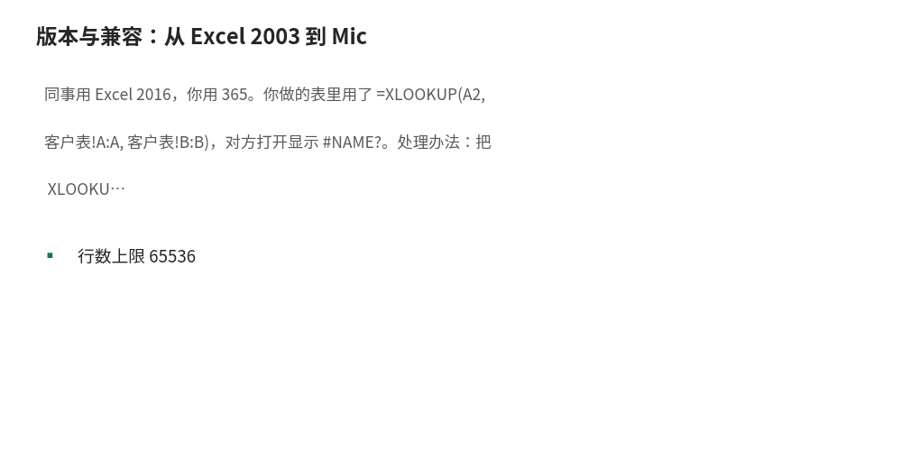

# 版本与兼容：从 Excel 2003 到 Microsoft 365

- **所属栏目**：C01 入门基础 ／ C01-L2-5 版本与兼容
- **适用版本**：Excel 2003／2007／2010／2013／2016／2019／2021／365
- **难度**：入门
- **预计阅读时长**：12 分钟
- **更新日期**：2026-11-09

## 1. 学习目标

学完本篇，你将能够：
- 说出 Excel 各主要版本的发布时间线与标志性新增功能
- 判断一个函数在自己电脑的版本上能不能用（查兼容矩阵）
- 用兼容性检查器发现文件发给旧版本用户时会出的问题
- 针对旧版本用户选择替代写法（如用 INDEX+MATCH 代替 XLOOKUP）

## 2. 基础概念

**版本沿革**：Excel 2003 是最后一个 `.xls` 时代版本；2007 引入功能区与 `.xlsx`；2010 加入切片器与 Power Pivot；2013 加入快速填充与时间线；2016 加入 Power Query 内置与 6 个新函数；2019 新增 IFS、SWITCH、CONCAT、TEXTJOIN、MAXIFS、MINIFS；2021 新增 XLOOKUP 与动态数组函数 FILTER、SORT、UNIQUE；Microsoft 365 在此基础上持续新增 TEXTSPLIT、TEXTBEFORE、LAMBDA 等，且只有 365 能用最新函数。

**一个常见误标**：IFS、SWITCH、CONCAT、TEXTJOIN 是 Excel 2019 新增，不是 2016。很多旧教程写"2016+"是错的——在 Excel 2016 打开含 IFS 的文件会报 `#NAME?`。本站函数库的版本字段以 `versions.func_ver` 为准：IFS、SWITCH、TEXTJOIN、CONCAT、MAXIFS、MINIFS 均为 2019／365；XLOOKUP、FILTER、SORT、UNIQUE 为 2021／365；TEXTSPLIT、TEXTBEFORE、TEXTAFTER、LAMBDA 为 365 专属。

**兼容性检查器**：文件→信息→检查问题→检查兼容性，可列出当前文件在旧版本里会丢失的功能（如新函数、某些图表类型），并给出受影响的单元格。文件发给别人之前跑一遍，比对方打电话来说"公式报错"强。

**365 与买断版的区别**：Microsoft 365 是订阅制，持续获得新函数与新功能；2019、2021 是买断版，功能冻结在发布时。同样叫"最新版 Excel"，365 用户能用的函数可能比 2021 用户多。写教程、做模板时要先问清对方的版本。

**旧版本替代写法**：XLOOKUP（2021／365）→ 旧版用 INDEX+MATCH 或 VLOOKUP；IFS（2019／365）→ 旧版用 IF 嵌套；TEXTJOIN（2019／365）→ 旧版用 `&` 连接；FILTER（2021／365）→ 旧版用高级筛选或数组公式。本站每篇涉及新函数的教程都会注明替代写法。

## 3. 操作步骤

1. 查看自己的版本：文件→账户→关于 Excel，或文件→信息，顶部显示版本号（如"Microsoft 365"或"Excel 2019"）。
2. 查函数兼容性：本站函数库每函数详情页有"版本兼容性"表；或在微软官方支持页搜函数名，看"适用于"一栏。
3. 跑兼容性检查：文件→信息→检查问题→检查兼容性，选目标旧版本（如 Excel 2016），看报告里列出的问题单元格。
4. 处理不兼容项：把新函数换成替代写法，或把结果"选择性粘贴→数值"固定下来再发给对方；图表类问题换成旧版支持的图表类型。
5. 保存时降级：另存为时选旧格式（如"Excel 97-2003 工作簿 *.xls"）会触发兼容性检查，按提示逐项处理；无特殊原因不要主动降级保存。

## 4. 图文示例

同事用 Excel 2016，你用 365。你做的表里用了 `=XLOOKUP(A2, 客户表!A:A, 客户表!B:B)`，对方打开显示 `#NAME?`。处理办法：把 XLOOKUP 换成 `=INDEX(客户表!B:B, MATCH(A2, 客户表!A:A, 0))`，2016 也能跑；或把结果列选择性粘贴为数值再发。反过来，对方发来的 .xls 旧文件，你打开后先另存为 .xlsx 再改，避免旧格式限制（行数上限 65536 行、函数受限）。



## 5. 公式和代码

```excel
=INDEX(客户表!B:B, MATCH(A2, 客户表!A:A, 0)) → 与 XLOOKUP 相同结果
=IF(A2>=90,"优",IF(A2>=60,"及格","不及格")) → 及格（A2=75 时）
=A2&"、"&B2&"、"&C2 → 张三、李四、王五
```

- `=INDEX(客户表!B:B, MATCH(A2, 客户表!A:A, 0))` → 与 XLOOKUP 相同结果：XLOOKUP 的全版本替代写法：MATCH 定位行号，INDEX 取值；A2 是"张三"时返回其对应的客户经理
- `=IF(A2>=90,"优",IF(A2>=60,"及格","不及格"))` → 及格：IFS 的旧版替代写法：IF 嵌套；A2=75 时第一层假、第二层真，返回"及格"
- `=A2&"、"&B2&"、"&C2` → 张三、李四、王五：TEXTJOIN 的旧版替代写法：& 连接符逐个拼接；TEXTJOIN 本身需 2019／365

## 6. 实际工作场景

### 模板要发给全公司用

公司电脑版本混杂（2016、2019、365 都有）。模板里的函数只用 2016 也有的（SUMIF、VLOOKUP、INDEX+MATCH），新函数一律不用；发之前用兼容性检查器跑一遍，确认零问题再群发。

### 面试被问"你会 XLOOKUP 吗"

先答会，再补一句适用版本：XLOOKUP 需 2021／365，旧版用 INDEX+MATCH 实现同样效果。能说清版本边界，比只会背语法更像内行。

## 7. 常见错误

| 错误现象 | 原因 | 解决方案 |
|---|---|---|
| 对方打开文件公式报 #NAME? | 用了对方版本没有的新函数 | 查兼容矩阵确认引入版本；换替代写法或粘贴为数值 |
| 把 IFS 当成老版本就有的函数 | IFS 是 2019 新增，旧教程误标了版本 | IFS、SWITCH、CONCAT、TEXTJOIN、MAXIFS、MINIFS 均为 2019 新增；以本站 func_ver 数据为准 |
| 365 的新函数在 2021 上也不能用 | TEXTSPLIT、LAMBDA 是 365 专属，不在 2021 内 | 做跨版本模板时只用 2021 及以下版本共有的函数 |
| .xls 旧文件行数不够用 | 旧格式上限 65536 行 | 另存为 .xlsx（上限 1048576 行）再继续做 |

## 8. 相关教程

- 上一篇：快捷键速查（docs/basics/04-shortcuts.md）
- 跨栏目：函数百科版本兼容矩阵（docs/functions/README.md）
- 跨栏目：公式入门（docs/formulas/01-formula-basics.md）

## 9. 练习题

1. IFS、XLOOKUP、TEXTSPLIT 三个函数的引入版本各是什么？在 Excel 2016 上哪个能用？
2. 同事用 2016，你的表里用了 TEXTJOIN，要发给他，至少给出两种处理办法。
3. 文件→信息→检查问题→检查兼容性是干什么用的？

## 10. 参考答案

<details>
<summary>点击查看答案</summary>

1. IFS 是 2019／365，XLOOKUP 是 2021／365，TEXTSPLIT 是 365 专属。2016 上三个都不能用，都会报 #NAME?。

2. （1）换成 & 连接符逐个拼接；（2）把结果列选择性粘贴为数值后发送。

3. 列出当前文件在指定旧版本里会丢失的功能与受影响单元格，发文件给旧版本用户之前跑一遍。

</details>
