# 销售数据分析：从 12 行订单到销售仪表盘

- **所属栏目**：C13 商业与办公应用 ／ C13-L2-3 销售应用
- **适用版本**：Excel 2016／2019／2021／365
- **难度**：进阶
- **预计阅读时长**：40 分钟
- **更新日期**：2026-11-10

> 验证口径：本篇公式经 Microsoft 官方文档核对、数值经 Python 独立验算（验算脚本见工作底稿 `/tmp/phase8/verify_sales.py`，72 项检查全部通过）；配套模板文件的公式另经 LibreOffice 重算核对，结果与验算值一致。本篇未在 Excel 内执行验证，不作"已在 Excel 中运行通过"类表述。

## 1. 学习目标

学完本篇，你将能够：
- 用 SUMIF、SUMIFS、COUNTIF、COUNTIFS 对 12 行订单做分产品、分地区、分月汇总，并说出每个汇总值的预期结果
- 计算客单价、利润、利润率和同比增长率，并解释同比口径为什么必须用"同期"比"同期"
- 用数据透视表在 5 分钟内复现全部手工汇总结果，并用切片器做交互筛选
- 指出销售仪表盘的 6 个必备要素，并用本篇数据搭出一页仪表盘的骨架
- 说出销售分析里 6 种常见错误（口径、引用、日期、同比错配）的成因与修复方法

本篇是 C13-L2-3 的核心专篇，与案例中心"销售案例"（销售统计、环比分析）互相印证：案例中心给的是公式速查，本篇给的是拿同一份数据从头算到尾的完整流程。数据与阶段 6 的 12 行订单完全一致：订单 O001 至 O012，产品 P001 至 P005，客户 C001 至 C004。

## 2. 基础概念

### 2.1 先把口径钉死：金额、数量、单价

销售分析翻车，十次有九次是口径没钉死。本篇全部数字建立在三条口径上：

- **金额 = 数量 x 单价**。订单表里每一行的金额都是数量乘单价算出来的，不是手工填的。例如 O001 卖 2 台电脑，单价 5000 元，金额就是 2 x 5000 = 10000 元。
- **销售额 = 金额之和**。不含税、不扣折扣，就是订单金额加总。12 笔订单加总为 75600 元。
- **客单价 = 总销售额 / 订单笔数**。本篇是 75600 / 12 = 6300 元。注意分母是订单笔数，不是客户数（4 个客户），也不是产品件数（62 件）。

### 2.2 汇总的三个维度

销售分析最常用的三个切分维度是产品、地区、时间：

- **分产品**：卖什么赚钱。电脑、手机、耳机、显示器、键盘各卖了多少、赚了多少。
- **分地区**：卖到哪里去。华东、华南、华北、华西四个地区的销售额对比。
- **分月**：什么时候卖。按月看趋势，再算同比和环比。

三个维度互相印证：分产品合计、分地区合计、分月合计都必须等于总销售额 75600 元，任何一个对不上，就是公式或口径出了问题。

### 2.3 同比与环比

- **同比**：今年某段时间 vs 去年同一段时间。本篇算 2026 年 1-3 月 vs 2025 年 1-3 月，公式是（今年 - 去年同期）/ 去年同期。
- **环比**：本期 vs 上一期。本篇只对相邻月份算环比；2025 年 4 月、5 月没有订单，2025 年 6 月不能直接跟 3 月算环比——中间隔了两个月，那个"环比"没有业务意义。

### 2.4 利润与利润率

- **利润 = 数量 x（单价 - 成本）**。单价减成本是每件赚的钱，乘数量就是该产品的总利润。
- **利润率 = 总利润 / 总销售额**。本篇是 22770 / 75600 = 30.12%。

### 2.5 公式汇总 vs 数据透视表：两条路，一个答案

本篇第 3 节先用 SUMIF 手工汇总，再用透视表复核，两条路算的是同一批数：

- **公式汇总**：结果写在单元格里，可以参与下一步计算（比如同比公式直接引用汇总值），适合要进仪表盘、要反复引用的数。缺点是区域写死后新增行要手动扩区。
- **数据透视表**：拖字段就能出结果，适合一次性探索——想看分产品就拖产品，想看分地区就拖地区。但透视表的结果不能直接被别的公式引用（要用 GETPIVOTDATA），刷新后布局可能变。

判断标准：同一个维度，公式汇总与透视表的值必须逐项相等。本篇电脑 40000、手机 15000、耳机 9000、显示器 9000、键盘 2600，五个数两边都一样，才算复核通过。哪边对不上，就按第 7 节的表逐项排查，不要凭感觉改数。

## 3. 操作步骤

本节以配套模板文件 `示例-销售数据分析.xlsx` 为操作对象：订单明细表在第 3 行到第 14 行，金额列（J 列）是公式 `=H3*I3`，月份列（K 列）是公式 `=TEXT(B3,"yyyy-mm")`。

1. 准备订单明细表：打开模板的"订单明细表"，确认 12 行订单齐全，列是订单号、日期、客户编号、客户名称、地区、产品编号、产品名称、数量、单价、金额、月份。金额列不要手填，用公式 `=H3*I3`（数量 x 单价）下拉填充 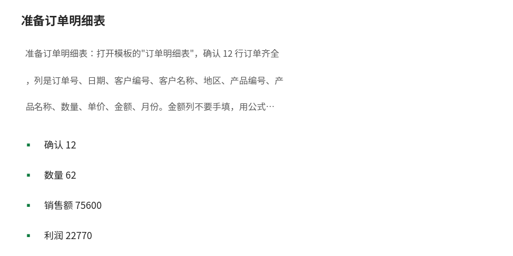
2. 核对总量：在订单明细表底部合计行检查三处：总数量 `=SUM(H3:H14)` → 62；总销售额 `=SUM(J3:J14)` → 75600；客单价 `=J15/COUNTA(A3:A14)` → 6300。任何一处不对，先查明细，不要往下做汇总。
3. 做分产品汇总：切换到"按产品汇总"表，数量列用 `=SUMIF(订单明细表!$F$3:$F$14,A3,订单明细表!$H$3:$H$14)`，销售额列用 `=SUMIF(订单明细表!$F$3:$F$14,A3,订单明细表!$J$3:$J$14)`，利润列用 `=E3*(C3-D3)`，利润率列用 `=G3/F3`。下拉填充 5 行，合计行检查数量 62、销售额 75600、利润 22770 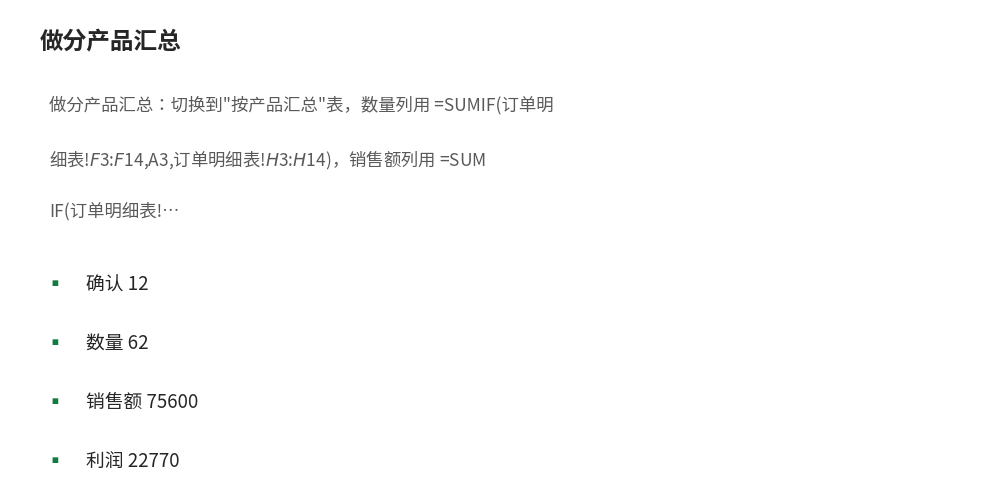
4. 做分地区汇总：切换到"按地区汇总"表，订单笔数用 `=COUNTIF(订单明细表!$E$3:$E$14,A3)`，销售额用 `=SUMIF(订单明细表!$E$3:$E$14,A3,订单明细表!$J$3:$J$14)`，占比用 `=C3/C$7`，平均订单金额用 `=C3/B3`。合计行检查销售额 75600、占比之和 100% 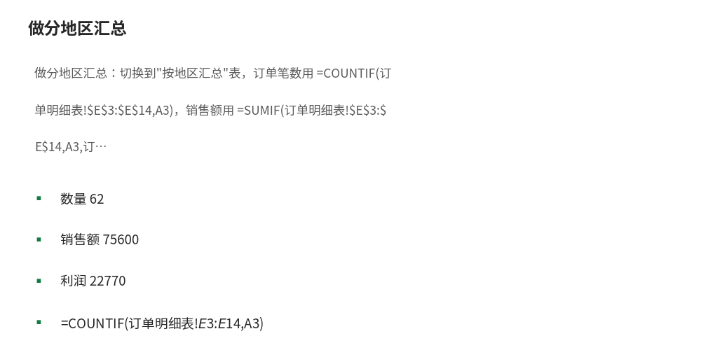
5. 做分月汇总：切换到"按月汇总"表，订单笔数用 `=COUNTIFS(订单明细表!$K$3:$K$14,A3)`，销售额用 `=SUMIFS(订单明细表!$J$3:$J$14,订单明细表!$K$3:$K$14,A3)`。合计行检查销售额 75600 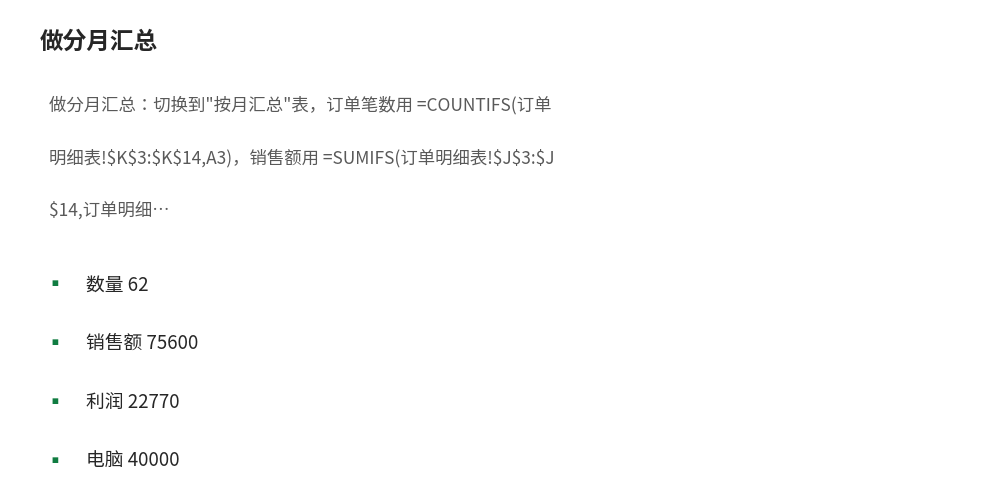
6. 算同比：在"按月汇总"表底部同比区，2025 年 1-3 月用 `=SUMIFS(订单明细表!$J$3:$J$14,订单明细表!$K$3:$K$14,">=2025-01",订单明细表!$K$3:$K$14,"<=2025-03")` → 26000；2026 年 1-3 月用同样写法 → 44600；同比增长率用 `=(B15-B14)/B14` → 71.54%。
7. 做透视表复核：选中订单明细表任意单元格，插入 → 数据透视表，把"产品名称"拖到行、"金额"拖到值（求和），核对电脑 40000、手机 15000、耳机 9000、显示器 9000、键盘 2600，与第 3 步的手工汇总逐项比对 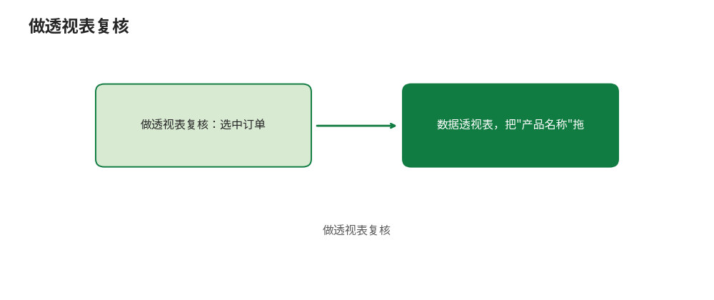
8. 搭仪表盘骨架：新建一张工作表放 KPI 卡片（总销售额、客单价、总利润、同比），下面放分产品柱形图和分月折线图，数据源全部链到三张汇总表，不要链原始明细 

## 4. 图文示例

### 4.1 订单明细表（12 行）

| 订单号 | 日期 | 客户 | 地区 | 产品 | 数量 | 单价 | 金额 |
|---|---|---|---|---|---|---|---|
| O001 | 2025-01-05 | 华东公司 | 华东 | 电脑 | 2 | 5000 | 10000 |
| O002 | 2025-01-12 | 华南公司 | 华南 | 手机 | 3 | 3000 | 9000 |
| O003 | 2025-02-08 | 华东公司 | 华东 | 耳机 | 10 | 300 | 3000 |
| O004 | 2025-03-15 | 华北公司 | 华北 | 键盘 | 5 | 200 | 1000 |
| O005 | 2025-03-20 | 华南公司 | 华南 | 显示器 | 2 | 1500 | 3000 |
| O006 | 2025-06-10 | 华西公司 | 华西 | 电脑 | 1 | 5000 | 5000 |
| O007 | 2026-01-06 | 华东公司 | 华东 | 电脑 | 3 | 5000 | 15000 |
| O008 | 2026-01-15 | 华南公司 | 华南 | 手机 | 2 | 3000 | 6000 |
| O009 | 2026-02-10 | 华北公司 | 华北 | 耳机 | 20 | 300 | 6000 |
| O010 | 2026-02-18 | 华东公司 | 华东 | 键盘 | 8 | 200 | 1600 |
| O011 | 2026-03-05 | 华西公司 | 华西 | 显示器 | 4 | 1500 | 6000 |
| O012 | 2026-03-22 | 华南公司 | 华南 | 电脑 | 2 | 5000 | 10000 |

合计：12 笔订单，62 件，总销售额 75600 元，客单价 6300 元。

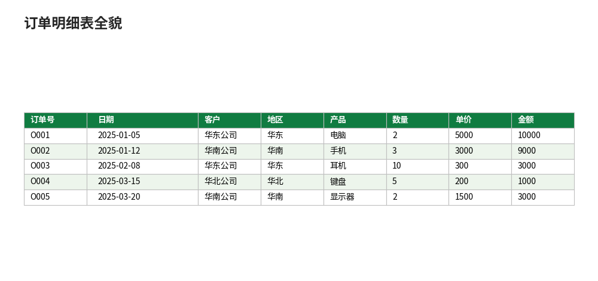

### 4.2 分产品汇总

| 产品 | 数量 | 销售额 | 占比 | 利润 | 利润率 |
|---|---|---|---|---|---|
| 电脑 | 8 | 40000 | 52.91% | 9600 | 24.00% |
| 手机 | 5 | 15000 | 19.84% | 4500 | 30.00% |
| 耳机 | 30 | 9000 | 11.90% | 4500 | 50.00% |
| 显示器 | 6 | 9000 | 11.90% | 3000 | 33.33% |
| 键盘 | 13 | 2600 | 3.44% | 1170 | 45.00% |
| 合计 | 62 | 75600 | 100.00% | 22770 | 30.12% |

读法：电脑销售额最高（40000 元，占 52.91%），但利润率最低（24.00%）；耳机销售额只有 9000 元，利润率却最高（50.00%）。只看销售额会误判"电脑最赚钱"，加上利润率才看到全貌。

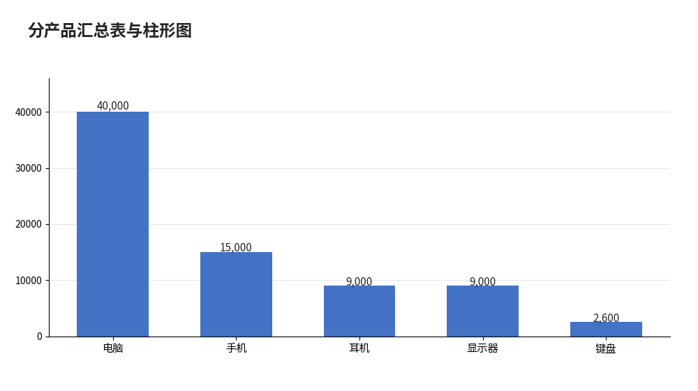

### 4.3 分地区汇总

| 地区 | 订单笔数 | 销售额 | 占比 | 平均订单金额 |
|---|---|---|---|---|
| 华东 | 4 | 29600 | 39.15% | 7400 |
| 华南 | 4 | 28000 | 37.04% | 7000 |
| 华西 | 2 | 11000 | 14.55% | 5500 |
| 华北 | 2 | 7000 | 9.26% | 3500 |
| 合计 | 12 | 75600 | 100.00% | 6300 |

读法：华东和华南合计占 76.19%，是基本盘；华北只有 7000 元、平均订单金额 3500 元，是最弱的地区。

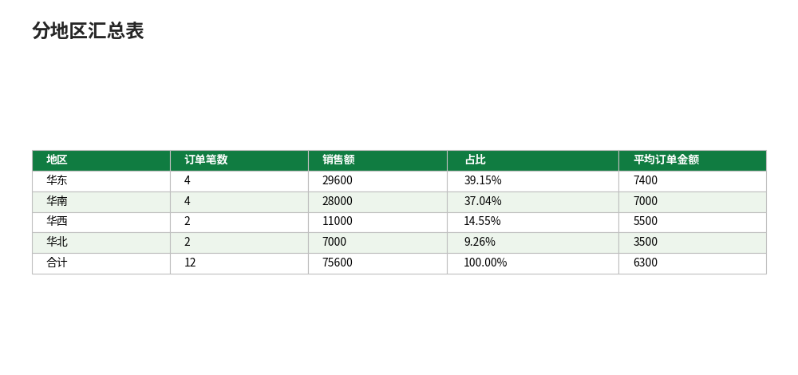

### 4.4 分月汇总

| 月份 | 订单笔数 | 销售额 | 环比 |
|---|---|---|---|
| 2025-01 | 2 | 19000 | — |
| 2025-02 | 1 | 3000 | -84.21% |
| 2025-03 | 2 | 4000 | 33.33% |
| 2025-06 | 1 | 5000 | （隔月，不直接比） |
| 2026-01 | 2 | 21000 | （隔月，不直接比） |
| 2026-02 | 2 | 7600 | -63.81% |
| 2026-03 | 2 | 16000 | 110.53% |

合计：2025 年销售额 31000 元，2026 年 1-3 月销售额 44600 元。2026 年 1-3 月占总销售额的 58.99%。

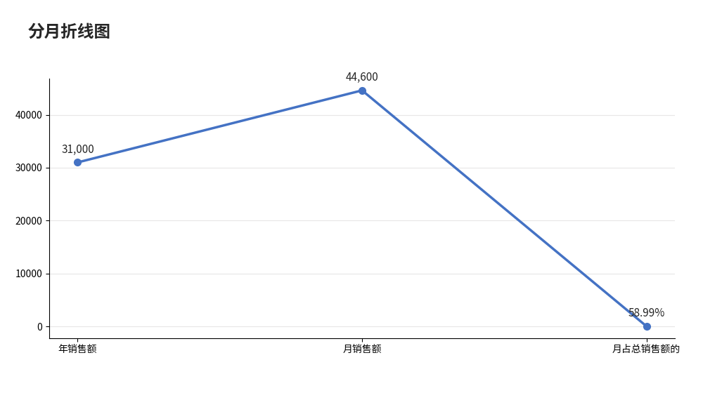

### 4.5 同比

| 期间 | 销售额 |
|---|---|
| 2025 年 1-3 月 | 26000 |
| 2026 年 1-3 月 | 44600 |
| 同比增长率 | 71.54% |

关键点：2025 年的对比口径是 1-3 月的 26000 元，不是全年的 31000 元。用 44600 比 31000 算出的 43.87% 是错的——2025 年 6 月那笔 5000 元订单不在 2026 年 1-3 月的对比区间里。

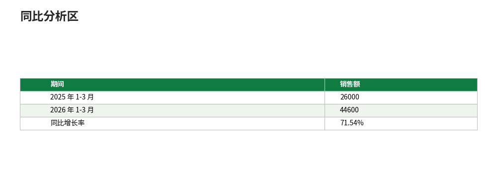

### 4.6 销售仪表盘骨架（一页看懂）

仪表盘分三层，从上到下是结论、对比、趋势：

| 层 | 内容 | 数据来源 | 关键数字 |
|---|---|---|---|
| KPI 卡片 | 总销售额、客单价、总利润、同比增长率 | 订单明细表合计行、按月汇总同比区 | 75600、6300、22770、71.54% |
| 对比图 | 分产品柱形图、分地区条形图 | 按产品汇总、按地区汇总 | 电脑 40000（52.91%）、华东 29600（39.15%） |
| 趋势图 | 分月折线图 | 按月汇总 | 峰值 2026-01 的 21000 元，低谷 2025-02 的 3000 元 |

仪表盘的 6 个必备要素：标题写清口径与期间（"2025-01 至 2026-03 销售分析"）、KPI 卡片带单位（元）、图表标题就是结论（不要只写"销售额"，要写"电脑占销售额 52.91%"）、所有数字链汇总表不许手填、配色全表一致（同一产品在柱形图与明细表里同色）、留一行数据来源与更新日期。缺任何一条，仪表盘就只是好看的图，不是能用的表。

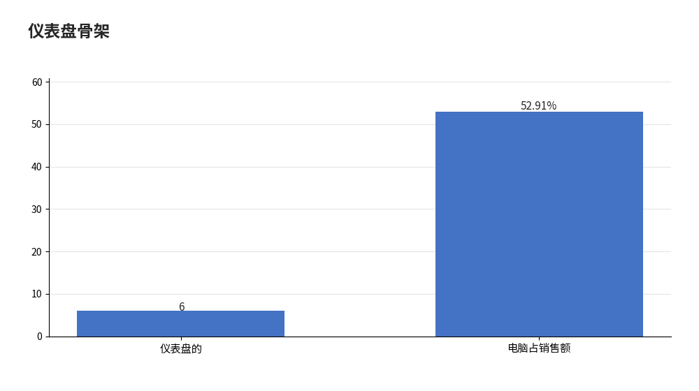

## 5. 公式和代码

### 5.1 金额与总量

```excel
= H3*I3                        → 10000（O001：2 件 x 单价 5000）
= SUM(H3:H14)                  → 62（总数量）
= SUM(J3:J14)                  → 75600（总销售额）
= J15/COUNTA(A3:A14)           → 6300（客单价：75600 / 12 笔）
= TEXT(B3,"yyyy-mm")           → 2025-01（月份列，从日期提取）
```

### 5.2 分产品汇总（SUMIF）

```excel
= SUMIF(订单明细表!$F$3:$F$14,A3,订单明细表!$H$3:$H$14)   → 8（电脑数量）
= SUMIF(订单明细表!$F$3:$F$14,A3,订单明细表!$J$3:$J$14)   → 40000（电脑销售额）
= E3*(C3-D3)                                                → 9600（电脑利润：8 x (5000-3800)）
= G3/F3                                                     → 24.00%（电脑利润率）
= F3/F$8                                                    → 52.91%（电脑销售额占比）
```

要点：SUMIF 的条件区域是产品编号列（F 列），不是产品名称列（G 列）；条件写 A3（产品编号 P001），区域和条件区域都要绝对引用，下拉填充才不会错位。

### 5.3 分地区汇总（COUNTIF 与 SUMIF）

```excel
= COUNTIF(订单明细表!$E$3:$E$14,A3)                        → 4（华东订单笔数）
= SUMIF(订单明细表!$E$3:$E$14,A3,订单明细表!$J$3:$J$14)    → 29600（华东销售额）
= C3/C$7                                                    → 39.15%（华东销售额占比）
= C3/B3                                                     → 7400（华东平均订单金额）
```

### 5.4 分月汇总与同比（SUMIFS 与 COUNTIFS）

```excel
= SUMIFS(订单明细表!$J$3:$J$14,订单明细表!$K$3:$K$14,A3)   → 19000（2025-01 销售额）
= COUNTIFS(订单明细表!$K$3:$K$14,A3)                       → 2（2025-01 订单笔数）
= SUMIFS(订单明细表!$J$3:$J$14,订单明细表!$K$3:$K$14,">=2025-01",订单明细表!$K$3:$K$14,"<=2025-03") → 26000（2025 年 1-3 月销售额）
= SUMIFS(订单明细表!$J$3:$J$14,订单明细表!$K$3:$K$14,">=2026-01",订单明细表!$K$3:$K$14,"<=2026-03") → 44600（2026 年 1-3 月销售额）
= (B15-B14)/B14                                             → 71.54%（同比增长率）
= (C4-C3)/C3                                                → -84.21%（2025-02 环比）
= (C9-C8)/C8                                                → 110.53%（2026-03 环比）
```

要点：月份列 K 列是文本格式的"yyyy-mm"，SUMIFS 的条件 `">=2025-01"` 按字典序比较，对"yyyy-mm"格式的文本月份是成立的；但如果月份列是真正的日期，就要用 `">="&DATE(2025,1,1)` 这类写法，不能直接比文本。

### 5.5 利润与排名

```excel
= SUMPRODUCT((订单明细表!$F$3:$F$14="P001")*(订单明细表!$H$3:$H$14)*(5000-3800)) → 9600（电脑利润，SUMPRODUCT 写法）
= RANK(F3,$F$3:$F$7)                                        → 1（电脑销售额排名第 1）
= LARGE($F$3:$F$7,2)                                        → 15000（销售额第 2 名是手机）
```

### 5.6 仪表盘 KPI 卡片公式

```excel
= TEXT(订单明细表!J15,"¥#,##0")&" 元"                       → ¥75,600 元（总销售额卡片）
= TEXT(订单明细表!J16,"¥#,##0")&" 元 / 笔"                  → ¥6,300 元 / 笔（客单价卡片）
= TEXT(按产品汇总!G8,"¥#,##0")&" 元"                        → ¥22,770 元（总利润卡片）
= TEXT(按月汇总!B16,"0.00%")&" 同比"                        → 71.54% 同比（同比卡片）
= "电脑占 "&TEXT(按产品汇总!F3/按产品汇总!F8,"0.00%")       → 电脑占 52.91%（图表标题公式）
```

要点：卡片文字用 TEXT 拼出来，数字部分仍是公式引用的汇总值，汇总表一变卡片跟着变；不要把"75600"写死在卡片里，写死了就是一张静态图。

## 6. 实际工作场景

### 6.1 场景一：季度复盘会，老板要一张"卖得怎么样"

场景：你是销售助理，每季度要向老板汇报一次。老板的问题永远是三个：卖了多少、什么卖得好、哪个地区拖后腿。

做法：打开模板，先看三张汇总表，再按第 3 节第 8 步搭一页仪表盘：顶部 4 张 KPI 卡片（总销售额 75600、客单价 6300、总利润 22770、同比 71.54%），中间分产品柱形图（电脑 40000 一柱独大），下面分月折线图（2026-01 的 21000 元是峰值，2026-02 回落到 7600 元）。

结果：汇报时可以直接说结论——"电脑贡献了 52.91% 的销售额，但利润率只有 24.00%，是五类产品里最低的；耳机利润率 50.00%，值得推；华北只有 7000 元，是唯一低于 10000 元的地区"。数字全部链到汇总表，老板追问任何一个数，都能当场点开公式溯源。

### 6.2 场景二：新订单进来，汇总表要自动更新

场景：4 月初又成交两笔订单，O013 卖 1 台电脑 5000 元，O014 卖 5 个耳机 1500 元。手工重算三张汇总表既慢又容易错。

做法：在订单明细表第 15、16 行追加两行，金额列公式下拉填充，月份列自动生成"2026-04"；但 SUMIF 的区域 `$F$3:$F$14` 不会自动扩大——要把汇总公式里的区域改成 `$F$3:$F$16`，或者一开始就把订单明细表转成超级表（插入 → 表格），用结构化引用写汇总公式，新增行自动纳入汇总范围。

结果：追加后总销售额变为 75600 + 5000 + 1500 = 82100 元，电脑数量变为 9 件、销售额 45000 元，耳机数量变为 35 件、销售额 10500 元，三张汇总表和仪表盘全部自动更新，不用逐格改数。验算：82100 - 75600 = 6500，与新增两笔订单金额之和一致。

## 7. 常见错误

| 错误现象 | 原因 | 解决方案 |
|---|---|---|
| 分产品合计不等于 75600 | SUMIF 的条件区域用了产品名称列（G 列），条件却写产品编号（P001），匹配不上 | 条件区域改成产品编号列（F 列），或条件改成产品名称（电脑），两者必须同列 |
| 占比之和不是 100% | 分母用了某个产品的销售额，而不是合计行的总销售额 | 分母写合计行单元格并锁行，如 `=C3/C$7`，下拉填充时分母不动 |
| 同比算成 43.87% | 用 2026 年 1-3 月的 44600 比了 2025 年全年的 31000，区间不对等 | 对比口径改成 2025 年 1-3 月的 26000，公式 `=(44600-26000)/26000` → 71.54% |
| 环比出现离谱的 320% | 2026-01 直接跟 2025-06 比，中间隔了 7 个月无订单 | 只对相邻月份算环比；有缺口的月份在环比列写"隔月，不直接比" |
| 金额列求和比 75600 多 | 金额列是手填的，某行数量改了金额没改 | 金额列全改公式 `=H3*I3`，不许手填；改数量后金额自动重算 |
| SUMIFS 按月份汇总出 0 | 月份列是真正的日期，却用文本条件 `"2025-01"` 去匹配 | 月份列统一用 `=TEXT(日期,"yyyy-mm")` 生成文本，或改用日期区间条件 `">="&DATE(2025,1,1)` |
| 客单价算成 1219 元 | 分母用了总件数 62（75600/62） | 客单价的分母是订单笔数 12，公式 `=总销售额/COUNTA(订单号区域)` → 6300 |
| 透视表结果与手工汇总对不上 | 透视表的值字段是"计数"不是"求和"，或日期没有分组 | 值字段设置改成"求和"；日期字段右键 → 组合 → 按月分组后再比对 |

## 8. 相关教程

同栏目（C13 商业与办公应用）：
- 财务报表制作（C13-L2-1）：利润表里的营业收入 1200000 元，口径与本篇销售额一致，三表勾稽时不要混用
- 人力资源管理（C13-L2-2）：销售部 4 人的工资与出勤汇总，做法与本篇分部门汇总同源

跨栏目：
- 数据透视表（PivotTable）（C08）：本篇第 3 节第 7 步的透视表复核做法，含分组、值显示方式与切片器
- Power Query：数据的清洗车间（C09）：订单从业务系统导出后先清洗（去重、改类型）再汇总，适合超过 1000 行的销售明细
- 柱形图与条形图（C07）：仪表盘里分产品柱形图的做法，含数据标签与配色

## 9. 练习题

1. 用 SUMIF 公式算出手机的销售额（预期 15000 元），再用 SUMPRODUCT 写出等价公式并比对结果。
2. 2025 年 2 月只有 1 笔订单（O003，3000 元）。用 COUNTIFS 与 SUMIFS 写出"2025 年 2 月订单笔数与销售额"的公式，并说明为什么 2 月销售额环比下降 84.21%。
3. 同比口径改一改：如果错用 2025 年全年 31000 元作对比，算出的同比是多少？为什么这个数字不能用？
4. 在订单明细表追加一笔订单 O013（2026-04-02，华东公司，电脑，1 件，5000 元），汇总表区域不变时总销售额会变吗？改成超级表后又会怎样？
5. 用 RANK 函数给 5 类产品按销售额排名，写出电脑、键盘的排名公式与结果。
6. 华北地区平均订单金额只有 3500 元。写出公式算出华北的订单笔数与销售额，并用一句话说出华北的问题（只看总额会漏掉什么）。

## 10. 参考答案

<details>
<summary>点击查看答案</summary>

1. 公式：`=SUMIF(订单明细表!$F$3:$F$14,"P002",订单明细表!$J$3:$J$14)` → 15000。等价 SUMPRODUCT：`=SUMPRODUCT((订单明细表!$F$3:$F$14="P002")*订单明细表!$J$3:$J$14)` → 15000。解析：SUMIF 是条件求和的简写，SUMPRODUCT 是逐行相乘再求和，两者对同一批数据结果必然相等；不等就说明条件区域或求和区域写错了。
2. 公式：`=COUNTIFS(订单明细表!$K$3:$K$14,"2025-02")` → 1；`=SUMIFS(订单明细表!$J$3:$J$14,订单明细表!$K$3:$K$14,"2025-02")` → 3000。解析：环比 (3000-19000)/19000 = -84.21%，降幅大是因为 1 月有两笔大单（10000 + 9000 = 19000），2 月只有一笔 3000 元的耳机订单；单月样本只有 1 笔，环比波动会被放大，解读时要说明样本量。
3. 错算结果：(44600-31000)/31000 = 43.87%。解析：2025 年全年含 6 月那笔 5000 元订单，而 2026 年只有 1-3 月数据，两边区间不对等；43.87% 低估了真实增长，正确口径是同期比同期：(44600-26000)/26000 = 71.54%。
4. 汇总表区域不变时，总销售额仍为 75600 元——SUMIF 的区域 `$F$3:$F$14` 不含第 15 行，新订单不会被统计。改成超级表后，结构化引用自动扩展，总销售额变为 75600 + 5000 = 80600 元。解析：这是"区域写死"最常见的坑；数据会增长的表一律转超级表或把区域预留到足够大的行。
5. 公式：电脑 `=RANK(40000,{40000,15000,9000,9000,2600})` → 1；键盘 `=RANK(2600,{40000,15000,9000,9000,2600})` → 5。解析：耳机与显示器都是 9000 元，并列第 3 名，RANK 默认返回相同名次；要区分并列可用 COUNTIF 辅助列。
6. 公式：`=COUNTIF(订单明细表!$E$3:$E$14,"华北")` → 2；`=SUMIF(订单明细表!$E$3:$E$14,"华北",订单明细表!$J$3:$J$14)` → 7000。解析：华北的问题不只是总额低（7000 元），平均订单金额 3500 元也是四个地区最低——单子小、数量少，两个维度同时弱；只看总额会漏掉"客单价也低"这一层。

</details>

## 11. 可下载示例文件

- [示例-销售数据分析.xlsx](../../templates/示例-销售数据分析.xlsx)（订单明细表 + 按产品汇总 + 按地区汇总 + 按月汇总，汇总表用 SUMIF/SUMIFS 公式）
- [示例-Power-Pivot-数据模型与DAX.xlsx](../../templates/示例-Power-Pivot-数据模型与DAX.xlsx)（同一份 12 行订单的订单表、产品表、客户表、库存表，可对照核对）
- [数据-销售数据1000行.xlsx](../../templates/数据-销售数据1000行.xlsx)（1000 行销售数据，练熟本篇做法后可换大数据量练习）
