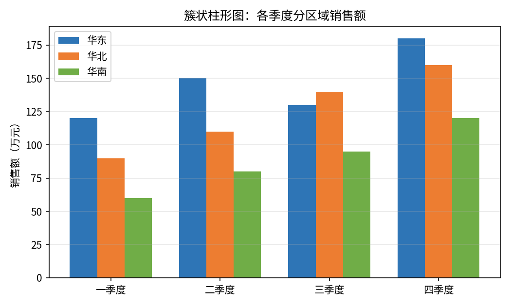
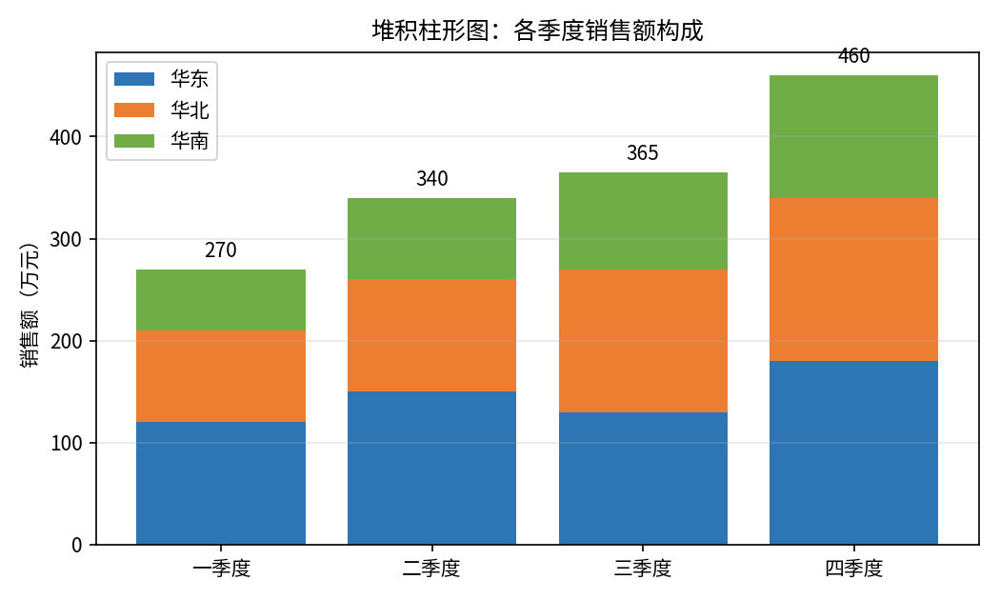
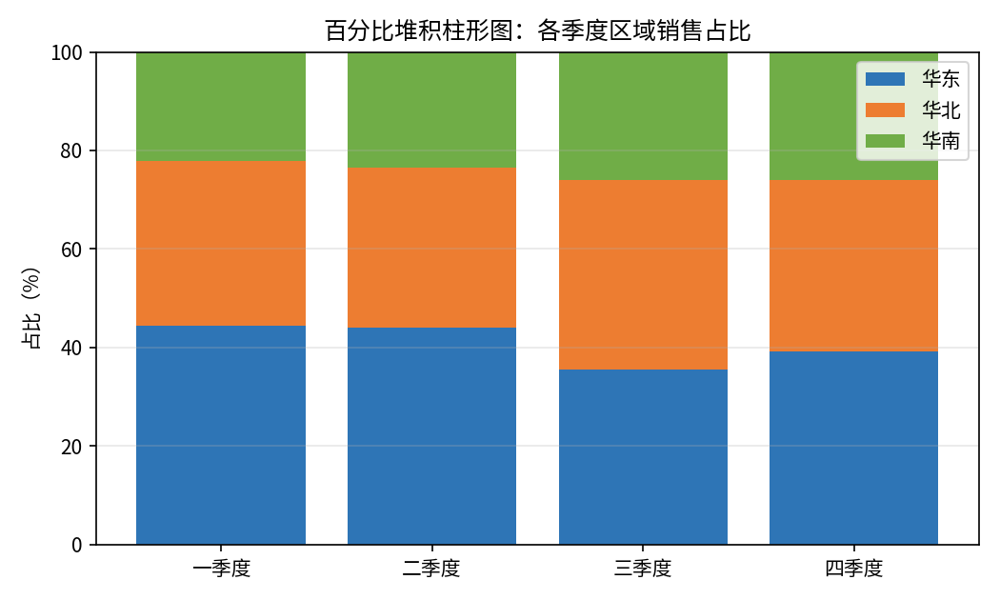
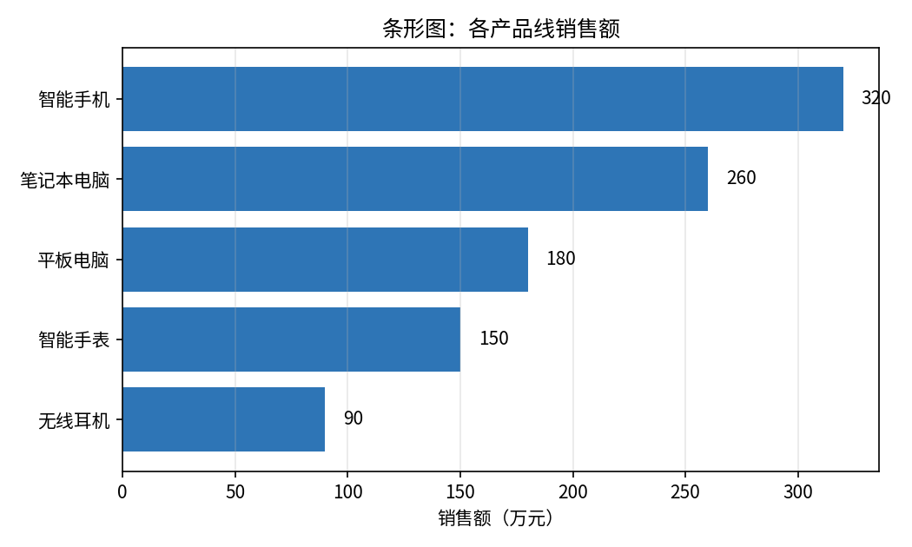

# 柱形图与条形图

- **所属栏目**：C07 图表大全 / C07-L2-1 柱形图与条形图
- **适用版本**：Excel 2007 / 2010 / 2013 / 2016 / 2019 / 2021 / 365
- **难度**：入门
- **预计阅读时长**：20 分钟
- **更新日期**：2026-11-10

## 学习目标

学完本篇，你将能够：

- 区分簇状柱形图、堆积柱形图、百分比堆积柱形图与条形图的适用场景
- 用同一张分区域季度销售表做出三种柱形图，并读出各自的结论
- 根据类别名称长短，在柱形图与条形图之间做出正确选择
- 给柱形图加上数据标签，删掉多余的网格线与图例

## 基础概念

**柱形图与条形图的区别**：柱形图的类别在横轴、数值在纵轴，柱子竖着长；条形图把两者对调，类别在纵轴、数值在横轴，条子横着长。两者表达的信息完全一样，选哪个只看类别名称有多长、类别有多少个。

**簇状与堆积的区别**：簇状是把同一类别的不同系列并排比较大小；堆积是把同一类别的不同系列叠起来，既看合计又看构成；百分比堆积不看绝对值，只看每个系列在合计里的占比。

**一图只讲一件事**：一张图只回答一个问题。既想比大小又想看占比时，拆成两张图，不要把两种结论塞进一张图。

## 簇状柱形图

- **图表名称**：簇状柱形图
- **英文名称**：Clustered Column
- **图表预览**：
- **适用场景**：比较同一类别下多个系列的数值大小，例如四个季度里华东、华北、华南三个区域的销售额对比。
- **数据结构**：

| 季度 | 华东 | 华北 | 华南 | 合计 |
|---|---|---|---|---|
| 一季度 | 120 | 90 | 60 | 270 |
| 二季度 | 150 | 110 | 80 | 340 |
| 三季度 | 130 | 140 | 95 | 365 |
| 四季度 | 180 | 160 | 120 | 460 |

- **创建步骤**：

1. 选中数据区域 A1:E5（含表头）。
2. 点插入选项卡，在图表组里点柱形图，选簇状柱形图。
3. 右键图表，点添加数据标签，让每根柱子顶上显示数值。
4. 选中网格线按 Delete 删除，保持画面干净。
5. 双击图表标题，改成结论句，例如“四季度三个区域全部创新高”。

- **格式调整**：系列重叠与分类间距在设置数据系列格式里调，柱子太细就把分类间距从 150% 降到 80% 左右；三个系列用同一套配色，全站统一用商务蓝、橙、绿；纵轴从 0 开始，不要截断，否则柱子长短会误导读数。
- **常见问题**：

| 问题 | 解答 |
|---|---|
| 柱子太多挤在一起怎么办？ | 类别超过 10 个时改用条形图，或只留重点类别，其余合并为其他。 |
| 系列顺序与表格不一致怎么办？ | 右键图表点选择数据，在图例项里用上下箭头调整系列顺序。 |
| 数值标签显示不全怎么办？ | 把纵轴最大值调大，或把标签位置从居中改成数据标签外。 |

- **版本兼容性**：全部版本均支持，兼容 Excel 2007 / 2010 / 2013 / 2016 / 2019 / 2021 / 365。
- **示例工作簿**：[图表-示例-柱形图与条形图.xlsx](../../templates/图表-示例-柱形图与条形图.xlsx)

## 堆积柱形图

- **图表名称**：堆积柱形图
- **英文名称**：Stacked Column
- **图表预览**：
- **适用场景**：既看每个季度的销售合计，又看华东、华北、华南三地在合计里的构成，例如四季度合计 460 万元，其中华东 180 万元、华北 160 万元、华南 120 万元。
- **数据结构**：

| 季度 | 华东 | 华北 | 华南 | 合计 |
|---|---|---|---|---|
| 一季度 | 120 | 90 | 60 | 270 |
| 二季度 | 150 | 110 | 80 | 340 |
| 三季度 | 130 | 140 | 95 | 365 |
| 四季度 | 180 | 160 | 120 | 460 |

表中每行三地之和等于合计列：270 = 120 + 90 + 60，340 = 150 + 110 + 80，365 = 130 + 140 + 95，460 = 180 + 160 + 120。

- **创建步骤**：

1. 选中数据区域 A1:D5（只选三地数值列，不用选合计列，否则合计会被当成第四个系列叠上去）。
2. 点插入选项卡，在图表组里点柱形图，选堆积柱形图。
3. 右键图表，点添加数据标签，核对每段数值与表一致。
4. 图例放图表底部，标题改成结论句，例如“四季度合计最高，三地全部过百万元”。

- **格式调整**：每段用不同颜色，同一系列全图同色；合计列不要进图，合计值如需展示，单独在柱顶加文本框；系列超过 4 个时堆积图很难读，改用簇状图或拆图。
- **常见问题**：

| 问题 | 解答 |
|---|---|
| 合计列也被叠进去了怎么办？ | 重新选数据，只选三地数值列；或右键图表点选择数据，把合计系列删掉。 |
| 中间段的大小看不出来怎么办？ | 这是堆积图的固有短板，只适合看合计与首尾段；要比中间段，改用簇状图。 |
| 负数能进堆积图吗？ | 能，但正负会向两个方向叠，读数容易乱；有负数时改用簇状图。 |

- **版本兼容性**：全部版本均支持，兼容 Excel 2007 / 2010 / 2013 / 2016 / 2019 / 2021 / 365。
- **示例工作簿**：[图表-示例-柱形图与条形图.xlsx](../../templates/图表-示例-柱形图与条形图.xlsx)

## 百分比堆积柱形图

- **图表名称**：百分比堆积柱形图
- **英文名称**：100% Stacked Column
- **图表预览**：
- **适用场景**：不比较绝对销售额，只比较结构变化，例如华东占比是否逐季下滑、华南占比是否逐季上升。
- **数据结构**：

| 季度 | 华东 | 华北 | 华南 | 合计 |
|---|---|---|---|---|
| 一季度 | 120 | 90 | 60 | 270 |
| 二季度 | 150 | 110 | 80 | 340 |
| 三季度 | 130 | 140 | 95 | 365 |
| 四季度 | 180 | 160 | 120 | 460 |

Excel 会自动把每行换算成占比，换算结果为：一季度 44.4%、33.3%、22.2%；二季度 44.1%、32.4%、23.5%；三季度 35.6%、38.4%、26.0%；四季度 39.1%、34.8%、26.1%。每季度三项占比之和为 100%。

- **创建步骤**：

1. 选中数据区域 A1:D5（同样不要选合计列）。
2. 点插入选项卡，在图表组里点柱形图，选百分比堆积柱形图。
3. 纵轴会显示 0% 到 100%，不用手动调。
4. 右键图表，点添加数据标签，标签显示为百分比。
5. 标题写结构结论，例如“华南占比从 22.2% 升到 26.1%”。

- **格式调整**：纵轴固定 0% 到 100%，不要改成其他范围；占比标签保留一位小数；三地颜色与簇状图、堆积图保持一致，同一系列全站同色。
- **常见问题**：

| 问题 | 解答 |
|---|---|
| 为什么看不到绝对销售额？ | 百分比堆积图本来就只表达结构；要看绝对值，用堆积柱形图。 |
| 占比标签加起来不是 100% 怎么办？ | 四舍五入会让显示值合计为 99.9% 或 100.1%，属于正常现象，改显示 0 位小数可缓解。 |
| 某季度占比变化很大但销售额没变，是错了吗？ | 不是错。占比是相对数，其他区域变了，这个区域的占比也会跟着变。 |

- **版本兼容性**：全部版本均支持，兼容 Excel 2007 / 2010 / 2013 / 2016 / 2019 / 2021 / 365。
- **示例工作簿**：[图表-示例-柱形图与条形图.xlsx](../../templates/图表-示例-柱形图与条形图.xlsx)

## 条形图

- **图表名称**：条形图
- **英文名称**：Bar Chart
- **图表预览**：
- **适用场景**：类别名称长、类别多（超过 8 个）时的数值比较，例如产品线销售额排名，笔记本电脑、智能手机这类较长的名称在横向条形里不会挤在一起。
- **数据结构**：

| 产品线 | 销售额 |
|---|---|
| 智能手机 | 320 |
| 笔记本电脑 | 260 |
| 平板电脑 | 180 |
| 智能手表 | 150 |
| 无线耳机 | 90 |

- **创建步骤**：

1. 选中数据区域 A1:B6（含表头）。
2. 点插入选项卡，在图表组里点条形图，选簇状条形图。
3. 右键纵轴，点设置坐标轴格式，勾选逆序类别，让销售额最高的智能手机排在最上面。
4. 右键图表，点添加数据标签。
5. 标题改成结论句，例如“智能手机销售额第一，是无线耳机的 3 倍多”。

- **格式调整**：类别名长时条形图比柱形图省空间；条形太细就调分类间距；排名类图表按数值从大到小排，不要按拼音或录入顺序排。
- **常见问题**：

| 问题 | 解答 |
|---|---|
| 柱形图和条形图怎么选？ | 类别名短、类别少用柱形图；类别名长、类别多用条形图。 |
| 为什么第一名排在最下面？ | 条形图的纵轴默认是正序；右键纵轴勾选逆序类别即可。 |
| 条形图能做堆积吗？ | 能，插入条形图时选堆积条形图，用法与堆积柱形图相同。 |

- **版本兼容性**：全部版本均支持，兼容 Excel 2007 / 2010 / 2013 / 2016 / 2019 / 2021 / 365。
- **示例工作簿**：[图表-示例-柱形图与条形图.xlsx](../../templates/图表-示例-柱形图与条形图.xlsx)

## 练习题

1. 用示例工作簿里的季度分区域销售表，先做一张簇状柱形图，再做一张堆积柱形图。两张图分别回答了什么问题？各写一句话结论。
2. 把条形图的示例数据按销售额从大到小排好，再做一张簇状条形图。为什么不直接用柱形图？写出你的理由。
3. 用同一张季度表做百分比堆积柱形图，算出四季度华东、华北、华南的占比（保留一位小数），并判断华南占比从一季度到四季度是上升还是下降。

## 参考答案

1. 簇状柱形图回答“每个季度各区域分别卖了多少”，结论示例：四季度华东 180 万元最高，三个区域全部过百万元。堆积柱形图回答“每个季度一共卖了多少、由哪几部分构成”，结论示例：四季度合计 460 万元为全年最高，华东贡献最大。
2. 排序后自上而下为智能手机 320、笔记本电脑 260、平板电脑 180、智能手表 150、无线耳机 90。理由：产品线名称较长，柱形图的横轴放不下，条形图的纵轴有足够空间显示完整名称。
3. 四季度占比：华东 180 / 460 = 39.1%，华北 160 / 460 = 34.8%，华南 120 / 460 = 26.1%。华南占比从一季度的 22.2% 上升到四季度的 26.1%，呈上升趋势。
