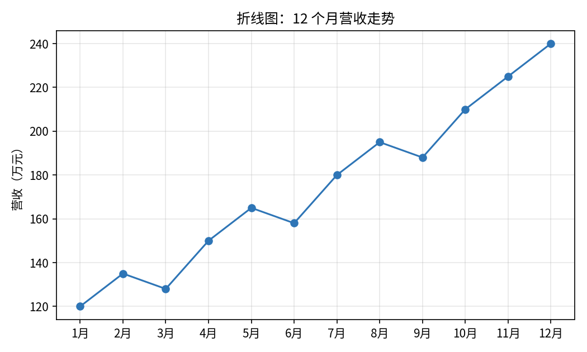
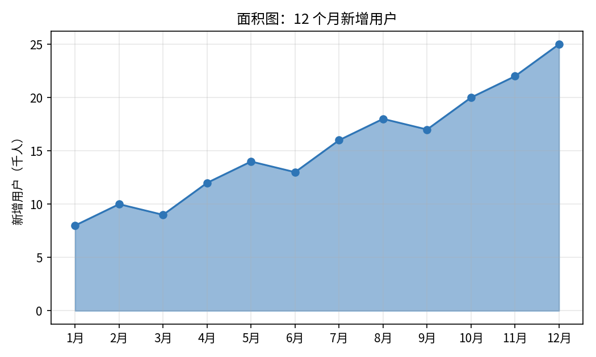
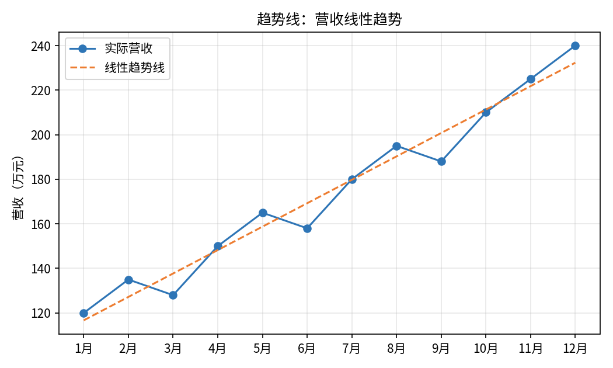

# 折线图与面积图

- **所属栏目**：C07 图表大全 / C07-L2-2 折线图与面积图
- **适用版本**：Excel 2007 / 2010 / 2013 / 2016 / 2019 / 2021 / 365
- **难度**：入门
- **预计阅读时长**：15 分钟
- **更新日期**：2026-11-10

## 学习目标

学完本篇，你将能够：

- 用折线图展示 12 个月营收随时间的变化趋势
- 用面积图表达累计感，并知道面积图在什么情况下会误导读者
- 给折线图添加线性趋势线，读出趋势方程与 R 平方值
- 判断一个数据该用折线图、面积图还是柱形图

## 基础概念

**折线图看变化**：折线图的横轴通常是时间，纵轴是数值，线的走向就是趋势。线往上走是增长，往下走是下滑，忽上忽下是波动。时间必须是连续等距的，缺了某个月要补上空值，不能直接跳过。

**面积图看体量**：面积图就是折线图下方填了颜色，填充的面积越大，数值越大。它比折线图更有视觉冲击力，但多系列面积图会互相遮挡，只适合单系列或两三个系列。

**趋势线是拟合不是预测**：趋势线是 Excel 按现有数据算出的一条最贴合的线，R 平方越接近 1，贴合越好。趋势线可以外推预测，但预测越远越不可靠，只能作参考。

## 折线图

- **图表名称**：折线图
- **英文名称**：Line Chart
- **图表预览**：
- **适用场景**：展示数值随时间的变化趋势，例如 12 个月营收从 120 万元涨到 240 万元，中间 3 月和 6 月各有一次小幅回落。
- **数据结构**：

| 月份 | 营收 |
|---|---|
| 1月 | 120 |
| 2月 | 135 |
| 3月 | 128 |
| 4月 | 150 |
| 5月 | 165 |
| 6月 | 158 |
| 7月 | 180 |
| 8月 | 195 |
| 9月 | 188 |
| 10月 | 210 |
| 11月 | 225 |
| 12月 | 240 |

- **创建步骤**：

1. 选中数据区域 A1:B13（含表头）。
2. 点插入选项卡，在图表组里点折线图，选带数据标记的折线图。
3. 右键横轴，确认横轴是 1 月到 12 月按顺序排列，没有跳月。
4. 右键图表，点添加数据标签，数值标在点的上方。
5. 标题改成结论句，例如“营收全年翻倍，12 月达到 240 万元”。

- **格式调整**：线条加粗到 2.25 磅，数据标记用圆点；网格线只留横向的，纵向网格线删掉；多系列时每条线用不同颜色加不同标记区分，不要只靠颜色区分。
- **常见问题**：

| 问题 | 解答 |
|---|---|
| 折线图和柱形图怎么选？ | 看趋势用折线图，比单月大小用柱形图；月份多（12 个以上）优先用折线图。 |
| 横轴月份顺序乱了怎么办？ | 选中横轴，检查坐标轴类型是否为文本坐标轴；数据源的月份列按时间顺序排好。 |
| 线条断开了怎么办？ | 数据里有空单元格；右键图表点选择数据，点隐藏和空单元格，选用直线连接数据点。 |

- **版本兼容性**：全部版本均支持，兼容 Excel 2007 / 2010 / 2013 / 2016 / 2019 / 2021 / 365。
- **示例工作簿**：[图表-示例-折线图与面积图.xlsx](templates/图表-示例-折线图与面积图.xlsx)

## 面积图

- **图表名称**：面积图
- **英文名称**：Area Chart
- **图表预览**：
- **适用场景**：展示单一系列随时间的累计体量感，例如 12 个月新增用户从每月 8 千人涨到 25 千人，面积越大表示当月新增越多。
- **数据结构**：

| 月份 | 新增用户 |
|---|---|
| 1月 | 8 |
| 2月 | 10 |
| 3月 | 9 |
| 4月 | 12 |
| 5月 | 14 |
| 6月 | 13 |
| 7月 | 16 |
| 8月 | 18 |
| 9月 | 17 |
| 10月 | 20 |
| 11月 | 22 |
| 12月 | 25 |

- **创建步骤**：

1. 选中数据区域 A1:B13（含表头）。
2. 点插入选项卡，在图表组里点面积图，选二维面积图。
3. 面积颜色设 50% 透明度，线条颜色与面积同色加深。
4. 纵轴从 0 开始，标题改成结论句，例如“下半年每月新增用户稳定在 17 千人以上”。

- **格式调整**：单系列面积图效果最好；两个以上系列时用堆积面积图，并把透明度调到 50% 左右，避免后一个系列被前一个完全盖住；面积图不要加数据标签，标在面积里读数困难。
- **常见问题**：

| 问题 | 解答 |
|---|---|
| 面积图和折线图有什么区别？ | 数据相同，面积图多了填充色，视觉冲击强但读数不如折线图精确。 |
| 多系列面积图互相遮挡怎么办？ | 改用堆积面积图，或拆成折线图；系列超过 3 个不要用面积图。 |
| 面积图能看累计值吗？ | 堆积面积图的顶部边界就是累计值；普通面积图不能直接读累计。 |

- **版本兼容性**：全部版本均支持，兼容 Excel 2007 / 2010 / 2013 / 2016 / 2019 / 2021 / 365。
- **示例工作簿**：[图表-示例-折线图与面积图.xlsx](templates/图表-示例-折线图与面积图.xlsx)

## 趋势线

- **图表名称**：趋势线
- **英文名称**：Trendline
- **图表预览**：
- **适用场景**：在折线图或散点图上叠加一条拟合线，判断数据整体是上升还是下降、上升有多快，例如 12 个月营收的线性趋势线斜率为正，说明营收整体向上。
- **数据结构**：

| 月份 | 营收 |
|---|---|
| 1月 | 120 |
| 2月 | 135 |
| 3月 | 128 |
| 4月 | 150 |
| 5月 | 165 |
| 6月 | 158 |
| 7月 | 180 |
| 8月 | 195 |
| 9月 | 188 |
| 10月 | 210 |
| 11月 | 225 |
| 12月 | 240 |

本表线性趋势线的方程为：营收 = 10.51 x 月份 + 106.18，R 平方 = 0.964。斜率 10.51 表示平均每月营收增加约 10.51 万元；R 平方 0.964 表示趋势线对数据的拟合程度很高。

- **创建步骤**：

1. 先按折线图的做法做出 12 个月营收折线图。
2. 右键折线上的任一数据点，点添加趋势线。
3. 在设置趋势线格式窗格里选线性。
4. 勾选显示公式与显示 R 平方值，公式和 R 平方值会出现在图表上。
5. 需要预测时，在预测栏里填向后预测的周期数，例如向后 3 个周期。

- **格式调整**：趋势线用虚线、与数据线不同的颜色，线宽 2.25 磅；公式与 R 平方值移到图表空白处，不要压住数据点；线性、指数、多项式等类型要根据数据形态选，不要默认只用线性。
- **常见问题**：

| 问题 | 解答 |
|---|---|
| R 平方是什么意思？ | R 平方越接近 1，趋势线与数据的贴合程度越高；0.964 表示拟合很好，0.5 以下表示拟合很差。 |
| 趋势线能预测未来吗？ | 可以外推，但只能作参考；数据形态一变，预测就失效，预测周期越长越不可靠。 |
| 哪种趋势线类型最合适？ | 数据匀速增长用线性，加速增长用指数，有波峰波谷用多项式；先看散点形态再选类型。 |

- **版本兼容性**：全部版本均支持，兼容 Excel 2007 / 2010 / 2013 / 2016 / 2019 / 2021 / 365。
- **示例工作簿**：[图表-示例-折线图与面积图.xlsx](templates/图表-示例-折线图与面积图.xlsx)

## 练习题

1. 用示例工作簿里的 12 个月营收表做一张带数据标记的折线图，找出营收回落的两个月份，并写一句话结论。
2. 给同一张折线图添加线性趋势线，写出趋势线方程与 R 平方值，并说明斜率 10.51 的业务含义。
3. 用月新增用户表做一张面积图，再把它改成折线图，对比两张图，哪张更容易读出 3 月新增用户比 2 月少？为什么？

## 参考答案

1. 回落的月份是 3 月（135 万元降到 128 万元）与 6 月（165 万元降到 158 万元），其余月份全部环比上涨。结论示例：营收全年整体向上，仅 3 月与 6 月小幅回落。
2. 趋势线方程为营收 = 10.51 x 月份 + 106.18，R 平方 = 0.964。斜率 10.51 表示平均每个月营收增加约 10.51 万元；R 平方 0.964 表示线性趋势对这 12 个月数据的拟合程度很高。
3. 折线图更容易读出。因为面积图的填充色会弱化单点数值的差异，折线图的数据点与数值标签直接可读，3 月的点低于 2 月的点一目了然。
