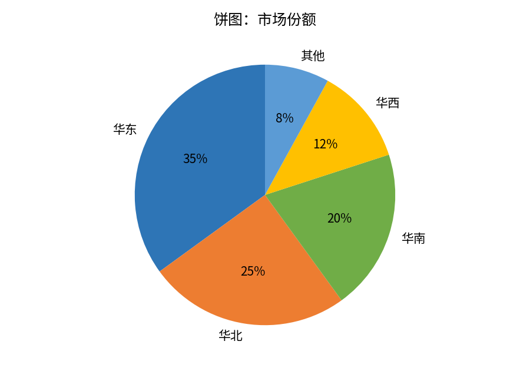
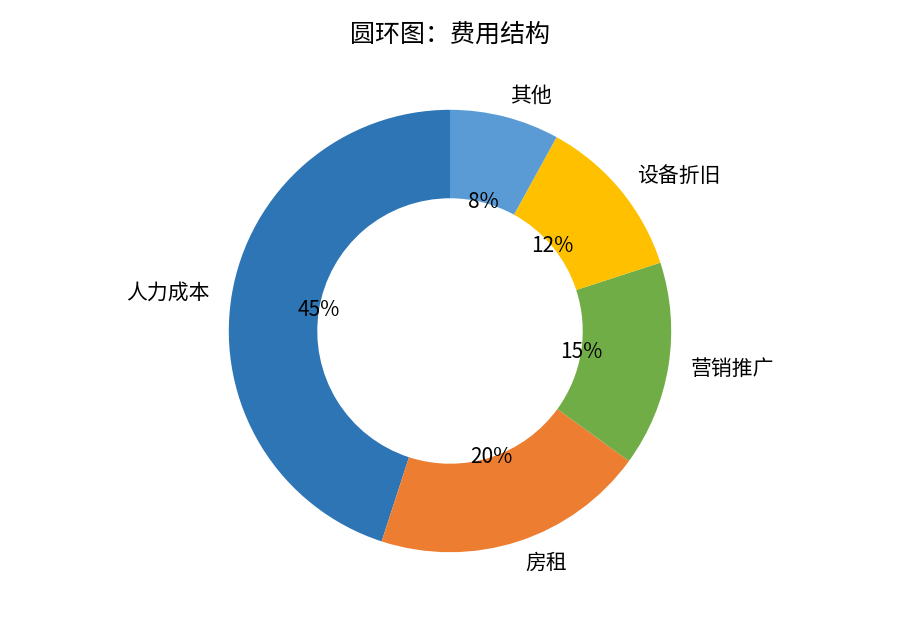
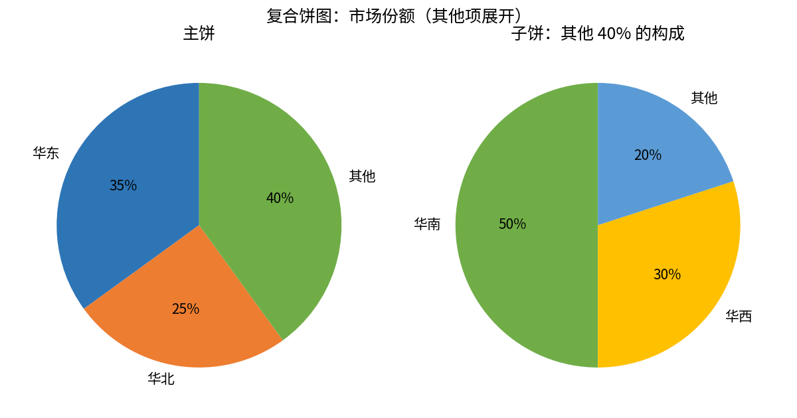

# 饼图与圆环图

- **所属栏目**：C07 图表大全 / C07-L2-3 饼图与圆环图
- **适用版本**：Excel 2007 / 2010 / 2013 / 2016 / 2019 / 2021 / 365
- **难度**：入门
- **预计阅读时长**：15 分钟
- **更新日期**：2026-11-10

## 学习目标

学完本篇，你将能够：

- 用饼图展示市场份额，核对各部分占比之和为 100
- 用圆环图展示费用结构，并在圆环中心放关键数字
- 用复合饼图把主饼里过小的“其他”项展开成子饼
- 判断类别超过 6 个时为什么不能用饼图

## 基础概念

**饼图看占比**：饼图把一个整体切成若干扇形，每块扇形的角度就是它在整体里的占比。饼图只适合展示一个整体的构成，类别一般不超过 6 个，类别太多时小扇形挤在一起，根本读不出来。

**圆环图是空心饼图**：圆环图与饼图表达的信息相同，区别是中间空出一块，可以放总计数字或标题。多系列圆环图可以套多层环，每层环是一个整体，适合对比两个时期的结构。

**复合饼图是主饼加子饼**：主饼里太小的几项会被合并成“其他”，子饼再把“其他”展开。这样既保住了主饼的简洁，又没有丢掉小类别的信息。

## 饼图

- **图表名称**：饼图
- **英文名称**：Pie Chart
- **图表预览**：
- **适用场景**：展示一个整体的构成占比，例如市场份额：华东 35%、华北 25%、华南 20%、华西 12%、其他 8%，五项合计 100%。
- **数据结构**：

| 区域 | 份额 |
|---|---|
| 华东 | 35 |
| 华北 | 25 |
| 华南 | 20 |
| 华西 | 12 |
| 其他 | 8 |

五项份额之和为 100：35 + 25 + 20 + 12 + 8 = 100。

- **创建步骤**：

1. 选中数据区域 A1:B6（含表头）。
2. 点插入选项卡，在图表组里点饼图，选二维饼图。
3. 右键饼图，点添加数据标签，再右键数据标签，勾选百分比，取消勾选值。
4. 把最大的扇形（华东 35%）向外拖出一点，突出重点。
5. 标题改成结论句，例如“华东占三分之一以上，是第一大市场”。

- **格式调整**：扇形按占比从大到小顺时针排列；每块扇形用不同颜色，相邻颜色对比要明显；不要用三维饼图，三维透视会让后面的扇形看起来比实际小。
- **常见问题**：

| 问题 | 解答 |
|---|---|
| 饼图类别超过 6 个怎么办？ | 把最小的几项合并为其他，或改用条形图；饼图不适合展示太多类别。 |
| 百分比标签加起来不是 100% 怎么办？ | 四舍五入所致，属正常现象；核对原始数据之和是否为 100 即可。 |
| 两组占比想对比怎么办？ | 饼图不适合对比两组数据；用两张并排的条形图，或用圆环图套两层环。 |

- **版本兼容性**：全部版本均支持，兼容 Excel 2007 / 2010 / 2013 / 2016 / 2019 / 2021 / 365。
- **示例工作簿**：[图表-示例-饼图与圆环图.xlsx](../../templates/图表-示例-饼图与圆环图.xlsx)

## 圆环图

- **图表名称**：圆环图
- **英文名称**：Doughnut Chart
- **图表预览**：
- **适用场景**：展示一个整体的构成占比，同时想在图中心放总计数字，例如费用结构：人力成本 45%、房租 20%、营销推广 15%、设备折旧 12%、其他 8%，五项合计 100%。
- **数据结构**：

| 费用项目 | 占比 |
|---|---|
| 人力成本 | 45 |
| 房租 | 20 |
| 营销推广 | 15 |
| 设备折旧 | 12 |
| 其他 | 8 |

五项占比之和为 100：45 + 20 + 15 + 12 + 8 = 100。

- **创建步骤**：

1. 选中数据区域 A1:B6（含表头）。
2. 点插入选项卡，在图表组里点饼图下拉，选圆环图。
3. 右键圆环，点添加数据标签，勾选百分比。
4. 在圆环中心插入文本框，写总计或标题，例如“月费用 100%”。
5. 标题改成结论句，例如“人力成本占近一半，是最大的费用项”。

- **格式调整**：圆环粗细在设置数据系列格式里调，环太细读数困难，太粗与饼图无异；中心文字只放一个关键数字，不要塞一整段话；多系列圆环图每层环用同一套配色，方便按颜色对照。
- **常见问题**：

| 问题 | 解答 |
|---|---|
| 圆环图和饼图怎么选？ | 只看占比用饼图；想在图中心放总计数字，或要对比两个时期的结构，用圆环图。 |
| 圆环中心怎么放字？ | 插入文本框拖到圆环中心，输入文字后去掉文本框边框与填充。 |
| 多层圆环图怎么读？ | 每层环是一个整体，内环与外环按颜色对照同一类别；层数超过 2 层就很难读。 |

- **版本兼容性**：全部版本均支持，兼容 Excel 2007 / 2010 / 2013 / 2016 / 2019 / 2021 / 365。
- **示例工作簿**：[图表-示例-饼图与圆环图.xlsx](../../templates/图表-示例-饼图与圆环图.xlsx)

## 复合饼图

- **图表名称**：复合饼图
- **英文名称**：Pie of Pie
- **图表预览**：
- **适用场景**：主饼里有几项太小、直接展示读不出来时，把它们合并成“其他”再用子饼展开，例如市场份额主饼只留华东 35%、华北 25%、其他 40%，子饼把其他 40% 展开为华南 20%、华西 12%、其他 8%。
- **数据结构**：

主饼：

| 区域 | 份额 |
|---|---|
| 华东 | 35 |
| 华北 | 25 |
| 其他 | 40 |

子饼：其他 40% 的构成：

| 区域 | 份额 |
|---|---|
| 华南 | 20 |
| 华西 | 12 |
| 其他 | 8 |

两表自洽：主饼三项之和 35 + 25 + 40 = 100；子饼三项之和 20 + 12 + 8 = 40，与主饼的“其他 40%”相等。

- **创建步骤**：

1. 选中完整数据区域 A1:B6（五类原始数据：华东 35、华北 25、华南 20、华西 12、其他 8）。
2. 点插入选项卡，在图表组里点饼图下拉，选复合饼图。
3. 右键主饼，点设置数据系列格式，在第二绘图区包含最后 3 个值（即华南、华西、其他进子饼）。
4. 两个饼都添加百分比数据标签。
5. 标题改成结论句，例如“华东、华北合计占 60%，其余三地合计占 40%”。

- **格式调整**：子饼与主饼之间用连线对应“其他”扇形；子饼里的“其他 8%”是原始数据里最小的类别，不要与主饼的“其他 40%”混淆；复合饼图只适合主饼 3 到 4 项的情况。
- **常见问题**：

| 问题 | 解答 |
|---|---|
| 子饼里出现了几个值，怎么定？ | 在设置数据系列格式里改第二绘图区包含最后几个值，默认是最后 3 个。 |
| 主饼的“其他”和子饼的“其他”是一回事吗？ | 不是。主饼的“其他 40%”是三类之和，子饼的“其他 8%”是原始数据里最小的一类。 |
| 复合饼图和复合条饼图怎么选？ | 子饼想用饼图展示选复合饼图，子饼想用条形图展示选复合条饼图。 |

- **版本兼容性**：全部版本均支持，兼容 Excel 2007 / 2010 / 2013 / 2016 / 2019 / 2021 / 365。
- **示例工作簿**：[图表-示例-饼图与圆环图.xlsx](../../templates/图表-示例-饼图与圆环图.xlsx)

## 练习题

1. 用市场份额表做一张饼图，核对五项份额之和为 100，并把华东扇形向外拖出，写一句话结论。
2. 用费用结构表做一张圆环图，在圆环中心放“人力占 45%”六个字，说明圆环图比饼图多提供了什么信息。
3. 用五类市场份额数据做一张复合饼图，设置第二绘图区包含最后 3 个值，写出主饼三项与子饼三项的数值，并验证子饼之和等于主饼的“其他”项。

## 参考答案

1. 五项之和：35 + 25 + 20 + 12 + 8 = 100。结论示例：华东 35% 为第一大市场，超过华北与华南之和的一半。
2. 圆环图中心可以放总计数字或一句话标题，饼图没有这个位置；本例中心放“人力占 45%”后，读者不用看标签就能抓住费用结构的最大头。
3. 主饼：华东 35、华北 25、其他 40；子饼：华南 20、华西 12、其他 8。验证：20 + 12 + 8 = 40，与主饼“其他 40”相等。
