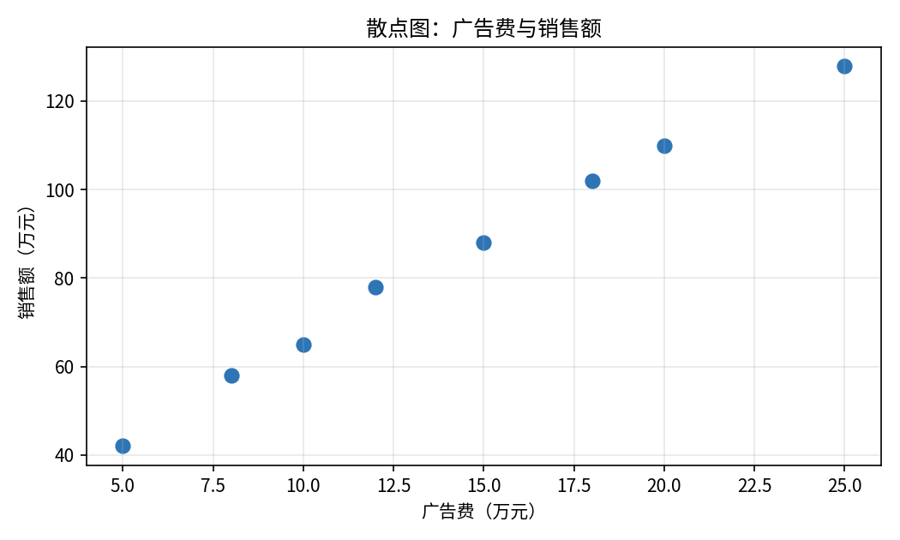
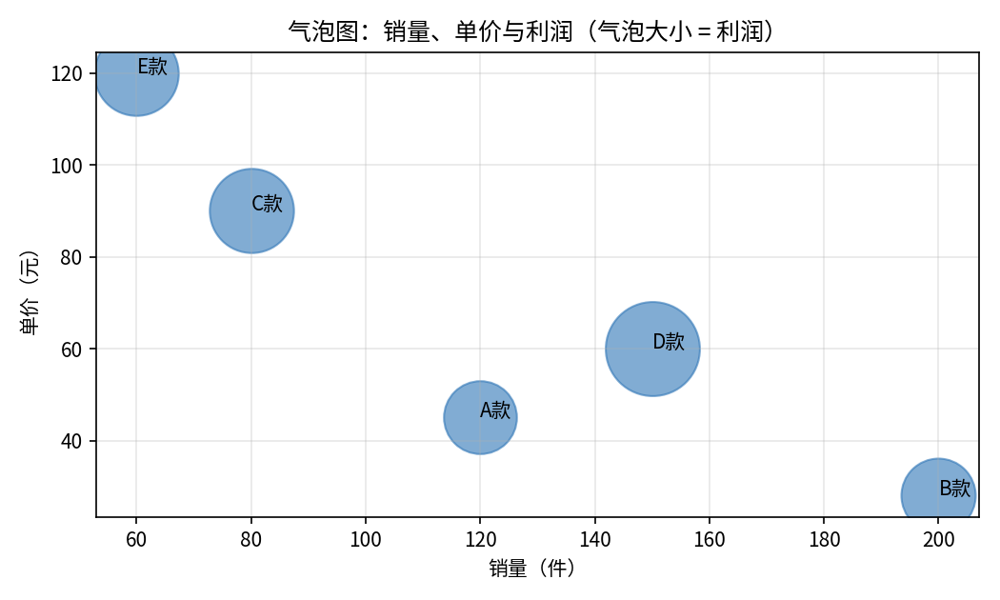
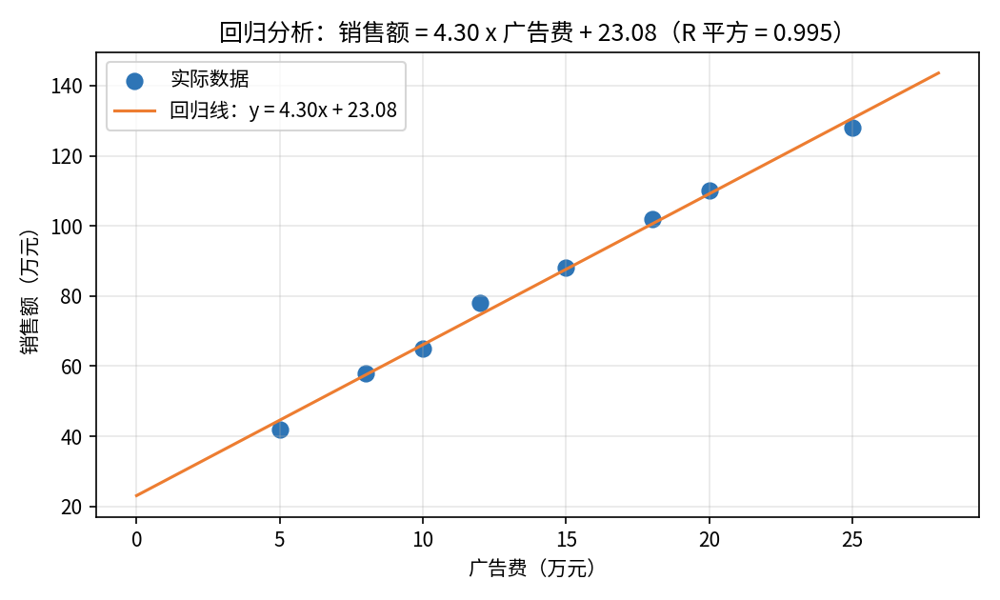

# 散点图与气泡图

- **所属栏目**：C07 图表大全 / C07-L2-4 散点图与气泡图
- **适用版本**：Excel 2007 / 2010 / 2013 / 2016 / 2019 / 2021 / 365
- **难度**：进阶
- **预计阅读时长**：20 分钟
- **更新日期**：2026-11-10

## 学习目标

学完本篇，你将能够：

- 用散点图判断广告费与销售额之间有没有关系、关系有多强
- 用气泡图同时展示销量、单价与利润三个变量
- 对散点图做线性回归，读出回归方程与 R 平方值，并说出预测的适用边界
- 区分相关关系与因果关系，不把“一起涨”说成“因为所以”

## 基础概念

**散点图看关系**：散点图的横轴与纵轴都是数值，每个点是一次观测。点越接近一条直线，两个变量的关系越强；点散成一团，说明两者没什么关系。散点图只回答“有没有关系”，不回答“谁导致谁”。

**气泡图是三维散点图**：气泡图在散点图的基础上加了第三个变量，用气泡的大小表示。横轴一个变量、纵轴一个变量、气泡大小一个变量，一张图能同时讲三个维度。

**回归分析是给散点找一条线**：线性回归用最小二乘法给散点找一条最贴合的直线，方程写成 y = a x + b，R 平方表示这条线解释了多少波动。R 平方越接近 1，线越贴合。

## 散点图

- **图表名称**：散点图
- **英文名称**：Scatter Chart
- **图表预览**：
- **适用场景**：判断两个数值变量之间有没有关系，例如广告费越高，销售额是不是也越高；8 个观测点的分布是否大致沿一条直线上升。
- **数据结构**：

| 广告费 | 销售额 |
|---|---|
| 5 | 42 |
| 8 | 58 |
| 10 | 65 |
| 12 | 78 |
| 15 | 88 |
| 18 | 102 |
| 20 | 110 |
| 25 | 128 |

- **创建步骤**：

1. 选中数据区域 A1:B9（含表头）。
2. 点插入选项卡，在图表组里点散点图，选仅带数据标记的散点图。
3. 横轴放广告费（自变量），纵轴放销售额（因变量），不要放反。
4. 右键横轴与纵轴，把刻度调成从 0 开始，避免分布被拉变形。
5. 标题改成结论句，例如“广告费越高，销售额越高，8 个点大致沿直线分布”。

- **格式调整**：数据点用实心圆点，大小适中；不要把散点连成折线，连上线就暗示了点与点之间有顺序，散点图没有顺序；点太多重叠时把透明度调到 60% 左右。
- **常见问题**：

| 问题 | 解答 |
|---|---|
| 散点图和折线图怎么选？ | 两个变量都是数值、想看关系用散点图；横轴是时间、想看趋势用折线图。 |
| 横轴与纵轴放反了怎么办？ | 右键图表点选择数据，点编辑，把 X 值与 Y 值对调。 |
| 点散成一团说明什么？ | 说明两个变量之间没有明显的线性关系，不要硬找规律。 |

- **版本兼容性**：全部版本均支持，兼容 Excel 2007 / 2010 / 2013 / 2016 / 2019 / 2021 / 365。
- **示例工作簿**：[图表-示例-散点图与气泡图.xlsx](templates/图表-示例-散点图与气泡图.xlsx)

## 气泡图

- **图表名称**：气泡图
- **英文名称**：Bubble Chart
- **图表预览**：
- **适用场景**：同时展示三个变量，例如五款产品的销量（横轴）、单价（纵轴）与利润（气泡大小），一眼看出 D 款利润最大、E 款单价最高但销量最低。
- **数据结构**：

| 产品 | 销量 | 单价 | 利润 |
|---|---|---|---|
| A款 | 120 | 45 | 5400 |
| B款 | 200 | 28 | 5600 |
| C款 | 80 | 90 | 7200 |
| D款 | 150 | 60 | 9000 |
| E款 | 60 | 120 | 7200 |

表中利润等于销量乘以单价：120 x 45 = 5400，200 x 28 = 5600，80 x 90 = 7200，150 x 60 = 9000，60 x 120 = 7200。

- **创建步骤**：

1. 选中数据区域 A1:D6（含表头，产品列是标签列）。
2. 点插入选项卡，在图表组里点散点图下拉，选气泡图。
3. 右键图表点选择数据，确认 X 值是销量列、Y 值是单价列、气泡大小是利润列。
4. 给每个气泡加上产品标签（A 款到 E 款），否则读者不知道哪个气泡是谁。
5. 标题改成结论句，例如“D 款利润 9000 元最高，E 款单价最高但销量最低”。

- **格式调整**：气泡大小按利润等比缩放，Excel 会自动算；气泡太多重叠时调透明度；气泡数量超过 10 个就很难读，改用表格或拆图。
- **常见问题**：

| 问题 | 解答 |
|---|---|
| 气泡大小代表什么？ | 代表第三个变量，本例是利润；气泡面积与数值成正比，不是直径。 |
| 气泡标签怎么加？ | 右键气泡点添加数据标签，再把标签内容改成产品列。 |
| 气泡图能放负数吗？ | 气泡大小不能为负数；销量或单价出现负数时，气泡图不适用。 |

- **版本兼容性**：全部版本均支持，兼容 Excel 2007 / 2010 / 2013 / 2016 / 2019 / 2021 / 365。
- **示例工作簿**：[图表-示例-散点图与气泡图.xlsx](templates/图表-示例-散点图与气泡图.xlsx)

## 回归分析

- **图表名称**：回归分析
- **英文名称**：Regression Analysis
- **图表预览**：
- **适用场景**：给散点图配一条回归直线并量化关系强度，例如广告费与销售额的回归方程为销售额 = 4.30 x 广告费 + 23.08，R 平方 = 0.995，说明广告费能解释销售额 99.5% 的波动。
- **数据结构**：

| 广告费 | 销售额 |
|---|---|
| 5 | 42 |
| 8 | 58 |
| 10 | 65 |
| 12 | 78 |
| 15 | 88 |
| 18 | 102 |
| 20 | 110 |
| 25 | 128 |

回归结果（线性拟合）：斜率 4.30，截距 23.08，R 平方 0.995。斜率 4.30 表示广告费每增加 1 万元，销售额平均增加 4.30 万元；截距 23.08 表示广告费为 0 时，模型预测的销售额为 23.08 万元。

- **创建步骤**：

1. 先按散点图的做法做出广告费与销售额的散点图。
2. 右键任一数据点，点添加趋势线。
3. 在设置趋势线格式窗格里选线性。
4. 勾选显示公式与显示 R 平方值，图表上出现方程与 R 平方值。
5. 读出方程：销售额 = 4.30 x 广告费 + 23.08，R 平方 = 0.995。

- **格式调整**：回归线用虚线、与数据点不同的颜色；公式与 R 平方值放在图表空白处；残差大的点要单独检查，可能是录入错误或特殊情况，不要直接删掉。
- **常见问题**：

| 问题 | 解答 |
|---|---|
| R 平方 0.995 说明什么？ | 说明回归线对 8 个点的拟合程度极高，广告费能解释销售额 99.5% 的波动。 |
| 能用方程预测广告费 30 万元时的销售额吗？ | 可以算：4.30 x 30 + 23.08 = 152.08 万元，但 30 万元超出了观测范围（5 到 25 万元），外推预测仅供参考。 |
| 相关关系等于因果关系吗？ | 不等于。广告费与销售额一起涨，不代表涨销售额全是广告费的功劳，可能还有季节、促销等因素。 |

- **版本兼容性**：全部版本均支持，兼容 Excel 2007 / 2010 / 2013 / 2016 / 2019 / 2021 / 365。
- **示例工作簿**：[图表-示例-散点图与气泡图.xlsx](templates/图表-示例-散点图与气泡图.xlsx)

## 练习题

1. 用示例工作簿里的广告费与销售额表做一张散点图，描述 8 个点的分布形态，并判断两者是正相关还是负相关。
2. 给散点图添加线性趋势线，写出回归方程与 R 平方值，并用方程预测广告费为 15 万元时的销售额，再与表中实际值 88 万元对比，算出残差。
3. 用气泡图表做一张五款产品的气泡图，哪个产品的利润最大？哪个产品的单价最高？E 款单价最高但利润为什么不是最高？

## 参考答案

1. 8 个点大致沿一条上升直线分布，广告费越大，销售额越大，两者为正相关。
2. 回归方程为销售额 = 4.30 x 广告费 + 23.08，R 平方 = 0.995。广告费 15 万元时预测销售额为 4.30 x 15 + 23.08 = 87.58 万元，实际值为 88 万元，残差为 88 - 87.58 = 0.42 万元，拟合非常好。
3. D 款利润最大，为 9000 元；E 款单价最高，为 120 元。E 款利润不是最高，因为利润等于销量乘以单价，E 款销量只有 60 件，60 x 120 = 7200 元，小于 D 款的 150 x 60 = 9000 元。
