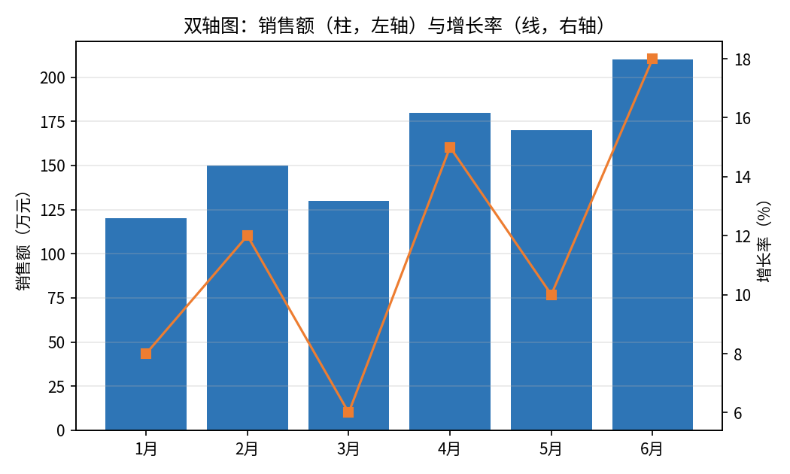
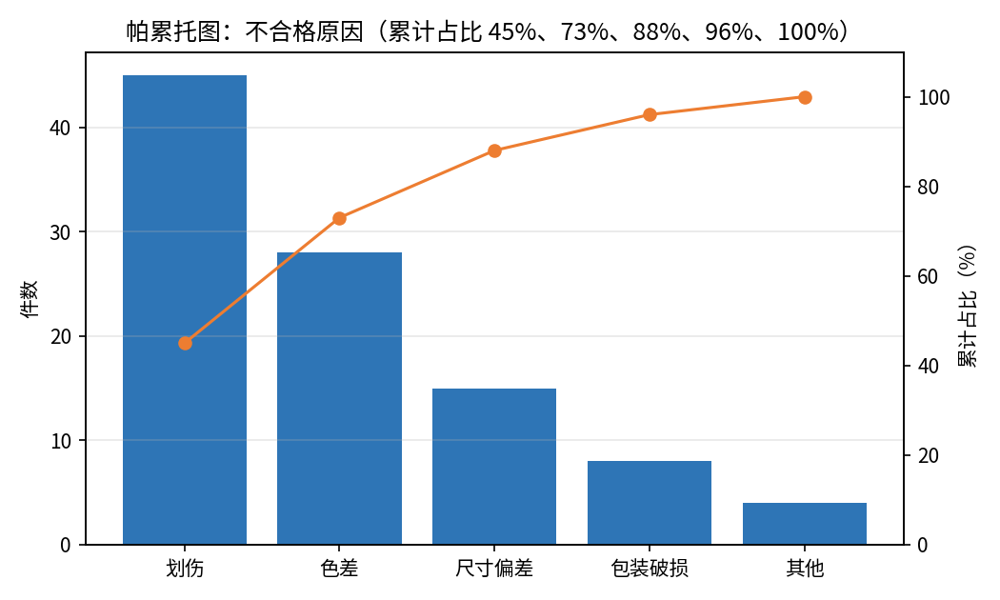

# 组合图

- **所属栏目**：C07 图表大全 / C07-L2-5 组合图与双轴
- **适用版本**：Excel 2013 / 2016 / 2019 / 2021 / 365（组合图需 Excel 2013 及以上版本；帕累托图需 Excel 2016 及以上版本）
- **难度**：进阶
- **预计阅读时长**：20 分钟
- **更新日期**：2026-11-10

## 学习目标

学完本篇，你将能够：

- 用柱线组合图同时展示销售额与增长率
- 给增长率单独配一个右轴，解决两个量级差太大的问题
- 用帕累托图找出造成 80% 问题的原因，并算出累计占比
- 判断什么情况下不该用双轴，避免双轴误导读者

## 基础概念

**组合图是一张图两种图形**：组合图把柱形图与折线图画在同一张图上，柱子看绝对值，折线看比率或趋势。两个系列的量级差太大时，折线会被压成一条直线，这时就要给它单独配一个坐标轴。

**双轴是组合图的标配**：左轴管柱子（销售额，万元），右轴管折线（增长率，%）。双轴让两个量级的序列都能正常显示，但双轴也容易误导：左右轴的刻度一改，两条线的相对位置就全变了。

**帕累托图是柱形图加累计折线**：帕累托图按数量从大到小排柱子，再叠加一条累计占比折线，帮你找到“关键的少数”。帕累托法则说：80% 的问题往往由 20% 的原因造成。

## 柱线组合图

- **图表名称**：柱线组合图
- **英文名称**：Combo Chart
- **图表预览**：
- **适用场景**：同时展示绝对值与比率，例如 1 月到 6 月的销售额（柱，万元）与增长率（线，%），同一组月份，两个视角一次看完。
- **数据结构**：

| 月份 | 销售额 | 增长率 |
|---|---:|---:|
| 1月 | 120 | 8 |
| 2月 | 150 | 12 |
| 3月 | 130 | 6 |
| 4月 | 180 | 15 |
| 5月 | 170 | 10 |
| 6月 | 210 | 18 |

柱子与折线对应同一组月份：1 月销售额 120 万元、增长率 8%，6 月销售额 210 万元、增长率 18%。

- **创建步骤**：

1. 选中数据区域 A1:C7（含表头）。
2. 点插入选项卡，在图表组里点组合图，选簇状柱形图与折线图的组合。
3. 在弹出的对话框里，把销售额设为簇状柱形图，把增长率设为折线图，并勾选增长率的次坐标轴。
4. 右键折线，点添加数据标签，标签显示百分比。
5. 标题改成结论句，例如“6 月销售额最高，增长率也最高，达到 18%”。

- **格式调整**：柱子用商务蓝，折线用橙色加圆点标记；左右轴标题要写清楚单位（左轴万元、右轴百分比）；图例放底部，柱子与折线各标清楚。
- **常见问题**：

| 问题 | 解答 |
|---|---|
| 折线被压成一条直线怎么办？ | 两个系列量级差太大；勾选增长率的次坐标轴，让折线用右轴刻度。 |
| 组合图里能放三组数据吗？ | 能，但超过两组就很难读；三组以上建议拆成两张图。 |
| 柱子与折线哪个放前面？ | 折线在上层，柱子在下层；右键折线选置于顶层，避免被柱子挡住。 |

- **版本兼容性**：组合图需 Excel 2013 及以上版本，兼容 Excel 2013 / 2016 / 2019 / 2021 / 365；Excel 2010 及更早版本没有组合图功能，可用双轴做法手工模拟。
- **示例工作簿**：[图表-示例-组合图.xlsx](../../templates/图表-示例-组合图.xlsx)

## 双轴图

- **图表名称**：双轴图
- **英文名称**：Dual Axis Chart
- **图表预览**：
- **适用场景**：两个量级不同的序列画在一张图上，例如销售额 120 到 210 万元与增长率 6% 到 18% 共用 1 月到 6 月的横轴，左轴读销售额，右轴读增长率。
- **数据结构**：

| 月份 | 销售额 | 增长率 |
|---|---:|---:|
| 1月 | 120 | 8 |
| 2月 | 150 | 12 |
| 3月 | 130 | 6 |
| 4月 | 180 | 15 |
| 5月 | 170 | 10 |
| 6月 | 210 | 18 |

与柱线组合图用同一组数据：柱子（销售额）走左轴，折线（增长率）走右轴，两者对应同一组月份。

- **创建步骤**：

1. 选中数据区域 A1:C7（含表头），先插入一张簇状柱形图。
2. 右键代表增长率的系列，点设置数据系列格式。
3. 在系列选项里选次坐标轴，该系列移到右轴。
4. 右键该系列，点更改系列图表类型，改成折线图。
5. 左右轴标题分别写清楚：左轴“销售额（万元）”，右轴“增长率（%）”。

- **格式调整**：左右轴的刻度要诚实，不要为了制造“两条线交叉”的效果而调刻度；右轴最大值不要与左轴凑巧对齐成误导性交叉；双轴图必须在图上标明哪条线走哪个轴。
- **常见问题**：

| 问题 | 解答 |
|---|---|
| 双轴图会不会误导读者？ | 会。左右轴刻度一改，两条线的相对位置就变了；只在量级确实差太大时用双轴，且必须标清轴标题。 |
| 什么时候不该用双轴？ | 两个系列量级接近时不要用双轴，直接放同一坐标轴更诚实。 |
| 次坐标轴选项是灰的怎么办？ | 先确认图表是组合图；单一图表类型没有次坐标轴，要先把其中一个系列改成另一种图表类型。 |

- **版本兼容性**：双轴做法全部版本均可手工实现，组合图对话框需 Excel 2013 及以上版本，兼容 Excel 2013 / 2016 / 2019 / 2021 / 365。
- **示例工作簿**：[图表-示例-组合图.xlsx](../../templates/图表-示例-组合图.xlsx)

## 帕累托图

- **图表名称**：帕累托图
- **英文名称**：Pareto Chart
- **图表预览**：
- **适用场景**：找出造成大多数问题的原因，例如五种不合格原因中，划伤与色差两项就占了 73% 的不合格件数，先解决这两项，效果最大。
- **数据结构**：

| 不合格原因 | 件数 | 累计占比 |
|---|---:|---:|
| 划伤 | 45 | 45 |
| 色差 | 28 | 73 |
| 尺寸偏差 | 15 | 88 |
| 包装破损 | 8 | 96 |
| 其他 | 4 | 100 |

件数合计 100 件：45 + 28 + 15 + 8 + 4 = 100。累计占比逐项累加：45%，45 + 28 = 73%，73 + 15 = 88%，88 + 8 = 96%，96 + 4 = 100%。

- **创建步骤**：

1. 选中数据区域 A1:B6（原因与件数两列，不用选累计占比列，Excel 会自动算）。
2. 点插入选项卡，在图表组里点直方图下拉，选帕累托图。
3. 柱子自动按件数从大到小排列，折线是累计占比。
4. 右键折线，点添加数据标签，标签显示百分比。
5. 标题改成结论句，例如“划伤与色差占不合格总数的 73%，优先解决这两项”。

- **格式调整**：柱子按数量降序排列是帕累托图的硬性要求，不要手动打乱顺序；累计占比折线用橙色，与蓝色柱子区分；累计占比到 80% 的位置可以加一条参考线，标出“关键的少数”。
- **常见问题**：

| 问题 | 解答 |
|---|---|
| 帕累托图是 Excel 哪个版本新增的？ | Excel 2016 新增，微软 2015 年 7 月 2 日的官方博客把帕累托图列为 Office 2016 预览版新增的六种图表之一；2013 及更早版本没有内置帕累托图，需手工做柱线组合图模拟。 |
| 累计占比列要自己算吗？ | 不用。只给原因与件数两列，Excel 会自动算累计占比；自己算好填进去也可以，但不要两处数字打架。 |
| 原因太多怎么办？ | 只留前 5 到 7 项，其余合并为其他；原因超过 10 项时帕累托图失去重点。 |

- **版本兼容性**：Excel 2016 新增，兼容 Excel 2016 / 2019 / 2021 / 365；Excel 2013 及更早版本无内置帕累托图，可用柱线组合图手工模拟。
- **示例工作簿**：[图表-示例-组合图.xlsx](../../templates/图表-示例-组合图.xlsx)

## 练习题

1. 用示例工作簿里的 1 月到 6 月数据做一张柱线组合图：销售额用柱（左轴），增长率用线（右轴）。哪个月销售额最高？哪个月增长率最高？是同一个月吗？
2. 把增长率系列改到次坐标轴之前与之后各截一张图对比，说明为什么量级差太大时必须用双轴。
3. 用不合格原因表做一张帕累托图，算出前两项（划伤与色差）的累计占比，并写一句话说明应该优先解决哪两项、为什么。

## 参考答案

1. 销售额最高是 6 月，210 万元；增长率最高也是 6 月，18%。是同一个月。次高是 4 月：销售额 180 万元、增长率 15%。
2. 改到次坐标轴之前，增长率只有 6% 到 18%，在 0 到 210 万元的左轴刻度下几乎贴着横轴，是一条看不出起伏的直线；改到次坐标轴之后，折线用 0% 到 20% 的右轴刻度，3 月回落到 6%、6 月冲到 18% 的变化一目了然。
3. 前两项累计占比为 45% + 28% = 73%。应优先解决划伤与色差，因为两项就占了不合格总数的 73%，解决这两项的效果最大，符合帕累托法则中“关键的少数”的思路。
