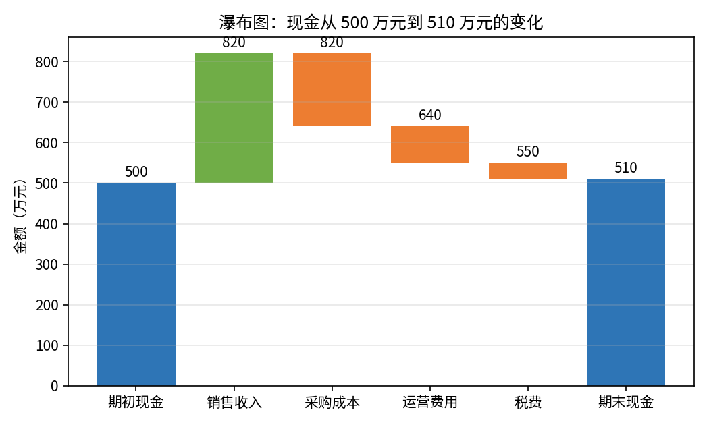
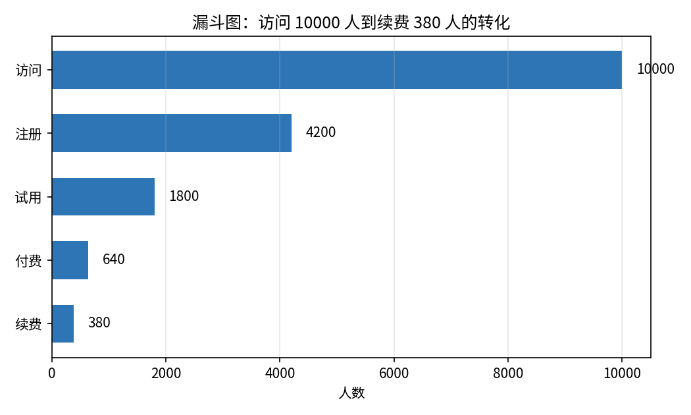
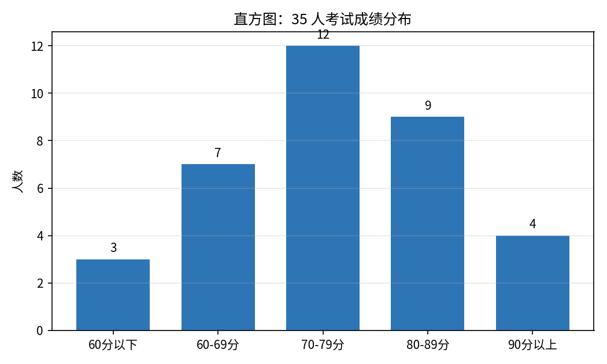
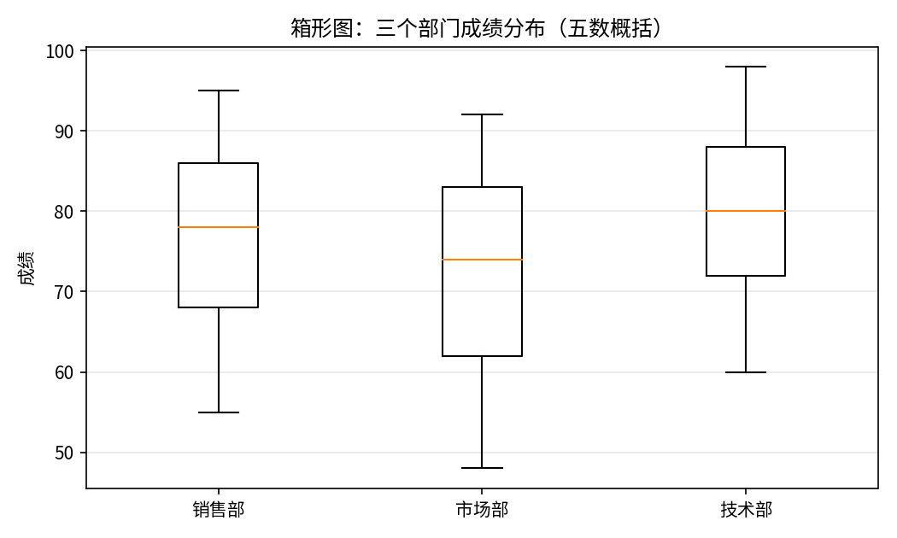
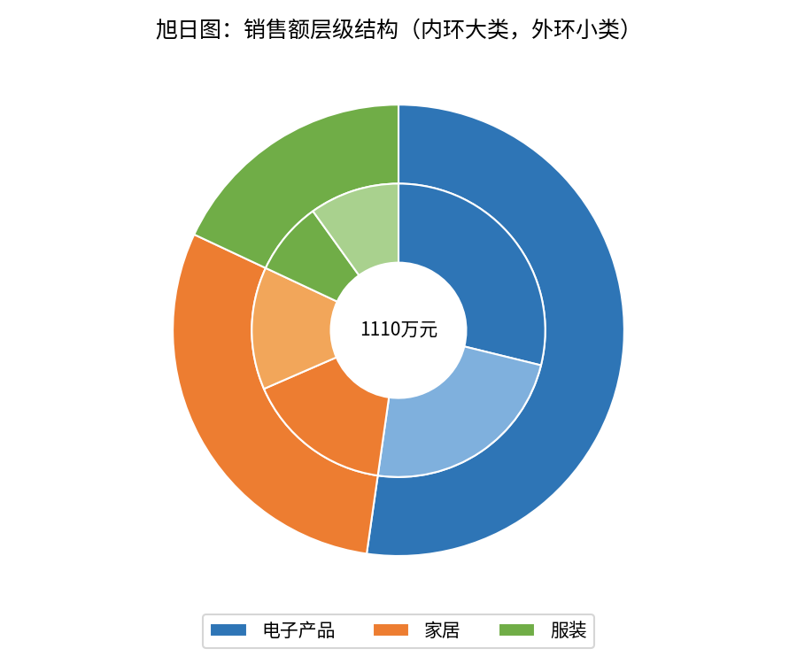
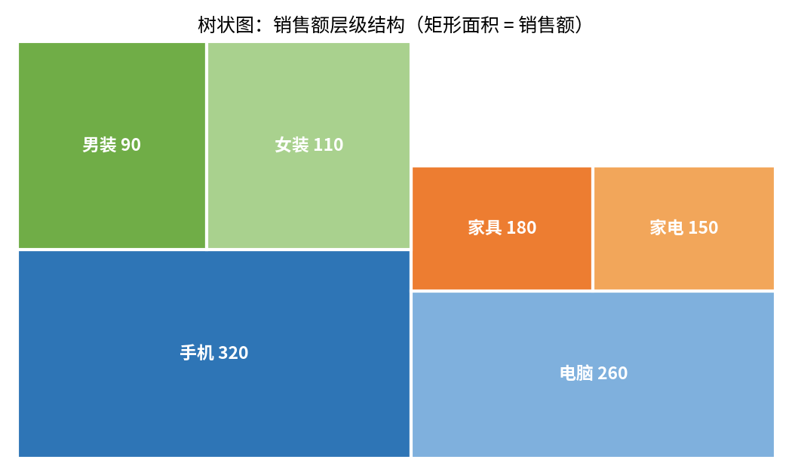
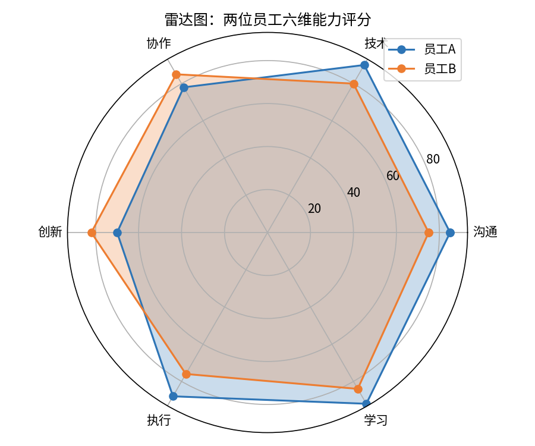
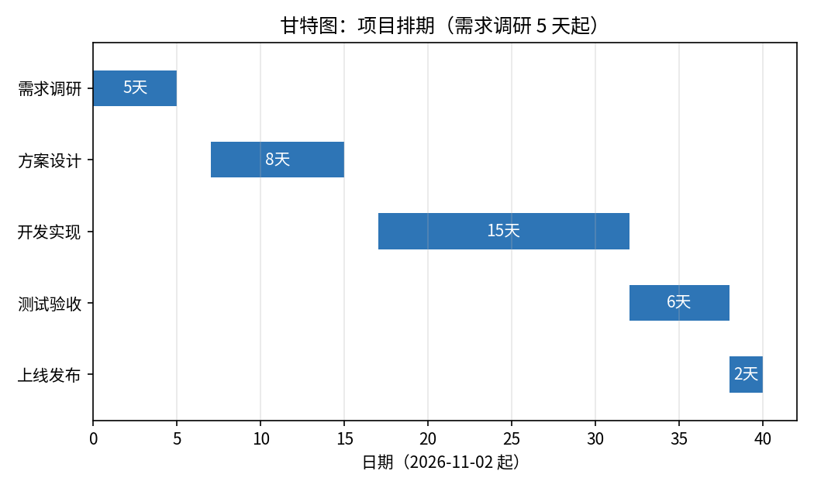
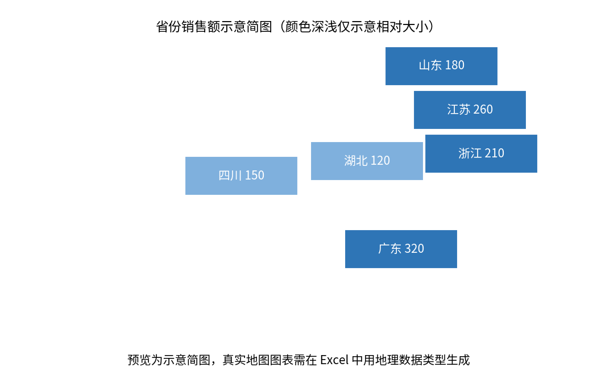

# 新图表类型

- **所属栏目**：C07 图表大全 / C07-L2-6 新图表类型
- **适用版本**：Excel 2016 / 2019 / 2021 / 365（本篇图表多为 2016 或 2019 新增，雷达图与甘特图除外，各节版本兼容性逐项注明）
- **难度**：进阶
- **预计阅读时长**：30 分钟
- **更新日期**：2026-11-10

## 学习目标

学完本篇，你将能够：

- 说出 Excel 2016 新增的六种图表与 2019 新增的两种图表分别是哪些
- 用瀑布图展示现金从期初到期末的变化过程
- 用漏斗图、直方图、箱形图分别展示转化、分布与五数概括
- 用旭日图与树状图展示两层结构数据，用雷达图对比多维评分
- 用堆积条形图的做法做出甘特图，用地理数据类型做出地图图表

## 基础概念

**新图表的分界线是 2016 与 2019**：微软官方博客（2015 年 7 月 2 日）宣布 Office 2016 预览版新增六种图表：瀑布图、直方图、帕累托图、箱形图、树状图、旭日图。2016 与 2019 之间又新增两种：漏斗图与填充地图图表。打开旧版本文件时，这些图表会显示为静态图片或报错，分享前要确认对方的版本。

**新图表不是万能的**：瀑布图只适合有正负增减的累计过程，直方图只适合看分布，箱形图只适合对比多组分布，旭日图与树状图只适合两到三层结构。选错图表比不做图更糟。

## 瀑布图

- **图表名称**：瀑布图
- **英文名称**：Waterfall Chart
- **图表预览**：
- **适用场景**：展示一个数值从期初到期末是怎样一步步变化的，例如现金从期初 500 万元，经过销售收入、采购成本、运营费用、税费，到期末 510 万元。
- **数据结构**：

| 项目 | 金额 |
|---|---:|
| 期初现金 | 500 |
| 销售收入 | 320 |
| 采购成本 | -180 |
| 运营费用 | -90 |
| 税费 | -40 |
| 期末现金 | 510 |

算术自洽：500 + 320 - 180 - 90 - 40 = 510，期末现金与表中最后一行一致。

- **创建步骤**：

1. 选中数据区域 A1:B7（含表头）。
2. 点插入选项卡，在图表组里点瀑布图。
3. 右键期初现金与期末现金两个柱子，点设置为汇总，让它们从 0 开始画。
4. 正数柱用绿色，负数柱用橙色，汇总柱用蓝色。
5. 标题改成结论句，例如“现金净增 10 万元，销售收入是最大正向贡献”。

- **格式调整**：增加项与减少项必须用不同颜色；汇总柱（期初与期末）单独设色；连接线可以打开，方便读者顺着柱子看累计过程。
- **常见问题**：

| 问题 | 解答 |
|---|---|
| 期初与期末柱子浮在半空怎么办？ | 没有设为汇总；右键这两个柱子，点设置为汇总，它们就会从 0 开始画。 |
| 瀑布图是哪个版本新增的？ | Excel 2016 新增，微软 2015 年 7 月 2 日的官方博客列为六种新图表之一。 |
| 只有正数能做瀑布图吗？ | 不是。瀑布图正是为正负增减混合的数据设计的，全是正数时用堆积柱形图更合适。 |

- **版本兼容性**：Excel 2016 新增，兼容 Excel 2016 / 2019 / 2021 / 365；Excel 2013 及更早版本无内置瀑布图。
- **示例工作簿**：[图表-示例-新图表类型.xlsx](templates/图表-示例-新图表类型.xlsx)

## 漏斗图

- **图表名称**：漏斗图
- **英文名称**：Funnel Chart
- **图表预览**：
- **适用场景**：展示逐级减少的转化流程，例如访问 10000 人，到注册 4200 人、试用 1800 人、付费 640 人、续费 380 人，每一步的流失一目了然。
- **数据结构**：

| 阶段 | 人数 |
|---|---:|
| 访问 | 10000 |
| 注册 | 4200 |
| 试用 | 1800 |
| 付费 | 640 |
| 续费 | 380 |

转化率逐级计算：注册 4200 / 10000 = 42.0%，试用 1800 / 10000 = 18.0%，付费 640 / 10000 = 6.4%，续费 380 / 10000 = 3.8%。

- **创建步骤**：

1. 选中数据区域 A1:B6（含表头）。
2. 点插入选项卡，在图表组里点漏斗图。
3. 阶段按人数从大到小排列，顺序不要打乱。
4. 右键图表，点添加数据标签，显示每阶段人数。
5. 标题改成结论句，例如“访问到付费的整体转化率只有 6.4%，注册到试用流失最大”。

- **格式调整**：漏斗图只有一组数据，不要塞两组；每段用同一色系由深到浅；转化率可以写在标签旁边，方便读者直接读数。
- **常见问题**：

| 问题 | 解答 |
|---|---|
| 漏斗图是哪个版本新增的？ | Excel 2019 新增；2016 及更早版本没有内置漏斗图，老版本用居中条形图模拟。 |
| 数据不是递减的能做漏斗图吗？ | 不能。漏斗图要求数据逐级减少；某一步比上一步大时，先检查数据是不是录错了。 |
| 漏斗图与条形图有什么区别？ | 漏斗图居中对称、没有坐标轴，专为转化流程设计；条形图适合一般比较。 |

- **版本兼容性**：Excel 2019 新增，兼容 Excel 2019 / 2021 / 365；Excel 2016 及更早版本无内置漏斗图，可用居中条形图模拟。
- **示例工作簿**：[图表-示例-新图表类型.xlsx](templates/图表-示例-新图表类型.xlsx)

## 直方图

- **图表名称**：直方图
- **英文名称**：Histogram
- **图表预览**：
- **适用场景**：展示一批数值的分布形态，例如 35 人考试成绩的分段人数：60 分以下 3 人、60 到 69 分 7 人、70 到 79 分 12 人、80 到 89 分 9 人、90 分以上 4 人，峰值在 70 到 79 分段。
- **数据结构**：

| 分数段 | 人数 |
|---|---:|
| 60分以下 | 3 |
| 60-69分 | 7 |
| 70-79分 | 12 |
| 80-89分 | 9 |
| 90分以上 | 4 |

五段人数之和为 35：3 + 7 + 12 + 9 + 4 = 35。

- **创建步骤**：

1. 准备一列原始成绩（35 个分数），选中这一列。
2. 点插入选项卡，在图表组里点直方图下拉，选直方图。
3. 右键横轴，点设置坐标轴格式，调整箱数与箱宽，例如箱宽 10 分。
4. 柱子之间不要留空隙，直方图的柱子是挨着的。
5. 标题改成结论句，例如“成绩集中在 70 到 89 分段，共 21 人”。

- **格式调整**：箱宽决定图的精细程度，箱太宽看不出分布，箱太窄全是碎柱；横轴标签是分数段，不是单个分数；不要把直方图与柱形图混用，直方图的横轴是连续数值区间。
- **常见问题**：

| 问题 | 解答 |
|---|---|
| 直方图和柱形图有什么区别？ | 直方图的横轴是连续数值区间、柱子挨着；柱形图的横轴是离散类别、柱子分开。 |
| 直方图是哪个版本新增的？ | Excel 2016 新增，微软 2015 年 7 月 2 日的官方博客列为六种新图表之一。 |
| 箱数怎么定？ | 数据量 35 个时箱数 5 个左右合适；数据量大时可适当增加，一般不超过 10 个。 |

- **版本兼容性**：Excel 2016 新增，兼容 Excel 2016 / 2019 / 2021 / 365；Excel 2013 及更早版本可用数据分析工具库的直方图功能代替。
- **示例工作簿**：[图表-示例-新图表类型.xlsx](templates/图表-示例-新图表类型.xlsx)

## 箱形图

- **图表名称**：箱形图
- **英文名称**：Box and Whisker Chart
- **图表预览**：
- **适用场景**：对比多组数据的分布，包括中位数、四分位数与极值，例如三个部门的考试成绩分布：销售部中位数 78 分，技术部中位数 80 分，市场部中位数 74 分。
- **数据结构**：

| 部门 | 最小值 | 第一四分位数 | 中位数 | 第三四分位数 | 最大值 |
|---|---|---:|---:|---:|---:|
| 销售部 | 55 | 68 | 78 | 86 | 95 |
| 市场部 | 48 | 62 | 74 | 83 | 92 |
| 技术部 | 60 | 72 | 80 | 88 | 98 |

每行五个数从小到大排列：以销售部为例，55 < 68 < 78 < 86 < 95。

- **创建步骤**：

1. 准备三列原始成绩（每列一个部门），选中三列。
2. 点插入选项卡，在图表组里点箱形图。
3. 图中箱子上下边是第一与第三四分位数，箱内横线是中位数，两端须线伸到最小值与最大值。
4. 超出须线的点是异常值，单独显示，不要删掉。
5. 标题改成结论句，例如“技术部中位数最高，市场部最低分最低、分布最散”。

- **格式调整**：箱形图不要加数据标签，数字写在图下方的表格里；多组对比时箱子按中位数排序；异常值要单独核查，可能是录入错误。
- **常见问题**：

| 问题 | 解答 |
|---|---|
| 箱形图里的线分别代表什么？ | 箱内横线是中位数，箱子上下边是第一与第三四分位数，须线两端是最小值与最大值。 |
| 箱形图是哪个版本新增的？ | Excel 2016 新增，微软 2015 年 7 月 2 日的官方博客列为六种新图表之一。 |
| 只有一组数据能做箱形图吗？ | 能，但箱形图的价值在多组对比；只有一组时用直方图更直观。 |

- **版本兼容性**：Excel 2016 新增，兼容 Excel 2016 / 2019 / 2021 / 365；Excel 2013 及更早版本无内置箱形图。
- **示例工作簿**：[图表-示例-新图表类型.xlsx](templates/图表-示例-新图表类型.xlsx)

## 旭日图

- **图表名称**：旭日图
- **英文名称**：Sunburst Chart
- **图表预览**：
- **适用场景**：展示两到三层结构数据的占比，例如销售额按大类与小类分层：电子产品 580 万元（手机 320、电脑 260），家居 330 万元（家具 180、家电 150），服装 200 万元（男装 90、女装 110）。
- **数据结构**：

| 大类 | 小类 | 销售额 |
|---|---|---:|
| 电子产品 | 手机 | 320 |
| 电子产品 | 电脑 | 260 |
| 家居 | 家具 | 180 |
| 家居 | 家电 | 150 |
| 服装 | 男装 | 90 |
| 服装 | 女装 | 110 |

分层合计：电子产品 320 + 260 = 580，家居 180 + 150 = 330，服装 90 + 110 = 200；三类合计 580 + 330 + 200 = 1110 万元。

- **创建步骤**：

1. 按大类、小类、数值的顺序准备三列数据，层级从左到右排。
2. 选中数据区域 A1:C7（含表头）。
3. 点插入选项卡，在图表组里点旭日图。
4. 内环是大类，外环是小类，同一大类的两个小类用同色系。
5. 标题改成结论句，例如“电子产品占一半以上，手机是最大单项”。

- **格式调整**：层级不要超过 3 层，层数越多外环越碎；小类太多时合并为其他；标签只标大类与主要小类，全部标上会糊成一片。
- **常见问题**：

| 问题 | 解答 |
|---|---|
| 旭日图是哪个版本新增的？ | Excel 2016 新增，微软 2015 年 7 月 2 日的官方博客列为六种新图表之一。 |
| 旭日图和树状图怎么选？ | 想看层级关系用旭日图，想比较各块大小用树状图；数据相同，视角不同。 |
| 数据层级顺序错了怎么办？ | 旭日图按列的左右顺序定层级；大类放第一列，小类放第二列，不要放反。 |

- **版本兼容性**：Excel 2016 新增，兼容 Excel 2016 / 2019 / 2021 / 365；Excel 2013 及更早版本无内置旭日图。
- **示例工作簿**：[图表-示例-新图表类型.xlsx](templates/图表-示例-新图表类型.xlsx)

## 树状图

- **图表名称**：树状图
- **英文名称**：Treemap
- **图表预览**：
- **适用场景**：用矩形面积比较层级数据的大小，例如同一组销售额数据：手机 320 万元的矩形最大，男装 90 万元的矩形最小，面积一眼可比。
- **数据结构**：

| 大类 | 小类 | 销售额 |
|---|---|---:|
| 电子产品 | 手机 | 320 |
| 电子产品 | 电脑 | 260 |
| 家居 | 家具 | 180 |
| 家居 | 家电 | 150 |
| 服装 | 男装 | 90 |
| 服装 | 女装 | 110 |

与旭日图用同一组数据：三类合计 580 + 330 + 200 = 1110 万元，最大单项是手机 320 万元，最小单项是男装 90 万元。

- **创建步骤**：

1. 按大类、小类、数值的顺序准备三列数据。
2. 选中数据区域 A1:C7（含表头）。
3. 点插入选项卡，在图表组里点树状图。
4. 每个矩形里标小类名与数值，字体大小随矩形面积自动调整。
5. 标题改成结论句，例如“手机一块就占全部销售额的 28.8%”。

- **格式调整**：矩形面积与数值成正比；相邻矩形用对比明显的颜色；矩形太小时标签会被省略，这种小项适合合并为其他。
- **常见问题**：

| 问题 | 解答 |
|---|---|
| 树状图是哪个版本新增的？ | Excel 2016 新增，微软 2015 年 7 月 2 日的官方博客列为六种新图表之一。 |
| 树状图里看不出层级怎么办？ | 树状图的层级靠颜色分组表达，不如旭日图直观；层级是重点时用旭日图。 |
| 负数能进树状图吗？ | 不能。矩形面积不能为负；有负数时改用条形图。 |

- **版本兼容性**：Excel 2016 新增，兼容 Excel 2016 / 2019 / 2021 / 365；Excel 2013 及更早版本无内置树状图。
- **示例工作簿**：[图表-示例-新图表类型.xlsx](templates/图表-示例-新图表类型.xlsx)

## 雷达图

- **图表名称**：雷达图
- **英文名称**：Radar Chart
- **图表预览**：
- **适用场景**：多维度综合评价，例如两位员工六维能力评分：员工 A 技术 90 分、学习 92 分最高，创新 70 分最低；员工 B 各维比较均衡。
- **数据结构**：

| 能力维度 | 员工A | 员工B |
|---|---:|---:|
| 沟通 | 85 | 75 |
| 技术 | 90 | 80 |
| 协作 | 78 | 85 |
| 创新 | 70 | 82 |
| 执行 | 88 | 76 |
| 学习 | 92 | 84 |

- **创建步骤**：

1. 选中数据区域 A1:C7（含表头，维度放第一列）。
2. 点插入选项卡，在图表组里点雷达图，选带数据标记的雷达图。
3. 两个员工用不同颜色，填充透明度调到 25% 左右，两个多边形重叠处仍能看清。
4. 维度数量控制在 5 到 8 个，太少不成网，太多读不出来。
5. 标题改成结论句，例如“A 技术强、B 更均衡，A 的短板是创新”。

- **格式调整**：坐标轴刻度各维统一，最大值一致，否则多边形形状会失真；填充色浅一点，边线加粗；不要用三维雷达图，透视会扭曲各维的相对大小。
- **常见问题**：

| 问题 | 解答 |
|---|---|
| 雷达图适合多少个维度？ | 5 到 8 个最合适；超过 10 个维度时图形太碎，改用表格。 |
| 雷达图是新图表吗？ | 不是。雷达图是老图表类型，全部版本均支持，不属于 2016 新增的六种。 |
| 两个员工的图形完全重叠怎么办？ | 把其中一个的填充透明度调低，或改用簇状柱形图对比。 |

- **版本兼容性**：全部版本均支持，兼容 Excel 2007 / 2010 / 2013 / 2016 / 2019 / 2021 / 365。
- **示例工作簿**：[图表-示例-新图表类型.xlsx](templates/图表-示例-新图表类型.xlsx)

## 甘特图

- **图表名称**：甘特图
- **英文名称**：Gantt Chart
- **图表预览**：
- **适用场景**：项目进度排期，例如一个项目五个阶段：需求调研 5 天、方案设计 8 天、开发实现 15 天、测试验收 6 天、上线发布 2 天，谁先谁后、谁长谁短一目了然。
- **数据结构**：

| 任务 | 开始日期 | 工期 |
|---|---|---:|
| 需求调研 | 2026-11-02 | 5 |
| 方案设计 | 2026-11-09 | 8 |
| 开发实现 | 2026-11-19 | 15 |
| 测试验收 | 2026-12-04 | 6 |
| 上线发布 | 2026-12-10 | 2 |

工期单位为天；开始日期为各任务的第一天。

- **创建步骤**：

1. 准备任务、开始日期、工期三列数据。
2. 选中数据区域，插入堆积条形图，得到两个系列：开始与工期。
3. 选中开始系列，设为无填充、无边框，只剩工期系列可见。
4. 右键纵轴，勾选逆序类别，让第一个任务排在最上面。
5. 横轴设为日期刻度，标题改成结论句，例如“开发实现最长 15 天，是关键路径”。

- **格式调整**：开始系列必须设为无填充，否则甘特图会变成实心长条；今天的日期可以加一条竖线作进度参考线；任务超过 20 个时拆成两个阶段分别画。
- **常见问题**：

| 问题 | 解答 |
|---|---|
| Excel 有内置甘特图吗？ | 没有独立的甘特图类型；甘特图是用堆积条形图的做法模拟出来的，data.json 的 chart_lib 也是这个做法。 |
| 开始系列藏不掉怎么办？ | 选中开始系列，在设置数据系列格式里把填充选无填充、边框选无线条。 |
| 任务顺序反了怎么办？ | 右键纵轴勾选逆序类别；堆积条形图的默认顺序是反的，必须手动调。 |

- **版本兼容性**：堆积条形图全部版本均支持，甘特图做法兼容 Excel 2007 / 2010 / 2013 / 2016 / 2019 / 2021 / 365。
- **示例工作簿**：[图表-示例-新图表类型.xlsx](templates/图表-示例-新图表类型.xlsx)

## 地图图表

- **图表名称**：地图图表
- **英文名称**：Map Chart
- **图表预览**：
- **适用场景**：展示地域分布，例如六个省份的销售额：广东 320 万元最高，湖北 120 万元最低，颜色越深表示销售额越高。
- **数据结构**：

| 省份 | 销售额 |
|---|---:|
| 广东 | 320 |
| 江苏 | 260 |
| 浙江 | 210 |
| 山东 | 180 |
| 四川 | 150 |
| 湖北 | 120 |

- **创建步骤**：

1. 准备省份与销售额两列数据，省份名称必须规范填写（例如写广东，不要写粤）。
2. 选中数据区域，点数据选项卡，点地理数据类型，把省份列转换为地理数据类型。
3. 选中数据区域，点插入选项卡，在图表组里点地图，选填充地图。
4. 在设置数据系列格式里选颜色范围，数值越大颜色越深。
5. 标题改成结论句，例如“广东销售额最高，是湖北的 2.7 倍”。

- **格式调整**：地图区域可以选只显示有数据的区域；标签只标主要省份，全部标上会挤在一起；色阶用单色由浅到深，不要用红绿对比色。
- **常见问题**：

| 问题 | 解答 |
|---|---|
| 预览为示意简图，真实地图图表需在 Excel 中用地理数据类型生成。 | 本篇预览图是省份数值示意简图，不是 Excel 生成的真实地图；真实地图图表按上面创建步骤在 Excel 里生成。 |
| 有资料说地图图表是 2016 新增，哪个对？ | 2019 新增才对。2016 新增的六种是瀑布图、直方图、帕累托图、箱形图、树状图、旭日图；地图图表与漏斗图是 2016 与 2019 之间新增的两种。本篇按 2019 写，data.json 的 chart_lib 也是“2019+”。 |
| 地名识别不出来怎么办？ | 先检查地名是否规范（省、国家、邮编），再确认联网状态；地图图表需要联网调用 Bing 地图服务，离线只能查看、不能新建。 |

- **版本兼容性**：Excel 2019 新增（填充地图图表），兼容 Excel 2019 / 2021 / 365；Excel 2016 及更早版本无内置地图图表。
- **示例工作簿**：[图表-示例-新图表类型.xlsx](templates/图表-示例-新图表类型.xlsx)

## 练习题

1. 用示例工作簿里的现金表做一张瀑布图，核对期末现金 510 万元的算式，并把期初与期末两个柱子设为汇总。
2. 用 35 人成绩分段表做一张直方图，再用三个部门五数概括表做一张箱形图。两张图分别回答了什么问题？
3. 用销售额分层表分别做一张旭日图与一张树状图，对比两张图：哪张更容易看出“手机是最大单项”？哪张更容易看出层级关系？地图图表的预览图为什么注明是示意简图？

## 参考答案

1. 算式为 500 + 320 - 180 - 90 - 40 = 510，与表中期末现金一致。设为汇总后，期初柱从 0 画到 500，期末柱从 0 画到 510，不再浮在半空。
2. 直方图回答“成绩分布形态如何”，结论示例：峰值在 70 到 79 分段，共 12 人。箱形图回答“三个部门的分布有什么差别”，结论示例：技术部中位数 80 分最高，市场部最低分 48 分最低、分布最散。
3. 树状图更容易看出“手机是最大单项”，因为矩形面积直接可比，手机矩形最大。旭日图更容易看出层级关系，因为内环是大类、外环是小类。地图图表预览图注明示意简图，是因为 matplotlib 没有现成地图库，画不出真实地图；真实地图图表需在 Excel 中用地理数据类型生成。
