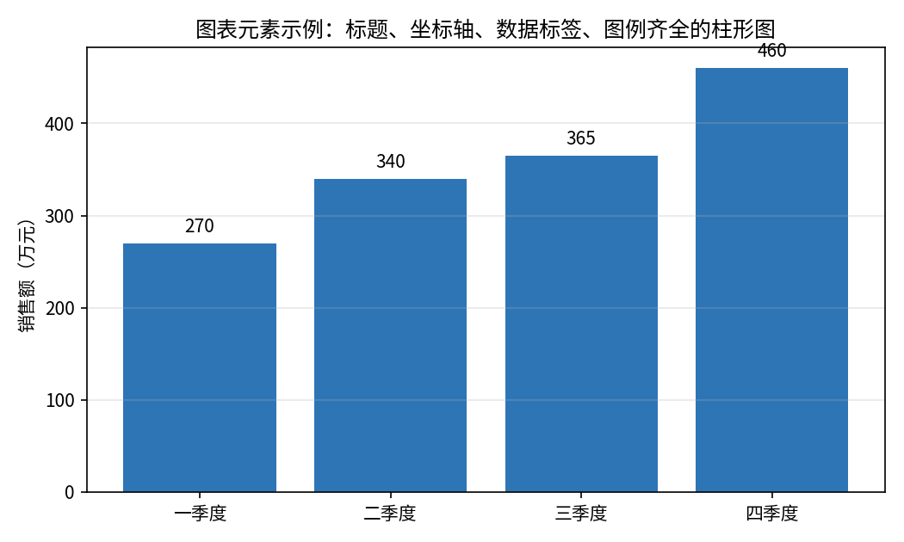
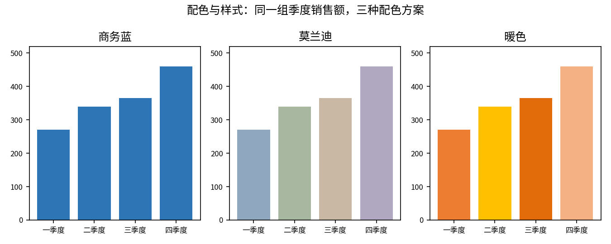
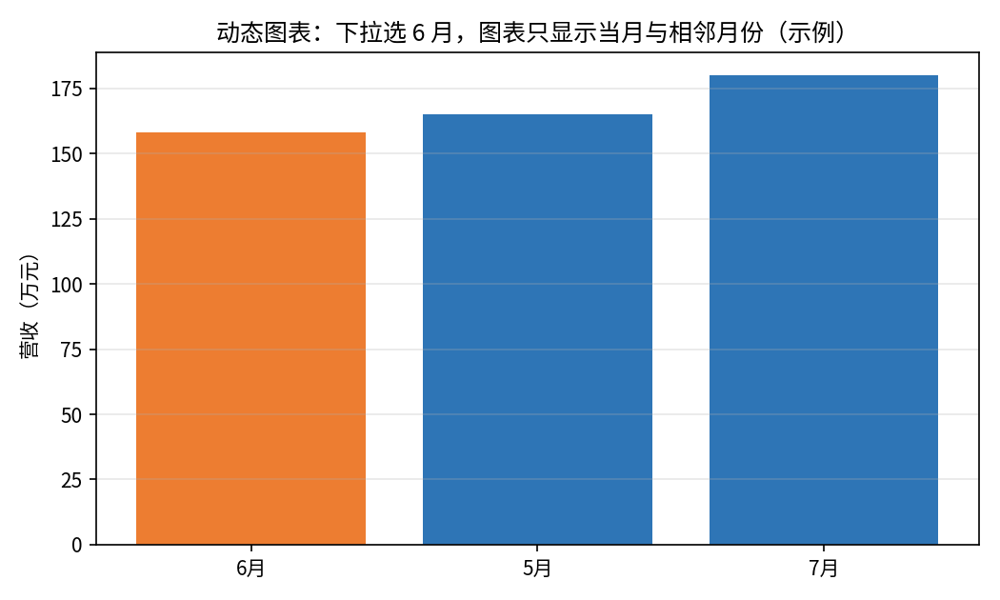

# 图表格式化

- **所属栏目**：C07 图表大全 / C07-L2-7 图表格式化与美化
- **适用版本**：Excel 2007 / 2010 / 2013 / 2016 / 2019 / 2021 / 365
- **难度**：进阶
- **预计阅读时长**：20 分钟
- **更新日期**：2026-11-10

## 学习目标

学完本篇，你将能够：

- 说出图表的九大元素，并按需要开关每一个元素
- 给图表选一套统一配色，全站同一系列保持同色
- 用数据验证加 INDEX 与 MATCH 做出下拉联动的动态图表
- 判断一张图里哪些元素是多余的，删掉它们而不丢信息

## 基础概念

**图表元素是零件**：标题、坐标轴、网格线、图例、数据标签、数据表、趋势线、误差线，一共九大元素。每个元素都可以开关。默认全开的图表最臃肿，好图表是做减法做出来的。

**配色是信息不是装饰**：颜色要用来区分系列或突出重点，不是用来好看。同一系列在全站所有图表里用同一个颜色，读者看一眼颜色就知道是哪个系列。

**动态图表是公式驱动的图**：动态图表的数据源不是固定区域，而是指向公式取数的区域。下拉菜单一变，公式取数跟着变，图表跟着变。图表本身不用重做。

## 图表元素

- **图表名称**：图表元素
- **英文名称**：Chart Elements
- **图表预览**：
- **适用场景**：检查与调整一张图表的全部零件，例如给季度销售额柱形图加上数据标签、删掉网格线、把标题改成结论句。
- **数据结构**：

| 季度 | 华东 | 华北 | 华南 | 合计 |
|---|---|---|---|---|
| 一季度 | 120 | 90 | 60 | 270 |
| 二季度 | 150 | 110 | 80 | 340 |
| 三季度 | 130 | 140 | 95 | 365 |
| 四季度 | 180 | 160 | 120 | 460 |

本节练习用表为季度销售额合计列：270、340、365、460 万元。

- **创建步骤**：

1. 用合计列做一张簇状柱形图。
2. 点图表右上角的加号，打开图表元素清单，逐项检查九大元素。
3. 勾选数据标签，让每根柱子顶上显示数值。
4. 取消勾选网格线，图表立刻干净一半。
5. 双击图表标题，改成结论句，例如“四季度合计 460 万元，全年最高”。

- **格式调整**：坐标轴标题只在单位不明时加，单位明确就不加；图例能删就删，系列名直接标在柱子或线条旁边；数据标签与网格线不要同时开，两个都开会糊成一片。
- **常见问题**：

| 问题 | 解答 |
|---|---|
| 图表元素清单在哪里？ | 点图表右上角的加号；或点图表工具设计选项卡里的添加图表元素。 |
| 标题应该写什么？ | 写结论句，不要写“销售额图表”这种描述句；好标题是“四季度合计最高”，不是“季度销售额”。 |
| 数据标签与图例哪个优先保留？ | 数据标签优先；标了数值就不用图例再解释一次，图例可以删掉。 |

- **版本兼容性**：全部版本均支持，兼容 Excel 2007 / 2010 / 2013 / 2016 / 2019 / 2021 / 365；图表元素加号按钮需 Excel 2013 及以上版本，更早版本在功能区里找添加图表元素。
- **示例工作簿**：[图表-示例-图表格式化.xlsx](../../templates/图表-示例-图表格式化.xlsx)

## 配色与样式

- **图表名称**：配色与样式
- **英文名称**：Color and Style
- **图表预览**：
- **适用场景**：给同一组数据换一套配色方案并对比效果，例如季度销售额分别用商务蓝、莫兰迪、暖色三套方案，看哪套最适合正式汇报。
- **数据结构**：

| 季度 | 华东 | 华北 | 华南 | 合计 |
|---|---|---|---|---|
| 一季度 | 120 | 90 | 60 | 270 |
| 二季度 | 150 | 110 | 80 | 340 |
| 三季度 | 130 | 140 | 95 | 365 |
| 四季度 | 180 | 160 | 120 | 460 |

配色方案参考：

| 配色方案 | 主色 | 适用场景 |
|---|---|---|
| 商务蓝 | #2E75B6 | 正式汇报、财务报告 |
| 莫兰迪 | #8FA8BF | 柔和、长时间阅读的报告 |
| 暖色 | #ED7D31 | 需要突出重点的演示 |

- **创建步骤**：

1. 用季度销售额合计列做一张簇状柱形图。
2. 点图表工具设计选项卡，点更改颜色，选一套内置配色。
3. 需要自定义时，右键系列，点设置数据系列格式，在填充里输入主色代码，例如商务蓝 #2E75B6。
4. 全站统一：华东永远用商务蓝，华北永远用橙色，华南永远用绿色。
5. 需要突出某一根柱子时，只把那根柱子改成橙色，其余保持商务蓝。

- **格式调整**：图表样式在设计选项卡里一键换，包括配色、字体与效果；颜色数量不要超过 5 种，超过 5 种读者就记不住了；柱形图纵轴从 0 开始，截断纵轴会夸大差异。
- **常见问题**：

| 问题 | 解答 |
|---|---|
| 配色有推荐方案吗？ | 正式汇报用商务蓝，长时间阅读用莫兰迪，需要突出重点用暖色；三套方案见上表。 |
| 颜色太多怎么办？ | 只留主色与强调色，其余系列用同色系深浅区分；不要给每个系列都配一个高饱和颜色。 |
| 图表样式改完还能还原吗？ | 能。设计选项卡里点图表样式，选回原来的样式；或按 Ctrl + Z 撤销。 |

- **版本兼容性**：全部版本均支持，兼容 Excel 2007 / 2010 / 2013 / 2016 / 2019 / 2021 / 365；一键换样式的图表样式库需 Excel 2013 及以上版本。
- **示例工作簿**：[图表-示例-图表格式化.xlsx](../../templates/图表-示例-图表格式化.xlsx)

## 动态图表

- **图表名称**：动态图表
- **英文名称**：Dynamic Chart
- **图表预览**：
- **适用场景**：下拉菜单联动图表，例如下拉选 6 月，图表只显示当月与相邻月份的营收；选 12 月，图表就切换到 12 月的数据，不用重做图表。
- **数据结构**：

| 月份 | 营收 |
|---|---|
| 1月 | 120 |
| 2月 | 135 |
| 3月 | 128 |
| 4月 | 150 |
| 5月 | 165 |
| 6月 | 158 |
| 7月 | 180 |
| 8月 | 195 |
| 9月 | 188 |
| 10月 | 210 |
| 11月 | 225 |
| 12月 | 240 |

动态图表取数示例：下拉选 6 月时，取数区域显示 5 月 165 万元、6 月 158 万元、7 月 180 万元，图表只画这三根柱子。

- **创建步骤**：

1. 用数据验证在单元格里做一个月份下拉菜单（1 月到 12 月）。
2. 用 INDEX 与 MATCH 按下拉选择取数：先 MATCH 找到月份所在行，再 INDEX 取出当月与相邻月份的营收。
3. 图表数据源指向取数区域，不要指向原始数据表。
4. 下拉选 6 月，检查图表是否只显示 5 月、6 月、7 月三根柱子。
5. 下拉换成 12 月，检查图表是否跟着切换。

- **格式调整**：取数区域单独放一张表或放在图表旁边，不要与原始数据混在一起；下拉菜单旁边写清楚“选月份”；动态图表的标题也可以用公式拼，例如 ="营收（" & 下拉单元格 & "）"，标题跟着下拉变。
- **常见问题**：

| 问题 | 解答 |
|---|---|
| 下拉变了，图表没变怎么办？ | 检查图表数据源是不是指向取数区域；指向原始数据表的图表永远不会动。 |
| INDEX 与 MATCH 不熟怎么办？ | 先用 VLOOKUP 代替 INDEX 与 MATCH，熟练后再换；取数逻辑一样。 |
| 新增月份后图表不更新怎么办？ | 用 OFFSET 做动态区域，或把原始数据转成超级表，新增数据自动进图。 |

- **版本兼容性**：数据验证、INDEX、MATCH 全部版本均支持，兼容 Excel 2007 / 2010 / 2013 / 2016 / 2019 / 2021 / 365。
- **示例工作簿**：[图表-示例-图表格式化.xlsx](../../templates/图表-示例-图表格式化.xlsx)

## 练习题

1. 用示例工作簿里的季度销售额表做一张柱形图，依次完成：加数据标签、删网格线、删图例、把标题改成结论句。做完后数一下图上还剩几个元素。
2. 把同一张图分别换成商务蓝、莫兰迪、暖色三套配色，哪套最适合正式汇报？为什么？把华东系列固定为商务蓝 #2E75B6，说明全站统一配色的好处。
3. 用 12 个月营收表做一个动态图表：数据验证做月份下拉，INDEX 与 MATCH 取当月与相邻月份，图表数据源指向取数区域。下拉选 6 月时图表应显示哪三个月、哪三个数值？

## 参考答案

1. 做完后图上剩标题、横轴、纵轴、数据标签四个元素。删掉的是网格线与图例：网格线删掉后读数靠数据标签，图例删掉后系列名由标题与标签说明，信息没有丢失。
2. 商务蓝最适合正式汇报：颜色稳重、对比清晰、打印后仍可读。莫兰迪偏柔和，适合长时间阅读的报告；暖色适合需要突出重点的演示。全站统一配色的好处是读者看一眼颜色就知道是哪个系列，不用每次重新对照图例。
3. 下拉选 6 月时图表显示 5 月 165 万元、6 月 158 万元、7 月 180 万元。取数方法是 MATCH 找到 6 月所在行，INDEX 取出该行与上下相邻行的营收。
