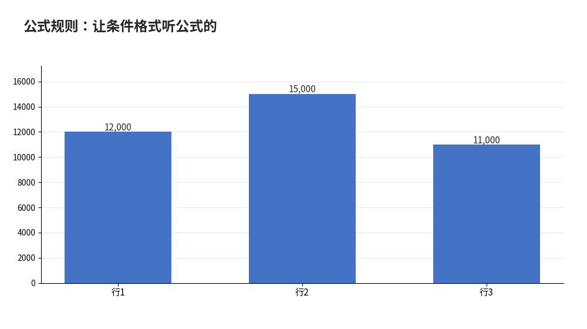

# 公式规则：让条件格式听公式的

- **所属栏目**：C06 条件格式 ／ C06-L2-2 公式规则
- **适用版本**：Excel 2016／2019／2021／365
- **难度**：进阶
- **预计阅读时长**：30 分钟
- **更新日期**：2026-11-10

## 1. 学习目标

学完本篇，你将能够：
- 用公式规则实现整行高亮、跨表条件与到期提醒
- 说出公式相对选中区域左上角写的含义，并正确使用 $ 锁定列与行
- 判断内置规则与公式规则分别适合什么场景

## 2. 基础概念

### 2.1 什么时候必须用公式规则

内置规则只能判断“这个单元格本身”的值：大于 10000、文本包含“紧急”、前 10 名。一旦判断条件涉及别的单元格、别的列、别的表，内置规则就做不了，必须用公式：

| 需求 | 内置规则 | 公式规则 |
|---|---|---|
| 金额大于 10000 的单元格变红 | 可以 | 可以 |
| 金额大于 10000 的**整行**变红 | 不可以（只管本格） | 可以 |
| 到期日已过且状态不是“已完成”才标红 | 不可以（两个条件跨列） | 可以 |
| 订单客户出现在另一张黑名单表里才标红 | 不可以（跨表） | 可以 |

经验法则：**条件只看本格用内置，条件要看别的格用公式**。

### 2.2 核心心法：公式是相对选中区域左上角写的

新建规则时，先选中要应用的区域（如 A2:D100），再写公式。公式里的单元格引用是**相对选中区域左上角**写的：公式里的 A2 指“当前正在判断的行的 A 列”，Excel 会把公式逐行（逐格）套用一遍。

`$` 的作用是锁定：

| 写法 | 含义 | 典型用途 |
|---|---|---|
| `=$C2>10000` | 列锁定、行不锁定 | 整行高亮：每行都看本行的 C 列 |
| `=C$2>10000` | 行锁定、列不锁定 | 整列判断：每列都看第 2 行 |
| `=$C$2>10000` | 行列都锁定 | 全区域只看 C2 一个格 |
| `=COUNTIF($A$2:$A$100,$A2)>1` | 查找范围绝对引用、当前行相对引用 | 整行标重复 |

最常见的错就是锁反了：整行高亮写成 `=$C$2>10000`，结果全区域只看 C2 一个格，要么全红要么全不红。

### 2.3 公式规则的求值：返回 TRUE 就上色

公式规则不关心公式算出什么数字，只关心**是 TRUE 还是 FALSE**：TRUE 就套格式，FALSE 就不套。所以公式最后一定要是一个判断（比较、AND、OR、COUNTIF>0），而不是一个数值。写完先在旁边空白列把公式原样贴出来，看着一列 TRUE/FALSE 都对了，再搬进规则里，这是最稳的调试办法。

## 3. 操作步骤

1. 选中要应用的区域（如 A2:D100），注意左上角是 A2，公式就按 A2 写。
2. “开始”→“条件格式”→“新建规则”→“使用公式确定要设置格式的单元格”。
3. 输入公式（相对选中区域左上角写，`$` 按 2.2 节锁定），如 `=$C2>10000`。
4. 点“格式”设颜色（填充、字体颜色、加粗），确定。
5. 回到“管理规则”检查“应用于”范围是不是整片区域（如 `=$A$2:$D$100`），范围只选了一个格是新手最常见的错。
6. 改动数据验证：改一个值，看颜色是否跟着变；不变就检查 `$` 锁定。

## 4. 图文示例

订单表 5 行：A 列订单号、B 列客户、C 列金额、D 列状态。金额：12000、8000、15000、9000、11000，合计 55000。

- 规则 `=$C2>10000`，应用范围 `=$A$2:$D$5`：命中 3 行（12000、15000、11000），其余 2 行不变。
- 把 8000 改成 13000：命中变成 4 行，颜色自动跟着变，不用重建规则。
- 只想标金额格本身而不是整行：应用范围改成 `=$C$2:$C$5`，公式不变，同样 3 格变色。



## 5. 公式和代码

### 5.1 整行高亮

选中 A2:D100，公式：

```excel
=$C2>10000 → C 列金额大于 10000 的行整行变红
```

`$C` 锁定列（每行都看 C 列），`2` 不锁定行（随行变化）。

### 5.2 标出重复值（整行）

```excel
=COUNTIF($A$2:$A$100, $A2)>1 → A 列出现 2 次以上的行整行标黄
```

查找范围要绝对引用 `$A$2:$A$100`；当前行 `$A2` 列锁定行不锁定。

### 5.3 隔行变色

```excel
=MOD(ROW(),2)=0 → 偶数行上色
```

ROW() 返回当前行号，隔行变色让大表格更易读。

### 5.4 到期分级提醒（已验算）

合同表 A 列合同名、B 列到期日。假设今天是 2026-11-10，三条规则从高到低建，并给前两条勾选“如果为真则停止”（见 03-规则管理）：

| 规则 | 公式 | 预期结果（今天 2026-11-10） |
|---|---|---|
| 已过期，深红加粗 | `=AND($B2<>"", $B2<TODAY())` | 合同甲到期 2026-11-08（已过 2 天），命中 |
| 7 天内到期，红色 | `=AND($B2<>"", $B2-TODAY()<=7)` | 合同乙到期 2026-11-13（剩 3 天），命中 |
| 30 天内到期，黄色 | `=AND($B2<>"", $B2-TODAY()<=30)` | 合同丙到期 2026-11-30（剩 20 天），命中；合同丁到期 2026-12-25（剩 45 天），不命中 |

验算：2026-11-13 减 2026-11-10 得 3 天；2026-11-30 减 2026-11-10 得 20 天；2026-12-25 减 2026-11-10 得 45 天；2026-11-08 比今天早 2 天。`$B2<>""` 的作用是空单元格不误报。

### 5.5 跨表条件

“黑名单”工作表 A2:A100 存着客户名；“订单”工作表 A 列是客户名。选中订单表 A2:D100，新建公式规则：

```excel
=COUNTIF(黑名单!$A$2:$A$100, $A2)>0
```

验算用订单 3 行：陈静（黑名单中有，COUNTIF = 1 > 0，高亮）、郑爽（黑名单中无，COUNTIF = 0，不高亮）、吴磊（黑名单中有，COUNTIF = 1 > 0，高亮）。要点：跨表引用要带工作表名加感叹号（`黑名单!`），查找范围用绝对引用；表名含空格时加单引号，如 `'黑名单表'!$A$2:$A$100`。

## 6. 实际工作场景

### 6.1 库存低于安全库存的行标黄

库存表 A 列产品、B 列库存、C 列安全库存：打印机 3/8、鼠标 25/10、键盘 6/8、显示器 15/8。选中 A2:C5，新建公式规则 `=$B2<$C2`，格式设黄底。验算：4 行中 2 行满足库存 < 安全库存（打印机 3 < 8、键盘 6 < 8），鼠标 25 ≥ 10 与显示器 15 ≥ 8 不高亮。库存改动后高亮自动跟着变，补货后数字一改，黄色自己消失。

### 6.2 考勤异常整行标红

人事每月收考勤表：A 姓名、B 日期、C 状态。选中 A2:C500，公式 `=$C2="缺勤"` 整行标红，再加一条 `=$C2="迟到"` 整行标黄。复核时只看有颜色的行，不用逐行扫状态列；下月新表直接格式刷刷过去，规则跟着走。

## 7. 常见错误

| 错误现象 | 原因 | 解决方案 |
|---|---|---|
| 公式规则没有任何单元格变色 | 公式是按选中区域左上角相对写的，引用锁错了 | 检查 `$` 锁定：整行高亮要锁列不锁行（如 `=$C2>10000`）；逐行判断的公式里行号不能带 `$` |
| 规则建好了，但只对第一个单元格生效 | 应用范围只选了一个格 | 在“管理规则”里把“应用于”改成整片区域（如 `=$A$2:$D$100`） |
| 公式返回的是数字而不是 TRUE/FALSE | 公式最后不是判断 | 公式末尾一定是比较或逻辑判断（如 `>10000`、`AND(...)`）；先在空白列贴出公式看 TRUE/FALSE 列 |
| 跨表条件公式报错 | 跨表引用缺工作表名，或表名含空格没加单引号 | 引用写成 `黑名单!$A$2:$A$100`；表名含空格时写成 `'黑名单表'!$A$2:$A$100` |
| 整列套复杂公式规则后表格变卡 | 规则应用到整列（如 A:A），每格都重算公式 | 把应用范围限定到具体区域（如 A2:A5000），不要用整列 |
| 复制粘贴后条件格式乱了 | 格式刷或粘贴把规则范围带偏了 | 粘贴后进“管理规则”检查“应用于”范围；跨表复制时复核 `$` 锁定对不对 |

## 8. 相关教程

- 同栏目：内置规则（docs/conditional-formatting/01-conditional-formatting.md，先分清内置规则与公式规则的适用场景）
- 同栏目：规则管理（docs/conditional-formatting/03-rule-management.md，多条公式规则的优先级与“如果为真则停止”）
- 跨栏目：数据验证（docs/data-management/04-data-validation.md，录入时拦截与事后标红配合用）
- 跨栏目：排序筛选（docs/data-management/01-sort-filter.md，按颜色筛选与排序）

## 9. 练习题

1. 要把金额大于 5000 的整行标红，应该用什么规则、公式怎么写？应用范围选哪里？
2. 选中 A2:D100 写公式 `=$C$2>10000`，结果会怎样？错在哪里？
3. 库存表里打印机库存 3、安全库存 8，鼠标库存 25、安全库存 10，公式 `=$B2<$C2` 会高亮哪几行？为什么？
4. 订单表的客户名在另一张“黑名单”表里出现时要整行标红，公式怎么写？跨表引用要注意什么？
5. 合同 2026-11-13 到期，假设今天是 2026-11-10，公式 `=AND($B2<>"", $B2-TODAY()<=7)` 会命中吗？算出剩余天数说明理由。

## 10. 参考答案

<details>
<summary>点击查看答案</summary>

1. 用公式规则，公式 `=$C2>5000`（C 列是金额，$ 锁列不锁行），应用范围选整表 A2:D100。

2. 全区域只看 C2 一个格：C2 大于 10000 则全红，否则全不红。错在行号带了 `$`，应写成 `=$C2>10000`。

3. 只高亮打印机一行。打印机 3 < 8 满足条件；鼠标 25 ≥ 10 不满足。`$B2` 锁列不锁行，每行都拿本行的 B 列和 C 列比。

4. 公式 `=COUNTIF(黑名单!$A$2:$A$100, $A2)>0`。跨表引用要带工作表名加感叹号，查找范围用绝对引用；表名含空格时加单引号。

5. 会命中。2026-11-13 减 2026-11-10 得 3 天，3 ≤ 7 且 B2 非空，两个条件都满足。

</details>
