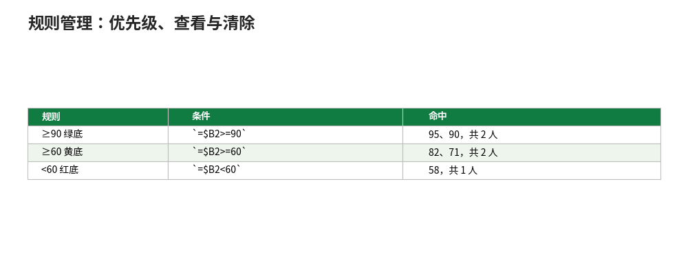

# 规则管理：优先级、查看与清除

- **所属栏目**：C06 条件格式 ／ C06-L2-3 规则管理
- **适用版本**：Excel 2016／2019／2021／365
- **难度**：入门
- **预计阅读时长**：20 分钟
- **更新日期**：2026-11-10

## 1. 学习目标

学完本篇，你将能够：
- 在“管理规则”里查看一表全部规则，并改顺序、改范围、改格式、删单条规则
- 用“如果为真则停止”做分级提醒，让高级别规则独占
- 按范围清除规则（所选单元格／工作表／工作簿），并说出只清规则不删数据的安全回退含义

## 2. 基础概念

### 2.1 一个单元格可以命中多条规则

条件格式的规则是叠加的：一张成绩表可以同时有“≥90 绿底”“≥60 黄底”“<60 红底”三条规则，也可以再叠一条“缺考灰底”。一个单元格同时命中多条时，Excel 按**规则列表的顺序**决定谁先生效：列表中靠上的优先。

### 2.2 “如果为真则停止”：分级提醒只取最高级

某条规则勾选“如果为真则停止”后，一旦命中就不再往下判断。适合“分级提醒只取最高级”的场景：已过期的合同只显示深红，不再叠加“30 天内到期”的黄色；否则深红黄底叠在一起，反而看不清哪级最紧急。

### 2.3 “管理规则”对话框：一表规则一览无余

入口：“开始”→“条件格式”→“管理规则”，左上角下拉选“当前工作表”，一张表上的全部规则一览无余。在这里可以：上移／下移改顺序、改“应用于”范围、双击改格式、点“删除规则”删单条。改范围时注意：范围写成 `=$A$2:$D$100` 这种带 `$` 的绝对引用，复制粘贴后范围带偏是常见故障源。

### 2.4 清除规则：只清规则不删数据

“条件格式”→“清除规则”，可清“所选单元格的规则”“整个工作表的规则”或“整个工作簿的规则”。清除是安全的回退操作：只删规则不删数据，格式恢复原样。想留数据、去颜色时用它，不要手动一个格一个格改回白色。

## 3. 操作步骤

1. 查看全部规则：“条件格式”→“管理规则”，左上角下拉选“当前工作表”。
2. 调整优先级：选中一条规则，点“上移”／“下移”，高级别规则放上面。
3. 分级提醒：给高级别规则勾选“如果为真则停止”，命中后不再往下判断。
4. 改应用范围：双击规则，在“应用于”里改成整片区域（如 `=$A$2:$D$100`）。
5. 删单条规则：选中规则点“删除规则”，只删这一条，不影响其他规则。
6. 清除规则：“条件格式”→“清除规则”，按范围选“所选单元格”“整个工作表”或“整个工作簿”。

## 4. 图文示例

成绩表 5 人：95、82、58、71、90。三条规则从高到低建，前两条勾选“如果为真则停止”：

| 规则 | 条件 | 命中 |
|---|---|---|
| ≥90 绿底 | `=$B2>=90` | 95、90，共 2 人 |
| ≥60 黄底 | `=$B2>=60` | 82、71，共 2 人 |
| <60 红底 | `=$B2<60` | 58，共 1 人 |

验算：5 人中绿 2、黄 2、红 1，合计 5 人，与人数一致。如果不勾选“如果为真则停止”，95 分会同时命中绿与黄两条，列表顺序决定最终颜色，规则一多就容易乱。



## 5. 公式和代码

管理规则时常用的三条公式（配合 02-公式规则篇的写法）：

```excel
=$B2>=90 → 成绩 90 分以上绿底（高级别，放最上）
=$B2>=60 → 成绩 60 分以上黄底（中级别）
=$B2<60 → 成绩 60 分以下红底（低级别）
```

三条从高到低排列，前两条勾选“如果为真则停止”。应用范围三条都写 `=$A$2:$B$6`，保证同一片区域。

想查某条规则实际应用到哪里：在“管理规则”里看“应用于”列，范围带偏时直接在这里改，不要去重建规则。

## 6. 实际工作场景

### 6.1 月度榜单分级：只取最高级

销售月榜三档：冠军金色、Top 10 银色、其余无色。规则从高到低建，冠军规则勾选“如果为真则停止”，冠军只显示金色，不再叠加 Top 10 的银色。榜单每月重排：改名次数字，颜色自动跟着走，不用每月重建规则。

### 6.2 考勤三色：缺勤、迟到、正常

考勤表 C 列状态三条规则：`=$C2="缺勤"` 红色、`=$C2="迟到"` 黄色，正常无规则。每月新表直接格式刷刷过去，规则跟着走；复核时只看有颜色的行。月底想清掉颜色交表：选中全表→“清除规则”→“所选单元格的规则”，数据原样保留。

## 7. 常见错误

| 错误现象 | 原因 | 解决方案 |
|---|---|---|
| 两条规则同时命中，颜色和预期不一样 | 列表中靠上的规则优先，低级别盖住了高级别 | 在“管理规则”里把高级别规则移到上面；分级提醒给高级别勾选“如果为真则停止” |
| 规则建好了，但只对第一个单元格生效 | 应用范围只选了一个格 | 在“管理规则”里把“应用于”改成整片区域（如 `=$A$2:$D$100`） |
| 复制粘贴后条件格式乱了 | 格式刷或粘贴把规则范围带偏了 | 粘贴后进“管理规则”检查“应用于”范围；跨表复制时复核 `$` 锁定对不对 |
| 删了一条规则，其他规则的颜色也变了 | 被删的规则原本挡住了下面的规则 | 删规则前先看列表顺序：删高级别规则后，低级别规则会接管，原本被挡的颜色会露出来 |
| 清除规则后想恢复 | 清除操作不可撤销（除非马上按 Ctrl+Z） | 清除前先确认范围选的是“所选单元格”还是“整个工作表”；重要表的规则先截图留档 |
| 表越用越卡 | 规则应用到整列（如 A:A），或规则越积越多 | 把应用范围限定到具体区域；定期进“管理规则”删掉废弃规则 |

## 8. 相关教程

- 同栏目：内置规则（docs/conditional-formatting/01-conditional-formatting.md，五种内置规则的建立方法）
- 同栏目：公式规则（docs/conditional-formatting/02-formula-rules.md，公式规则的写法与 `$` 锁定）
- 跨栏目：排序筛选（docs/data-management/01-sort-filter.md，按颜色筛选与排序）
- 跨栏目：超级表（docs/formatting/05-tables.md，新增行自动继承条件格式）

## 9. 练习题

1. 两个规则同时命中一个单元格，谁先生效？想让高级别规则独占，要勾选什么？
2. 一张表上有 5 条规则，想一眼看全并改顺序，去哪里？
3. 成绩 95、82、58、71、90，用“≥90 绿、≥60 黄、<60 红”三条规则（前两条勾选“如果为真则停止”），各有几人命中？
4. 只想清掉所选单元格的条件格式、保留数据，点哪里？清掉后数据还在吗？

## 10. 参考答案

<details>
<summary>点击查看答案</summary>

1. 规则列表中靠上的优先。想让高级别独占，给高级别规则勾选“如果为真则停止”，命中后不再往下判断。

2. “条件格式”→“管理规则”，左上角下拉选“当前工作表”，一张表上的全部规则一览无余，可上移／下移改顺序。

3. 绿 2 人（95、90）、黄 2 人（82、71）、红 1 人（58），合计 5 人。

4. “条件格式”→“清除规则”→“所选单元格的规则”。数据还在，清除只删规则不删数据，是安全的回退操作。

</details>
