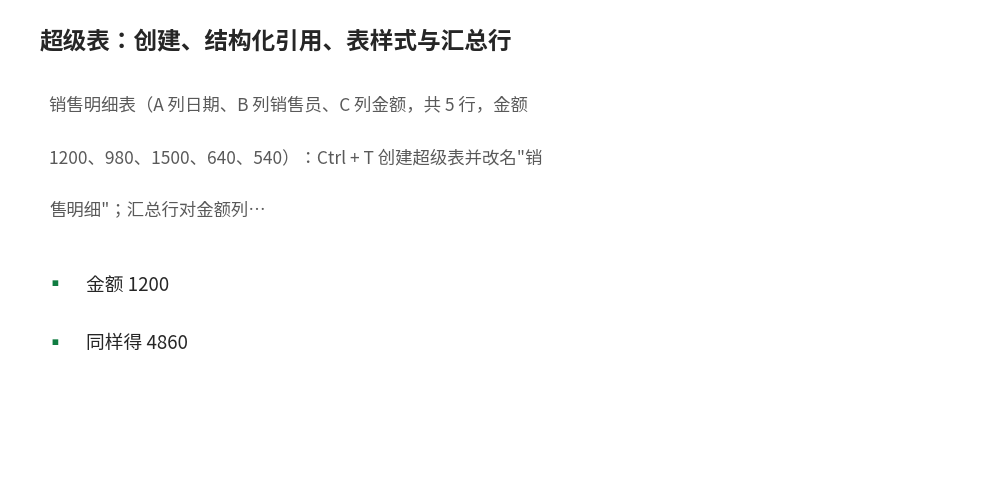

# 超级表：创建、结构化引用、表样式与汇总行

- **所属栏目**：C02 单元格与表格格式 ／ C02-L2-5 超级表（结构化表格）
- **适用版本**：Excel 2016／2019／2021／365
- **难度**：进阶
- **预计阅读时长**：20 分钟
- **更新日期**：2026-11-09

## 1. 学习目标

学完本篇，你将能够：
- 用 Ctrl + T 把普通区域转成超级表，并给表起一个有意义的名字
- 读懂并写出结构化引用（如 表1[金额]、表1[[#汇总],[金额]]）
- 用汇总行一键求和、计数、求平均，并用切片器筛选超级表
- 知道超级表新增行时公式与格式自动扩展，替代手工拖公式

## 2. 基础概念

**超级表（结构化表格）**：`Ctrl + T` 创建的带格式、带筛选、带结构化引用的智能表格。它与普通区域的根本区别是"表知道自己的边界"：新增一行，格式、公式、汇总行自动扩展；删除一行，引用自动收缩。

**结构化引用**：超级表里的公式不用 `B2:B6` 这种地址，改用表名加列名，如 `=SUM(表1[金额])`。好处是公式自带语义（"对表 1 的金额列求和"），新增行后引用范围自动扩大，不用改公式；跨表引用时也不怕插行错位。

**表样式与汇总行**：表设计选项卡可换样式、开关筛选按钮、开关首行/末行、开汇总行。汇总行在表底加一行，每列可下拉选求和、计数、平均值、最大值等，一键出合计，不用手写公式。

**表名管理**：表名默认是"表1"、"表2"，应在表设计选项卡改成有意义的名字（如"销售明细"），结构化引用才可读。表名不能与单元格地址重名（如不能叫 A1），不能含空格。

**与数据管理的分工**：超级表本身归属本栏目（C02-L2-5）；数据管理栏目（C05-L2-3）只做交叉引用，不重复建内容。排序筛选、数据清洗在超级表上操作与普通区域一致，但体验更好（筛选箭头常驻、新增行自动纳入）。

## 3. 操作步骤

1. 创建：点数据区内任一格，按 `Ctrl + T`，确认"表包含标题"已勾选，点确定；或插入→表格。
2. 改名：选中表内任一格，表设计→表名称，改成"销售明细"这类有意义的名字。
3. 写结构化引用：在汇总格输入 `=SUM(销售明细[金额])`，输入表名后按 `[` 会自动提示列名，Tab 选中。
4. 开汇总行：表设计→勾选"汇总行"，表底出现一行，每列点下拉选求和/计数/平均值。
5. 换样式：表设计→表样式，选一个样式；勾选"镶边行"得隔行变色，勾选"首行"加粗表头。
6. 转回普通区域：表设计→转换为区域（结构化引用会变成普通地址引用，汇总行保留为数值行，需确认）。

## 4. 图文示例

销售明细表（A 列日期、B 列销售员、C 列金额，共 5 行，金额 1200、980、1500、640、540）：`Ctrl + T` 创建超级表并改名"销售明细"；汇总行对金额列选"求和"得 4860；旁边写 `=SUM(销售明细[金额])` 同样得 4860，两处互相核对；新增一行（张三、11 月 9 日、700），汇总行与结构化引用自动变成 5560，不用改任何公式。



## 5. 公式和代码

```excel
=SUM(销售明细[金额]) → 4860
=AVERAGE(销售明细[金额]) → 972
=COUNTIF(销售明细[销售员],"张三") → 2
```

- `=SUM(销售明细[金额])` → 4860：结构化引用求和：1200+980+1500+640+540=4860；新增行后自动纳入
- `=AVERAGE(销售明细[金额])` → 972：4860÷5=972，金额列平均值
- `=COUNTIF(销售明细[销售员],"张三")` → 2：示例中张三出现 2 次；结构化引用同样适用于 COUNTIF 等条件函数

## 6. 实际工作场景

### 每天追加的销售流水

流水每天新增几十行：做成超级表后，汇总行的合计与旁边的结构化引用公式自动包含新行，透视表的数据源设为表名后刷新即含新数据。普通区域每次都要改引用范围，迟早漏一次。

### 多人协作的台账

表名即文档：公式里写 `销售明细[金额]`，接手的人不用猜 B 列是什么。表头重命名后公式里的列名自动跟着改，不会断链。

## 7. 常见错误

| 错误现象 | 原因 | 解决方案 |
|---|---|---|
| 结构化引用公式报错 #NAME? | 表名含空格或与单元格地址重名 | 表名用无空格的名字（如"销售明细"不要用"销售 明细"），不要叫 A1、R1C1 这类地址 |
| 新增行后公式没跟上 | 新增的行不在表内（空了一行再写） | 紧贴表底最后一行新增，或直接在汇总行上方插入行；空行会断开表的扩展 |
| 汇总行求和结果不对 | 金额列混入了文本型数字 | 文本数字不参与求和：先分列或乘 1 转数值，再看汇总行 |
| 想取消超级表但公式全断了 | 直接删表或清格式 | 用表设计→转换为区域，结构化引用会转回普通地址，公式不断 |

## 8. 相关教程

- 上一篇：样式与主题（docs/formatting/04-styles-themes.md）
- 跨栏目：排序筛选（docs/data-management/01-sort-filter.md）
- 跨栏目：数据管理·超级表应用（docs/data-management/03-tables-ref.md，交叉引用）

## 9. 练习题

1. 金额列 1200、980、1500、640、540，用结构化引用写求和与求平均公式，结果各是多少？新增一行 700 后求和变多少？
2. 超级表与普通区域的根本区别是什么？说出两点。
3. 表名为什么不能叫 A1、不能含空格？

## 10. 参考答案

<details>
<summary>点击查看答案</summary>

1. 求和 `=SUM(销售明细[金额])` → 4860；平均 `=AVERAGE(销售明细[金额])` → 972。新增 700 后求和自动变 5560（4860+700）。

2. 表知道自己的边界：新增行格式与公式自动扩展；引用用结构化引用（表名+列名），新增行自动纳入。

3. A1 会与单元格地址冲突，Excel 无法区分；空格会让结构化引用解析失败。改名用无空格的有意义名字。

</details>
