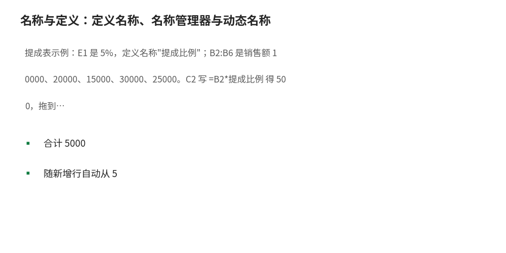

# 名称与定义：定义名称、名称管理器与动态名称

- **所属栏目**：C03 公式基础与高级公式 ／ C03-L2-3 名称与定义
- **适用版本**：Excel 2016／2019／2021／365
- **难度**：进阶
- **预计阅读时长**：15 分钟
- **更新日期**：2026-11-09

## 1. 学习目标

学完本篇，你将能够：
- 给单元格与区域定义名称，并在公式里用名称代替地址
- 用名称管理器查看、编辑与删除已定义名称
- 用 OFFSET 或 INDEX 定义动态名称，让引用范围随数据增减自动扩展
- 判断名称与直接引用的适用边界：什么时候用名称、什么时候不用

## 2. 基础概念

**名称**：给单元格或区域起一个名字，如把 E1 命名为"提成比例"，公式写 `=B2*提成比例`，比 `=B2*$E$1` 好读得多。名称是工作簿级的：全工作簿任何一张表都能用同一个名称。

**定义名称**：选中单元格或区域，公式→定义名称，输入名字、确认引用范围。命名规则：不能与单元格地址重名（如 A1、B2），不能含空格（用下划线代替），不能以数字开头。名字里用"税率"、"提成比例"这类业务词，公式立刻自带文档。

**名称管理器**：公式→名称管理器，列出全部名称：名字、引用位置、范围。改引用、改名字、删名称都在这里；名称引用错了（如指向了被删的表）会在这里显示 `#REF!`，是排查断链的第一站。

**名称框快捷定义**：选中区域后点左上角名称框，直接输入名字回车，即完成定义——比打开对话框更快。输入已定义名称回车，可瞬间跳转到该区域。

**动态名称**：引用范围会自己变长的名称。经典写法是用 OFFSET：`=OFFSET($A$2,0,0,COUNTA($A:$A)-1,1)`，表示"从 A2 开始、高度等于 A 列非空数减 1"，A 列新增一行，名称范围自动加一行。更稳妥的写法是用 INDEX：`= $A$2:INDEX($A:$A,COUNTA($A:$A))`，INDEX 是非易失性函数，不会每次重算全表。

**适用边界**：参数格（税率、比例、单价）、反复引用的关键区域适合定义名称；一次性引用、局部小范围没必要命名。名称太多会增加维护成本，名称管理器里超过 20 个就要定期清理。

## 3. 操作步骤

1. 定义名称：选中 E1（提成比例 5%），公式→定义名称，名字填"提成比例"，点确定；或点名称框输入"提成比例"回车。
2. 在公式里用名称：C2 输入 `=B2*提成比例`，回车得 500；拖填充柄，全表通用。
3. 查看与管理：公式→名称管理器，看名称列表；点某名称可改引用范围；点删除可删名称（删前确认没有公式在用它）。
4. 定义动态名称：公式→定义名称，名字填"销售数据"，引用位置输入 `=$A$2:INDEX($A:$A,COUNTA($A:$A))`，点确定。
5. 验证动态范围：在名称框输入"销售数据"回车，看选中区域是否随 A 列增减自动变化；新增一行后重进名称框再验证一次。
6. 公式里用动态名称：`=SUM(销售数据)`，A 列新增数据后求和自动包含新行，不用改公式。

## 4. 图文示例

提成表示例：E1 是 5%，定义名称"提成比例"；B2:B6 是销售额 10000、20000、15000、30000、25000。C2 写 `=B2*提成比例` 得 500，拖到 C6 得 1000、750、1500、1250，合计 5000。A 列销售数据定义动态名称"销售数据"后，`=COUNTA(销售数据)` 随新增行自动从 5 变 6。



## 5. 公式和代码

```excel
=B2*提成比例 → 500（B2=10000，提成比例=5% 时）
=SUM(销售数据) → 随 A 列增减自动变化
=COUNTA(销售数据) → 5（A 列 5 条数据时）
```

- `=B2*提成比例` → 500：名称代替地址：10000×0.05=500，公式自带业务语义
- `=SUM(销售数据)` → 随 A 列增减自动变化：动态名称求和：A 列新增一行，求和范围自动扩大
- `=COUNTA(销售数据)` → 5：动态名称计数：A2:A6 共 5 条，新增一行后变 6

## 6. 实际工作场景

### 给领导看的测算模型

税率、折扣、汇率三个参数格各定义名称，公式里全用名称。领导问"税率改成 13% 会怎样"，只改参数格，全模型联动；公式本身不用解释，名称就是注释。

### 每天追加的流水表

流水列定义动态名称，透视表与图表的数据源引用该名称。每天追加行后刷新即含新数据，不用每月改一次数据源范围。

## 7. 常见错误

| 错误现象 | 原因 | 解决方案 |
|---|---|---|
| 名称在公式里报 #NAME? | 名称含空格、与地址重名，或定义在别的工作簿 | 名称不用空格、不用 A1 这类地址名；跨工作簿名称要带工作簿名引用 |
| 动态名称范围没变 | COUNTA 数错了：A 列有标题行或空行 | 公式里减去标题行（COUNTA-1）；A 列中间不要留空行 |
| 删了名称公式全报错 | 公式还在引用已删的名称 | 先在名称管理器看引用，再删；或用查找替换把名称批量换回地址 |
| OFFSET 动态名称让表变卡 | OFFSET 是易失性函数，任何改动都触发重算 | 改用 INDEX 写法定义动态名称，非易失性，不拖慢全表 |

## 8. 相关教程

- 上一篇：引用方式（docs/formulas/02-references.md）
- 下一篇：数组公式与动态数组（docs/formulas/04-array-formulas.md）
- 跨栏目：LET 函数（docs/functions/04-logical.md）、超级表结构化引用（docs/formatting/05-tables.md）

## 9. 练习题

1. E1 是 5% 已定义名称"提成比例"，B2=10000，写公式算提成并给出结果；如果把名称删了，公式会怎样？
2. A 列有标题行 A1 与 5 条数据 A2:A6，用 INDEX 写动态名称"销售数据"的引用位置，并说明 COUNTA 要不要减 1。
3. 名称不能怎么起？说出两条命名规则。

## 10. 参考答案

<details>
<summary>点击查看答案</summary>

1. 公式 `=B2*提成比例` → 500。删名称后公式报 #NAME?，因为引用不到定义。

2. 引用位置 `=$A$2:INDEX($A:$A,COUNTA($A:$A))`。A 列非空数是 6（含标题），INDEX 行号取 6 即 A6；从 A2 开始共 5 行，不用减 1——因为起始行已是 A2。

3. 不能与单元格地址重名（如 A1）；不能含空格；不能以数字开头。

</details>
