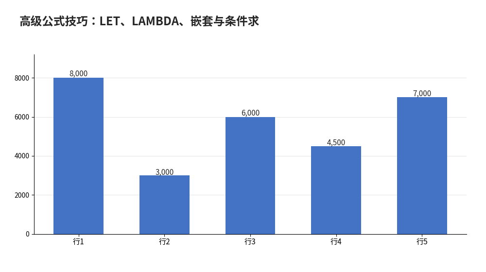

# 高级公式技巧：LET、LAMBDA、嵌套与条件求和进阶

- **所属栏目**：C03 公式基础与高级公式 ／ C03-L2-6 高级公式技巧
- **适用版本**：LET：Excel 2021／365；LAMBDA：Microsoft 365 专属；其余技巧全版本
- **难度**：高级
- **预计阅读时长**：25 分钟
- **更新日期**：2026-11-09

## 1. 学习目标

学完本篇，你将能够：
- 用 LET 给中间结果起名字，让长公式可读、可维护
- 用 LAMBDA 定义自己的函数，并在公式里调用它
- 用 SUMPRODUCT 实现多条件求和与计数，替代辅助列
- 用文本拼接公式批量生成带变量的句子与编号

## 2. 基础概念

**LET（2021／365）**：`LET(名字1, 值1, 名字2, 值2, 计算式)`，先定义、后计算。长公式里同一个子表达式出现多次时，用 LET 只算一次、起个名字，后面直接用名字。公式变短、变快、变好读。示例：`=LET(单价,B2,数量,C2,单价*数量)`。

**LAMBDA（365 专属）**：`LAMBDA(参数, 计算式)`，定义一个自己的函数。` =LAMBDA(x, x*2)(5)` 返回 10。更实用的用法是先在名称管理器里把 LAMBDA 存成名称（如"税额"），以后全表像用内置函数一样调用 `=税额(10000)`。LAMBDA 配合 MAP、BYROW 等函数可对整列逐行计算，是 365 的高阶玩法。

**嵌套的度**：IF 嵌套超过 3 层就难读难维护，优先换 IFS（2019／365）、SWITCH（2019／365）或 VLOOKUP/XLOOKUP 查表。嵌套不是炫技，少一层是一层。

**SUMPRODUCT 多条件求和**：`=SUMPRODUCT((条件1)*(条件2)*求和区域)`，不用辅助列、不用数组三键。原理：条件相乘得 0/1 掩码，只有全满足的行是 1，再与求和区域相乘后加总。它是 SUMIFS 出现之前的通用解法，条件更灵活（可做或条件、可做不等式）。

**文本拼接公式**：`&` 与 TEXT 函数配合可批量生成句子，如 `=A2&"本月销售额"&TEXT(B2,"#,##0")&"元"` 生成"张三本月销售额12,000元"。TEXT 的第二个参数是格式代码，与数字格式篇的自定义格式代码同一套写法。

**版本红线**：LET 是 2021／365，LAMBDA 是 365 专属——写进模板前确认对方版本；旧版用户用辅助列＋普通公式实现同样结果，不要硬上新函数。

## 3. 操作步骤

1. LET 入门：在 D2 输入 `=LET(单价,B2,数量,C2,单价*数量)`，回车得结果；再把公式里重复出现的子表达式抽成 LET 变量。
2. LAMBDA 入门：在任意格输入 `=LAMBDA(x, x*1.13)(10000)` 验证返回 11300；再到名称管理器新建名称"含税价"，引用位置填 `=LAMBDA(x, x*1.13)`，以后用 `=含税价(10000)` 调用。
3. SUMPRODUCT 多条件求和：`=SUMPRODUCT((A2:A100="销售部")*(B2:B100>5000)*C2:C100)`，求销售部且金额大于 5000 的合计。
4. 文本拼接：`=A2&"本月销售额"&TEXT(B2,"#,##0")&"元"`，拖填充柄批量生成句子；TEXT 的格式代码控制千分位。
5. 嵌套改查表：把三层 IF 嵌套换成 IFS 或 VLOOKUP 查表，公式短一半；改完用公式求值逐项核对边界值。
6. 版本检查：公式用到 LET/LAMBDA 前，先确认文件使用者的版本；模板发给旧版用户时换成辅助列写法。

## 4. 图文示例

销售表示例：A 列部门（销售部、市场部、销售部、销售部、市场部），B 列金额（8000、3000、6000、4500、7000），C 列数量（2、1、3、1、2）。多条件求和 `=SUMPRODUCT((A2:A6="销售部")*(B2:B6>5000)*B2:B6)`：销售部且金额>5000 的是 8000 与 6000，和为 14000。LET 写法：`=LET(单价,120,数量,3,单价*数量)` → 360。LAMBDA：`=LAMBDA(x,x*1.13)(10000)` → 11300（含税价，10000×1.13）。



## 5. 公式和代码

```excel
=SUMPRODUCT((A2:A6="销售部")*(B2:B6>5000)*B2:B6) → 14000
=LET(单价,120,数量,3,单价*数量) → 360
=LAMBDA(x,x*1.13)(10000) → 11300
=A2&"本月销售额"&TEXT(B2,"#,##0")&"元" → 张三本月销售额12,000元（A2=张三，B2=12000 时）
```

- `=SUMPRODUCT((A2:A6="销售部")*(B2:B6>5000)*B2:B6)` → 14000：销售部且金额>5000 的是 8000 与 6000，和为 14000；4500 不满足>5000 被排除
- `=LET(单价,120,数量,3,单价*数量)` → 360：LET 定义两个变量后计算：120×3=360；2021／365 可用
- `=LAMBDA(x,x*1.13)(10000)` → 11300：LAMBDA 含税价：10000×1.13=11300；365 专属
- `=A2&"本月销售额"&TEXT(B2,"#,##0")&"元"` → 张三本月销售额12,000元：文本拼接：TEXT 的 #,##0 格式代码给 12000 加千分位

## 6. 实际工作场景

### 提成规则三档变五档

原来 IF 嵌套三层算提成，规则变五档后嵌套到五层没法看。改成 VLOOKUP 查提成率表（区间+比率），规则再变只改表不改公式；或用 IFS（2019／365）扁平化。

### 每月自动生成催款函抬头

客户名、欠款金额在 A、B 列，C 列用拼接公式批量生成"尊敬的张三：您尚有欠款 12,000 元，请于本月 30 日前结清。"TEXT 控格式、& 拼句子，一列公式生成全月函件。

## 7. 常见错误

| 错误现象 | 原因 | 解决方案 |
|---|---|---|
| LET/LAMBDA 在旧版报 #NAME? | 对方是 2019 或更早版本 | LET 需 2021／365，LAMBDA 需 365 专属；旧版用辅助列＋普通公式替代 |
| SUMPRODUCT 结果偏大 | 条件区域与求和区域行数不一致 | 三个区域必须同高同起止行（如都是 A2:A6）；行数错一位结果全错 |
| LAMBDA 存成名称后调用失败 | 名称管理器里引用位置没加等号或参数不匹配 | 引用位置填 =LAMBDA(x, x*1.13)，调用时参数个数与定义一致 |
| IF 嵌套到五层还继续加 | 嵌套层数失控 | 三层以上换 IFS、SWITCH 或 VLOOKUP 查表；嵌套不是炫技 |

## 8. 相关教程

- 上一篇：公式审核与调试（docs/formulas/05-auditing.md）
- 跨栏目：LET 函数（docs/functions/04-logical.md）、SUMPRODUCT（docs/functions/01-math.md）
- 跨栏目：数组公式与动态数组（docs/formulas/04-array-formulas.md）

## 9. 练习题

1. A2:A6 部门是销售部、市场部、销售部、销售部、市场部，B2:B6 金额是 8000、3000、6000、4500、7000。用 SUMPRODUCT 求销售部且金额>5000 的合计，结果是多少？哪两行被算进去了？
2. =LET(单价,120,数量,3,单价*数量) 的结果是多少？LET 有什么好处？
3. =LAMBDA(x,x*1.13)(10000) 的结果是多少？这个函数能在 Excel 2019 上用吗？

## 10. 参考答案

<details>
<summary>点击查看答案</summary>

1. 结果 14000，算进去的是 8000 与 6000 两行（都是销售部且>5000）；4500 是销售部但不大于 5000，被排除。

2. 结果 360。好处：子表达式只写一次、起名字后可读，公式变短且不易错。

3. 结果 11300。不能，LAMBDA 是 365 专属，2019 会报 #NAME?。

</details>

## 11. 可下载示例文件

- [数据-函数练习题.xlsx](../../templates/数据-函数练习题.xlsx)
