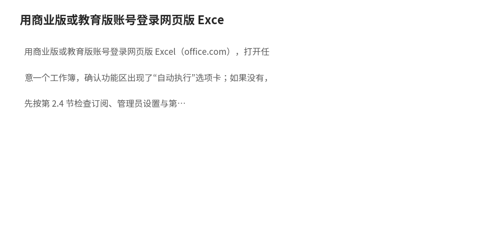
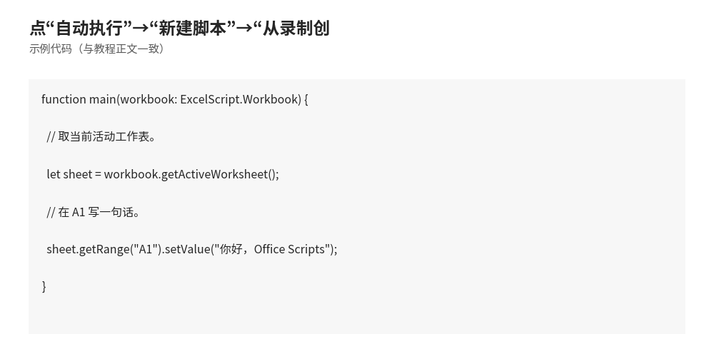
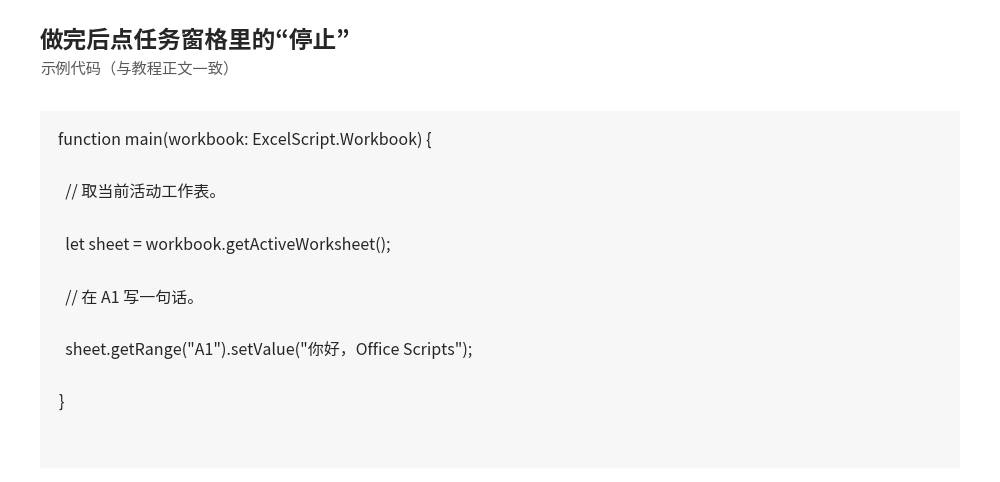
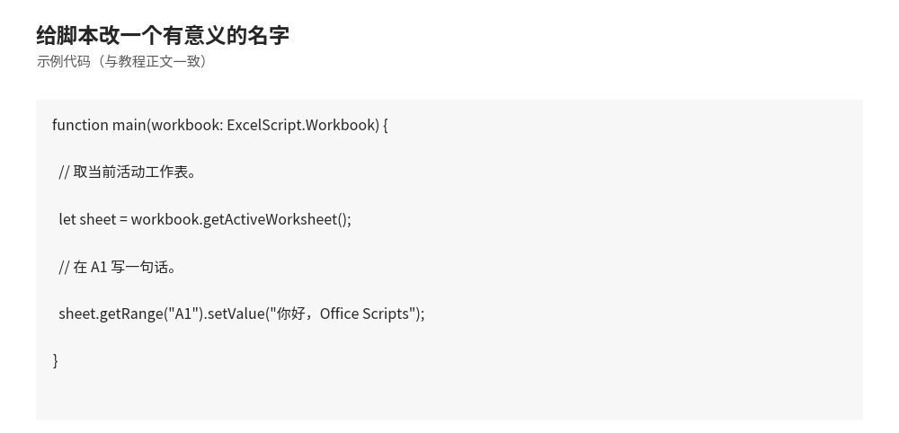
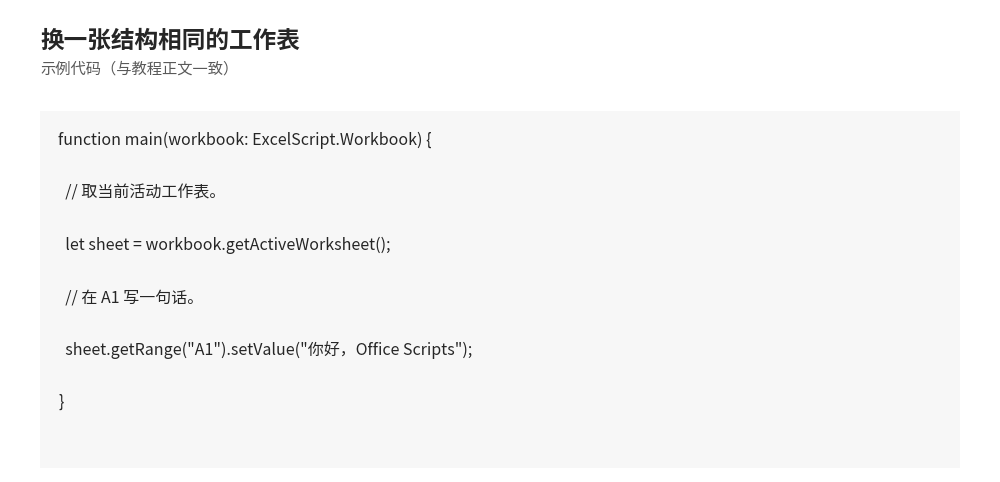
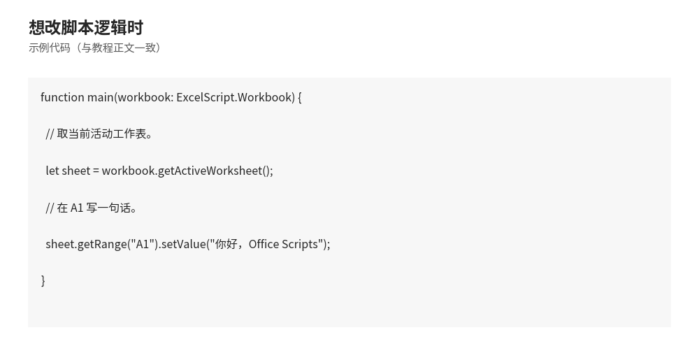
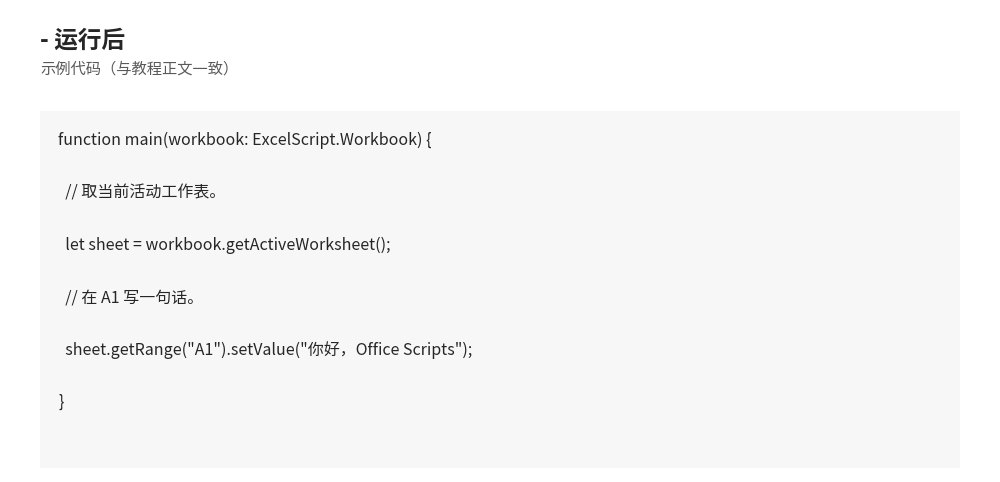

# Office Scripts 入门：不用 VBA 也能让 Excel 自己干活

- **所属栏目**：C12 Office Scripts ／ C12-L2-1 入门
- **适用版本**：Microsoft 365 商业版／教育版（网页版 Excel、Excel for Windows 2210 及更高版本、Excel for Mac）；个人版与家庭版不包含此功能
- **难度**：入门
- **预计阅读时长**：30 分钟
- **更新日期**：2026-11-10

> 验证方式说明：本篇所有 Office Scripts 代码均未在 Excel 网页版内执行验证。验证口径为两层：API 名称与可用性前提对照 Microsoft 官方文档核对（learn.microsoft.com 的 Office Scripts 平台要求与 API 参考），代码经去类型注解后的语法检查与括号配对检查。本篇正文与全站均不使用声称代码已在 Excel 内实际跑通过的表述；每段代码配的是预期效果说明，不是实测运行结果。

## 1. 学习目标

学完本篇，你将能够：
- 用一句话说出 Office Scripts 是什么，以及它与 VBA 的根本区别
- 对照一张表，说出在什么情况下该用 Office Scripts、什么情况下该用 VBA
- 判断自己的账号与 Excel 版本能不能用 Office Scripts，并说出看不到“自动执行”选项卡时的三类原因
- 说出 Office Scripts 的三类适用场景（网页版 Excel、跨平台、与 Power Automate 联动），并各举一个例子
- 在网页版 Excel 里找到“自动执行”选项卡，录制并运行自己的第一段脚本

## 2. 基础概念

### 2.1 Office Scripts 是什么

Office Scripts 是 Excel 里的一套自动化功能：把一串重复操作写成脚本（Script），以后点一下运行，Excel 就按脚本把这些操作自动做完。它用 TypeScript 写代码，脚本存在云端（OneDrive for Business 或 SharePoint），运行也在云端完成。

一句话定位：Office Scripts 是“云端版的 Excel 宏”，面向的是网页版 Excel 和跨平台办公；VBA 是“桌面版的 Excel 宏”，面向的是 Windows 桌面版 Excel。

### 2.2 它由哪几部分组成

- **操作记录器（Action Recorder）**：不用写代码，把手动操作录下来，Excel 自动生成一段 TypeScript 脚本。适合“动作固定、每周都要做一次”的任务。
- **代码编辑器（Code Editor）**：在浏览器里直接写 TypeScript，可以加判断、循环和参数。适合录制做不到的任务，例如“只处理金额大于 10000 的行”。
- **自动执行（Automate）选项卡**：网页版 Excel 功能区里的入口，所有脚本的新建、查看、运行都从这里开始。
- **Power Automate 联动**：脚本本身没有定时器和邮件触发器，这些由 Power Automate 提供。流程触发后调用脚本，脚本负责改工作簿（详见 03 篇）。

### 2.3 与 VBA 的区别

| 对比维度 | Office Scripts | VBA |
|---|---|---|
| 语言 | TypeScript（JavaScript 的超集，带类型注解） | Visual Basic for Applications |
| 运行位置 | 云端（Excel 网页版、Windows、Mac 上运行脚本，计算在云端完成） | 本机（只在装了桌面版 Excel 的 Windows 或 Mac 上运行） |
| 保存形式 | 脚本文件（.osts），存在 OneDrive for Business 或 SharePoint，与工作簿分开保存 | 宏保存在工作簿里（.xlsm），随文件走 |
| 入口位置 | 网页版 Excel 的“自动执行”选项卡 | 桌面版 Excel 的“开发工具”选项卡 |
| 触发方式 | 手动运行、Power Automate 流程触发（定时、收到邮件、新文件到达等） | 手动运行、按钮、打开文件、工作表事件（如内容改变时触发） |
| 跨平台 | 网页版、Windows、Mac 都能跑同一段脚本 | 主要在 Windows 桌面版；Mac 支持有限；网页版完全不能跑 |
| 适用场景 | 网页版 Excel 日常自动化、跨平台团队共用、与 Power Automate 联动的无人值守任务 | 桌面端深度自动化、操作本机文件与系统、与 Outlook 等桌面应用联动 |
| 学习门槛 | 会录制就能起步；写代码要学 TypeScript 基础 | 要学 VBA 语法与对象模型；本教程 C11 有完整内容 |

怎么选，一句话：人在网页版 Excel 里、要跨电脑跨平台、要定时自动跑，选 Office Scripts；人在桌面版 Excel 里、要操作本机文件或做工作表事件触发，选 VBA。两者不是谁取代谁，而是各管一摊。

### 2.4 可用性前提（对照 Microsoft 官方文档核对）

以下四条缺一不可，来源为 Microsoft Learn 的 Office Scripts 平台要求文档（Platform limits, requirements, and error messages for Office Scripts）与 Microsoft Support 的 Office Scripts 简介：

1. **订阅**：Microsoft 365 商业版或教育版许可，例如 Office 365 Business、Business Premium、ProPlus、A3、A5、Enterprise E1、E3、E5、F3。Microsoft 365 个人版与家庭版不包含 Office Scripts。
2. **Excel 位置**：Excel 网页版、Excel for Windows（2210 或更高版本）或 Excel for Mac。
3. **存储**：OneDrive for Business（脚本默认存在 OneDrive 的 Office Scripts 文件夹里）；用 SharePoint 库里的脚本时走 Power Automate 的另一条动作。
4. **网络与管理员设置**：需要联网并开启联网体验；管理员可以在 Microsoft 365 管理中心关掉 Office Scripts；网页版使用时浏览器须允许第三方 Cookie，否则“自动执行”选项卡不出现。

补充两条 Power Automate 相关的许可说明（同上官方文档）：要在 Power Automate 里调用脚本，必须持有 Microsoft 365 商业许可；E1 与 F3 许可可以用脚本配合 Power Automate，但在 Excel 里没有直接的 Power Automate 集成入口。

如果你的账号是个人版或家庭版，Office Scripts 不可用，替代办法是继续用 VBA（桌面版 Excel 自带，见 C11），或改用 Power Query 做数据整理（见 C09）。

## 3. 操作步骤

1. 用商业版或教育版账号登录网页版 Excel（office.com），打开任意一个工作簿，确认功能区出现了“自动执行”选项卡；如果没有，先按第 2.4 节检查订阅、管理员设置与第三方 Cookie 
2. 点“自动执行”→“新建脚本”→“从录制创建”，右侧出现“录制操作”任务窗格 
3. 在工作表中做一遍你要自动化的操作，例如选中 A1:D1，把字加粗并填充浅灰色；任务窗格里会逐条列出你做的动作 
4. 做完后点任务窗格里的“停止”，Excel 生成一段脚本并在代码编辑器里打开 
5. 给脚本改一个有意义的名字，例如“标题行加粗变灰”，不要用默认的“脚本 1” 
6. 换一张结构相同的工作表，点“自动执行”→“查看脚本”，选中刚录的脚本点“运行”，检查标题行是不是同样变粗变灰 
7. 想改脚本逻辑时，在代码编辑器里直接改 TypeScript 代码，改完点“运行”再验一次 

## 4. 图文示例

示例：第一次录制——给报表标题行加粗并填充颜色（文字版）。

- 录制前：工作表 A1:D1 是“日期、销售员、产品、金额”四个标题，普通样式，无加粗、无填充。
- 录制中做的动作：选中 A1:D1 → 点“加粗”→ 填充色选浅灰色 → 点“停止”。
- 录制后生成的脚本大意（由录制器自动生成，实际代码行数可能略有不同）：取活动工作表 → 取 A1:D1 区域 → 把字体设为加粗 → 把填充色设为浅灰色。
- 运行后：换一张同样有 A1:D1 标题的工作表运行该脚本，A1:D1 同样变粗变灰，不用再手动点三下 

这个例子说明两件事：录制器适合“动作固定”的任务；录制出来的代码是可以再编辑的起点，不是只能原样用的成品。

## 5. 公式和代码

本篇代码均为入门示例，每段配预期效果说明；均未在 Excel 网页版内执行验证。

第一段脚本：写一句话到 A1，理解 main 函数的形状。

```typescript
function main(workbook: ExcelScript.Workbook) {
  // 取当前活动工作表。
  let sheet = workbook.getActiveWorksheet();
  // 在 A1 写一句话。
  sheet.getRange("A1").setValue("你好，Office Scripts");
}
```

预期效果：运行后，活动工作表的 A1 单元格出现文字“你好，Office Scripts”。这是 Office Scripts 的最小完整脚本：每个脚本必须有一个 main 函数，它的第一个参数固定是 ExcelScript.Workbook 类型的工作簿对象。

第二段脚本：录制器生成的典型代码（标题行加粗变灰）。

```typescript
function main(workbook: ExcelScript.Workbook) {
  let sheet = workbook.getActiveWorksheet();
  // 取标题行 A1:D1。
  let headerRange = sheet.getRange("A1:D1");
  // 加粗。
  headerRange.getFormat().getFont().setBold(true);
  // 填充浅灰色。
  headerRange.getFormat().getFill().setColor("#D9D9D9");
}
```

预期效果：运行后，活动工作表的 A1:D1 四个标题单元格变粗，背景变成浅灰色（#D9D9D9）。其中 getFormat().getFont().setBold(true) 与 getFormat().getFill().setColor(...) 是录制器最常生成的两行，分别改字体与填充。

第三段脚本：批量写一行表头并加粗，理解“区域一次写多个值”。

```typescript
function main(workbook: ExcelScript.Workbook) {
  let sheet = workbook.getActiveWorksheet();
  // 一次写 4 个标题（二维数组：一行四列）。
  sheet.getRange("A1:D1").setValues([["日期", "销售员", "产品", "金额"]]);
  // 标题行加粗。
  sheet.getRange("A1:D1").getFormat().getFont().setBold(true);
}
```

预期效果：运行后，A1:D1 依次出现“日期、销售员、产品、金额”，且全部加粗。注意 setValues 接收的是二维数组：外层数组是行，内层数组是列，一行四列就写成 [["日期", "销售员", "产品", "金额"]]。

## 6. 实际工作场景

场景一：每周一的报表标题美化。

- 背景：行政每周一从系统导出一张新表，表头在 A1:D1，每次都要手动加粗标题行、调列宽，再发给主管。
- 做法：录制一次“加粗标题行、调列宽”的操作，保存为脚本；每周一打开新表，点一下运行。
- 预期效果：原来每次 2 分钟的手动操作，变成点一次运行；多人轮流做这件事时，结果样式完全一致。

场景二：跨平台团队共用同一份自动化。

- 背景：团队里有人用 Windows、有人用 Mac、有人只用网页版 Excel，每周都要把同一份原始数据整理成固定格式。
- 做法：把整理脚本存在 OneDrive for Business 里共享，团队成员各自在自己的 Excel 里运行同一段脚本。
- 预期效果：同一段脚本在网页版、Windows、Mac 上跑出同样的结果；如果用 VBA 写，网页版的同事根本跑不起来。

## 7. 常见错误

| 错误现象 | 原因 | 解决方案 |
|---|---|---|
| 功能区没有“自动执行”选项卡 | 订阅是个人版或家庭版，或管理员已关闭该功能，或网页版浏览器禁用了第三方 Cookie | 先确认订阅为商业版或教育版；再请管理员在 Microsoft 365 管理中心检查 Office Scripts 设置；网页版启用第三方 Cookie 后刷新 |
| 录制后脚本为空，任务窗格提示某操作不受支持 | 该操作不在录制器支持范围内，录制器会跳过它并给出提示 | 把不支持的那一步改成代码编辑器里手写，或换一种界面操作实现同样效果 |
| 脚本在第一张表能跑，换一张表就报错 | 录制器写死了工作表名或区域地址，新表的名字或结构不同 | 在代码编辑器里把写死的名字改成 getActiveWorksheet()，把固定地址改成按实际数据范围取（例如 getUsedRange()） |
| 运行后单元格内容没变，也没有报错 | 脚本操作的是另一张工作表（例如按名字取了别的表），或区域地址写错 | 检查脚本第一行取的是哪张表；在编辑器里逐行核对 getRange 里的地址与当前工作表是否一致 |
| 提示脚本保存失败或找不到脚本 | 脚本存在 OneDrive for Business，当前账号没有 OneDrive 或存储未就绪 | 确认已登录商业版账号且 OneDrive for Business 可用；换一个工作簿重试 |
| 同一段脚本在网页版能跑，在旧版桌面 Excel 上找不到入口 | 桌面版要求 Excel for Windows 2210 或更高版本，旧版本没有 Office Scripts | 升级桌面版 Excel，或只在网页版里运行该脚本 |
| 把 VBA 宏代码直接粘贴进代码编辑器，报错 | Office Scripts 用 TypeScript，不认 VBA 语法，两者语言与对象模型完全不同 | 按 C11 的 VBA 知识对照重写：VBA 的 Range 对应 ExcelScript.Range，Sub 过程对应 main 函数；不要直接粘贴 |

## 8. 相关教程

- 同栏目下一篇：02-typescript-basics.md（TypeScript 基础：main 函数入口、对象模型、录制与编辑、常用 API）
- 同栏目相关：03-automation-cases.md（自动化实战：Power Automate 联动与 3 个完整案例）
- 跨栏目相关：docs/vba/01-basics.md（VBA 基础语法：与本篇对照理解两种自动化路线的差异）
- 跨栏目相关：docs/powerquery/01-power-query.md（Power Query：不需要写代码的数据整理路线，适合先判断任务是否需要脚本）
- 跨栏目相关：docs/basics/01-getting-started.md（认识 Excel 界面：功能区与选项卡的基础）

## 9. 练习题

1. 用一句话说出 Office Scripts 是什么，并说出它与 VBA 在“运行位置”上的根本区别。
2. 你的账号是 Microsoft 365 家庭版，能不能用 Office Scripts？如果不能，写出两种替代办法。
3. 录制器适合录什么样的任务？举一个适合录制的任务和一个不适合录制的任务，并说出理由。
4. 下面的代码运行后，A1 会出现什么？`sheet.getRange("A1").setValue("你好，Office Scripts");`
5. 对照第 2.3 节的表，回答：一个团队有人用网页版、有人用 Mac，要共用同一段自动化，该选 Office Scripts 还是 VBA？为什么？
6. 功能区没有“自动执行”选项卡，列出三类可能原因，并各写一句对应的检查方法。

## 10. 参考答案

<details>
<summary>点击查看答案</summary>

1. Office Scripts 是 Excel 里用 TypeScript 写脚本、把重复操作自动化的云端功能。根本区别在运行位置：Office Scripts 在云端运行，网页版、Windows、Mac 都能跑；VBA 在本机运行，主要依赖 Windows 桌面版 Excel。
2. 不能。家庭版不在官方许可清单里。替代办法一：用 VBA（桌面版 Excel 自带，见 C11）；替代办法二：用 Power Query 做数据整理（见 C09），很多整理任务不需要脚本也能完成。
3. 适合录制：动作固定、每次步骤相同的任务，例如每周给标题行加粗变灰。不适合录制：需要判断的任务，例如“只处理金额大于 10000 的行”，录制器录不出条件判断，要在代码编辑器里手写。
4. A1 出现文字“你好，Office Scripts”。getRange("A1") 取 A1 单元格，setValue 把文字写进去。
5. 选 Office Scripts。因为 VBA 在网页版完全不能跑，Mac 支持也有限；Office Scripts 同一段脚本在网页版、Windows、Mac 上都能跑，适合跨平台团队共用。
6. 原因一：订阅是个人版或家庭版，检查方法是登录微软账号页看订阅类型。原因二：管理员已关闭该功能，检查方法是请管理员在 Microsoft 365 管理中心查看 Office Scripts 设置。原因三：网页版浏览器禁用了第三方 Cookie，检查方法是启用第三方 Cookie 后刷新页面。

</details>

## 11. 可下载示例文件

本篇为入门概念篇，无配套 .ts 文件。实战脚本见 03 篇的 3 个可下载示例文件：OfficeScripts-DailySummary.ts、OfficeScripts-DataCleaning.ts、OfficeScripts-FormatStandardization.ts（templates/ 目录下）。
