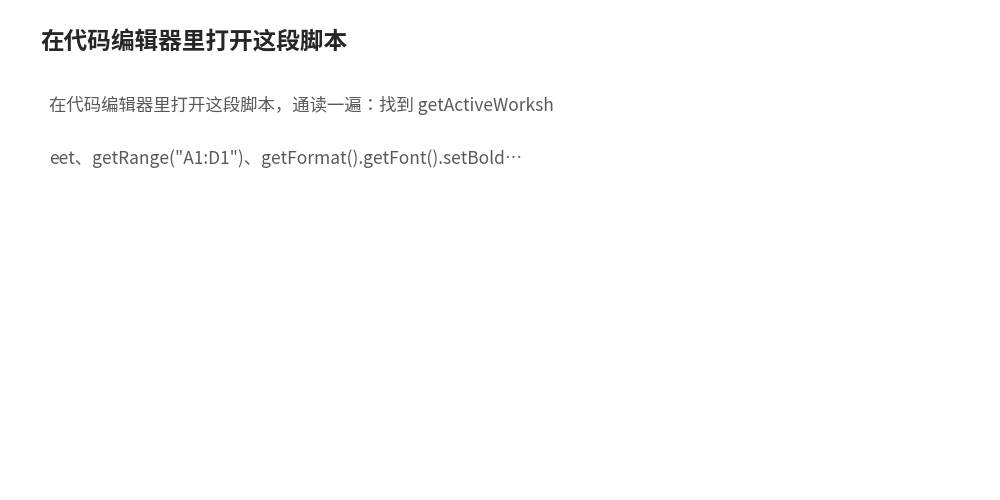
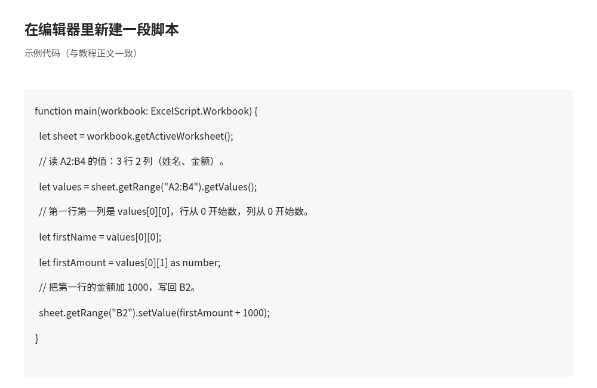
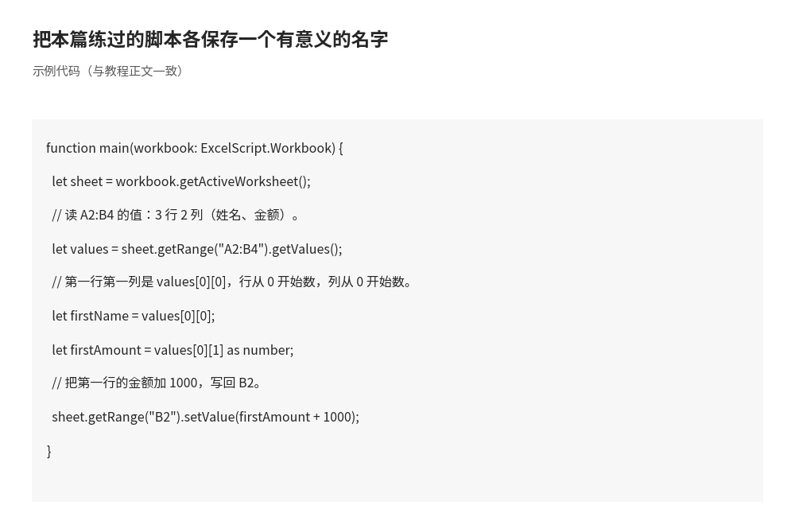
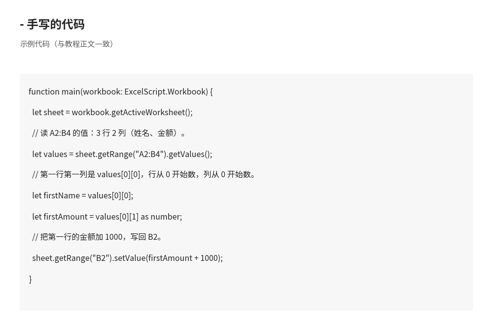
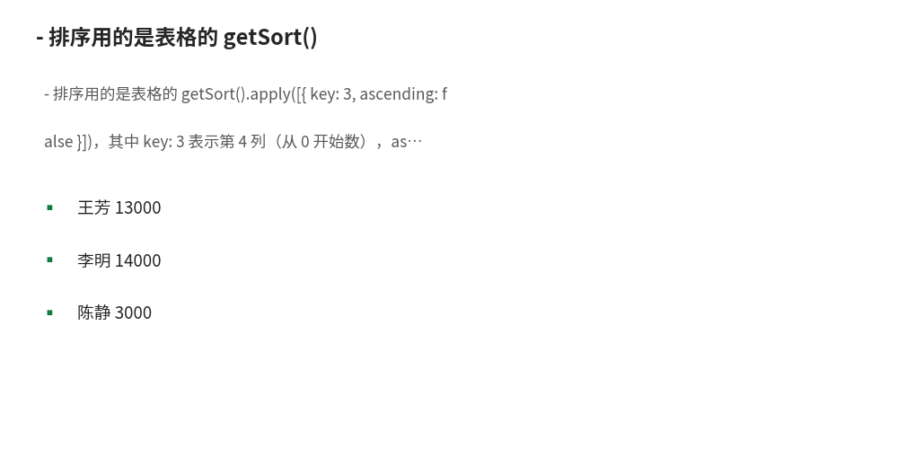

# TypeScript 基础：写出你的第一段 Office Scripts 代码

- **所属栏目**：C12 Office Scripts ／ C12-L2-2 TypeScript 基础
- **适用版本**：Microsoft 365 商业版／教育版（网页版 Excel、Excel for Windows 2210 及更高版本、Excel for Mac）
- **难度**：入门
- **预计阅读时长**：40 分钟
- **更新日期**：2026-11-10

> 验证方式说明：本篇所有 Office Scripts 代码均未在 Excel 网页版内执行验证。验证口径为两层：API 名称与方法签名对照 Microsoft 官方文档核对（learn.microsoft.com 的 Office Scripts 基础文档与 ExcelScript API 参考：Workbook、Worksheet、Range、Table、TableSort、AutoFilter），代码经去类型注解后的语法检查与括号配对检查。本篇正文与全站均不使用声称代码已在 Excel 内实际跑通过的表述；每段代码配的是预期效果说明，不是实测运行结果。

## 1. 学习目标

学完本篇，你将能够：
- 写出 main 函数的标准形状，并说出为什么第一个参数必须是 ExcelScript.Workbook
- 用 Workbook、Worksheet、Range、Table 四个对象说出“工作簿里有什么、表里有什么、区域里有什么”
- 用操作记录器录一段脚本，再在代码编辑器里改掉写死的工作表名与地址
- 用 getRange、setValues、getValues、addTable、getSort、getAutoFilter 六个常用 API 完成读写、建表、排序、筛选
- 给变量与函数参数写出正确的类型注解，并说出三种最常见的类型报错原因

## 2. 基础概念

### 2.1 TypeScript 与 Office Scripts 的关系

Office Scripts 的脚本语言是 TypeScript。TypeScript 是 JavaScript 的超集：会 JavaScript 的人，写 TypeScript 只需要多学一样东西，就是类型注解（写明每个变量是什么类型）。Office Scripts 只支持 TypeScript 的一个子集，不支持引用外部第三方库，只能用内置 JavaScript 对象与 Office Scripts API（Microsoft 官方文档“Using built-in JavaScript objects in Office Scripts”）。

### 2.2 main 函数：脚本的入口

每个脚本必须有一个 main 函数，它是脚本的起点。它的第一个参数固定是 ExcelScript.Workbook 类型的工作簿对象，脚本通过这个参数拿到整个工作簿，再一层层往下取工作表、区域和表格（Microsoft 官方文档“Fundamentals for Office Scripts in Excel”）：

```typescript
function main(workbook: ExcelScript.Workbook) {
  // 脚本从这里开始执行。
}
```

main 函数可以带更多参数：Power Automate 调用脚本时，可以把参数传进 main（例如传一个日期字符串），脚本也可以返回结果给流程。手动在 Excel 里运行时，这些额外参数没有人传值，所以写带参数的脚本前，先想清楚它是不是要交给 Power Automate 调用。

### 2.3 ExcelScript 对象模型：四层结构

对象模型是“工作簿里有什么东西、东西之间怎么套着”的地图。Office Scripts 里最常用的四层是：

- **Workbook（工作簿）**：整个文件。main 函数给你的就是它。能做的事：取活动工作表（getActiveWorksheet）、按名字取工作表（getWorksheet）、新建工作表（addWorksheet）、取所有表格。
- **Worksheet（工作表）**：文件里的一张表。能做的事：按地址取区域（getRange）、取已用区域（getUsedRange）、新建表格（addTable）、取自动筛选（getAutoFilter）。
- **Range（区域）**：一张表里连续的一块单元格，可以是一个格、一行、一列或一块矩形。区域有三个核心属性：值（values）、公式（formulas）、格式（format），分别用 getValues、getFormulas、getFormat 读，用 setValues、setFormulas 改。
- **Table（表格）**：用“插入表格”功能建的结构化表格（超级表），带标题行与筛选按钮。能做的事：加行（addRow、addRows）、加列（addColumn）、取排序对象（getSort）、取自动筛选（getAutoFilter）。

四层的关系是：Workbook 包含多个 Worksheet，Worksheet 通过 Range 读写单元格，Range 可以变成 Table，Table 再提供排序与筛选。写脚本时永远是顺着这条链往下取：先拿 workbook，再拿 sheet，再拿 range，最后才是改值或改格式。

### 2.4 两个命名空间

Office Scripts API 用两个命名空间（Microsoft 官方文档“Fundamentals for Office Scripts in Excel”）：

- **ExcelScript**：与 Excel 工作簿有关的 API，例如 ExcelScript.Workbook、ExcelScript.Range、ExcelScript.Table。
- **OfficeScript**：与工作簿无关的 API，例如与脚本运行环境有关的通用对象。

初学者记住一条就够了：凡是操作工作簿、工作表、单元格、表格的代码，类型名前都写 ExcelScript。

### 2.5 录制脚本与编辑脚本：两条路怎么配合

- **录制（操作记录器）**：在“自动执行”选项卡点“新建脚本”→“从录制创建”，做一遍操作，点“停止”，Excel 自动生成 TypeScript。优点是不用写代码；缺点是录出来的代码写死了工作表名、区域地址和具体数值，换一张表就可能报错；而且录制器录不出判断与循环。
- **编辑（代码编辑器）**：在“自动执行”选项卡点“新建脚本”→“在代码编辑器中创建”，直接写 TypeScript；也可以打开录制好的脚本接着改。优点是能加判断、循环、参数；缺点是要学 TypeScript 基础。
- **推荐配合方式**：先录制拿到能跑的骨架，再进编辑器做三处替换：把写死的工作表名改成 getActiveWorksheet() 或按名字取表；把写死的地址改成按 getUsedRange() 动态取；把写死的数值改成从单元格里读出来（getValues）或改成参数。

## 3. 操作步骤

1. 打开网页版 Excel，新建一个空白工作簿，在 A1:D1 写“日期、销售员、产品、金额”，在 A2:D4 写 3 行示例数据 
2. 点“自动执行”→“新建脚本”→“从录制创建”，选中 A1:D1，点“加粗”，再点“停止”，得到一段录制脚本 
3. 在代码编辑器里打开这段脚本，通读一遍：找到 getActiveWorksheet、getRange("A1:D1")、getFormat().getFont().setBold(true) 这三行，确认自己能说出每行在干什么 
4. 把脚本里的 A1:D1 改成 A1:D4，再点“运行”，检查是不是前四行都变粗了；如果只想加粗标题行，把地址改回 A1:D1 
5. 在编辑器里新建一段脚本，练习用 setValues 一次写多行数据（见第 5 节第二段代码），运行后检查 A2:D4 的值是不是写进去了 
6. 在同一张表上练习建表：用 addTable 把 A1:D4 变成表格，再用 getSort 按金额列排序（见第 5 节第四段代码），运行后检查表格与排序结果 
7. 把本篇练过的脚本各保存一个有意义的名字，例如“写表头”“建表并排序”，方便以后在“查看脚本”里找到 

## 4. 图文示例

示例一：区域的二维数组长什么样（文字版）。

- 工作表上的 A1:B2 是 2 行 2 列：第一行是“姓名、金额”，第二行是“王芳、13000”。
- getValues() 读出来是 [["姓名", "金额"], ["王芳", 13000]]：外层数组有 2 个元素（2 行），每个内层数组有 2 个元素（2 列）。
- setValues 写回去时，数组的形状必须与目标区域的形状一致：2 行 2 列的数组只能写进 2 行 2 列的区域，写进 1 行 4 列的区域会报错。

示例二：录制脚本与手写脚本的同一件事（文字版）。

- 任务：把 A1:D1 加粗。
- 录制得到的代码：取活动工作表 → 取 A1:D1 → getFormat().getFont().setBold(true)。
- 手写的代码：和录制得到的代码完全一样。录制器生成的就是手写代码，读懂录制代码就是学会手写的第一步 

示例三：表格排序前后的对照（文字版）。

- 排序前（A1:D4，含标题行）：王芳 13000、李明 14000、陈静 3000（按录入顺序）。
- 按金额降序排序后：李明 14000、王芳 13000、陈静 3000。
- 排序用的是表格的 getSort().apply([{ key: 3, ascending: false }])，其中 key: 3 表示第 4 列（从 0 开始数），ascending: false 表示降序 

## 5. 公式和代码

本篇代码均为教学示例，每段配预期效果说明；均未在 Excel 网页版内执行验证。API 名称与签名对照 Microsoft 官方 API 参考核对。

第一段：读值、算数、写回——最常用的三步。

```typescript
function main(workbook: ExcelScript.Workbook) {
  let sheet = workbook.getActiveWorksheet();
  // 读 A2:B4 的值：3 行 2 列（姓名、金额）。
  let values = sheet.getRange("A2:B4").getValues();
  // 第一行第一列是 values[0][0]，行从 0 开始数，列从 0 开始数。
  let firstName = values[0][0];
  let firstAmount = values[0][1] as number;
  // 把第一行的金额加 1000，写回 B2。
  sheet.getRange("B2").setValue(firstAmount + 1000);
}
```

预期效果：假设 A2:B4 第一行是“王芳、13000”，运行后 B2 变成 14000（13000 + 1000），其余单元格不变。其中 `as number` 是类型断言：告诉 TypeScript“这个值当数字用”，因为 getValues 读出来的单元格值可能是字符串、数字或布尔值。

第二段：一次写多行数据（setValues 与二维数组）。

```typescript
function main(workbook: ExcelScript.Workbook) {
  let sheet = workbook.getActiveWorksheet();
  // 一次写 3 行 2 列：外层是行，内层是列。
  sheet.getRange("A2:B4").setValues([
    ["王芳", 13000],
    ["李明", 14000],
    ["陈静", 3000]
  ]);
}
```

预期效果：运行后，A2:B4 依次出现三行数据（王芳 13000、李明 14000、陈静 3000）。三行合计 30000（13000 + 14000 + 3000），与 03 篇日报汇总案例的原始数据一致。

第三段：建表（addTable）与取表（getTable）。

```typescript
function main(workbook: ExcelScript.Workbook) {
  let sheet = workbook.getActiveWorksheet();
  // 把 A1:D4 变成带标题行的表格，第二个参数 true 表示第一行是标题。
  let table = sheet.addTable("A1:D4", true);
  table.setName("销售表");
  // 再按名字取回这张表，确认建表成功。
  let sameTable = sheet.getTable("销售表");
  console.log(sameTable.getName());
}
```

预期效果：运行后，A1:D4 变成一张带标题行与筛选按钮的表格，名字是“销售表”；console.log 会在编辑器日志里输出“销售表”。注意 addTable 的第二个参数：true 表示第一行是标题行，false 表示没有标题行，写错会导致第一行数据被当成标题。

第四段：表格排序（getSort）与筛选（getAutoFilter）。

```typescript
function main(workbook: ExcelScript.Workbook) {
  let sheet = workbook.getActiveWorksheet();
  let table = sheet.getTable("销售表");
  // 按第 4 列（金额，key 从 0 开始数，所以是 3）降序排序。
  table.getSort().apply([{ key: 3, ascending: false }]);
  // 只显示金额大于 10000 的行：列索引 3，条件是大于 10000。
  let filter = table.getAutoFilter();
  filter.apply(table.getRange(), 3, {
    filterOn: ExcelScript.FilterOn.custom,
    criterion1: ">10000"
  });
}
```

预期效果：运行后，表格按金额降序排列（李明 14000、王芳 13000、陈静 3000）；筛选后只显示金额大于 10000 的两行（李明、王芳），陈静一行被隐藏（不是删除）。其中 getSort().apply 的字段格式 [{ key: 3, ascending: false }] 与 AutoFilter.apply 的调用形式对照 Microsoft 官方 API 参考（TableSort.apply、AutoFilter.apply）核对。

第五段：循环与判断——只处理符合条件的行。

```typescript
function main(workbook: ExcelScript.Workbook) {
  let sheet = workbook.getActiveWorksheet();
  let range = sheet.getRange("A2:B4");
  let values = range.getValues();
  // 逐行检查：金额大于 10000 的行，在 C 列写“重点客户”。
  for (let i = 0; i < values.length; i++) {
    let amount = values[i][1] as number;
    if (amount > 10000) {
      sheet.getRange("C" + (i + 2)).setValue("重点客户");
    }
  }
}
```

预期效果：运行后，C2 写“重点客户”（王芳 13000），C3 写“重点客户”（李明 14000），C4 不写（陈静 3000 不大于 10000）。注意行号换算：数组下标 i 从 0 开始，对应工作表行号 i + 2（因为数据从第 2 行开始）。

第六段：类型注解要点（变量、参数、返回值）。

```typescript
function main(workbook: ExcelScript.Workbook) {
  let sheet: ExcelScript.Worksheet = workbook.getActiveWorksheet();
  let title: string = "日报汇总";
  let total: number = 0;
  let done: boolean = false;
  // 把标题写进 A1，把合计写进 B2。
  sheet.getRange("A1").setValue(title);
  sheet.getRange("B2").setValue(total);
  done = true;
}
```

预期效果：运行后，A1 出现“日报汇总”，B2 出现 0。类型注解写在变量名后面、冒号之后：string 是文字，number 是数字，boolean 是真或假，ExcelScript.Worksheet 是工作表对象。注解写错类型（例如把数字赋给 string 变量）时，编辑器会直接报错，不用等到运行。

## 6. 实际工作场景

场景一：把系统导出的原始数据一次写进模板。

- 背景：每天从业务系统导出一份数据，字段顺序固定，要贴进一张固定格式的模板表，过去是复制粘贴再逐格检查。
- 做法：用 setValues 一次把多行数据写进模板的指定区域，再用 addTable 把区域变成表格。
- 预期效果：写数据的动作从逐格粘贴变成一次运行；数组形状与区域形状一致时一次成功，不一致时编辑器报错，错误当场发现而不是发出去后才发现。

场景二：每周例会前的表格排序与筛选。

- 背景：每周例会前要把销售表按金额降序排好，再筛出金额大于 10000 的重点客户，过去是手动点排序、手动设筛选。
- 做法：一段脚本里先后调用 getSort().apply 与 getAutoFilter().apply，例会前点一次运行。
- 预期效果：排序与筛选一次完成；重点客户名单每次都按同一条规则筛出，不会因为手动操作漏掉一行。

## 7. 常见错误

| 错误现象 | 原因 | 解决方案 |
|---|---|---|
| 报错“找不到 main 函数”或脚本不运行 | 脚本里没有 main 函数，或 main 函数名拼错 | 确认脚本里有且只有一个 function main(workbook: ExcelScript.Workbook)，大小写不能错 |
| 报错“类型不匹配”，例如把字符串赋给数字变量 | 类型注解与实际值不一致，或 getValues 读出的值没做类型断言 | 给变量写正确的注解；读出的单元格值用 as number 或 as string 做类型断言 |
| setValues 报错，提示数组形状不匹配 | 二维数组的行数或列数与目标区域的行数或列数不一致 | 先数清目标区域是几行几列，再数数组是几行几列，两边对齐；一行四列的数组不能写进两行两列的区域 |
| getRange("A1:D1") 取到了别的表的数据 | 脚本取的是 getActiveWorksheet()，运行时活动工作表不是预期的那张 | 用 workbook.getWorksheet("表名") 按名字取表，不要依赖活动工作表；给 Power Automate 调用的脚本尤其不能用 getActiveWorksheet |
| addTable 报错，提示区域无效或与已有表格重叠 | 目标区域已有表格，或区域地址写错、超出了工作表范围 | 先检查该区域是否已有表格；确认地址正确；已有表格时用 getTable 取回，不要重复 addTable |
| 排序后顺序不对，或排的是错的列 | getSort 的 key 是从 0 开始数的列索引，误当成从 1 开始数 | 第 1 列的 key 是 0，第 4 列的 key 是 3；排序前先确认表格有几列、目标列是第几列 |
| 筛选后数据“不见了”，以为被删除 | 筛选只是隐藏行，没有删除数据；再运行一次脚本时筛选条件叠加 | 用 table.getAutoFilter().clearCriteria() 或 table.clearFilters() 先清掉旧筛选，再设新筛选 |
| 循环里写错行号，写到了错误的单元格 | 数组下标从 0 开始，工作表行号从 1 开始，两者换算漏了起始行 | 数据从第 2 行开始时，工作表行号 = 下标 i + 2；写完后用一两行数据先验算行号再全量运行 |

## 8. 相关教程

- 同栏目上一篇：01-introduction.md（Office Scripts 入门：是什么、与 VBA 的区别、可用性前提）
- 同栏目下一篇：03-automation-cases.md（自动化实战：Power Automate 联动与 3 个完整案例）
- 跨栏目相关：docs/vba/02-objects.md（VBA 对象模型：Workbook、Worksheet、Range 的对照，理解对象模型时可对照看）
- 跨栏目相关：docs/powerquery/01-power-query.md（Power Query：M 语言与 Office Scripts 的分工，数据转换优先用 Power Query）
- 跨栏目相关：docs/formulas/01-formula-basics.md（公式基础：脚本里 setFormulas 写公式时用到的公式知识）

## 9. 练习题

1. 写出 main 函数的标准形状，并说出第一个参数的类型与含义。
2. Workbook、Worksheet、Range、Table 四层对象之间是什么包含关系？用一句话画出这条链。
3. getValues() 读 A1:B2（2 行 2 列）会得到什么形状的数组？写出这个数组的字面量（假设 A1:B2 是“姓名、金额／王芳、13000”）。
4. setValues 的数组是 3 行 2 列，目标区域写成了 A2:B3（2 行 2 列），运行会发生什么？为什么？
5. 把 A1:D4 变成带标题行的表格，写出 addTable 的调用，并说出第二个参数 true 的含义。
6. 要按金额列（第 4 列）降序排序，getSort().apply 里的 key 该写几？ascending 该写 true 还是 false？并说出 key 从几开始数的理由。

## 10. 参考答案

<details>
<summary>点击查看答案</summary>

1. `function main(workbook: ExcelScript.Workbook) { }`。第一个参数的类型是 ExcelScript.Workbook，含义是脚本要操作的整个工作簿对象，脚本通过它拿到工作表、区域和表格。
2. Workbook 包含多个 Worksheet，Worksheet 通过 Range 读写单元格，Range 可以变成 Table。链：Workbook → Worksheet → Range → Table。
3. [["姓名", "金额"], ["王芳", 13000]]。外层数组 2 个元素对应 2 行，内层数组 2 个元素对应 2 列。
4. 会报错（数组形状与目标区域不匹配）。setValues 要求二维数组的行数与列数和目标区域完全一致，3 行 2 列的数组不能写进 2 行 2 列的区域；应把目标区域改成 A2:B4。
5. `sheet.addTable("A1:D4", true)`。第二个参数 true 表示第一行是标题行；写 false 则表示没有标题行，第一行数据会被当成标题。
6. key 写 3，ascending 写 false。key 是从 0 开始数的列索引，第 4 列对应 key 3；降序时 ascending 为 false，升序时为 true。

</details>

## 11. 可下载示例文件

本篇为 TypeScript 基础篇，示例代码均为短片段，无单独配套 .ts 文件。完整可运行脚本见 03 篇的 3 个可下载示例文件：OfficeScripts-DailySummary.ts、OfficeScripts-DataCleaning.ts、OfficeScripts-FormatStandardization.ts（templates/ 目录下）。
