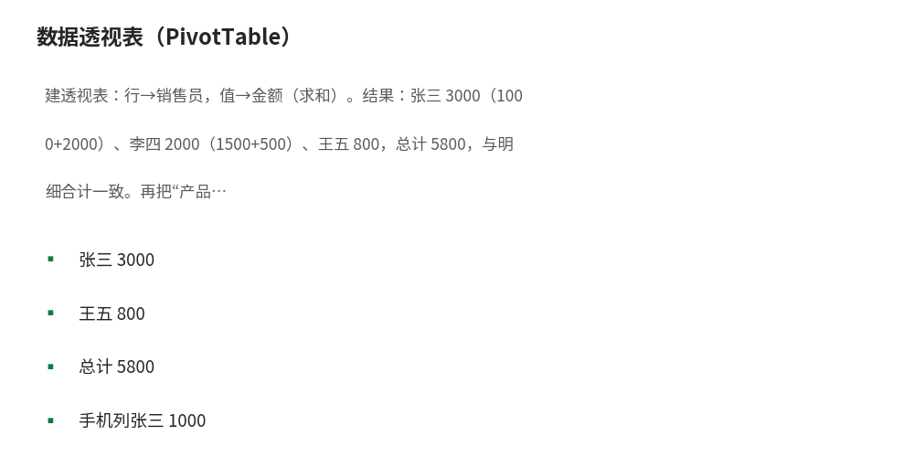

# 数据透视表（PivotTable）

- **所属栏目**：C08 数据透视表 ／ C08-L2-1 创建与布局、C08-L2-2 分组与筛选、C08-L2-3 计算字段与计算项、C08-L2-4 切片器与日程表、C08-L2-5 数据透视图、C08-L2-6 透视表实战
- **适用版本**：Excel 2016／2019／2021／365（切片器／时间线需 2013+）
- **难度**：中级
- **预计阅读时长**：40 分钟
- **更新日期**：2026-11-10

## 1. 学习目标

学完本篇，你将能够：
- 创建数据透视表并拖字段完成分组求和
- 设置值字段的汇总方式（求和／计数／平均值）与值显示方式（占比／差异百分比）
- 用计算字段算毛利率、用计算项合并类别，并说出汇总层面计算与逐行计算的区别
- 用切片器与日程表筛选透视表，并让一个切片器联动多张透视表
- 创建数据透视图并与透视表联动
- 对照练习数据文件完成 6 个透视表实战任务，并用重算核对每个数字

## 2. 基础概念

### 2.1 为什么用数据透视表

想象你有一张 5000 行的销售明细：日期、销售员、产品、金额。老板问：“每个销售员每个月的销售额是多少？”

- 不用透视表：写一堆 SUMIFS，还要手动列出所有销售员和月份，容易漏。
- 用透视表：**拖三下鼠标，3 秒出结果**。源数据增删行后点一下“刷新”即可更新。

核心思想：**把“分组+聚合”这个动作交给 Excel**，你只负责告诉它“按什么分组、对什么求和”。

### 2.2 四个区域详解

| 区域 | 作用 | 典型拖入字段 |
|------|------|--------------|
| **行** | 纵向分组维度 | 销售员、产品类别、部门 |
| **列** | 横向分组维度 | 月份、季度、年份 |
| **值** | 要聚合计算的数字 | 金额、数量 |
| **筛选器** | 报表级筛选 | 年份、区域（拖到这里后报表上方出现下拉筛选） |

操作要点：
- 同一字段可以拖到多个区域（如“日期”同时拖到行和筛选器）。
- 拖错了直接把字段拖出窗格即可移除。
- 字段顺序决定层级：行区域里“年份”在上、“月份”在下，就是先按年再按月展开。

### 2.3 值汇总方式

默认对数字字段“求和”，对文本字段“计数”。右键值字段→“值字段设置”可切换：

| 汇总方式 | 含义 | 常用场景 |
|----------|------|----------|
| 求和 | 加总 | 销售额、数量 |
| 计数 | 非空单元格个数 | 订单笔数 |
| 平均值 | 算术平均 | 客单价、平均分 |
| 最大值／最小值 | 极值 | 最高分、最低价 |
| 乘积 | 连乘（少用） | — |

**显示方式**（同一对话框的“值显示方式”选项卡，更实用）：
- **占总和的百分比**：每个销售员占总销售额的比例。
- **父行汇总的百分比**：某产品占其所属类别的比例。
- **差异**：本月 vs 上月的差额（需配合日期分组）。
- **差异百分比**：环比增长率——做月报的神器。

### 2.4 分组

**日期分组**：右键行区域的日期字段→“组合”：
- 按月：选“月”，自动按年月分组。
- 按季度+年：同时勾选“季度”和“年”。
- 按周：选“日”，天数填 7。

**数字分组**：右键数字字段→“组合”：如把年龄按 10 岁一段分组（起始 20，终止 60，步长 10），快速做年龄段分布。

### 2.5 L2-3 计算字段与计算项

**计算字段**：当现有字段算不出你要的指标时用。是在**汇总层面**计算的，不是逐行：公式里的字段先各自汇总，再代入公式。

**计算项**：在某个字段内部新增一个“虚拟项”，由该字段已有的两个（或多个）项组合而成（如把“手机”和“电脑”合并成一个“数码产品”项）。

**示例 1：毛利率计算字段**

源数据有“销售额”和“成本”，想算“毛利率”。“数据透视表分析”→“字段、项目和集”→“计算字段”：
- 名称：`毛利率`
- 公式：`= (销售额 - 成本) / 销售额`

验算用 3 行小表：

| 产品 | 销售额 | 成本 | 毛利率（逐行算） |
|---|---|---|---|
| A | 10000 | 6000 | (10000-6000)/10000 = 40% |
| B | 20000 | 15000 | (20000-15000)/20000 = 25% |
| C | 5000 | 2000 | (5000-2000)/5000 = 60% |

注意：透视表里的毛利率是**汇总层面**算的：(35000-23000)/35000 = 34.29%，而不是三行毛利率的平均值 41.67%（(40%+25%+60%)/3）。汇总层面算的才是整体真实毛利率，这正是计算字段的正确用法。计算字段不能引用透视表里的“计数”等聚合结果，只能引用源字段。

**示例 2：占比值显示方式**

不用新建字段，用值显示方式直接出占比。做法：值字段放“金额”（求和），再把同一个字段拖进值区域第二次，右键→“值字段设置”→“值显示方式”→“占总和的百分比”。

用练习数据文件（500 行销售明细，总金额 20957073）验算，5 个产品类别的占比：

| 产品类别 | 金额 | 占总和的百分比 |
|---|---|---|
| 电脑 | 8755100 | 41.78% |
| 手机 | 4656899 | 22.22% |
| 家电 | 4118100 | 19.65% |
| 办公 | 2455668 | 11.72% |
| 配件 | 971306 | 4.63% |

验算：8755100 / 20957073 = 41.78%；4656899 / 20957073 = 22.22%；4118100 / 20957073 = 19.65%；2455668 / 20957073 = 11.72%；971306 / 20957073 = 4.63%。五项合计 100.00%，与总金额 20957073 一致。

**示例 3：计算项——把两个类别合并成一组**

想在报表里单列“数码产品”= 手机 + 电脑，不改源数据：行区域选中“产品类别”字段，“数据透视表分析”→“字段、项目和集”→“计算项”，名称填“数码产品”，公式填 `= 手机 + 电脑`。

验算（练习数据文件）：手机 4656899 + 电脑 8755100 = 13411999；13411999 / 20957073 = 64.00%。也就是说数码产品合计 13411999 元，占总销售额的 64.00%。计算项是字段内的虚拟项，只影响本张透视表，源数据不动；想永久合并类别，改源数据加一列“大类”更稳妥。

### 2.6 L2-4 切片器与日程表

**切片器**：可视化筛选按钮。“数据透视表分析”→“插入切片器”→勾选字段（如“产品类别”）。生成一排可点击的按钮，点选即筛选，比下拉框直观，适合做仪表盘。

**日程表（时间线）**：专门用于日期字段的筛选器。“数据透视表分析”→“插入日程表”→勾选日期字段，拖动滑块筛选时间段；可按年／季度／月／日切换粒度。比切片器更适合时间筛选。

**多表联动**：一个切片器可以同时控制**多个**透视表：右键切片器→“报表连接”，勾选其他透视表——做联动仪表盘的核心技巧。联动前提是多张透视表基于同一数据源（或同一数据模型）。

**切片器与日程表的区别**：切片器用于任意字段（类别、销售员、区域）；日程表只用于日期字段，带时间滑块。月报仪表盘两者常一起用：切片器选区域，日程表拖月份。

### 2.7 L2-5 数据透视图

数据透视图是与透视表联动的图表：透视表一筛选，图跟着变；图上点选系列，也能反向筛选透视表。

- **创建**：点透视表内任一格，“数据透视表分析”→“数据透视图”，选图表类型（常用簇状柱形图、折线图）。也可以在建透视表时直接勾选“添加数据透视图”，表和图一次生成。
- **与透视表联动**：图和表共用同一字段窗格：行／列字段决定图的分类轴与图例，值字段决定图的数值。改字段布局，图同步重画。
- **适用场景**：月度趋势用折线图（行=月份，值=金额求和）；各区域对比用簇状柱形图（行=区域，值=金额求和）；类别占比用饼图（行=产品类别，值=金额求和，再把值显示方式改成“占总和的百分比”）。
- **注意**：透视图不能像普通图表那样自由改数据源或删系列，改动要回透视表的字段窗格做；想做完全自定义的图，先把透视表结果复制为值，再按普通图表做法画。

## 3. 操作步骤

1. 创建：点击源数据区域任意单元格（确保数据是规范的二维表：第一行是标题行，无合并单元格、无空行空列）。“插入”→“数据透视表”。选择放置位置：建议选“新工作表”，报表和源数据分开更清爽。
2. 布局：右侧“数据透视表字段”窗格，把分组字段拖到行／列，把数字字段拖到值，把报表级筛选字段拖到筛选器。
3. 改汇总方式：右键值字段→“值字段设置”，切换求和／计数／平均值；再到“值显示方式”选项卡，选“占总和的百分比”或“差异百分比”。
4. 分组：右键行区域的日期字段→“组合”，按月／季度／年分组；数字字段右键→“组合”，按区间分组。
5. 建计算字段：点透视表，“数据透视表分析”→“字段、项目和集”→“计算字段”，填名称与公式（如 `= (销售额 - 成本) / 销售额`），确定后字段出现在值区域。
6. 建计算项：行区域选中某字段，“数据透视表分析”→“字段、项目和集”→“计算项”，填名称与公式（如 `= 手机 + 电脑`），确定。
7. 插切片器：点透视表，“数据透视表分析”→“插入切片器”，勾选字段，确定；想联动多表时右键切片器→“报表连接”，勾选其他透视表。
8. 插日程表：点透视表，“数据透视表分析”→“插入日程表”，勾选日期字段，拖滑块筛选时间段。
9. 建透视图：点透视表内任一格，“数据透视表分析”→“数据透视图”，选类型，确定；改字段布局时图同步更新。
10. 刷新：源数据增删行后，点透视表→右键→“刷新”；建议先把源数据转成“表格”（Ctrl+T），新增行自动纳入数据源。

> 数据规范是透视表好用的前提：一列只放一种含义的数据，日期列全是日期，不要出现“合计”行混在明细里。

## 4. 图文示例

5 行销售明细：张三／手机／1000、张三／电脑／2000、李四／手机／1500、李四／电脑／500、王五／手机／800。合计 5800。

建透视表：行→销售员，值→金额（求和）。结果：张三 3000（1000+2000）、李四 2000（1500+500）、王五 800，总计 5800，与明细合计一致。再把“产品”拖到列，结果变成交叉表：手机列张三 1000、李四 1500、王五 800，电脑列张三 2000、李四 500。



## 5. 公式和代码

### 5.1 GETPIVOTDATA 函数

当你在透视表外引用某个汇总值时，Excel 会自动生成 GETPIVOTDATA 公式：

```excel
=GETPIVOTDATA("金额", $A$3, "销售员", "张三", "月份", "2026-01")
```

意思是：从以 A3 为左上角的透视表中，取出“销售员=张三、月份=2026-01”的金额汇总。

- 优点：条件变了（如下拉选了“李四”），引用自动跟着变，不会错位。
- 缺点：公式冗长。想关闭自动生成：点击透视表→“数据透视表分析”→取消“生成 GetPivotData”。

### 5.2 计算字段公式

```excel
毛利率 = (销售额 - 成本) / 销售额 → 汇总层面：(35000-23000)/35000 = 34.29%
占比 = 金额 / 总金额 → 电脑 8755100 / 20957073 = 41.78%
```

- 毛利率计算字段的公式写在“计算字段”对话框里，不写进单元格；结果 34.29% 是先汇总再相除，不等于逐行毛利率的平均值 41.67%。
- 占比一般不用计算字段，用值显示方式“占总和的百分比”一步到位，结果与手工相除一致（电脑 41.78%）。

## 6. 实际工作场景：L2-6 透视表实战（6 个任务及参考答案）

以下 6 个任务以练习数据文件“使用说明”工作表的 6 个任务为准。数据文件：`数据-透视表练习数据.xlsx`，销售明细 500 行（日期／区域／销售员／产品类别／产品名称／数量／单价／金额）。注意两点：金额列是公式 `=数量*单价`，Excel 打开后自动算出；日期列存的是文本型日期（形如 2026-04-27），做任务 5 的日期组合前，先用“数据”→“分列”把日期列转成真正的日期，否则“组合”按钮不可用。以下每个答案都用 Python 对 xlsx 数据独立重算过。

### 任务 1（基础）：各区域总额

做法：行=区域，值=金额（求和）。

| 区域 | 金额 |
|---|---|
| 华南 | 5452113 |
| 华东 | 5283360 |
| 西南 | 3549711 |
| 华北 | 3378124 |
| 华中 | 3293765 |
| **总计** | **20957073** |

核对：5452113+5283360+3549711+3378124+3293765 = 20957073。华南最高，华中最低。

### 任务 2（行列）：各品类在各区域的表现

做法：行=产品类别，列=区域，值=金额（求和）。

| 产品类别 | 华东 | 华中 | 华北 | 华南 | 西南 | 合计 |
|---|---|---|---|---|---|---|
| 办公 | 666163 | 399241 | 460026 | 425274 | 504964 | 2455668 |
| 家电 | 974400 | 944400 | 799900 | 695200 | 704200 | 4118100 |
| 手机 | 1203983 | 567907 | 623431 | 1057301 | 1204277 | 4656899 |
| 电脑 | 2137700 | 1276400 | 1398500 | 3029400 | 913100 | 8755100 |
| 配件 | 301114 | 105817 | 96267 | 244938 | 223170 | 971306 |
| **合计** | **5283360** | **3293765** | **3378124** | **5452113** | **3549711** | **20957073** |

核对：每行合计与每列合计交叉相加都等于 20957073。单格最高是“电脑 × 华南”3029400；电脑在 4 个区域都是第一，只有西南的第一是手机（1204277）。

### 任务 3（排序筛选）：谁排第一

做法：在任务 1 的透视表里对金额列降序。

- 按区域：第一是华南 5452113，第二是华东 5283360。
- 按产品类别：第一是电脑 8755100，第二是手机 4656899。
- 按区域×品类单格：第一是“电脑 × 华南”3029400。

### 任务 4（切片器）：看个人业绩

做法：插入切片器→勾选“销售员”，点名字即时筛选。

| 销售员 | 金额 | 订单笔数 |
|---|---|---|
| 王芳 | 4214138 | 89 |
| 周敏 | 3204070 | 64 |
| 刘洋 | 2814799 | 62 |
| 陈静 | 2412703 | 65 |
| 黄伟 | 2318303 | 53 |
| 李明 | 2181886 | 54 |
| 赵强 | 2067664 | 58 |
| 吴磊 | 1743510 | 55 |
| **总计** | **20957073** | **500** |

核对：8 人金额合计 20957073，笔数合计 500。个人第一是王芳 4214138（占 20.11%）；点切片器上的“王芳”，透视表只显示她的 89 笔。

### 任务 5（日期组合）：月度趋势与季度汇总

做法：先把文本型日期列用分列转成真日期；右键日期字段→“组合”→按月；再试按季度。

月度趋势：

| 月份 | 金额 |
|---|---|
| 2026-01 | 3145764 |
| 2026-02 | 2251675 |
| 2026-03 | 2595681 |
| 2026-04 | 1736654 |
| 2026-05 | 2438304 |
| 2026-06 | 2639209 |
| 2026-07 | 1634673 |
| 2026-08 | 2256896 |
| 2026-09 | 2258217 |
| **总计** | **20957073** |

按季度：2026-Q1 7993120（3145764+2251675+2595681）、2026-Q2 6814167（1736654+2438304+2639209）、2026-Q3 6149786（1634673+2256896+2258217）。最高月是 1 月 3145764，最低月是 7 月 1634673；季度逐季下降。

### 任务 6（值显示方式）：占比

做法：金额字段→值字段设置→显示方式→“占总和的百分比”。

| 区域 | 金额 | 占总和的百分比 |
|---|---|---|
| 华南 | 5452113 | 26.02% |
| 华东 | 5283360 | 25.21% |
| 西南 | 3549711 | 16.94% |
| 华北 | 3378124 | 16.12% |
| 华中 | 3293765 | 15.72% |

验算：5452113 / 20957073 = 26.02%；5283360 / 20957073 = 25.21%；3549711 / 20957073 = 16.94%；3378124 / 20957073 = 16.12%；3293765 / 20957073 = 15.72%。五项合计 100.01%（四舍五入尾差，精确值合计 100.00%）。

### 实战案例补充

**案例 1：销售员月度业绩表**

源数据：日期、销售员、金额。做法：行→销售员，列→日期（组合为“月”），值→金额（求和）。3 秒得到交叉表，行是人、列是月。

**案例 2：产品类别占比**

值字段放两次：一次“求和”，一次“求和”但值显示方式选“占总和的百分比”。一列看绝对值，一列看占比（见 2.5 示例 2）。

**案例 3：环比增长率**

行→日期（组合为“月”），值→金额，值显示方式选“差异百分比”，基本字段选“日期”，基本项选“（上一个）”。直接得到每月环比。

**案例 4：Top 10 客户**

行→客户名称，值→金额（求和）。右键行标签→“筛选”→“前 10 个”，按金额汇总取前 10。

**案例 5：考勤异常统计**

源数据：姓名、日期、状态（正常／迟到／缺勤）。行→姓名，列→状态，值→状态（计数）。一眼看出谁迟到最多。再加切片器按部门筛选。

## 7. 常见错误

| 错误现象 | 原因 | 解决方案 |
|---|---|---|
| 刷新后格式丢失 | 默认勾选了“更新时自动调整列宽” | 右键透视表→“数据透视表选项”→取消勾选“更新时自动调整列宽” |
| 新增数据不进来 | 数据源范围没包含新行 | 把源数据转成“表格”（Ctrl+T）再建透视表，新增行自动纳入；或点透视表→“更改数据源”扩大范围 |
| 日期无法组合 | 日期列里混入了文本（如“待定”），或整列是文本型日期 | 先清洗成纯日期：文本型日期用“数据”→“分列”转成日期格式，再组合 |
| 计数不对 | 值字段默认对文本“计数”、对数字“求和” | 先确认汇总方式：右键值字段→“值字段设置”，改成想要的求和／计数／平均值 |
| 计算字段结果和逐行算的不一样 | 计算字段是在汇总层面算的，先汇总再代入公式 | 这是正常现象：整体毛利率 34.29% 不等于逐行毛利率的平均值 41.67%，以汇总结果为准 |
| 切片器不能联动另一张透视表 | 两张透视表数据源不同，“报表连接”里不出现对方 | 联动要求同一数据源（或同一数据模型）；基于同一张源表重建两张透视表再联动 |
| 透视图改不了系列 | 透视图的系列由透视表字段决定，不能直接改 | 回透视表的字段窗格改行／列／值字段，图同步重画；想完全自定义，先把透视结果复制为值再画普通图 |

## 8. 相关教程

- 前置：排序筛选（docs/data-management/01-sort-filter.md，分组前先排好序、筛好数）
- 前置：数据清洗（docs/data-management/02-clean-data.md，日期混文本、空行空列先洗干净）
- 前置：超级表（docs/formatting/05-tables.md，源数据做成超级表后新增行自动纳入透视表）
- 同栏目：条件格式（docs/conditional-formatting/01-conditional-formatting.md，透视表结果再用条件格式做可视化）
- 跨栏目：Power Query（docs/powerquery/01-power-query.md，多表合并后再建透视表）

## 9. 练习题

1. 把“销售员”拖到行、“金额”拖到值，默认汇总方式是什么？想改成计数怎么改？
2. 透视表不显示新追加的数据，原因与解决办法是什么？
3. 切片器是干什么用的？
4. 3 行小表：A 产品销售额 10000、成本 6000；B 产品销售额 20000、成本 15000；C 产品销售额 5000、成本 2000。用计算字段算整体毛利率是多少？为什么不是 40%、25%、60% 的平均值？
5. 练习数据里电脑类金额 8755100、总金额 20957073，用值显示方式“占总和的百分比”会显示多少？写出算式。
6. 一个切片器想同时控制两张透视表，怎么做？有什么前提条件？

## 10. 参考答案

<details>
<summary>点击查看答案</summary>

1. 默认对数值求和。点值字段→值字段设置→改成“计数”。

2. 数据源范围没包含新行。点透视表→更改数据源扩大范围，或把源数据做成超级表后刷新。

3. 可视化筛选器：点切片器上的项，透视表即时筛选；多个透视表可共用一个切片器联动。

4. 整体毛利率 34.29%。计算字段先汇总再算：(35000-23000)/35000 = 34.29%；40%、25%、60% 的平均值 41.67% 是逐行毛利率的平均，不是整体毛利率。

5. 显示 41.78%。算式：8755100 / 20957073 = 41.78%。

6. 右键切片器→“报表连接”，勾选另一张透视表。前提是两张透视表基于同一数据源（或同一数据模型）。

</details>

## 11. 可下载示例文件

- [数据-透视表练习数据.xlsx](../../templates/数据-透视表练习数据.xlsx)
