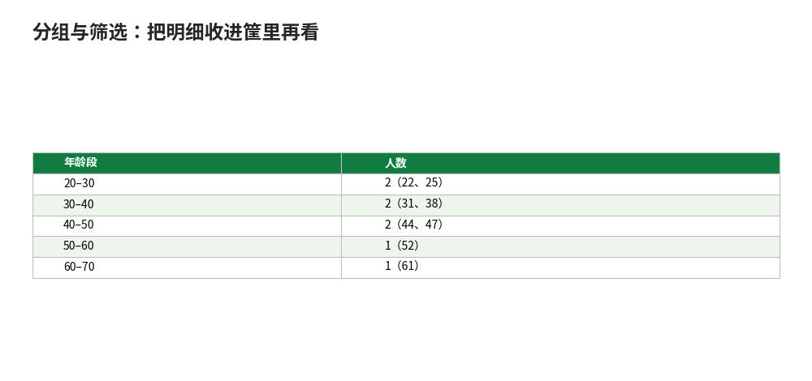

# 分组与筛选：把明细收进筐里再看

- **所属栏目**：C08 数据透视表 ／ C08-L2-2 分组与筛选
- **适用版本**：Excel 2016／2019／2021／365
- **难度**：进阶
- **预计阅读时长**：25 分钟
- **更新日期**：2026-11-10

## 1. 学习目标

学完本篇，你将能够：
- 用组合功能按年、季度、月、周分组日期，按区间分组数字
- 用标签筛选与值筛选（前 10 个、按值大小）筛出目标分组
- 对透视表排序并核对分组后各组合计与总数一致

## 2. 基础概念

### 2.1 分组：把连续的值收进筐里

明细是散的：300 天的销售日期、几百个年龄。分组就是定筐：日期按年／季度／月／周收，数字按区间收（如年龄 10 岁一段、成绩 10 分一段）。分组后透视表从“每一天一行”变成“每月一行”，趋势立刻可见。

### 2.2 日期分组：组合对话框

右键行区域的日期字段→“组合”，勾选要分的粒度：

| 粒度 | 做法 | 适用 |
|---|---|---|
| 按月 | 只勾“月” | 月度趋势 |
| 按季度+年 | 同时勾“季度”和“年” | 季度汇报（只勾季度不勾年会把两年的 Q1 并在一起） |
| 按周 | 选“日”，天数填 7 | 周报 |
| 按日 | 选“日”，天数填 1 | 日粒度（明细太多时不建议） |

要点：**季度必须配年一起勾**，否则 2025-Q1 与 2026-Q1 会被并成一个“Q1”。

### 2.3 数字分组：起始、终止、步长

右键数字字段→“组合”，填三个数：起始、终止、步长。如年龄按 10 岁一段：起始 20、终止 70、步长 10，得到 20–30、30–40、40–50、50–60、60–70 五档。步长决定筐的宽度：步长太大看不出分布，太小又碎。

### 2.4 筛选：标签筛选与值筛选

行标签下拉箭头里有两种筛选：

- **标签筛选**：按分组名筛，如只看“华东”“华南”两个区域。
- **值筛选**：按汇总值筛，如“前 10 个”取金额最高的 10 个客户、“大于 100000”只留大单。

值筛选是透视表做 Top 10 的标准做法，不用先排序再手动挑。

### 2.5 排序：按汇总值排

点行标签的排序按钮，或右键值字段→“排序”→“降序”，透视表按金额从高到低排。排序后第一名就是最大值，做“谁排第一”一眼可见。注意：透视表的排序是跟着值走的，刷新后顺序自动重排，不用重新排。

## 3. 操作步骤

1. 建透视表：行放日期字段、值放金额（求和）。
2. 日期分组：右键日期字段→“组合”，勾选“年”和“季度”（或“月”），确定。
3. 数字分组：行放年龄字段，右键→“组合”，填起始、终止、步长，确定。
4. 标签筛选：点行标签下拉箭头，取消勾选不要的分组。
5. 值筛选：点行标签下拉→“值筛选”→“前 10 个”，按金额汇总取前 10。
6. 排序：右键值字段→“排序”→“降序”，第一名排在最上。
7. 核对：各组金额合计等于总计；各组人数合计等于总行数。

## 4. 图文示例

### 4.1 日期分组：上半年月度销售

月度销售 1–6 月：12000、15000、11000、18000、16000、14000。透视表行放月份、值放金额求和后，右键月份→“组合”→勾选“季度”与“年”：

| 分组 | 金额 |
|---|---|
| 2026-Q1 | 38000（12000+15000+11000） |
| 2026-Q2 | 48000（18000+16000+14000） |
| 上半年合计 | 86000 |

验算：38000+48000=86000，与 6 个月合计一致；Q2 比 Q1 高 10000。

### 4.2 数字分组：年龄段分布

8 人年龄：22、25、31、38、44、47、52、61。右键年龄→“组合”，起始 20、终止 70、步长 10：

| 年龄段 | 人数 |
|---|---|
| 20–30 | 2（22、25） |
| 30–40 | 2（31、38） |
| 40–50 | 2（44、47） |
| 50–60 | 1（52） |
| 60–70 | 1（61） |
| 合计 | 8 |

验算：2+2+2+1+1=8，与人数一致。分布一眼可见：40 岁以下 6 人，占多数。



## 5. 公式和代码

分组后核对用的公式（在透视表外验证）：

```excel
=SUM(透视表季度列) → 86000
```

Q1 38000 + Q2 48000 = 86000，与明细 6 个月合计一致；对不上先查分组有没有漏行（如日期列混入文本导致某行没进组）。

```excel
=GETPIVOTDATA("金额", $A$3, "季度", "2026-Q1") → 38000
```

在透视表外引用某个分组的汇总值：从以 A3 为左上角的透视表中，取出“季度=2026-Q1”的金额汇总。条件变了引用自动跟着变，不会错位。

## 6. 实际工作场景

### 6.1 月报：按季度看趋势

销售月报每月一更：行放月份、值放金额，组合成季度后，季度合计自动算出；再把值字段放两次，第二次值显示方式选“差异百分比”，环比直接出来。月报会只用改源数据、点刷新，季度分组与环比都不用重做。

### 6.2 客户分层：值筛选取 Top 10

客户 200 家，行放客户名称、值放金额求和，值筛选→“前 10 个”，透视表只剩金额最高的 10 家。头部客户合计占总销售额的比例，就是值显示方式“占总和的百分比”一列的事； Top 10 名单每月刷新自动重排，新冲进前 10 的客户自己浮上来。

## 7. 常见错误

| 错误现象 | 原因 | 解决方案 |
|---|---|---|
| 日期无法组合 | 日期列里混入了文本（如“待定”），或整列是文本型日期 | 先清洗成纯日期：文本型日期用“数据”→“分列”转成日期格式，再组合 |
| 季度把两年的 Q1 并在一起 | 组合时只勾了“季度”，没勾“年” | 重新组合，同时勾选“季度”和“年” |
| 分组后合计与明细总数对不上 | 某行没进组（如空值、文本混入数字列） | 检查源数据：空行、文本型数字先清洗；分组后核对各组合计 |
| 值筛选“前 10 个”取出来不对 | 值字段的汇总方式不是求和（如默认成了计数） | 先确认汇总方式：右键值字段→“值字段设置”，改成求和再筛选 |
| 取消组合后字段变回明细 | 取消组合是正常操作，不是数据丢失 | 右键字段→“取消组合”即恢复明细；想保留分组结果，复制透视表为值 |
| 排序后刷新又乱了 | 排序是跟着值走的，刷新后按新值重排 | 这是正常现象：刷新后顺序按最新汇总值重排，第一名永远是当前最大值 |

## 8. 相关教程

- 同栏目：创建与布局（docs/pivottable/01-pivottable.md，先会建表与拖字段，再学分组）
- 同栏目：透视表实战（docs/pivottable/06-practice-cases.md，分组与筛选的综合任务）
- 前置：排序筛选（docs/data-management/01-sort-filter.md，分组前先排好序、筛好数）
- 前置：数据清洗（docs/data-management/02-clean-data.md，日期混文本、空行空列先洗干净）

## 9. 练习题

1. 6 个月销售 12000、15000、11000、18000、16000、14000，按季度分组后 Q1 与 Q2 各是多少？上半年合计多少？
2. 组合日期时只勾“季度”不勾“年”，会出什么问题？
3. 8 人年龄 22、25、31、38、44、47、52、61，按 10 岁一段分组，20–30 岁档有几人？各档人数合计是多少？
4. 200 家客户想只看金额最高的 10 家，用什么筛选？值字段汇总方式要先确认成什么？
5. 日期列里混了文本型日期，“组合”按钮不可用，怎么办？

## 10. 参考答案

<details>
<summary>点击查看答案</summary>

1. Q1 38000（12000+15000+11000），Q2 48000（18000+16000+14000），上半年合计 86000。

2. 两年的 Q1 会被并成一个“Q1”。季度必须配年一起勾。

3. 20–30 岁档 2 人；各档 2、2、2、1、1，合计 8 人。

4. 用值筛选→“前 10 个”。先确认值字段汇总方式是求和（不是计数）。

5. 先把文本型日期用“数据”→“分列”转成真正的日期，再组合。

</details>

## 11. 可下载示例文件

- [数据-透视表练习数据.xlsx](../../templates/数据-透视表练习数据.xlsx)
