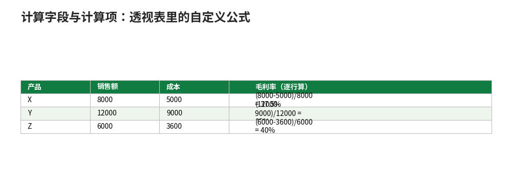

# 计算字段与计算项：透视表里的自定义公式

- **所属栏目**：C08 数据透视表 ／ C08-L2-3 计算字段与计算项
- **适用版本**：Excel 2016／2019／2021／365
- **难度**：进阶
- **预计阅读时长**：30 分钟
- **更新日期**：2026-11-10

## 1. 学习目标

学完本篇，你将能够：
- 用计算字段算毛利率、折扣率等汇总层面指标，并说出与逐行计算的区别
- 用计算项把两个类别合并成一个虚拟项，并说出与改源数据的区别
- 用值显示方式做出占比，并判断何时用计算字段、何时用值显示方式

## 2. 基础概念

### 2.1 计算字段：在汇总层面算

当现有字段算不出你要的指标时用。是在**汇总层面**计算的，不是逐行：公式里的字段先各自汇总，再代入公式。入口：“数据透视表分析”→“字段、项目和集”→“计算字段”，填名称与公式。

关键区别：计算字段不能引用透视表里的“计数”等聚合结果，只能引用源字段；也不能引用透视表里另一列的汇总值。

### 2.2 计算项：在字段内部加虚拟项

在某个字段内部新增一个“虚拟项”，由该字段已有的两个（或多个）项组合而成。入口：行区域选中某字段，“数据透视表分析”→“字段、项目和集”→“计算项”，填名称与公式（如 `= 手机 + 电脑`）。计算项只影响本张透视表，源数据不动；想永久合并类别，改源数据加一列“大类”更稳妥。

### 2.3 计算字段、计算项、值显示方式怎么选

| 需求 | 用什么 |
|---|---|
| 毛利率、折扣率（两个汇总字段相除） | 计算字段 |
| 把两个类别合并成一组（如手机+电脑=数码产品） | 计算项 |
| 占比、环比、排名（对同一值字段换一种显示） | 值显示方式，不用新建字段 |

值显示方式不用新建字段，是最轻的做法；计算字段是汇总层面算，别拿逐行平均去核对它。

## 3. 操作步骤

1. 建计算字段：点透视表，“数据透视表分析”→“字段、项目和集”→“计算字段”。
2. 填名称（如“毛利率”）与公式（如 `= (销售额 - 成本) / 销售额`），确定后字段出现在值区域。
3. 建计算项：行区域选中某字段，“数据透视表分析”→“字段、项目和集”→“计算项”。
4. 填名称（如“数码产品”）与公式（如 `= 手机 + 电脑`），确定。
5. 值显示方式：值字段放两次，第二次右键→“值字段设置”→“值显示方式”→“占总和的百分比”。
6. 核对：计算字段的结果是先汇总再算，与逐行平均不一样是正常的，以汇总结果为准。

## 4. 图文示例

### 4.1 计算字段：毛利率（汇总层面算）

源数据 3 行：X 产品销售额 8000、成本 5000；Y 产品销售额 12000、成本 9000；Z 产品销售额 6000、成本 3600。计算字段“毛利率”公式 `= (销售额 - 成本) / 销售额`：

| 产品 | 销售额 | 成本 | 毛利率（逐行算） |
|---|---|---|---|
| X | 8000 | 5000 | (8000-5000)/8000 = 37.5% |
| Y | 12000 | 9000 | (12000-9000)/12000 = 25% |
| Z | 6000 | 3600 | (6000-3600)/6000 = 40% |

透视表里的毛利率是**汇总层面**算的：销售额合计 26000、成本合计 17600，(26000-17600)/26000 = 32.31%，而不是三行毛利率的平均值 34.17%（(37.5%+25%+40%)/3）。汇总层面算的才是整体真实毛利率，这正是计算字段的正确用法。

### 4.2 计算项：把两个类别合并成一组

产品类别四项：办公用品 12000、耗材 8000、家电 15000、食品 15000，合计 50000。行区域选中“产品类别”字段，计算项名称“办公类”，公式 `= 办公用品 + 耗材`：

验算：办公用品 12000 + 耗材 8000 = 20000；20000 / 50000 = 40%。也就是说办公类合计 20000 元，占总销售额的 40%。计算项是字段内的虚拟项，只影响本张透视表，源数据不动。

### 4.3 值显示方式：占比不用新建字段

值字段放“金额”（求和），再把同一个字段拖进值区域第二次，右键→“值字段设置”→“值显示方式”→“占总和的百分比”。以 4.2 的数据为例：办公用品 12000 / 50000 = 24%、耗材 8000 / 50000 = 16%、家电 15000 / 50000 = 30%、食品 15000 / 50000 = 30%，四项合计 100%。



## 5. 公式和代码

### 5.1 计算字段公式

```excel
毛利率 = (销售额 - 成本) / 销售额 → 汇总层面：(26000-17600)/26000 = 32.31%
折扣率 = 1 - 实收金额 / 原价金额 → 先汇总再相除
```

- 毛利率计算字段的公式写在“计算字段”对话框里，不写进单元格；结果 32.31% 是先汇总再相除，不等于逐行毛利率的平均值 34.17%。
- 计算字段不能引用透视表里的“计数”等聚合结果，只能引用源字段。

### 5.2 计算项公式

```excel
办公类 = 办公用品 + 耗材 → 12000 + 8000 = 20000，占总销售额 40%
```

- 公式里的项名就是字段里的项名，有空格的项名不用加引号，直接写。
- 计算项是虚拟项：删掉计算项，源数据与原有项都不受影响。

## 6. 实际工作场景

### 6.1 销售分析：毛利率一眼见

销售明细有销售额与成本两列，老板要毛利率。计算字段一次建好，透视表按产品类别分组，毛利率列自动按汇总算；再按毛利率降序，哪个品类最赚钱一眼可见。注意：别用逐行毛利率的平均值去核对，汇总层面 32.31% 才是对的。

### 6.2 报表合并：临时并类不改源数据

月报要把“办公用品”与“耗材”并成“办公类”单列，但源数据下月还要原样用。计算项最合适：本月报表里有“办公类” 20000 元，源数据不动，下月想拆回两项，删掉计算项即可。长期固定要并类，改源数据加一列“大类”更稳妥。

## 7. 常见错误

| 错误现象 | 原因 | 解决方案 |
|---|---|---|
| 计算字段结果和逐行算的不一样 | 计算字段是在汇总层面算的，先汇总再代入公式 | 这是正常现象：整体毛利率 32.31% 不等于逐行毛利率的平均值 34.17%，以汇总结果为准 |
| 计算字段公式里引用了“计数”报错 | 计算字段只能引用源字段，不能引用聚合结果 | 把“计数”换成源字段重写公式；或先用值显示方式出占比 |
| 计算项建好后数字不对 | 公式里的项名写错（如多了空格） | 核对项名与字段里的项名逐字一致；公式 `= 办公用品 + 耗材` 里的项名直接写，不加引号 |
| 计算项影响了其他透视表 | 计算项只影响本张透视表，不会跨表 | 若其他表数字也变了，查是不是改了源数据；计算项本身不跨表 |
| 占比用计算字段算出来是错的 | 占比是“同一值字段换一种显示”，不该新建字段 | 用值显示方式“占总和的百分比”，不用计算字段 |

## 8. 相关教程

- 同栏目：创建与布局（docs/pivottable/01-pivottable.md，先会建表与拖字段）
- 同栏目：分组与筛选（docs/pivottable/02-group-filter.md，分组后再算字段）
- 同栏目：透视表实战（docs/pivottable/06-practice-cases.md，计算字段的综合任务）
- 跨栏目：公式基础（docs/formulas/01-formula-basics.md，公式里的引用与运算符）

## 9. 练习题

1. 3 行小表：X 产品销售额 8000、成本 5000；Y 产品销售额 12000、成本 9000；Z 产品销售额 6000、成本 3600。用计算字段算整体毛利率是多少？为什么不是 37.5%、25%、40% 的平均值？
2. 办公用品 12000、耗材 8000、家电 15000、食品 15000，用计算项把办公用品与耗材合并成“办公类”，是多少？占总销售额的百分之几？
3. 想看各类别占总销售额的百分比，用计算字段还是值显示方式？为什么？
4. 计算字段的公式里能引用透视表里的“计数”结果吗？

## 10. 参考答案

<details>
<summary>点击查看答案</summary>

1. 整体毛利率 32.31%。计算字段先汇总再算：(26000-17600)/26000 = 32.31%；37.5%、25%、40% 的平均值 34.17% 是逐行毛利率的平均，不是整体毛利率。

2. 办公类 20000 元（12000+8000），占总销售额 50000 的 40%。

3. 用值显示方式“占总和的百分比”。占比是同一值字段换一种显示，不用新建字段；计算字段是汇总层面算新指标。

4. 不能。计算字段只能引用源字段，不能引用透视表里的“计数”等聚合结果。

</details>

## 11. 可下载示例文件

- [数据-透视表练习数据.xlsx](../../templates/数据-透视表练习数据.xlsx)
