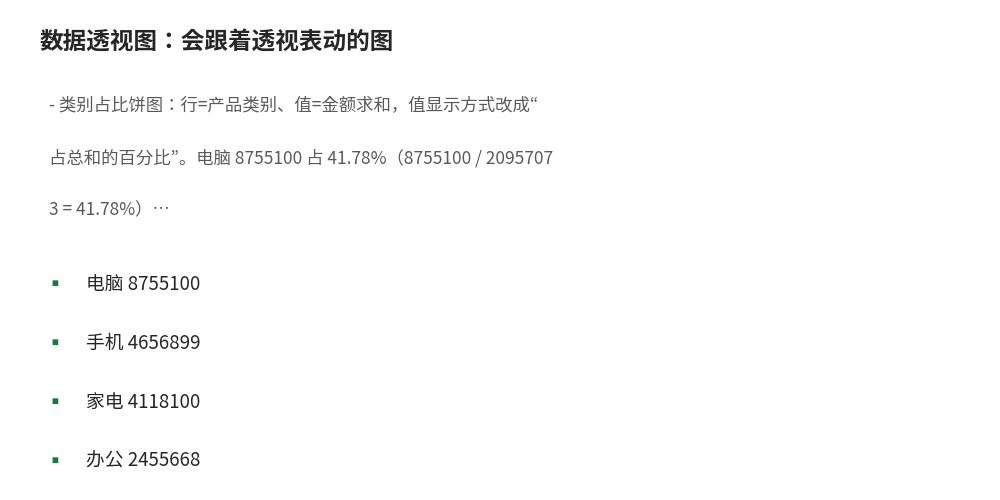

# 数据透视图：会跟着透视表动的图

- **所属栏目**：C08 数据透视表 ／ C08-L2-5 数据透视图
- **适用版本**：Excel 2016／2019／2021／365
- **难度**：进阶
- **预计阅读时长**：20 分钟
- **更新日期**：2026-11-10

## 1. 学习目标

学完本篇，你将能够：
- 创建数据透视图并说出两种创建方式的区别
- 按场景选对透视图类型（趋势用折线、对比用柱形、占比用饼图）
- 用字段窗格改透视图的布局，并说出透视图与普通图表的三个区别

## 2. 基础概念

### 2.1 数据透视图是什么

数据透视图是与透视表联动的图表：透视表一筛选，图跟着变；图上点选系列，也能反向筛选透视表。图和表共用同一字段窗格：行／列字段决定图的分类轴与图例，值字段决定图的数值。改字段布局，图同步重画。

### 2.2 两种创建方式

| 方式 | 做法 | 适用 |
|---|---|---|
| 先有表再建图 | 点透视表内任一格，“数据透视表分析”→“数据透视图”，选类型 | 已有透视表，补一张图 |
| 建表时一起建 | 建透视表时勾选“添加数据透视图”，表和图一次生成 | 从零做仪表盘 |

两种方式得到的图与表是同一对联动关系，没有区别。

### 2.3 图表类型怎么选

| 场景 | 透视图类型 | 字段放法 |
|---|---|---|
| 月度趋势 | 折线图 | 行=月份，值=金额求和 |
| 各区域对比 | 簇状柱形图 | 行=区域，值=金额求和 |
| 类别占比 | 饼图 | 行=产品类别，值=金额求和，值显示方式改成“占总和的百分比” |
| 两维对比 | 簇状柱形图+图例 | 行=区域、列=产品类别，值=金额求和 |

### 2.4 透视图与普通图表的三个区别

- **数据源不能自由改**：透视图的系列由透视表字段决定，不能像普通图表那样直接改数据源或删系列，改动要回透视表的字段窗格做。
- **筛选联动**：透视表一筛选，图跟着变；图上点选系列，也能反向筛选透视表。普通图表没有这个。
- **刷新同步**：源数据刷新后，透视表与透视图一起更新；普通图表只在数据源变了时才变。

想做完全自定义的图，先把透视表结果复制为值，再按普通图表做法画。

## 3. 操作步骤

1. 点透视表内任一格，“数据透视表分析”→“数据透视图”。
2. 选图表类型：趋势用折线图、对比用簇状柱形图、占比用饼图，确定。
3. 改布局：拖字段窗格里的行／列／值字段，图同步重画。
4. 占比图：值字段再拖一次，值显示方式改成“占总和的百分比”。
5. 联动检查：点透视表的筛选，图跟着变；点图上的系列，透视表跟着筛。
6. 刷新：源数据变了，右键透视表→刷新，图同步更新。

## 4. 图文示例

练习数据文件（数据-透视表练习数据.xlsx，500 行销售明细，总金额 20957073）里的三个图：

- 月度趋势折线图：行=月份（组合为“月”）、值=金额求和。最高点 1 月 3145764，最低点 7 月 1634673；季度合计 Q1 7993120、Q2 6814167、Q3 6149786，逐季下降，折线一眼可见。
- 区域对比柱形图：行=区域、值=金额求和。华南 5452113 最高、华中 3293765 最低，柱子高低直接对比。
- 类别占比饼图：行=产品类别、值=金额求和，值显示方式改成“占总和的百分比”。电脑 8755100 占 41.78%（8755100 / 20957073 = 41.78%），手机 4656899 占 22.22%，家电 4118100 占 19.65%，办公 2455668 占 11.72%，配件 971306 占 4.63%，五项合计 100.00%。



## 5. 公式和代码

透视图本身没有公式要写，核对靠透视表外的引用：

```excel
=GETPIVOTDATA("金额", $A$3, "月份", "2026-01") → 3145764
```

在透视表外引用 1 月的金额汇总，应为 3145764；图上 1 月的点就是这个值，表图一致。

```excel
=8755100 / 20957073 → 41.78%
```

电脑类占总销售额的比例：8755100 / 20957073 = 41.78%，饼图里电脑那块就是这个比例。

## 6. 实际工作场景

### 6.1 月度经营会：趋势图+占比图一页

月度经营会一页放两张透视图：上面折线图看 1–9 月趋势（Q1 7993120 到 Q3 6149786 逐季下降），下面饼图看产品类别占比（电脑 41.78% 占大头）。会上点切片器切区域，两张图一起变，不用逐张重做。

### 6.2 区域复盘：柱形图一眼排座次

区域复盘用簇状柱形图：华南 5452113、华东 5283360、西南 3549711、华北 3378124、华中 3293765，柱子从高到低排好，座次一眼可见。再点图上的“华南”柱子，透视表反向筛出华南明细，追问直接跟进。

## 7. 常见错误

| 错误现象 | 原因 | 解决方案 |
|---|---|---|
| 透视图改不了系列 | 透视图的系列由透视表字段决定，不能直接改 | 回透视表的字段窗格改行／列／值字段，图同步重画；想完全自定义，先把透视结果复制为值再画普通图 |
| 图上点了系列，透视表没变 | 点的是图表空白处，不是系列 | 点图上的柱子或折线点（系列本身），才能反向筛选透视表 |
| 透视图类型选错，趋势看不出来 | 月度趋势用了饼图 | 趋势用折线图、对比用柱形图、占比用饼图，按 2.3 节选 |
| 饼图类别太多看不清 | 类别超过 6 个，饼图碎成一堆 | 类别多时改用簇状柱形图；或先按值筛选只留前 5 类 |
| 刷新后图没变 | 只刷新了图，没刷新透视表 | 刷新透视表（右键→刷新），图同步更新；图本身没有独立的刷新 |
| 占比饼图百分比加起来不是 100% | 四舍五入尾差 | 精确值合计 100.00%，显示值合计 100.01% 这类尾差是正常的，以精确值为准 |

## 8. 相关教程

- 同栏目：创建与布局（docs/pivottable/01-pivottable.md，先会建表与拖字段）
- 同栏目：切片器与日程表（docs/pivottable/04-slicers-timelines.md，切片器联动透视图）
- 同栏目：计算字段与计算项（docs/pivottable/03-calculated-fields-items.md，值显示方式做占比）
- 跨栏目：图表大全（docs/charts/01-column-bar.md，普通图表的类型选择对照）

## 9. 练习题

1. 数据透视图与普通图表最大的区别是什么？
2. 月度趋势用什么图？各区域对比用什么图？类别占比用什么图？
3. 练习数据里电脑类 8755100 元、总金额 20957073 元，饼图里电脑占百分之几？写出算式。
4. 透视图想改系列（如删掉某个产品），直接在图上改行吗？正确做法是什么？
5. 1 月 3145764、7 月 1634673，折线图上最高点与最低点分别是哪月？

## 10. 参考答案

<details>
<summary>点击查看答案</summary>

1. 透视图与透视表联动：透视表一筛选图跟着变，图上点选系列也能反向筛选透视表；普通图表没有这个联动。

2. 月度趋势用折线图，各区域对比用簇状柱形图，类别占比用饼图（值显示方式改成“占总和的百分比”）。

3. 占 41.78%。算式：8755100 / 20957073 = 41.78%。

4. 不行。透视图的系列由透视表字段决定，改动要回透视表的字段窗格做；想完全自定义，先把透视结果复制为值再画普通图。

5. 最高点 1 月 3145764，最低点 7 月 1634673。

</details>

## 11. 可下载示例文件

- [数据-透视表练习数据.xlsx](../../templates/数据-透视表练习数据.xlsx)
