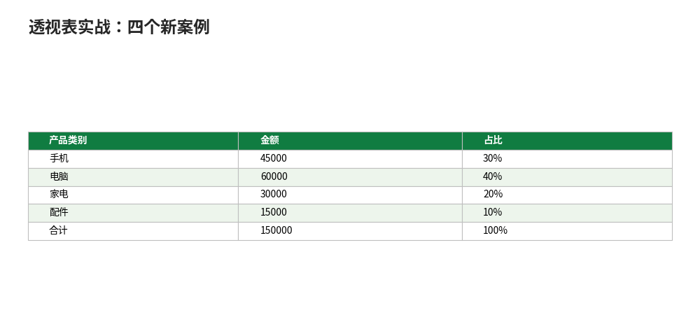

# 透视表实战：四个新案例

- **所属栏目**：C08 数据透视表 ／ C08-L2-6 透视表实战
- **适用版本**：Excel 2016／2019／2021／365
- **难度**：进阶
- **预计阅读时长**：30 分钟
- **更新日期**：2026-11-10

## 1. 学习目标

学完本篇，你将能够：
- 用透视表做考勤异常统计、客户 Top 10、月度环比、产品占比四个实战案例
- 每个案例都用行列合计交叉核对数字，任一口径对不上先查源数据
- 对照案例做法，把自己的明细表换成透视表报表

## 2. 基础概念

### 2.1 实战案例的通用做法

四个案例共用一套做法：源数据先整理成规范二维表（第一行标题行，无合并单元格、无空行空列），再建透视表拖字段，最后核对。核对只有一条铁律：**行合计与列合计交叉相加都等于总计**，任一口径对不上，先查源数据有没有文本型数字、空行、重复行。

### 2.2 四个案例分工

| 案例 | 练什么 | 关键操作 |
|---|---|---|
| 考勤异常统计 | 行列交叉+计数 | 行=姓名、列=状态、值=状态（计数） |
| 客户 Top 10 | 值筛选 | 值筛选→前 10 个（本例 6 家取前 3） |
| 月度环比 | 值显示方式 | 差异百分比，基本字段选日期、基本项选上一个 |
| 产品占比 | 值显示方式 | 占总和的百分比 |

本篇四个案例用行内小数据（每案 4–6 行），不用练习数据文件；想练 500 行大表，去 01-创建与布局篇的 6 个任务。

## 3. 操作步骤

1. 把明细整理成规范二维表：第一行标题行，每列一种数据。
2. 选中数据区域任意单元格，插入→数据透视表，选新工作表。
3. 按案例拖字段：行、列、值、筛选各就各位。
4. 改汇总方式：右键值字段→值字段设置（求和／计数／平均值）。
5. 需要时加值显示方式：占比选“占总和的百分比”，环比选“差异百分比”。
6. 核对：行合计与列合计交叉相加等于总计；各组人数合计等于总行数。

## 4. 图文示例

### 4.1 案例 1：考勤异常统计

源数据：姓名、日期、状态（正常／迟到／缺勤）。做法：行→姓名，列→状态，值→状态（计数）。

| 姓名 | 正常 | 迟到 | 缺勤 | 合计 |
|---|---|---|---|---|
| 张三 | 18 | 2 | 0 | 20 |
| 李四 | 20 | 0 | 0 | 20 |
| 王五 | 19 | 1 | 0 | 20 |
| 赵六 | 16 | 3 | 1 | 20 |
| 合计 | 73 | 6 | 1 | 80 |

核对：每人 20 天，4 人合计 80 天；迟到合计 6 次（2+0+1+3），缺勤 1 次。一眼看出赵六迟到最多（3 次），且是唯一缺勤的人。

### 4.2 案例 2：客户 Top 10（6 家取前 3）

6 家客户金额：A 50000、B 42000、C 38000、D 30000、E 25000、F 18000，合计 203000。做法：行→客户名称，值→金额（求和），右键行标签→筛选→前 10 个，取前 3：

| 客户 | 金额 |
|---|---|
| A | 50000 |
| B | 42000 |
| C | 38000 |
| 前 3 合计 | 130000 |

核对：前 3 合计 130000（50000+42000+38000），占总金额 203000 的 64.04%（130000 / 203000 = 64.04%）。200 家客户的做法完全相同，只是“前 10 个”改成取 10 家。

### 4.3 案例 3：月度环比增长率

4 个月销售额：1 月 80000、2 月 96000、3 月 84000、4 月 105000。做法：行→日期（组合为“月”），值→金额，值显示方式选“差异百分比”，基本字段选“日期”，基本项选“（上一个）”。

| 月份 | 金额 | 环比 |
|---|---|---|
| 1 月 | 80000 | —（首月无上月） |
| 2 月 | 96000 | +20%（(96000-80000)/80000） |
| 3 月 | 84000 | -12.5%（(84000-96000)/96000） |
| 4 月 | 105000 | +25%（(105000-84000)/84000） |

核对：2 月增长两成、3 月回落 12.5%、4 月反弹 25%，三个环比的算式分母都是上月金额。

### 4.4 案例 4：产品占比

4 类产品：手机 45000、电脑 60000、家电 30000、配件 15000，合计 150000。做法：值字段放两次，一次求和、一次值显示方式“占总和的百分比”。

| 产品类别 | 金额 | 占比 |
|---|---|---|
| 手机 | 45000 | 30% |
| 电脑 | 60000 | 40% |
| 家电 | 30000 | 20% |
| 配件 | 15000 | 10% |
| 合计 | 150000 | 100% |

核对：45000+60000+30000+15000=150000；占比 30%+40%+20%+10%=100%。



## 5. 公式和代码

四个案例的核对公式（在透视表外验证）：

```excel
=SUM(考勤合计列) → 80
```

考勤案例：每人 20 天×4 人 = 80 天；迟到合计 6 次，缺勤 1 次。

```excel
=130000 / 203000 → 64.04%
```

Top 案例：前 3 名 130000 占总金额 203000 的 64.04%。

```excel
=(96000-80000)/80000 → 20%
=(84000-96000)/96000 → -12.5%
=(105000-84000)/84000 → 25%
```

环比案例：三个环比的分母都是上月金额，首月无环比。

## 6. 实际工作场景

### 6.1 人事月报：考勤异常一眼见

人事每月收考勤表：行→姓名、列→状态、值→状态（计数）。一眼看出谁迟到最多、谁缺勤；再加切片器按部门筛选，部门会只看本部门。迟到 3 次以上标红：透视表结果再用条件格式标色，见 C06。

### 6.2 销售复盘：头部客户与环比一起看

销售复盘两张表拼一页：左表客户 Top 10（值筛选前 10 个），右表月度环比（差异百分比）。头部占比过高（如前 3 占 64.04%）提示客户集中风险；环比三连降提示趋势问题。两张表都基于同一张销售明细，刷新一次全更新。

## 7. 常见错误

| 错误现象 | 原因 | 解决方案 |
|---|---|---|
| 行列合计交叉对不上 | 源数据有文本型数字、空行或重复行 | 先清洗源数据：文本型数字转数值、删空行、去重；再建透视表 |
| 值筛选“前 10 个”取出来不对 | 值字段汇总方式不是求和（如默认成了计数） | 先确认汇总方式：右键值字段→值字段设置，改成求和再筛选 |
| 环比首月也有数字 | 首月没有上月，差异百分比本应为空 | 首月为空是正常的；想显示 0，在源数据里补一个上年 12 月做基数 |
| 占比合计不是 100% | 四舍五入尾差 | 精确值合计 100.00%，显示值尾差是正常的，以精确值为准 |
| 计数不对 | 值字段默认对文本“计数”、对数字“求和” | 先确认汇总方式：考勤案例的值字段必须是“计数”，不是求和 |
| 新增数据不进来 | 数据源范围没包含新行 | 把源数据转成“表格”（Ctrl+T）再建透视表，新增行自动纳入；或点透视表→“更改数据源”扩大范围 |

## 8. 相关教程

- 同栏目：创建与布局（docs/pivottable/01-pivottable.md，500 行练习数据的 6 个任务）
- 同栏目：分组与筛选（docs/pivottable/02-group-filter.md，分组与值筛选的做法）
- 同栏目：计算字段与计算项（docs/pivottable/03-calculated-fields-items.md，毛利率等汇总层面指标）
- 同栏目：切片器与日程表（docs/pivottable/04-slicers-timelines.md，复盘时点选切换）
- 跨栏目：条件格式（docs/conditional-formatting/01-conditional-formatting.md，透视表结果再上色）

## 9. 练习题

1. 考勤表 4 人每人 20 天，迟到次数张三 2、李四 0、王五 1、赵六 3，迟到合计几次？谁迟到最多？
2. 6 家客户金额 50000、42000、38000、30000、25000、18000，前 3 名合计多少？占总金额的百分之几？
3. 1 月 80000、2 月 96000，2 月环比是多少？写出算式。
4. 手机 45000、电脑 60000、家电 30000、配件 15000，电脑占总销售额的百分之几？
5. 行列合计交叉对不上，最可能的原因是什么？先查哪里？

## 10. 参考答案

<details>
<summary>点击查看答案</summary>

1. 迟到合计 6 次（2+0+1+3）。赵六迟到最多，3 次。

2. 前 3 名合计 130000（50000+42000+38000），占总金额 203000 的 64.04%。

3. 2 月环比 +20%。算式：(96000-80000)/80000 = 20%。

4. 电脑占 40%。算式：60000 / 150000 = 40%。

5. 源数据有文本型数字、空行或重复行。先清洗源数据：文本型数字转数值、删空行、去重，再建透视表。

</details>

## 11. 可下载示例文件

- [数据-透视表练习数据.xlsx](../../templates/数据-透视表练习数据.xlsx)（500 行销售明细，练大表时用；本篇四个案例用行内小数据）
