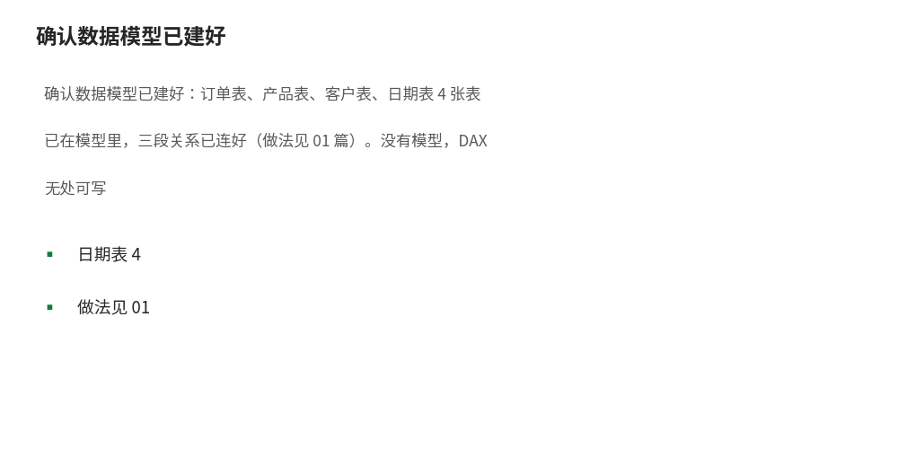
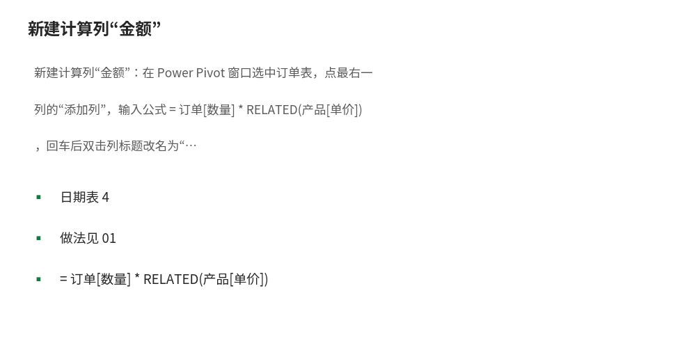
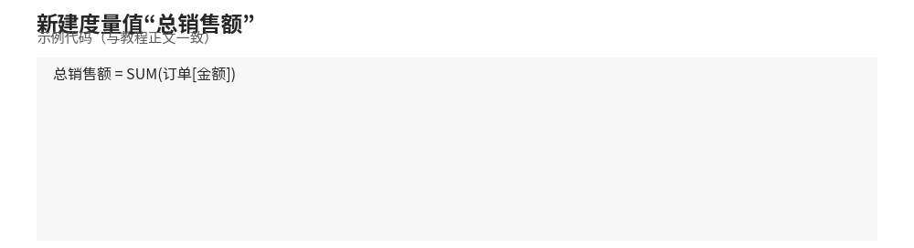
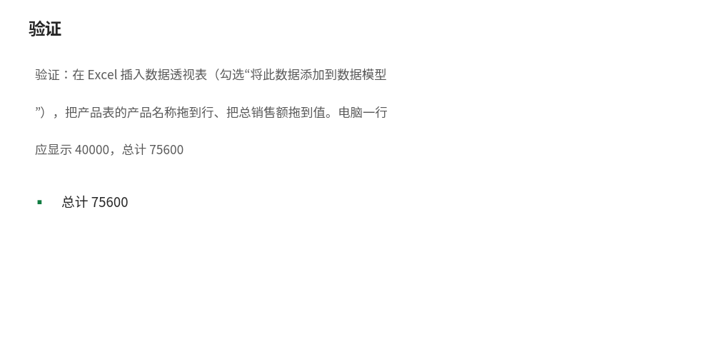
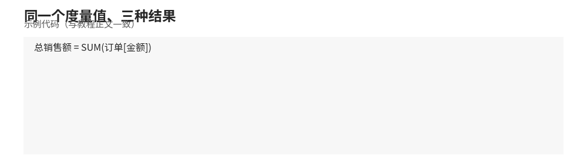

# DAX 基础：语法、计算列与度量值、行上下文与筛选上下文

- **所属栏目**：C10 Power Pivot 与 DAX ／ C10-L2-2 DAX 基础
- **适用版本**：Excel 2016／2019／2021／365（需启用 Power Pivot 加载项；部分家庭版无此功能）
- **难度**：进阶
- **预计阅读时长**：40 分钟
- **更新日期**：2026-11-10

## 1. 学习目标

学完本篇，你将能够：
- 写出正确的 DAX 语法：函数名、表名、列引用、度量值引用的写法
- 说出计算列与度量值的 4 处区别，并判断一个需求该用哪一个
- 用“逐行”和“先筛后算”两句话解释行上下文与筛选上下文
- 指出 3 个行上下文与筛选上下文的典型反例错在哪里
- 用 SUM、COUNTROWS、AVERAGE 写出总销售额、订单笔数、平均单价，并报出每个度量值的预期结果

本篇并入 data.json ppivot 种子 1 条：DAX 公式入门（DAX 长得像 Excel 函数但思维是列式，SUM(表[列])、CALCULATE(表达式, 筛选)、RELATED(取关联表字段)）。

## 2. 基础概念

### 2.1 DAX 是什么

DAX（Data Analysis Expressions，数据分析表达式）是 Power Pivot 里写公式的语言。外形像 Excel 函数：SUM、AVERAGE、IF 这些名字都一样；思维是列式的：公式操作的是整列、整张表，而不是单个单元格。写 DAX 之前先忘掉“A1 单元格”这种定位方式，改成想“对哪张表的哪一列、按什么条件算”。

### 2.2 DAX 语法

- 表名用单引号括起来（表名含中文或空格时必须写）：`'订单'`，或省略单引号写 `订单`。
- 列引用写成 `表[列]`：`订单[金额]`、`产品[单价]`。
- 度量值引用只写方括号：`[总销售额]`，前面不加表名。
- 计算列公式以等号开头：`= 订单[数量] * RELATED(产品[单价])`；度量值公式同样以等号开头：`= SUM(订单[金额])`。
- 注释用双斜线：`// 这是注释`。

### 2.3 计算列与度量值

| 对比项 | 计算列 | 度量值 |
|---|---|---|
| 存在位置 | 表里真实的一列，每行都有一个值 | 不占列，只在透视表、图表里现算出一个值 |
| 计算时机 | 数据加载或刷新时逐行算好、存起来 | 查询时按当前筛选现算 |
| 典型用途 | 每行都要用的派生值，如订单金额 = 数量 × 单价 | 汇总指标，如总销售额、利润率、同比 |
| 内存占用 | 占内存（算好存起来） | 几乎不占（算完即走） |
| 随筛选变化 | 值固定不变，筛不掉 | 随切片器、行列筛选自动重算 |

判断口诀：**要的是“每行一个值”写计算列；要的是“一个汇总数”写度量值**。订单金额每行不同，用计算列；总销售额只有一个汇总数，用度量值。

### 2.4 行上下文与筛选上下文（DAX 最难的概念）

DAX 公式求值时同时受两种上下文影响，90% 的 DAX 报错和“数字不对”都出在这里。

- **行上下文**：公式正在算“当前这一行”。计算列天生有行上下文：算 O001 这一行的金额时，`订单[数量]` 就是 O001 的 2，`订单[单价]` 就是 O001 所在行的单价值。迭代函数（SUMX、FILTER、ADDCOLUMNS）也会逐行产生行上下文。
- **筛选上下文**：公式正在算“经过筛选后剩下的那些行”。透视表的行标签、列标签、切片器都是筛选上下文：透视表里“电脑”那一行，就是先把订单表筛到产品是电脑的 4 笔订单，再对这 4 行求和。度量值天生只有筛选上下文，没有行上下文。

两句话记住：**行上下文决定“当前是哪一行”，筛选上下文决定“还剩哪些行”**。计算列靠行上下文逐行算；度量值靠筛选上下文汇总算。

### 2.5 两个上下文如何互相影响

- 度量值里用 CALCULATE 可以改筛选上下文（下一章细讲）。
- 迭代函数里用 CALCULATE 会发生上下文转换：行上下文变成筛选上下文，即“当前行”的值变成筛选条件。这是 DAX 进阶的第一个坎，本篇先记住结论，03 篇有实例。

## 3. 操作步骤

1. 确认数据模型已建好：订单表、产品表、客户表、日期表 4 张表已在模型里，三段关系已连好（做法见 01 篇）。没有模型，DAX 无处可写 
2. 新建计算列“金额”：在 Power Pivot 窗口选中订单表，点最右一列的“添加列”，输入公式 `= 订单[数量] * RELATED(产品[单价])`，回车后双击列标题改名为“金额” 
3. 检查计算列结果：O001 一行金额应为 10000（2 × 5000），O003 一行应为 3000（10 × 300）。对不上先查 RELATED 有没有连对关系。
4. 新建度量值“总销售额”：在 Power Pivot 窗口选中订单表，右键 → 新建度量值 → 度量值名称填“总销售额”，公式填 `= SUM(订单[金额])`，格式选货币 
5. 新建度量值“订单笔数”与“客单价”：订单笔数公式 `= COUNTROWS(订单)`；客单价公式 `= DIVIDE([总销售额], [订单笔数])`。DIVIDE 会在除数为零时返回空值，比直接用斜线更安全。
6. 验证：在 Excel 插入数据透视表（勾选“将此数据添加到数据模型”），把产品表的产品名称拖到行、把总销售额拖到值。电脑一行应显示 40000，总计 75600 

## 4. 图文示例

示例 1：计算列金额的前 3 行（文字版，订单表）。

| 订单号 | 数量 | 单价（RELATED 取产品表） | 金额（计算列） |
|---|---|---|---|
| O001 | 2 | 5000 | 10000 |
| O002 | 3 | 3000 | 9000 |
| O003 | 10 | 300 | 3000 |

每一行的金额只跟本行有关：O001 的 10000 = 2 × 5000，与其他行无关。这就是行上下文。

示例 2：度量值随筛选变化（文字版）。

- 不筛任何条件时，总销售额 = 75600（12 笔全算）。
- 透视表行标签选“电脑”时，总销售额 = 40000（只剩 O001、O006、O007、O012 共 4 笔）。
- 再叠加切片器选地区“华东”，总销售额 = 25000（只剩 O001、O007 两笔：10000+15000）。

同一个度量值、三种结果，变的是筛选上下文，不是公式本身 

## 5. 公式和代码

DAX 语法经 Microsoft 官方文档核对；输入表与预期结果经 Python 独立验算；未在 Excel 内执行验证。以下度量值均以本篇配套表的 12 行订单为准。

示例 1：总销售额（入门第一式）。

```dax
总销售额 = SUM(订单[金额])
```

运行结果：总销售额 = 75600（12 行金额合计：10000+9000+3000+1000+3000+5000+15000+6000+6000+1600+6000+10000）。

示例 2：订单笔数。

```dax
订单笔数 = COUNTROWS(订单)
```

运行结果：订单笔数 = 12（订单表共 12 行）。

示例 3：平均单价（对产品表的单价列取平均）。

```dax
平均单价 = AVERAGE(产品[单价])
```

运行结果：平均单价 = 2000（(5000+3000+300+200+1500) / 5 = 10000 / 5）。

示例 4：客单价（度量值引用度量值）。

```dax
客单价 = DIVIDE([总销售额], [订单笔数])
```

运行结果：客单价 = 6300（75600 / 12）。

示例 5：计算列金额（逐行算）。

```dax
金额 = 订单[数量] * RELATED(产品[单价])
```

运行结果：O001 行 10000、O002 行 9000、O003 行 3000、O004 行 1000、O005 行 3000、O006 行 5000、O007 行 15000、O008 行 6000、O009 行 6000、O010 行 1600、O011 行 6000、O012 行 10000；12 行合计 75600，与示例 1 的度量值互相印证。

反例 1：在度量值里直接写列引用（最常见的初学错误）。

```dax
// 错误写法：度量值没有行上下文，订单[数量]不知道指哪一行
错误客单价 = 订单[数量] * 订单[单价]
```

运行结果：报错。度量值里没有“当前行”，`订单[数量]` 是一整列，不能直接参与单值运算。正确做法是先用 SUMX 逐行算再汇总（见 03 篇），或写成计算列。

反例 2：在产品表计算列里用 RELATED 取订单表字段（方向反了）。

```dax
// 错误写法：RELATED 只能从多端取一端，不能从一端取多端
错误金额 = RELATED(订单[金额])
```

运行结果：报错。一个产品对应多笔订单，RELATED 不知道取哪一笔。正确做法是在订单表（多端）用 RELATED 取产品表（一端）的字段；反方向取多行要用 RELATEDTABLE（返回一张表，再配 SUMX 汇总）。

反例 3：把度量值当计算列用，以为每行都会变。

```dax
// 度量值本身没错，但放在订单明细表里当“每行金额”用就是错的
总销售额 = SUM(订单[金额])
```

运行结果：明细表每一行都显示 75600（整表汇总值），而不是本行的金额。原因：度量值只有筛选上下文、没有行上下文，在明细行里筛不到“当前行”。每行金额必须用计算列。

## 6. 实际工作场景

场景：销售日报的三个数，老板每天要看。

- 背景：每天下班前，老板问三个数：今天总共卖了多少、多少笔、平均每笔多少。订单明细每天追加，产品单价在产品表里。
- 做法：数据模型里建好关系后，写 3 个度量值：总销售额 `= SUM(订单[金额])`、订单笔数 `= COUNTROWS(订单)`、客单价 `= DIVIDE([总销售额], [订单笔数])`；透视表行拖日期表里的日期，值拖这 3 个度量值。
- 结果：以本篇数据为例，全表三个数是 75600、12 笔、6300；按月展开后，2026-01 是 21000、2 笔、10500，2026-02 是 7600、2 笔、3800，2026-03 是 16000、2 笔、8000。每天追加订单后刷新即可，不用每天重写公式。
- 要点：这三个数全是度量值，原因是要的是汇总数、且要随日期筛选自动变化；如果写成计算列，透视表里每行都会显示同一个全表汇总值。

## 7. 常见错误

| 错误现象 | 原因 | 解决方案 |
|---|---|---|
| 度量值里写列名直接报错 | 度量值没有行上下文，列引用不知道指哪一行 | 用 SUM、COUNTROWS、SUMX 等聚合函数包起来；或改写成计算列 |
| 计算列每一行都是同一个数 | 在计算列里用了 SUM(整列) 这类聚合 | 计算列要逐行算，用行内列运算（如数量 × 单价），不要用聚合函数 |
| RELATED 报错“找不到相关行” | 方向反了，从一端取多端 | RELATED 只能多端取一端；反方向用 RELATEDTABLE 加 SUMX |
| 度量值在明细行里全是总计值 | 把度量值当计算列用 | 明细行要每行不同的值，改用计算列；度量值只放汇总位置 |
| SUM 求和结果比手工加的大 | 金额列里混进了文本型数字或重复行 | 检查金额列类型是否为数值；检查模型里有没有重复导入同一张表 |
| AVERAGE 平均数明显不对 | 对事实表数量列取了平均，而不是按订单平均 | 明确平均对象：产品单价平均用 AVERAGE(产品[单价]) = 2000；客单价要用 DIVIDE([总销售额], [订单笔数]) = 6300 |
| 度量值名含空格后引用报错 | 引用度量值时漏了方括号 | 度量值一律用方括号引用，如 [总销售额]；表名含空格时加单引号 |
| 写了公式但透视表里找不到度量值 | 度量值建在了另一张表上 | 在 Power Pivot 窗口确认度量值所属表；建议把度量值统一建在事实表（订单表）上 |

## 8. 相关教程

- 同栏目上一篇：01-data-model.md（数据模型：添加到数据模型、关系视图、主外键、星型模型）
- 同栏目下一篇：03-measures-calculated-columns.md（度量值与计算列：CALCULATE、SUMX、RELATED、FILTER、ALL）
- 跨栏目相关：docs/formulas/01-formula-basics.md（公式基础：公式结构、运算符、相对引用与绝对引用）

## 9. 练习题

1. 写出度量值“总销售额”的 DAX 公式，并说出它的预期结果是多少。
2. 计算列“金额”的公式是 `= 订单[数量] * RELATED(产品[单价])`，O007 一行的金额是多少？写出算式。
3. 判断：客单价应该写成计算列还是度量值？为什么？
4. 下面的度量值为什么报错？`错误公式 = 订单[数量] * 5000`。写出正确的改法（两种改法任选一种）。
5. 透视表行标签是产品名称时，总销售额度量值在“电脑”一行显示多少？在“键盘”一行显示多少？两数相加是多少？
6. AVERAGE(产品[单价]) 的结果是 2000。如果改成 AVERAGE(订单[金额])，结果是多少？这个数有什么业务含义？

## 10. 参考答案

<details>
<summary>点击查看答案</summary>

1. `总销售额 = SUM(订单[金额])`，预期结果 75600。
2. O007 金额 = 3 × 5000 = 15000。
3. 度量值。因为客单价是一个汇总数（总销售额除以订单笔数），且要随日期、产品等筛选自动变化；计算列的值固定不变，不适合。
4. 报错原因：度量值没有行上下文，`订单[数量]` 是一整列，不能直接乘。改法一：改成计算列 `金额2 = 订单[数量] * 5000`。改法二：改成度量值 `= SUMX(订单, 订单[数量] * 5000)`。
5. 电脑一行 40000，键盘一行 2600，两数相加 42600。
6. AVERAGE(订单[金额]) = 75600 / 12 = 6300。这个数等于客单价（每笔订单的平均金额），因为订单表一行就是一笔订单；但它和产品平均单价 2000 不是一回事，不要混用。

</details>

## 11. 可下载示例文件

- 示例-Power-Pivot-数据模型与DAX.xlsx（templates/示例-Power-Pivot-数据模型与DAX.xlsx，含订单表 12 行、产品表 5 行、客户表 4 行、日期表 455 行、库存表 5 行、使用说明）
