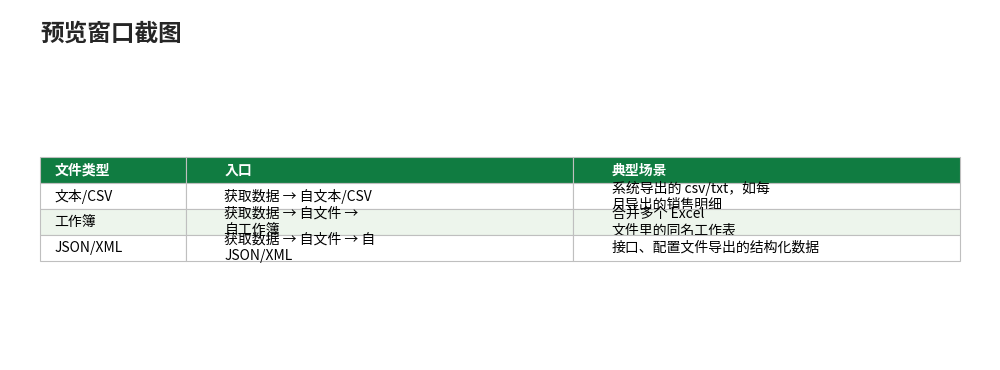

# Power Query：数据的清洗车间——获取数据

- **所属栏目**：C09 Power Query ／ C09-L2-1 获取数据
- **适用版本**：Excel 2016／2019／2021／365（内置，位于“数据”选项卡）；Excel 2013 需单独安装 Power Query 插件；Excel 2010 同样需安装插件
- **难度**：中级
- **预计阅读时长**：25 分钟
- **更新日期**：2026-11-10

## 1. 学习目标

学完本篇，你将能够：
- 从文件、文件夹、数据库、网页四种来源获取数据，并说出每种来源适用的场景
- 用从文件夹获取做月度报表自动化：每月丢新文件，刷新一次即并入
- 导入后核对行数与列类型，并说出编码 65001 与 936 的区别

## 2. 基础概念

### 2.1 Power Query 是什么

它是 Excel 里的一个**数据加工流水线**：你把“获取→清洗→整理”的每一步操作点一遍，Power Query 会把步骤记下来。下个月拿到新的源文件，点一下“刷新”，所有步骤自动重跑一遍。

和公式的区别：

- 公式是“算出一个结果”，Power Query 是“产出一张干净的表”。
- 公式适合行内计算；Power Query 适合**结构性整理**：拆分列、转置、合并文件、逆透视——这些用公式写会很痛苦。

核心观念：**你点的每一步都会变成一行 M 代码**，记录在右侧“应用的步骤”里。可以回头修改、删除、调整顺序。M 代码的读法见 04-M 语言入门篇。

### 2.2 三个基本概念：查询、步骤、加载

| 概念 | 含义 | 类比 |
|---|---|---|
| 查询 (Query) | 一段取数加清洗的完整定义，从来源到输出结果 | 一条做菜的菜谱 |
| 步骤 (Step) | 查询里的一次操作，如提升标题、拆分列、筛选行 | 菜谱里的一步 |
| 加载 (Load) | 把查询结果放进哪里：工作表中的表、仅创建连接、数据模型 | 菜做好端上哪张桌子 |

一个查询可以只加载为“仅创建连接”，供其他查询引用，不占工作表位置；也可以加载到工作表，成为一张真正的 Excel 表格，后面再接透视表。

### 2.3 查询编辑器里有什么

打开“数据 → 获取数据 → 启动 Power Query 编辑器”，左侧是查询列表，中间是数据预览，右侧是“应用的步骤”，顶部是公式栏（显示当前步骤的 M 代码）。左上角“文件”菜单里可以改查询的加载方式；“主页 → 关闭并上载”把结果送回 Excel。

### 2.4 与公式、透视表、Power Pivot 的分工

| 任务 | 首选工具 | 原因 |
|---|---|---|
| 行内计算（单价乘数量） | 公式 | 即时、灵活 |
| 结构性清洗（拆分、合并文件、逆透视） | Power Query | 步骤可重跑、可刷新 |
| 分组汇总出报表 | 数据透视表 | 拖拽即得，见 C08 |
| 百万行建模、多表关联度量值 | Power Pivot 与 DAX | 数据模型与度量值，见 C10 |

经验法则：**数据进 Excel 之前先过 Power Query**，让透视表吃到的永远是干净的表。

## 3. 操作步骤

下面是第一次获取数据的标准流程（以配套示例文件“PowerQuery-示例-销售明细.xlsx”中的“销售明细”表为例，12 行，总计 42690）：

1. 选来源：“数据 → 获取数据”，按来源选文件、文件夹、数据库或 Web（四种来源见第 4 节）。
2. 预览确认：预览窗口确认分隔符、编码与列名。CSV 编码选 65001（UTF-8），乱码改 936（GBK）。
3. 点“转换数据”进入 Power Query 编辑器，或点“加载”直接把原样数据放进工作表。
4. 检查列类型：每列顶上有类型图标（ABC 表示文本、123 表示数字、日历表示日期）。点图标把“日期”改成日期、“金额”改成数字。**类型不对会导致求和变计数、日期无法按月分组**，清洗时务必先检查。
5. 提升标题：如果第一行是标题行而非数据，点“主页 → 将第一行用作标题”。 
6. 点“主页 → 关闭并上载”，结果以表的形式回到工作表；以后源数据更新，在表上右键 →“刷新”即可。

要点：步骤 4 的改类型要尽早做——后面的筛选、分组、合并都依赖正确的类型；步骤 6 之前先在编辑器里看一眼右下角的行数，行数对不上先别上载。从文件夹获取时，关键一步是“合并文件”生成的合并步骤（见 4.1.2 节）。

## 4. 图文示例

### 4.1 获取数据

入口都在“数据 → 获取数据”。四种来源各有各的适用场景：

#### 4.1.1 从文件获取：最常用的起点

| 文件类型 | 入口 | 典型场景 |
|---|---|---|
| 文本/CSV | 获取数据 → 自文本/CSV | 系统导出的 csv/txt，如每月导出的销售明细 |
| 工作簿 | 获取数据 → 自文件 → 自工作簿 | 合并多个 Excel 文件里的同名工作表 |
| JSON/XML | 获取数据 → 自文件 → 自 JSON/XML | 接口、配置文件导出的结构化数据 |

示例：导入配套文件“销售2026-01.csv”（4 行，1 月总计 14690）。

1. “数据 → 获取数据 → 自文本/CSV”，选中“销售2026-01.csv”。
2. 预览窗口显示 4 行数据，确认分隔符是逗号、编码是 UTF-8。
3. 点“转换数据”进入编辑器做清洗，或点“加载”直接把原样数据放进工作表。



#### 4.1.2 从文件夹获取：月报自动化的关键

场景：12 个月的销售表结构相同，每月一个文件，要拼成一张全年表。配套文件用 3 个小 csv 模拟这个场景：“销售2026-01.csv”（4 行，14690）、“销售2026-02.csv”（4 行，9730）、“销售2026-03.csv”（4 行，18270），合计 12 行、42690，与“销售明细”表逐项一致。

1. “数据 → 获取数据 → 自文件 → 自文件夹”，选中存放月度文件的文件夹。
2. 预览窗口列出文件夹里的全部文件，点“合并和转换数据”。
3. 选择“合并文件”用的示例文件，Power Query 按第一个文件的结构生成合并步骤。
4. 以后每月往文件夹里丢新文件，右键查询 →“刷新”，新文件自动并进来——月报自动化就靠这一步。

要点：文件夹里不要混进说明文档或图片，否则合并时会报错；文件结构（列名、列顺序）必须一致。

#### 4.1.3 从数据库获取：大数据的正道

| 数据库 | 入口 | 说明 |
|---|---|---|
| SQL Server | 获取数据 → 自数据库 → 自 SQL Server 数据库 | 写服务器名与数据库名，可贴 SQL 语句只取需要的行 |
| Access | 获取数据 → 自数据库 → 自 Microsoft Access 数据库 | 直接选表或查询 |
| MySQL/PostgreSQL | 获取数据 → 自数据库 → 自 MySQL/PostgreSQL 数据库 | 需先装对应连接器 |

示例：从 SQL Server 取销售库。

1. “数据 → 获取数据 → 自 SQL Server 数据库”，输入服务器名与数据库名。
2. 在导航器里勾选需要的表，或点“高级选项”贴一条 SQL 只取 2026 年的数据。
3. 点“转换数据”，后续清洗与文件来源完全一样。

要点：数据库查询尽量在源头筛选（只取需要的列和行），不要把整库拖进 Excel 再筛；数据库来源支持“查询折叠”，筛选步骤会被翻译成 SQL 在服务器上执行，速度快得多。

#### 4.1.4 从 Web 获取：抓网页表格

1. “数据 → 获取数据 → 自其他源 → 自 Web”，粘贴网页地址。
2. 导航器列出该页面上所有能识别的表格，勾选需要的表。
3. 点“转换数据”，后续清洗与文件来源完全一样。

要点：需要登录才能看的页面会弹出凭据窗口，按提示输入账号密码；网页结构一改，查询就可能取不到表，刷新报错时先看页面是否改版；只抓公开数据，不要绕过网站的访问限制。

## 5. 公式和代码

### 5.1 获取后核对：金额合计

查询加载回工作表后，用公式核对数字是否与配套文件一致：

```excel
=SUM(表1[金额]) → 42690
```

“表1”是加载后的销售明细表结构化引用，合计应为 42690；若不是，先看行数，再看“金额”列类型是否为数字。

### 5.2 从文件读取的 M 写法（未执行验证）

```m
// 读 CSV：逗号分隔、UTF-8 编码（65001 是 UTF-8 的代码页）
源 = Csv.Document(File.Contents("C:\data\销售.csv"), [Delimiter=",", Encoding=65001])
```

读法：`Csv.Document` 的第 2 个参数是选项记录：`[Delimiter=",", Encoding=65001]`。从文件夹、数据库、网页取数的 M 写法见 04-M 语言入门篇（5.3、5.7 节）。本节代码未在 Power Query 内执行验证（无 Power Query 运行时），函数名与参数签名对照 Microsoft Learn 的 M 函数参考核对过。

## 6. 实际工作场景

### 6.1 月度销售报表自动化：获取这一步

场景：财务每月从系统导出“销售2026-XX.csv”，要出“销售员×月份”的汇总报表。配套文件用 3 个月模拟 12 个月（真实场景下文件夹里放 12 个文件，做法完全相同）。

1. 每月系统导出“销售2026-10.csv”，丢进“D:\月报\”文件夹。
2. “从文件夹”获取，合并，得到原始表（3 个月模拟：12 行，总计 42690）。
3. 清洗、合并、逆透视见 02-转换操作篇与 03-合并与追加篇；刷新见 05-查询管理与刷新篇。
4. 下个月：新 CSV 丢进文件夹，右键刷新——全自动。

结果核对：上载后 `=SUM(表1[金额])` 应为 42690，与 3 个 csv 的合计（14690+9730+18270）一致。总数对不上，先查获取步骤是否丢了文件（文件夹里是不是混进非数据文件、文件结构是否一致）。

### 6.2 系统导出 CSV：编码是第一关

系统导出的 csv 双击打开是乱码，别急着改文件：走“数据→获取数据→自文本/CSV”，预览里把编码改成 65001（UTF-8）或 936（GBK），中文立刻正常。导入后检查行数与金额列类型：行数对、金额是数字，才算取到了。

## 7. 常见错误

| 错误现象 | 原因 | 解决方案 |
|---|---|---|
| CSV 导入后中文是乱码 | 编码选错了 | 预览窗口把编码改成 65001（UTF-8）或 936（GBK） |
| 从文件夹合并报错（找不到文件） | 文件夹里混进了非数据文件，或示例文件被删改名 | 文件夹只放同结构数据文件；删掉混入的文件后刷新 |
| 刷新时弹凭据窗口 | 数据库或网页来源需要账号密码 | 在凭据窗口输入账号密码；或“数据→查询与连接→数据源设置”里清除旧凭据重输 |
| 导入后金额求和变计数 | “金额”列是文本型 | 点列类型图标改成数字；或在查询里加一步改类型，放在筛选之前 |
| 网页表格取不到 | 网页结构改版，或页面需要登录 | 刷新报错时先看页面是否改版；需要登录的页面按提示输入账号密码 |

## 8. 相关教程

- 同栏目：转换操作（docs/powerquery/02-transform.md，拿到数据后的清洗步骤）
- 同栏目：合并与追加（docs/powerquery/03-merge-append.md，多表合并与从文件夹追加）
- 同栏目：M 语言入门（docs/powerquery/04-m-language.md，获取步骤的 M 写法）
- 同栏目：查询管理与刷新（docs/powerquery/05-query-management.md，刷新与错误处理）
- 同栏目：数据透视表（docs/pivottable/01-pivottable.md，Power Query 的干净输出表直接做透视表）
- 跨栏目：数据管理-数据导入导出（docs/data-management/05-import-export.md，导入导出的手工做法，与 Power Query 对照）

## 9. 练习题

1. 文件夹里有 12 个结构相同的月度 csv，每月新增一个文件。只做一次设置，以后每月刷新自动并入新文件，应该用什么获取方式？关键步骤是哪一步？
2. 系统导出的 csv 导入后中文是乱码，应该改什么？65001 与 936 各是什么编码？
3. 从 SQL Server 只取 2026 年的订单，在哪里筛选？为什么不要把整库拖进 Excel 再筛？
4. 配套 3 个 csv 各 4 行，总计 42690。导入后 `=SUM(表1[金额])` 应该是多少？若不是，先查哪两处？
5. 网页表格刷新报错，最先检查什么？

## 10. 参考答案

<details>
<summary>点击查看答案</summary>

1. 从文件夹获取：“获取数据→自文件→自文件夹”，选“合并和转换数据”。关键步骤是“合并文件”生成的合并步骤；以后每月把新文件丢进文件夹，右键查询→“刷新”即可。

2. 改编码：65001 是 UTF-8，936 是 GBK。预览窗口改编码，中文立刻正常。

3. 在导航器里点“高级选项”贴一条 SQL 只取 2026 年的数据。数据库来源支持“查询折叠”，筛选步骤会被翻译成 SQL 在服务器上执行；把整库拖进 Excel 再筛又慢又占地方。

4. 应该是 42690（14690+9730+18270）。若不是，先看行数，再看“金额”列类型是否为数字。

5. 先看网页结构是否改版：网页结构一改，查询就可能取不到表；需要登录的页面按提示输入账号密码。

</details>

## 11. 可下载示例文件

- [PowerQuery-示例-销售明细.xlsx](../../templates/PowerQuery-示例-销售明细.xlsx)（销售明细 12 行、订单 6 行、客户档案 5 行、月度交叉表 3 行、使用说明；总计 42690）
- [销售2026-01.csv](../../templates/销售2026-01.csv)（1 月 4 行，14690）
- [销售2026-02.csv](../../templates/销售2026-02.csv)（2 月 4 行，9730）
- [销售2026-03.csv](../../templates/销售2026-03.csv)（3 月 4 行，18270）
