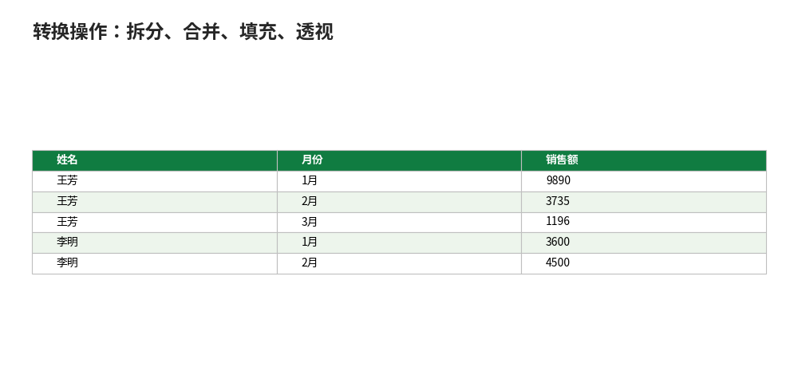

# 转换操作：拆分、合并、填充、透视

- **所属栏目**：C09 Power Query ／ C09-L2-2 转换操作
- **适用版本**：Excel 2016／2019／2021／365（内置，位于“数据”选项卡）
- **难度**：中级
- **预计阅读时长**：30 分钟
- **更新日期**：2026-11-10

## 1. 学习目标

学完本篇，你将能够：
- 用拆分列、合并列、填充、更改类型完成常见的数据清洗
- 用透视列与逆透视列在交叉表与明细表之间转换，并说出何时用哪一个
- 说出步骤顺序敏感的含义，并定位丢行的步骤

## 2. 基础概念

### 2.1 转换操作是什么

获取数据只是第一步：拿到的表往往是脏的——一列混着省市区、部门名只在第一行、交叉表透视表吃不了。转换操作就是在 Power Query 编辑器里把脏表变干净的操作集合，每一步都记录在右侧“应用的步骤”里，可回退、可调顺序、可删除。

### 2.2 先改类型，再做其他事

每列顶上有个类型图标（ABC 表示文本、123 表示数字、日历表示日期）。**类型不对会导致求和变计数、日期无法按月分组**，清洗时务必先检查类型：金额列改成数字、日期列改成日期，再做筛选、分组、合并。类型改晚了，后面的步骤可能全错。

### 2.3 步骤顺序敏感

步骤是按顺序执行的，后面的步骤引用前面的列。删列之后再引用该列的步骤会报错；改了某步的列名，后面用到旧列名的步骤全红。修法：点报错的步骤，看公式栏里引用的列名，逐个改成新列名；或者删掉报错的步骤重做。改步骤前先看后面的步骤是否依赖它——右侧“应用的步骤”里点一步就能看到做到那步的结果。

### 2.4 透视与逆透视：方向别弄反

| 操作 | 方向 | 适用 |
|---|---|---|
| 逆透视列 | 交叉表拆长：多列变两列（属性列+值列） | 姓名×3 个月的矩阵变明细表，透视表吃明细 |
| 透视列 | 明细表变交叉表：两列变多列 | 明细按月汇总后转回交叉表做报表 |

逆透视是 Power Query 最经典的用途之一；透视要求（姓名、月份）组合唯一，否则必须选聚合函数（如求和）先汇总。

## 3. 操作步骤

1. 进编辑器：选中查询→“转换数据”，或双击查询进 Power Query 编辑器。
2. 改类型：点每列顶上的类型图标，金额改数字、日期改日期。
3. 提升标题：如果第一行是标题行而非数据，点“主页→将第一行用作标题”。
4. 拆分列：选中列→“拆分列”→“按分隔符”，输入分隔符。
5. 合并列：选中两列→“添加列→合并列”，选分隔符。
6. 填充：选中列→“转换→填充→向下”，空单元格填上上方的值。
7. 替换值与去重：选中列→右键→“替换值”；选中列→“删除重复项”。
8. 逆透视或透视：选中月份列→右键→“逆透视列”；或选中月份列→“透视列”。
9. 检查行数：看右下角行数，行数对不上先别上载，逐个点“应用的步骤”定位丢行的步骤。
10. 点“主页→关闭并上载”，结果以表的形式回到工作表。

## 4. 图文示例

以下示例都以配套文件的数据为准，手工推演结果附在每节末尾。

### 4.1 拆分列

一列里混着“省-市-区”？选中列→“拆分列”→“按分隔符”→输入 `-`。一列变三列。也可以按固定宽度、按大小写转换处拆分。

示例：

| 拆分前（地址） | 拆分后（省） | 拆分后（市） | 拆分后（区） |
|---|---|---|---|
| 广东-深圳-南山区 | 广东 | 深圳 | 南山区 |
| 浙江-杭州-西湖区 | 浙江 | 杭州 | 西湖区 |

要点：分隔符在值里出现次数不一致时（如有的地址没有区），多余部分按“额外值”设置处理，默认忽略；拆完记得给新列改名。

新例：订单号“DD-2026-001”按 `-` 拆成三列（DD、2026、001）；“DD-2026-002”同样拆成（DD、2026、002）。固定前缀加年份加序号的结构，拆分后年份列可直接用来分组。

### 4.2 合并列

反向操作：选中“省”“市”两列→“合并列”，分隔符选 `-`，得到“广东-深圳”。常用于拼辅助键（如“省-市”做合并查询的关联列）。

示例：

| 省 | 市 | 合并后（省市） |
|---|---|---|
| 广东 | 深圳 | 广东-深圳 |
| 浙江 | 杭州 | 浙江-杭州 |

### 4.3 填充

导出的报表经常只有第一行有“部门”名，下面是空的（合并单元格拆开后的样子）。选中列→“转换”→“填充”→“向下”。空单元格自动填上上方的值，透视表分组的前提。

示例：

| 填充前（部门） | 填充后（部门） |
|---|---|
| 华东 | 华东 |
| （空） | 华东 |
| （空） | 华东 |
| 华北 | 华北 |

要点：先填充、再删分组小计行；顺序反了会把小计行也填上部门名，汇总就错了。

### 4.4 更改类型与替换值

每列顶上有个类型图标（ABC/123/日历）。点它把文本改成数字、日期。**类型不对会导致求和变计数、日期无法分组**，清洗时务必检查。

替换值：选中列→右键→“替换值”，把“N/A”换成空，把“男/女”换成“M/F”，支持整列批量。

### 4.5 删除重复项与筛选

选中列→“删除重复项”。列标题的下拉箭头可以筛选、排序，和 Excel 里一样。删除重复项只认选中列的值：只选“客户编号”列去重，得到的是不重复的客户清单；全选所有列去重，删的才是完全相同的整行。

### 4.6 透视列与逆透视列

逆透视（Unpivot）：把交叉表拆长。源数据是“姓名×3 个月”的矩阵（1 月、2 月、3 月各一列），透视表吃不了这种格式。选中 3 个月份列→右键→“逆透视列”。变成三列：姓名、月份、销售额。**这是 Power Query 最经典的用途之一。**

配套“月度交叉表”逆透视后的结果（9 行，总计 42690）：

| 姓名 | 月份 | 销售额 |
|---|---|---|
| 王芳 | 1月 | 9890 |
| 王芳 | 2月 | 3735 |
| 王芳 | 3月 | 1196 |
| 李明 | 1月 | 3600 |
| 李明 | 2月 | 4500 |
| 李明 | 3月 | 3574 |
| 陈静 | 1月 | 1200 |
| 陈静 | 2月 | 1495 |
| 陈静 | 3月 | 13500 |

行合计核对：王芳 14821、李明 11674、陈静 16195，三人合计 42690，与“销售明细”总计一致。

透视列（Pivot）：反向操作。把“月份、销售额”两列转回交叉表：选中“月份”列→“透视列”→值列选“销售额”、聚合选“求和”，得到的就是上面的“月度交叉表”。注意：透视要求（姓名、月份）组合唯一，否则必须选聚合函数（如求和）先汇总。



## 5. 公式和代码

### 5.1 清洗后核对：金额合计

查询加载回工作表后，用公式核对数字是否与配套文件一致：

```excel
=SUM(表1[金额]) → 42690
```

“表1”是清洗后加载的销售明细表结构化引用，合计应为 42690；若不是，先看逆透视有没有漏列，再看“金额”列类型是否为数字。

### 5.2 逆透视后核对：行合计

```excel
王芳行合计 = 9890 + 3735 + 1196 → 14821
李明行合计 = 3600 + 4500 + 3574 → 11674
陈静行合计 = 1200 + 1495 + 13500 → 16195
三人合计 = 14821 + 11674 + 16195 → 42690
```

逆透视不丢行：9 行总计 42690，与“销售明细”总计一致；对不上先查是不是某个月份列没选进逆透视。

### 5.3 M 写法

拆分列、填充、逆透视的 M 写法见 04-M 语言入门篇（5.2、5.5 节），本篇只讲界面操作，代码集中在一处，避免两处写法不一致。

## 6. 实际工作场景

### 6.1 系统导出表清洗：每月一次的标准动作

财务每月从系统导出销售明细：提升标题→改类型（日期/数字）→填充部门→拆分“省-市”→删除空行。五步做成一个查询，下月新文件丢进来，刷新一次全自动。清洗步骤存在工作簿里，不用每月重做。

### 6.2 交叉表转明细：给透视表喂数据

市场部给的表是“姓名×3 个月”的交叉表，透视表吃不了。逆透视成“姓名、月份、销售额”三列明细，透视表立刻能按月份分组、按销售员汇总。记住方向：交叉表→明细是逆透视，明细→交叉表是透视，别弄反。

## 7. 常见错误

| 错误现象 | 原因 | 解决方案 |
|---|---|---|
| 刷新后金额求和变计数 | “金额”列是文本型 | 点列类型图标改成数字；或在查询里加一步改类型，放在筛选之前 |
| （Expression.Error: 找不到列） | 前面的步骤删了列或改了列名，后面的步骤还在引用旧列名 | 点报错步骤，看公式栏里的旧列名，逐个改成新列名；或删掉报错步骤重做 |
| 逆透视后多出不需要的列 | 选了“逆透视列”只逆透视选中列，漏了新来的月份列 | 改用“逆透视其他列”，只保留“姓名”等标识列，其余自动跟进 |
| 透视列报错（值重复） | （姓名、月份）组合不唯一，透视不知道取哪一行 | 透视时选聚合函数（求和）；或先按（姓名、月份）分组汇总再透视 |
| 查询结果行数比源文件少 | 某步筛选或去重误删了行，或改类型把非法值变成了错误 | 逐个点“应用的步骤”，看每步行数变化，定位丢行的步骤 |
| 填充后小计行也被填上了部门名 | 先删小计行再填充的顺序反了 | 先填充、再删分组小计行；顺序反了会把小计行也填上部门名 |

## 8. 相关教程

- 同栏目：获取数据（docs/powerquery/01-power-query.md，先拿到数据再清洗）
- 同栏目：M 语言入门（docs/powerquery/04-m-language.md，拆分、填充、逆透视的 M 写法）
- 同栏目：合并与追加（docs/powerquery/03-merge-append.md，清洗完再合并多表）
- 跨栏目：数据清洗（docs/data-management/02-clean-data.md，TRIM/CLEAN 等函数清洗，与 Power Query 互补）
- 跨栏目：数据透视表（docs/pivottable/01-pivottable.md，干净输出表直接做透视表）

## 9. 练习题

1. 配套“月度交叉表”是“姓名×3 个月”的矩阵。把它变成“姓名、月份、销售额”的明细表，用什么操作？逆透视后是几行？总计是多少？
2. “地址”列的值是“广东-深圳-南山区”，要拆成省、市、区三列，用什么操作？分隔符填什么？
3. 清洗时先改类型还是先筛选？说出理由。再说一个步骤顺序敏感的例子：删列之后引用该列的步骤会发生什么？
4. 订单号“DD-2026-001”按 `-` 拆分，得到哪三列？
5. 逆透视时选了“逆透视列”只逆透视选中列，下个月多了一个月份列会怎样？改用什么操作？

## 10. 参考答案

<details>
<summary>点击查看答案</summary>

1. 逆透视列（或逆透视其他列，只保留姓名列）。逆透视后 9 行，总计 42690；行合计王芳 14821、李明 11674、陈静 16195。

2. 拆分列→按分隔符，分隔符填 `-`。得到广东、深圳、南山区三列。

3. 先改类型再筛选：筛选、分组、合并都依赖正确的类型，文本型的金额无法求和、文本型的日期无法按月分组。步骤顺序敏感的例子：删列之后再引用该列的步骤会报（Expression.Error: 找不到列），要改公式栏里的列名或删掉报错步骤重做。

4. 得到 DD、2026、001 三列。

5. 新来的月份列不会自动进逆透视。改用“逆透视其他列”，只保留“姓名”等标识列，其余自动跟进。

</details>

## 11. 可下载示例文件

- [PowerQuery-示例-销售明细.xlsx](../../templates/PowerQuery-示例-销售明细.xlsx)（销售明细 12 行、订单 6 行、客户档案 5 行、月度交叉表 3 行、使用说明；总计 42690）
- [销售2026-01.csv](../../templates/销售2026-01.csv)（1 月 4 行，14690）
- [销售2026-02.csv](../../templates/销售2026-02.csv)（2 月 4 行，9730）
- [销售2026-03.csv](../../templates/销售2026-03.csv)（3 月 4 行，18270）
