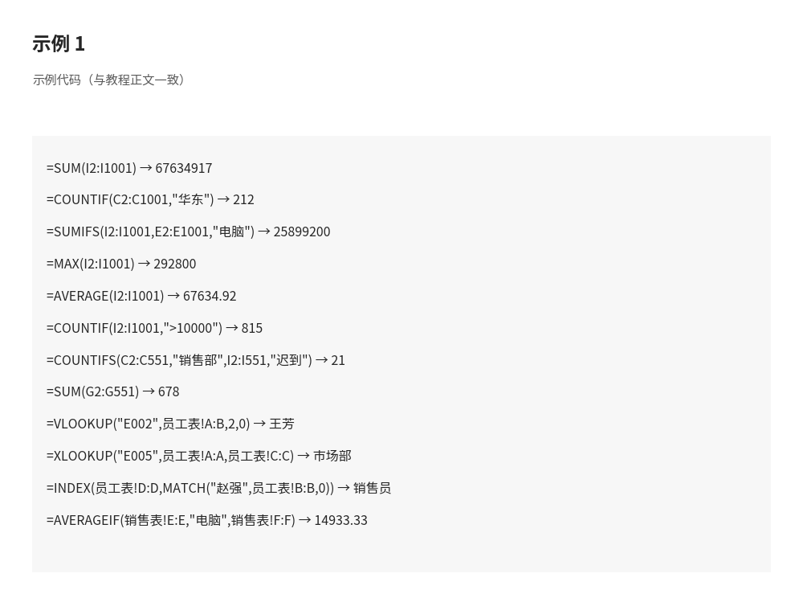
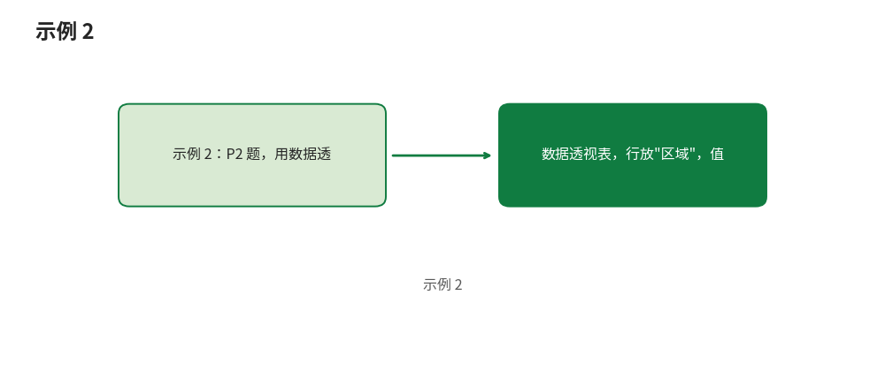

# 练习题库：30 道题，跟着真实数据练

- **所属栏目**：C18 学习路线与练习考试 ／ 练习题库
- **适用版本**：Excel 2016／2019／2021／365
- **难度**：入门到高级（30 道题按难度分组：入门 9 道、进阶 14 道、高级 7 道）
- **预计阅读时长**：90 分钟（做题约 60 分钟，核对答案与复盘约 30 分钟）
- **更新日期**：2026-11-10

## 1. 学习目标

学完本篇，你将能够：

- 用 SUM、SUMIFS、COUNTIF、COUNTIFS、AVERAGE、AVERAGEIF、MAX 对一份 1000 行的真实销售数据做总额、分组与条件统计，并说出每一步公式的含义
- 用 COUNTIFS 与 SUMIFS 对一份 550 行的真实考勤数据做按部门、按员工的统计，并分清"按出勤状态计数"与"按打卡时间计算分钟"两种口径
- 用 VLOOKUP、XLOOKUP、INDEX+MATCH、SUMIFS、AVERAGEIF 在两张小表之间做查询与条件统计
- 用数据透视表（行、列、值、排序、日期组合、值显示方式）对一份 500 行的销售明细做区域、品类、销售员与月度分析
- 建立自己的错题复盘流程：记录错因、隔天重做、连续两次做对才算过关

## 2. 基础概念

本篇 30 道题全部绑定 4 个真实示例数据集（第 11 节可下载）。做题前先认清每份数据的结构与口径，答案才不会算偏。

| 数据集 | 工作表与行数 | 关键列 | 口径说明 |
|---|---|---|---|
| 销售数据 | 销售数据表，1000 行数据（另有使用说明表） | A 订单号、B 日期、C 区域、D 销售员、E 产品类别、F 产品名称、G 数量、H 单价、I 金额、J 客户类型 | I 列金额是公式（=数量×单价），不是手填的数；日期 2026-01-01 至 2026-09-28；5 个区域（华东、华中、华北、华南、西南）、5 类产品、8 名销售员、3 类客户 |
| 考勤数据 | 考勤记录表，550 行数据（25 人 × 22 天，另有部门汇总表与使用说明表） | A 工号、B 姓名、C 部门、D 日期、E 上班打卡、F 下班打卡、G 迟到(分钟)、H 早退(分钟)、I 出勤状态 | G 列迟到分钟是公式（上班打卡晚于 09:00 才计分钟）；日期 2026-09-01 至 2026-09-30；5 个部门每部门 110 行 |
| 函数练习 | 员工表 8 人、销售表 8 单、练习题表、参考答案表、使用说明表 | 员工表：A 工号、B 姓名、C 部门、D 职位、E 入职日期、F 月薪；销售表：A 订单号、B 销售员工号、C 日期、D 区域、E 产品类别、F 金额 | 销售表 8 单的销售员（李明、赵强、吴磊）全是销售部；文件内练习题表原有 Q1–Q12，参考答案表只给公式不给结果值，本篇补上结果值 |
| 透视表数据 | 销售明细表，500 行数据（另有使用说明表，含 6 个任务） | A 日期、B 区域、C 销售员、D 产品类别、E 产品名称、F 数量、G 单价、H 金额 | H 列金额是公式（=数量×单价）；日期 2026-01-01 至 2026-09-28；5 个区域、5 类产品、8 名销售员 |

**验证口径**：本篇全部 30 道题的答案数值，均经 Python 对真实数据文件独立验算（金额按数量×单价重算，迟到分钟按上班打卡时间重算，部门汇总按文件内公式口径重算），不是凭记忆编的数。验算覆盖 52 项检查点，全部通过。公式本身没有在 Excel 内逐条点开验证，做法与公式写法以各题解析为准。

**考勤数据口径提醒（必读）**：考勤文件里有 25 行数据存在"状态列与打卡时间不一致"的情况：出勤状态标为"迟到"的共 86 人次，但按上班打卡时间晚于 09:00 算只有 61 人次，另有 25 行状态是"迟到"、打卡时间却在 09:00 及以前（08:57–09:00）。本题库的口径定为：凡是问"迟到人次""迟到几次"，一律按 I 列"出勤状态"计数（与文件内部门汇总表的 COUNTIFS 口径一致）；凡是问"迟到分钟"，一律按 G 列公式值计算。两种口径的结果不可直接混用，例如"销售部迟到 21 人次"是状态口径，"全表累计迟到 678 分钟"是分钟口径。

## 3. 操作步骤

1. 下载第 11 节的 4 个数据文件，打开后先看各表的"使用说明"表，了解文件自带的练习建议。
2. 按销售数据（S 组）、考勤数据（K 组）、函数练习（F 组）、透视表（P 组）的顺序做题，每组内由入门题做到高级题。
3. 每道题先在数据文件里写出公式、跑出结果，再打开第 10 节核对答案与解析，不要先看答案再凑公式。
4. 做错的题记入错题表（做法见第 6 节场景二），隔 3 天重做，连续两次做对才算过关。
5. 透视表题（P 组）做完后，在透视表上点右键刷新一次，确认结果不变；源数据新增行后也要刷新，见第 7 节。
6. 全部做完后，对照本节末尾的总计复核一遍：销售数据总额 67,634,917，透视表数据总额 20,957,073，考勤正常 448 人次、迟到 86 人次、请假 16 人次。

## 4. 图文示例

**示例 1：S3 题，用 SUMIFS 求电脑类销售额。** 打开数据-销售数据1000行.xlsx，在空白单元格输入 `=SUMIFS(I2:I1001,E2:E1001,"电脑")`，得到 25,899,200。核对方法：电脑类共 202 笔，抽 3 行手工算数量×单价，例如 48 台 × 6,100 元 = 292,800 元，与 I 列公式值一致；再用筛选只看产品类别为电脑的行，状态栏求和应为同一数字。 

**示例 2：P2 题，用数据透视表看区域总额。** 打开数据-透视表练习数据.xlsx，选中销售明细表任意单元格，插入→数据透视表，行放"区域"，值放"金额"求和，再按金额降序排列，排第一的是华南 5,452,113。核对方法：华南 118 笔，金额合计占总和 20,957,073 的 26.02%。 

## 5. 公式和代码

本篇用到的核心公式一览（区域写法以各题解析为准，`→` 后为数值经 Python 对真实数据文件独立验算的结果）：

```excel
=SUM(I2:I1001) → 67634917
=COUNTIF(C2:C1001,"华东") → 212
=SUMIFS(I2:I1001,E2:E1001,"电脑") → 25899200
=MAX(I2:I1001) → 292800
=AVERAGE(I2:I1001) → 67634.92
=COUNTIF(I2:I1001,">10000") → 815
=COUNTIFS(C2:C551,"销售部",I2:I551,"迟到") → 21
=SUM(G2:G551) → 678
=VLOOKUP("E002",员工表!A:B,2,0) → 王芳
=XLOOKUP("E005",员工表!A:A,员工表!C:C) → 市场部
=INDEX(员工表!D:D,MATCH("赵强",员工表!B:B,0)) → 销售员
=AVERAGEIF(销售表!E:E,"电脑",销售表!F:F) → 14933.33
=SUMIFS(销售表!F:F,销售表!B:B,"E001",销售表!D:D,"华东") → 15000
```

透视表题不用写公式，做法是拖字段：行放分组字段、值放金额求和，需要时加列字段、排序、日期组合或值显示方式（占总和的百分比）。

## 6. 实际工作场景

### 场景一：月末销售复盘，8 道题就是一次复盘

你是销售助理，每月 1 号要给经理交一份复盘。打开数据-销售数据1000行.xlsx，按 S 组顺序做一遍：S1 算总额 67,634,917，S2 看华东 212 笔，S3 看电脑类 25,899,200，S4 找出最大一单 SO-202600092（292,800 元），S5 算平均每单 67,634.92 元，S6 数出 815 笔过万订单，S7 确认销冠是吴磊（10,301,373 元），S8 确认 7 月是旺季（8,948,256 元）。8 个数齐了，复盘的三句话结论就有了：总额多少、哪个品类和谁是主力、哪个月最旺。以后每月换一份新数据，同一套公式直接复用。

### 场景二：错题复盘，把错题变成提分点

做完 30 道题后建一张错题表，四列：题号、第一次的答案、正确答案、错因（对照第 7 节的常见错误归类，例如"VLOOKUP 漏了 0""日期条件少了上限""口径混用"）。隔 3 天把错题重做一遍，做对的打勾，做错的再记一次错因；同一道题连续两次做对，才算过关，可以从错题表里划掉。本篇的 F5 题（答案是 0）最容易错成"公式写错了"，复盘时要记下教训：答案 0 可能是真没有符合条件的数据，先数一数再怀疑公式。

## 7. 常见错误

| 错误现象 | 原因 | 解决方案 |
|---|---|---|
| 金额列复制到别处后数值变了或变成 0 | 金额列是公式（=数量×单价），不是手填的数，直接粘贴会带走公式引用 | 只需要数值时用选择性粘贴→数值；需要联动时保留公式并检查引用列 |
| `=COUNTIF(I2:I1001,>10000)` 报错 | 条件里的比较运算符必须放在引号里，`>10000` 不能裸写 | 写成 `=COUNTIF(I2:I1001,">10000")` |
| SUMIFS 结果明显偏小或报错 | 求和区域与条件区域的行数不一致（例如一个写到 1001 行、一个写到 1000 行） | 三个区域用同一行范围，例如都写 `2:1001`；或用整列 `I:I`、`E:E` 保持一致 |
| VLOOKUP 查 E002 返回了别人的姓名 | 第 4 参数漏写 0，默认近似匹配，找到的是相近而不是相等的值 | 精确查找务必写 `0` 或 `FALSE`：`=VLOOKUP("E002",员工表!A:B,2,0)` |
| 跨表公式返回 `#REF!` 或当前表的错误值 | 引用另一张表时漏写表名或感叹号，例如把 `员工表!A:B` 写成 `A:B` | 跨表引用固定写成 `表名!区域`，表名含中文不需要加引号，直接写 `员工表!A:B` |
| 透视表结果还是旧数，新增的行没算进去 | 源数据新增行后透视表不会自动更新 | 在透视表上点右键→刷新；建议先把源数据转成表格（Ctrl+T），新增行自动纳入 |
| COUNTIFS 日期条件算出的笔数偏多 | 只写了下限 `">=2026-4-1"`，没写上限，5 月及以后的订单也被算进来 | 日期区间用一对条件：`">=2026-4-1"` 加 `"<2026-5-1"` |
| AVERAGEIF 返回 0 或 `#DIV/0!` | 条件写成了数据里没有的写法，例如数据里是"电脑"，条件写成"电脑类" | 条件必须与数据里的原值一字不差，先筛选看一眼原值再写条件 |
| 迟到人次算出来 61 次，但部门汇总表是 86 次 | 两种口径混用了：61 是按打卡时间晚于 09:00 算的，86 是按出勤状态列算的，文件里 25 行两者不一致 | 做题前先定口径：问人次按状态列计数，问分钟按 G 列公式值计算，见第 2 节口径提醒 |

## 8. 相关教程

- 跨栏目相关：docs/pivottable/01-pivottable.md（数据透视表（PivotTable）：创建、布局、分组、计算字段与切片器，P 组题的必读前置）
- 跨栏目相关：docs/data-management/01-sort-filter.md（排序与筛选：单条件、多条件、自动筛选与高级筛选，做题前先筛出目标行再算）
- 跨栏目相关：docs/data-management/02-clean-data.md（数据清洗：分列、去重、TRIM/CLEAN 与查找替换清理，动手前先确认数据干净）
- 跨栏目相关：docs/formulas/01-formula-basics.md（公式入门：公式结构、运算符与输入编辑，S 组与 F 组题的公式基础）
- 跨栏目相关：docs/formulas/02-references.md（引用方式：相对引用、绝对引用、混合引用与跨表引用，跨表公式写错时回看这一篇）
- 跨栏目相关：docs/powerquery/01-power-query.md（Power Query：数据的清洗车间，大批量数据先清洗再统计，与本题库的公式路线对照选型）

## 9. 练习题

### 销售数据组（S1–S8）：数据-销售数据1000行.xlsx

1. （S1，入门，SUM）销售数据表共 1000 行订单，I 列金额是公式（=数量×单价）。请算出全部订单的总金额是多少？关联数据文件：[数据-销售数据1000行.xlsx](../../templates/数据-销售数据1000行.xlsx)。
2. （S2，入门，COUNTIF）华东区域一共有多少笔订单？关联数据文件：[数据-销售数据1000行.xlsx](../../templates/数据-销售数据1000行.xlsx)。
3. （S3，进阶，SUMIFS）产品类别为"电脑"的销售额合计是多少？关联数据文件：[数据-销售数据1000行.xlsx](../../templates/数据-销售数据1000行.xlsx)。
4. （S4，进阶，MAX 与 INDEX+MATCH）金额最大的一笔订单是哪个订单号？金额是多少？写出该订单的区域、销售员、产品名称、数量与单价。关联数据文件：[数据-销售数据1000行.xlsx](../../templates/数据-销售数据1000行.xlsx)。
5. （S5，进阶，AVERAGE）全部 1000 笔订单的平均每单金额是多少（保留两位小数）？关联数据文件：[数据-销售数据1000行.xlsx](../../templates/数据-销售数据1000行.xlsx)。
6. （S6，进阶，COUNTIF）金额超过 10,000 元的订单一共有多少笔？关联数据文件：[数据-销售数据1000行.xlsx](../../templates/数据-销售数据1000行.xlsx)。
7. （S7，进阶，SUMIFS 或数据透视表）销售额最高的销售员是谁？他的销售额是多少？关联数据文件：[数据-销售数据1000行.xlsx](../../templates/数据-销售数据1000行.xlsx)。
8. （S8，高级，数据透视表日期组合）按月份汇总，哪个月的销售额最高？该月销售额与订单笔数各是多少？关联数据文件：[数据-销售数据1000行.xlsx](../../templates/数据-销售数据1000行.xlsx)。

### 考勤数据组（K1–K8）：数据-人事考勤样本.xlsx

9. （K1，入门，COUNTIF）出勤状态为"正常"的共多少人次？关联数据文件：[数据-人事考勤样本.xlsx](../../templates/数据-人事考勤样本.xlsx)。
10. （K2，入门，COUNTIFS）销售部迟到共多少人次（按 I 列出勤状态计数）？关联数据文件：[数据-人事考勤样本.xlsx](../../templates/数据-人事考勤样本.xlsx)。
11. （K3，进阶，COUNTIFS 或数据透视表）哪个部门的迟到人次最多？是多少？并列出 5 个部门的迟到人次。关联数据文件：[数据-人事考勤样本.xlsx](../../templates/数据-人事考勤样本.xlsx)。
12. （K4，高级，COUNTIFS 或数据透视表）迟到超过 3 次（即 4 次及以上）的员工共有几人？分别是谁、各迟到几次？关联数据文件：[数据-人事考勤样本.xlsx](../../templates/数据-人事考勤样本.xlsx)。
13. （K5，入门，COUNTIF）请假共多少人次？关联数据文件：[数据-人事考勤样本.xlsx](../../templates/数据-人事考勤样本.xlsx)。
14. （K6，进阶，MAX）单次最长迟到是多少分钟？关联数据文件：[数据-人事考勤样本.xlsx](../../templates/数据-人事考勤样本.xlsx)。
15. （K7，进阶，SUM）全表累计迟到共多少分钟（按 G 列迟到分钟公式值求和）？关联数据文件：[数据-人事考勤样本.xlsx](../../templates/数据-人事考勤样本.xlsx)。
16. （K8，高级，SUMIFS 或数据透视表）累计迟到分钟最多的员工是谁？共多少分钟？有没有并列？关联数据文件：[数据-人事考勤样本.xlsx](../../templates/数据-人事考勤样本.xlsx)。

### 函数练习组（F1–F7）：数据-函数练习题.xlsx

函数练习题文件内原有 Q1–Q12，本组取其中 Q1–Q6 与 Q12 共 7 道并补上结果值。文件内 Q7–Q11 的公式见参考答案表，验算结果一并列在 F7 答案的附注里，供学有余力时自测。

17. （F1，入门，VLOOKUP）用 VLOOKUP，根据工号 E002 查出姓名。关联数据文件：[数据-函数练习题.xlsx](../../templates/数据-函数练习题.xlsx)。
18. （F2，入门，XLOOKUP）用 XLOOKUP，根据工号 E005 查出部门（365/2021 可用；旧版用 VLOOKUP 替代）。关联数据文件：[数据-函数练习题.xlsx](../../templates/数据-函数练习题.xlsx)。
19. （F3，入门，INDEX+MATCH）用 INDEX+MATCH，根据姓名"赵强"查出职位。关联数据文件：[数据-函数练习题.xlsx](../../templates/数据-函数练习题.xlsx)。
20. （F4，进阶，SUMIFS）用 SUMIFS，统计销售部所有员工的总销售额（销售表+员工表）。关联数据文件：[数据-函数练习题.xlsx](../../templates/数据-函数练习题.xlsx)。
21. （F5，进阶，COUNTIFS）用 COUNTIFS，统计 2026 年 4 月华东区域的订单数。关联数据文件：[数据-函数练习题.xlsx](../../templates/数据-函数练习题.xlsx)。
22. （F6，进阶，AVERAGEIF）用 AVERAGEIF，计算"电脑"类别的平均金额（保留两位小数）。关联数据文件：[数据-函数练习题.xlsx](../../templates/数据-函数练习题.xlsx)。
23. （F7，高级，SUMIFS 多条件）统计李明在华东的销售额（题目说的是人名"李明"，先查出工号 E001 再统计）。关联数据文件：[数据-函数练习题.xlsx](../../templates/数据-函数练习题.xlsx)。

### 透视表组（P1–P7）：数据-透视表练习数据.xlsx

24. （P1，入门，数据透视表求和）插入数据透视表，值放"金额"求和，全表总销售额是多少？关联数据文件：[数据-透视表练习数据.xlsx](../../templates/数据-透视表练习数据.xlsx)。
25. （P2，进阶，数据透视表行分组）行放"区域"，值放"金额"求和，哪个区域总额最高？金额与占总和的百分比各是多少？关联数据文件：[数据-透视表练习数据.xlsx](../../templates/数据-透视表练习数据.xlsx)。
26. （P3，进阶，数据透视表行分组）行放"产品类别"，值放"金额"求和，哪个品类总额最高？金额是多少？关联数据文件：[数据-透视表练习数据.xlsx](../../templates/数据-透视表练习数据.xlsx)。
27. （P4，进阶，数据透视表行分组）行放"销售员"，值放"金额"求和，销售额最高的销售员是谁？金额是多少？关联数据文件：[数据-透视表练习数据.xlsx](../../templates/数据-透视表练习数据.xlsx)。
28. （P5，高级，数据透视表行列交叉）行放"产品类别"、列放"区域"，值放"金额"求和，电脑类在华东的销售额是多少？关联数据文件：[数据-透视表练习数据.xlsx](../../templates/数据-透视表练习数据.xlsx)。
29. （P6，高级，数据透视表日期组合）行放"日期"并组合按月，值放"金额"求和，哪个月总额最高？金额是多少？关联数据文件：[数据-透视表练习数据.xlsx](../../templates/数据-透视表练习数据.xlsx)。
30. （P7，高级，数据透视表排序）按金额降序排列后，单笔最大的订单金额是多少？关联数据文件：[数据-透视表练习数据.xlsx](../../templates/数据-透视表练习数据.xlsx)。

## 10. 参考答案

<details>
<summary>点击查看销售数据组答案（S1–S8）</summary>

1. **S1 答案：67,634,917 元。** 解析：I 列金额是数量×单价的公式，对 I2:I1001 求和即总额；分区域求和再相加也是同一数字（华东 13,584,280 + 华中 14,152,454 + 华北 13,236,859 + 华南 13,231,367 + 西南 13,429,957 = 67,634,917），可互相印证。公式：`=SUM(I2:I1001)`。
2. **S2 答案：212 笔。** 解析：对 C 列区域计数，华东 212 笔；其余区域华中 191 笔、华北 198 笔、华南 212 笔、西南 187 笔，合计 1000 笔。公式：`=COUNTIF(C2:C1001,"华东")`。
3. **S3 答案：25,899,200 元。** 解析：电脑类共 202 笔，金额合计 25,899,200 元，是 5 类产品中最高的；其余品类手机 16,722,232 元、家电 13,316,300 元、办公 9,059,440 元、配件 2,637,745 元。公式：`=SUMIFS(I2:I1001,E2:E1001,"电脑")`。
4. **S4 答案：订单号 SO-202600092，金额 292,800 元。** 解析：最大一单是华中区域赵强卖的一体机C，48 台 × 6,100 元 = 292,800 元。公式：先 `=MAX(I2:I1001)` 得到 292,800，再用 `=INDEX(A2:A1001,MATCH(292800,I2:I1001,0))` 反查订单号；或对金额列降序排列后看首行。
5. **S5 答案：67,634.92 元。** 解析：总额 67,634,917 除以 1000 笔，平均每单 67,634.92 元。公式：`=AVERAGE(I2:I1001)`，单元格格式设为数值保留两位小数。
6. **S6 答案：815 笔。** 解析：金额超过 10,000 元的订单 815 笔，占 1000 笔的 81.5%；金额超过 50,000 元的还有 498 笔，说明大单是常态不是例外。公式：`=COUNTIF(I2:I1001,">10000")`，注意条件要加引号。
7. **S7 答案：吴磊，10,301,373 元。** 解析：8 名销售员销售额从高到低是吴磊 10,301,373、黄伟 9,607,807、周敏 8,718,713、王芳 8,515,363、刘洋 8,330,300、赵强 8,075,605、李明 7,324,327、陈静 6,761,429，合计 67,634,917。做法：透视表行放销售员、值放金额求和后降序；或对每人写 SUMIFS 再比较。
8. **S8 答案：2026 年 7 月，8,948,256 元，121 笔。** 解析：按月汇总 2026-01 至 2026-09，7 月最高 8,948,256 元（121 笔），其次是 4 月 8,752,523 元、2 月 8,459,744 元，最低是 6 月 5,848,918 元。做法：透视表行放日期→右键组合→按月，值放金额求和；或按月写 9 条 SUMIFS。

</details>

<details>
<summary>点击查看考勤数据组答案（K1–K8）</summary>

9. **K1 答案：448 人次。** 解析：出勤状态共三类，正常 448 人次、迟到 86 人次、请假 16 人次，合计 550 人次，与总行数一致。公式：`=COUNTIF(I2:I551,"正常")`。
10. **K2 答案：21 人次。** 解析：按出勤状态口径，销售部迟到 21 人次；这个数与文件内部门汇总表的 COUNTIFS 公式结果一致。公式：`=COUNTIFS(C2:C551,"销售部",I2:I551,"迟到")`。
11. **K3 答案：销售部最多，21 人次。** 解析：5 个部门迟到人次是销售部 21、技术部 20、人事部 19、财务部 14、市场部 12，合计 86 人次。做法：透视表行放部门、值放出勤状态计数后筛选"迟到"；或对每个部门写 COUNTIFS。
12. **K4 答案：共 10 人。** 解析：迟到超过 3 次（4 次及以上）的员工是高翔 8 次、李明 7 次、王芳 6 次、周敏 6 次、陈静 5 次、卫东 5 次、沈涛 4 次、曹阳 4 次、董浩 4 次、潘磊 4 次。做法：透视表行放姓名、值放计数后筛选迟到且次数大于 3；或对每人写 COUNTIFS（工号+迟到）。注意口径：这里按出勤状态计数，不是按打卡时间算分钟。
13. **K5 答案：16 人次。** 解析：请假 16 人次，按部门是市场部 5、销售部 5、财务部 3、人事部 2、技术部 1；请假行的上班打卡为空，G 列迟到分钟为空值，不参与迟到分钟求和。公式：`=COUNTIF(I2:I551,"请假")`。
14. **K6 答案：20 分钟。** 解析：G 列迟到分钟的最大值是 20 分钟，全表迟到分钟合计 678 分钟，超过 15 分钟的行有 22 行。公式：`=MAX(G2:G551)`。
15. **K7 答案：678 分钟。** 解析：G 列迟到分钟求和 678 分钟；按部门是销售部 166、技术部 126、市场部 123、财务部 141、人事部 122，合计 678。公式：`=SUM(G2:G551)`。
16. **K8 答案：李明和高翔并列最多，各 52 分钟。** 解析：按人累计迟到分钟，前五名是李明 52、高翔 52、黄伟 51、何静 49、潘磊 47。做法：透视表行放姓名、值放迟到分钟求和后降序；或对每人写 SUMIFS。注意：李明迟到 7 次累计 52 分钟，高翔迟到 8 次累计 52 分钟，次数最多的人不一定累计分钟最多。

</details>

<details>
<summary>点击查看函数练习组答案（F1–F7）</summary>

17. **F1 答案：王芳。** 解析：工号 E002 对应员工表第 2 行，姓名王芳。公式：`=VLOOKUP("E002",员工表!A:B,2,0)`，第 4 参数 0 表示精确匹配，漏写会返回错误结果。
18. **F2 答案：市场部。** 解析：工号 E005 对应员工表第 5 行陈静，部门市场部。公式：`=XLOOKUP("E005",员工表!A:A,员工表!C:C)`；旧版 Excel 没有 XLOOKUP，替代公式是 `=VLOOKUP("E005",员工表!A:C,3,0)`。
19. **F3 答案：销售员。** 解析：姓名"赵强"在员工表第 3 行，职位销售员；VLOOKUP 只能向右查，姓名在 B 列、职位在 D 列在右边所以 VLOOKUP 也能做，但本题练的是 INDEX+MATCH 的通用写法。公式：`=INDEX(员工表!D:D,MATCH("赵强",员工表!B:B,0))`。
20. **F4 答案：76,096 元。** 解析：销售表 8 单的销售员是李明（E001）、赵强（E003）、吴磊（E008），三人全是销售部，所以销售部总额就是 8 单合计 15,000+8,000+2,300+12,600+6,400+4,598+9,998+17,200 = 76,096 元。做法：先在销售表加辅助列 `=VLOOKUP(工号,员工表!A:C,3,0)` 补出部门，再 `=SUMIFS(销售表!F:F,辅助列,"销售部")`。
21. **F5 答案：0 笔。** 解析：答案 0 不是公式写错了：2026 年 4 月销售表只有两单，SO003 是华南、SO004 是华北，没有一单同时满足"4 月+华东"。先数数再怀疑公式，是这道题要练的习惯。公式：`=COUNTIFS(销售表!C:C,">=2026-4-1",销售表!C:C,"<2026-5-1",销售表!D:D,"华东")`，日期区间必须一对条件同时写。
22. **F6 答案：14,933.33 元。** 解析：电脑类 3 单（SO001 15,000、SO004 12,600、SO008 17,200），合计 44,800 元，除以 3 得 14,933.33 元。公式：`=AVERAGEIF(销售表!E:E,"电脑",销售表!F:F)`，条件区域与求平均区域可以是不同列。
23. **F7 答案：15,000 元。** 解析：李明的工号是 E001，他在华东只有 SO001 一单 15,000 元；SO003 是华南、SO006 是西南，不算。公式：`=SUMIFS(销售表!F:F,销售表!B:B,"E001",销售表!D:D,"华东")`，人名要先换成工号再统计。

附注（文件内 Q7–Q11 自测验算值）：Q7 金额≥10000 为大单的共 3 笔（SO001、SO004、SO008），其余 5 笔为普通；Q8 查工号 E009 的姓名返回“无此员工”（员工表无此工号，IFERROR 兜底）；Q9 以李明 2020-03-15 为例，`=TEXT(员工表!E2,"yyyy年mm月")` 得“2020年03月”；Q11 按金额从大到小排名依次是 SO008 17,200 元第 1、SO001 15,000 元第 2、SO004 12,600 元第 3、SO007 9,998 元第 4、SO002 8,000 元第 5、SO005 6,400 元第 6、SO006 4,598 元第 7、SO003 2,300 元第 8；Q10 工龄以 2026-11-10 为今天：李明 6 年、王芳 7 年、赵强 4 年、刘洋 8 年、陈静 4 年、黄伟 9 年、周敏 5 年、吴磊 3 年（赵强 2021-11-20 入职，到 2026-11-20 才满 5 年）。

</details>

<details>
<summary>点击查看透视表组答案（P1–P7）</summary>

24. **P1 答案：20,957,073 元。** 解析：销售明细表 500 行，金额合计 20,957,073 元，总数量 7,674 件。做法：插入数据透视表，值放"金额"求和；或在原表用 `=SUM(H2:H501)` 验算同一数字。
25. **P2 答案：华南最高，5,452,113 元，占总和 26.02%。** 解析：5 个区域总额是华南 5,452,113、华东 5,283,360、西南 3,549,711、华北 3,378,124、华中 3,293,765，合计 20,957,073；华南占比 5,452,113 ÷ 20,957,073 = 26.02%。做法：行放区域、值放金额求和后降序；占比做法是金额字段→值字段设置→值显示方式→占总和的百分比。
26. **P3 答案：电脑最高，8,755,100 元。** 解析：5 类产品总额是电脑 8,755,100、手机 4,656,899、家电 4,118,100、办公 2,455,668、配件 971,306。做法：行放产品类别、值放金额求和后降序。
27. **P4 答案：王芳，4,214,138 元。** 解析：8 名销售员总额从高到低是王芳 4,214,138、周敏 3,204,070、刘洋 2,814,799、陈静 2,412,703、黄伟 2,318,303、李明 2,181,886、赵强 2,067,664、吴磊 1,743,510。做法：行放销售员、值放金额求和后降序；或插入切片器点选销售员即时筛选。
28. **P5 答案：2,137,700 元。** 解析：行放产品类别、列放区域的交叉值，电脑行与华东列交叉处是 2,137,700 元。做法：行放产品类别、列放区域、值放金额求和；也可以用 SUMIFS 写公式验算同一数字。
29. **P6 答案：2026 年 1 月，3,145,764 元。** 解析：按月汇总，1 月 3,145,764 元最高，其次是 6 月 2,639,209 元、3 月 2,595,681 元；注意不要把日期直接当行分组而不组合，那样会按天展开成上百行。做法：行放日期→右键组合→按月，值放金额求和。
30. **P7 答案：183,000 元。** 解析：单笔最大金额 183,000 元；金额超过 10,000 元的订单有 367 笔，可用 COUNTIF 验算。做法：透视表按金额降序排列后看首行，或在原表用 `=MAX(H2:H501)` 验算。

</details>

## 11. 可下载示例文件

- [数据-销售数据1000行.xlsx](../../templates/数据-销售数据1000行.xlsx)（销售数据表 1000 行 + 使用说明表；S1–S8 用，金额列是公式）
- [数据-人事考勤样本.xlsx](../../templates/数据-人事考勤样本.xlsx)（考勤记录表 550 行 + 部门汇总表 + 使用说明表；K1–K8 用，迟到分钟列是公式）
- [数据-函数练习题.xlsx](../../templates/数据-函数练习题.xlsx)（员工表 8 人 + 销售表 8 单 + 练习题表 Q1–Q12 + 参考答案表；F1–F7 用）
- [数据-透视表练习数据.xlsx](../../templates/数据-透视表练习数据.xlsx)（销售明细表 500 行 + 使用说明表含 6 个任务；P1–P7 用，金额列是公式）
