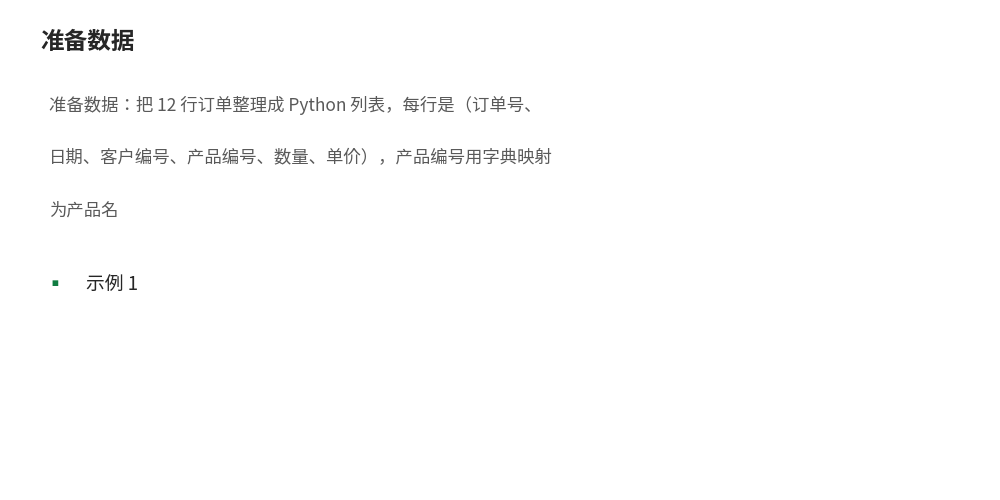
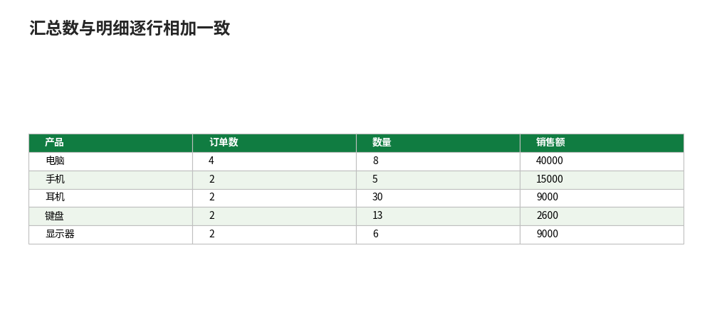

# openpyxl：用 Python 读写 Excel 工作簿

- **所属栏目**：C15 Python 与 Excel ／ C15-L2-1 openpyxl
- **适用版本**：Python 3.10 及以上，openpyxl 3.1.2；生成的 xlsx 文件可用 Excel 2016／2019／2021／365 打开
- **难度**：入门
- **预计阅读时长**：40 分钟
- **更新日期**：2026-11-10

## 1. 学习目标

学完本篇，你将能够：
- 安装 openpyxl 并用它新建、打开、保存 xlsx 工作簿
- 用 openpyxl 读写单元格、整行、整列与指定区域
- 给单元格设置字体、填充、边框、对齐与数字格式
- 向工作表写入 Excel 公式，并说清 openpyxl 为什么算不出公式结果
- 写一个批量生成报表的脚本：读一份订单明细，输出带样式与汇总表的报表文件

本篇全部示例脚本均在本机真实运行通过（Python 3.12，openpyxl 3.1.2），运行结果为真实运行输出；示例按顺序执行，示例 1 生成的文件供后续示例读取。配套可运行脚本见第 11 节。

本篇数据与阶段 6 教程共用同一份 12 行订单：订单数 12，数量合计 62，销售额合计 75600（手工验算：10000+9000+3000+1000+3000+5000+15000+6000+6000+1600+6000+10000 = 75600）。

## 2. 基础概念

### 2.1 openpyxl 是什么

openpyxl 是一个读写 xlsx 文件的 Python 库。它不启动 Excel、不需要装 Excel，在没有 Excel 的电脑（例如 Linux 服务器）上也能生成与读取 xlsx 文件。它操作的是文件本身：打开文件、改单元格、保存文件，全程 Excel 程序没有参与。

### 2.2 三个核心对象

- 工作簿（Workbook）：一个 xlsx 文件就是一个工作簿，用 `openpyxl.Workbook()` 新建、用 `load_workbook(路径)` 打开。
- 工作表（Worksheet）：工作簿里的一张表。`wb.active` 取当前活动表，`wb.create_sheet(表名)` 新建一张表，`wb[表名]` 按名字取表。
- 单元格（Cell）：行列交叉处的一个格子。`ws["A1"]` 按坐标取，`ws.cell(row=行, column=列)` 按行列号取，`.value` 是格子里的值。

### 2.3 openpyxl 能做什么、不能做什么

- 能：读写单元格的值、设置样式（字体、颜色、边框、对齐、数字格式）、写公式文本、合并单元格、冻结窗格、设置筛选、调整行高列宽。
- 不能：计算公式结果。openpyxl 没有 Excel 的计算引擎，写入 `=SUM(A1:A5)` 后保存，文件里存的是公式文本，缓存的结果值是空的；用 Excel 打开后才会计算出结果。这是本篇最重要的边界，下面示例 4 会实测给你看。
- 不能：运行宏、操作正在打开的 Excel 窗口、调用 Excel 的图表与数据透视表界面功能。需要驱动正在运行的 Excel 时用 xlwings（见 03 篇）。

### 2.4 安装

```bash
pip install openpyxl
```

装好后检查版本（本篇实测版本 3.1.2）：

```python
import openpyxl
print(openpyxl.__version__)
```

运行结果：

```
3.1.2
```

## 3. 操作步骤

1. 准备数据：把 12 行订单整理成 Python 列表，每行是（订单号、日期、客户编号、产品编号、数量、单价），产品编号用字典映射为产品名 
2. 新建工作簿：`wb = Workbook()`，活动表改名为“明细”，先写标题行，再逐行写入订单（示例 1）。
3. 读取核对：`load_workbook` 重新打开刚生成的文件，用 `iter_rows(values_only=True)` 逐行读出，核对行数与合计（示例 2）。
4. 加样式：给标题行加深蓝填充与白色加粗字体，单价列设千分位格式 `#,##0`，全表加细边框，冻结标题行（示例 3）。
5. 写公式：金额列写 `=E3*F3` 这类公式，末尾加合计行写 `=SUM(...)`，保存后重新打开核对公式文本（示例 4）。
6. 批量生成：读明细表，按产品分组汇总，新建“按产品汇总”工作表，输出最终报表文件（示例 5）。

## 4. 图文示例

示例：最终报表文件的两张表（文字版）。

明细表（前 4 行，金额列是公式，Excel 打开后显示计算结果）：

| 订单号 | 日期 | 客户编号 | 产品 | 数量 | 单价 | 金额 |
|---|---|---|---|---|---|---|
| O001 | 2025-01-05 | C001 | 电脑 | 2 | 5000 | =E3*F3（显示 10000） |
| O002 | 2025-01-12 | C002 | 手机 | 3 | 3000 | =E4*F4（显示 9000） |
| O003 | 2025-02-08 | C001 | 耳机 | 10 | 300 | =E5*F5（显示 3000） |
| O004 | 2025-03-15 | C003 | 键盘 | 5 | 200 | =E6*F6（显示 1000） |

按产品汇总表：

| 产品 | 订单数 | 数量 | 销售额 |
|---|---|---|---|
| 电脑 | 4 | 8 | 40000 |
| 手机 | 2 | 5 | 15000 |
| 耳机 | 2 | 30 | 9000 |
| 键盘 | 2 | 13 | 2600 |
| 显示器 | 2 | 6 | 9000 |
| 合计 | 12 | 62 | 75600 |

汇总数与明细逐行相加一致：数量 8+5+30+13+6 = 62，销售额 40000+15000+9000+2600+9000 = 75600 

## 5. 公式和代码

示例 1：新建工作簿，写入 12 行订单明细。

```python
from openpyxl import Workbook

ORDERS = [
    ("O001", "2025-01-05", "C001", "P001", 2, 5000),
    ("O002", "2025-01-12", "C002", "P002", 3, 3000),
    ("O003", "2025-02-08", "C001", "P003", 10, 300),
    ("O004", "2025-03-15", "C003", "P004", 5, 200),
    ("O005", "2025-03-20", "C002", "P005", 2, 1500),
    ("O006", "2025-06-10", "C004", "P001", 1, 5000),
    ("O007", "2026-01-06", "C001", "P001", 3, 5000),
    ("O008", "2026-01-15", "C002", "P002", 2, 3000),
    ("O009", "2026-02-10", "C003", "P003", 20, 300),
    ("O010", "2026-02-18", "C001", "P004", 8, 200),
    ("O011", "2026-03-05", "C004", "P005", 4, 1500),
    ("O012", "2026-03-22", "C002", "P001", 2, 5000),
]
PRODUCTS = {"P001": "电脑", "P002": "手机", "P003": "耳机", "P004": "键盘", "P005": "显示器"}

wb = Workbook()
ws = wb.active
ws.title = "明细"
ws.append(["订单号", "日期", "客户编号", "产品", "数量", "单价"])
for oid, date, cust, pid, qty, price in ORDERS:
    ws.append([oid, date, cust, PRODUCTS[pid], qty, price])
wb.save("订单明细.xlsx")
print("已写入行数：", ws.max_row)
print("已写入列数：", ws.max_column)
```

运行结果（本机真实运行输出）：

```
已写入行数： 13
已写入列数： 6
```

13 行 = 1 行标题 + 12 行订单。`ws.append` 一次追加一整行，是写多行数据最省事的写法。

示例 2：读取工作簿，核对内容。

```python
from openpyxl import load_workbook

wb = load_workbook("订单明细.xlsx")
ws = wb["明细"]
print("工作表：", wb.sheetnames)
print("行数：", ws.max_row, "列数：", ws.max_column)
for row in ws.iter_rows(min_row=1, max_row=4, values_only=True):
    print(row)
total_qty = sum(r[4] for r in ws.iter_rows(min_row=2, values_only=True))
total_amount = sum(r[4] * r[5] for r in ws.iter_rows(min_row=2, values_only=True))
print("数量合计：", total_qty)
print("销售额合计：", total_amount)
```

运行结果（本机真实运行输出）：

```
工作表： ['明细']
行数： 13 列数： 6
('订单号', '日期', '客户编号', '产品', '数量', '单价')
('O001', '2025-01-05', 'C001', '电脑', 2, 5000)
('O002', '2025-01-12', 'C002', '手机', 3, 3000)
('O003', '2025-02-08', 'C001', '耳机', 10, 300)
数量合计： 62
销售额合计： 75600
```

要点：`values_only=True` 只返回值不返回单元格对象，适合纯读数；`iter_rows` 可以限定行列范围，大文件不要一次全读进内存。

示例 3：设置单元格样式并保存为报表文件。

```python
from openpyxl import load_workbook
from openpyxl.styles import Alignment, Border, Font, PatternFill, Side

wb = load_workbook("订单明细.xlsx")
ws = wb["明细"]
header_fill = PatternFill("solid", fgColor="1F4E78")
header_font = Font(name="微软雅黑", size=11, bold=True, color="FFFFFF")
thin = Side(style="thin", color="B0B0B0")
border = Border(left=thin, right=thin, top=thin, bottom=thin)
for col in range(1, 7):
    cell = ws.cell(row=1, column=col)
    cell.fill = header_fill
    cell.font = header_font
    cell.alignment = Alignment(horizontal="center", vertical="center")
for row in ws.iter_rows(min_row=1, max_row=13, max_col=6):
    for cell in row:
        cell.border = border
for row in range(2, 14):
    ws.cell(row=row, column=6).number_format = '#,##0'
ws.column_dimensions["A"].width = 10
ws.column_dimensions["B"].width = 13
ws.column_dimensions["F"].width = 10
ws.freeze_panes = "A2"
ws.auto_filter.ref = "A1:F13"
wb.save("销售报表.xlsx")
print("标题字体加粗：", ws["A1"].font.bold)
print("标题填充色：", ws["A1"].fill.fgColor.rgb)
print("冻结窗格：", ws.freeze_panes)
```

运行结果（本机真实运行输出）：

```
标题字体加粗： True
标题填充色： 001F4E78
冻结窗格： A2
```

说明：填充色读出来是 `001F4E78`，前面多了两位透明度 `00`，是 openpyxl 的正常表示，不是写错了。`freeze_panes = "A2"` 表示冻结第 1 行；`auto_filter` 给标题行加上筛选箭头。

示例 4：写入公式，并验证 openpyxl 不计算公式。

```python
from openpyxl import load_workbook

wb = load_workbook("销售报表.xlsx")
ws = wb["明细"]
for row in range(2, 14):
    ws.cell(row=row, column=7, value=f"=E{row}*F{row}").number_format = '#,##0'
ws.cell(row=14, column=1, value="合计")
ws.cell(row=14, column=5, value="=SUM(E2:E13)")
ws.cell(row=14, column=7, value="=SUM(G2:G13)").number_format = '#,##0'
wb.save("销售报表.xlsx")

# 重新打开核对：默认读到的是公式文本
wb2 = load_workbook("销售报表.xlsx")
print("G3 公式：", wb2["明细"]["G3"].value)
print("G14 公式：", wb2["明细"]["G14"].value)
# 用 data_only=True 读缓存的结果值：openpyxl 没算过公式，缓存为空，读到 None
wb3 = load_workbook("销售报表.xlsx", data_only=True)
print("G3 缓存值：", wb3["明细"]["G3"].value)
print("G14 缓存值：", wb3["明细"]["G14"].value)
# 预期值用 Python 独立算出：数量 62，销售额 75600
print("Python 独立验算销售额：", sum(r[4] * r[5] for r in wb2["明细"].iter_rows(min_row=2, max_row=13, values_only=True)))
```

运行结果（本机真实运行输出）：

```
G3 公式： =E3*F3
G14 公式： =SUM(G2:G13)
G3 缓存值： None
G14 缓存值： None
Python 独立验算销售额： 75600
```

这就是 openpyxl 的边界：它只负责把公式文本写进文件，计算要交给 Excel。用 Excel 打开这个文件，G 列会显示 10000、9000……，G14 显示 75600；但在 Python 里用 `data_only=True` 去读，公式格读到的是 `None`。所以凡是“写公式 + 在 Python 里读结果”的流程，必须改成 Python 自己算一遍（如最后一行），不要等 Excel 的缓存。

示例 5：批量生成报表——按产品汇总，新增一张汇总表。

```python
from openpyxl import load_workbook
from openpyxl.styles import Font, PatternFill

wb = load_workbook("销售报表.xlsx")
ws = wb["明细"]
totals = {}
for row in ws.iter_rows(min_row=2, max_row=13, values_only=True):
    _oid, _date, _cust, product, qty, price = row[:6]  # 取前 6 列；G 列是示例 4 写入的金额公式，不参与汇总
    t = totals.setdefault(product, [0, 0, 0])
    t[0] += 1
    t[1] += qty
    t[2] += qty * price

ws2 = wb.create_sheet("按产品汇总")
ws2.append(["产品", "订单数", "数量", "销售额"])
for col in range(1, 5):
    cell = ws2.cell(row=1, column=col)
    cell.fill = PatternFill("solid", fgColor="1F4E78")
    cell.font = Font(name="微软雅黑", size=11, bold=True, color="FFFFFF")
for name in ["电脑", "手机", "耳机", "键盘", "显示器"]:
    n, qty, amount = totals[name]
    ws2.append([name, n, qty, amount])
ws2.append(["合计", "=SUM(B2:B6)", "=SUM(C2:C6)", "=SUM(D2:D6)"])
wb.save("销售报表.xlsx")
print("汇总表行数：", ws2.max_row)
for row in ws2.iter_rows(min_row=2, values_only=True):
    print(row)
```

运行结果（本机真实运行输出）：

```
汇总表行数： 7
('电脑', 4, 8, 40000)
('手机', 2, 5, 15000)
('耳机', 2, 30, 9000)
('键盘', 2, 13, 2600)
('显示器', 2, 6, 9000)
('合计', '=SUM(B2:B6)', '=SUM(C2:C6)', '=SUM(D2:D6)')
```

汇总表 7 行 = 1 行标题 + 5 行产品 + 1 行合计；合计行同样写公式，Excel 打开后显示 12、62、75600。

## 6. 实际工作场景

场景 1：每月 1 号自动生成上月销售报表。

- 背景：财务每月要一份销售报表，做法一直是手工复制订单、手工拉公式、手工调格式，半小时起步，还容易漏行。
- 做法：把订单导出成 xlsx，用示例 1 的写法读入、示例 3 的样式模板套用、示例 4 的公式写入、示例 5 的汇总逻辑生成“明细 + 按产品汇总”两张表，脚本保存为 `Python-openpyxl-report.py`，每月改一次文件名就跑。
- 结果：以本篇 12 行订单为例，脚本 1 秒内生成报表，数量合计 62、销售额合计 75600，与手工加总一致；下个月订单变多行时，公式里的行号由脚本按实际行数生成，不用手工改。

场景 2：把 30 个分表合并成一份总表。

- 背景：30 个门店每月各交一张 xlsx，表头相同、行数不同，要合成一张总表再汇总。
- 做法：循环 `load_workbook` 打开每个分表，`iter_rows(values_only=True)` 跳过标题行逐行读出，`append` 到总表；最后按示例 5 的办法加一张汇总表。
- 结果：30 个文件一次跑完；关键点是每个分表读完立刻关掉工作簿对象、不要同时打开 30 个工作簿，内存才不会爆。

## 7. 常见错误

| 错误现象 | 原因 | 解决方案 |
|---|---|---|
| `ModuleNotFoundError: No module named 'openpyxl'` | 没装 openpyxl，或装到了另一个 Python 环境 | 在同一个环境执行 `pip install openpyxl`，再用 `python3 -c "import openpyxl; print(openpyxl.__version__)"` 核对 |
| 保存后用 Excel 打开提示“文件已损坏” | 保存时文件还在 Excel 里打开着，或保存路径写到了不存在的文件夹 | 先关掉 Excel 里的同名文件；保存前确认文件夹存在，或用 `os.makedirs` 先建文件夹 |
| `load_workbook` 打不开 xls 文件 | openpyxl 只支持 xlsx，不支持老格式 xls | xls 先用 Excel 另存为 xlsx，或用 xlrd（仅读）处理；新文件一律存 xlsx |
| 公式写进去了，Python 读出来是 None | openpyxl 不计算公式，缓存结果值为空 | 见示例 4：这是正常现象；要在 Python 里用结果就自己算一遍，不要读 `data_only=True` 的公式格 |
| 公式在 Excel 里显示为文本不计算 | 公式字符串前面多了空格或单引号，如 `" =SUM(...)"` 或 `"'=SUM(...)"` | 公式字符串必须以 `=` 开头、前面没有任何字符；检查写入的值是不是以 `=` 开头 |
| 日期写进去变成 45658 这样的数字 | 把 Python 的 datetime 写进单元格后没设日期格式，Excel 按数值显示 | 设置 `cell.number_format = 'yyyy-mm-dd'`；或直接写 `"2025-01-05"` 这样的文本（会失去日期计算能力） |
| 中文标题在 Excel 里显示乱码 | 不是乱码问题：openpyxl 写的是 UTF-8，Excel 能正常显示；真正的原因常是字体缺失 | 换一个系统自带的中文字体，如微软雅黑、宋体；不要把问题当成编码问题去转码 |
| 样式设置了但打开文件看不到 | 把样式赋给了 `ws.cell()` 临时取出的单元格后又重新取了一次，或保存前又覆盖了工作簿 | 样式直接赋给取出的 cell 对象并保存同一个 wb；大段样式用循环集中处理，不要反复打开保存 |
| `ws.append` 追加到了错误的位置 | 工作表里已有带格式的空行，`max_row` 把格式行也算进去了 | 追加前先打印 `ws.max_row` 确认；或用 `ws.cell(row=指定行)` 精确定位写入 |
| 循环写几万行很慢 | 每次 `ws.cell()` 都做一次查找与样式初始化 | 用 `ws.append` 批量写；样式只在标题行与合计行设置，不要给每一格逐个建样式对象 |

## 8. 相关教程

- 同栏目下一篇：02-pandas.md（pandas：DataFrame 与 Excel 互转、数据清洗、分组汇总）
- 同栏目相关：03-xlwings.md（xlwings：调用正在运行的 Excel、批量处理、与 openpyxl 的分工）
- 同栏目相关：04-python-in-excel.md（Python in Excel：=PY() 入门、适用与限制）
- 跨栏目相关：docs/powerquery/01-power-query.md（Power Query：不用写代码的数据清洗与合并，适合与本篇对照选型）
- 跨栏目相关：docs/formulas/01-formula-basics.md（公式基础：公式结构、运算符、相对引用与绝对引用）
- 跨栏目相关：docs/pivottable/01-pivottable.md（数据透视表：不写代码做分组汇总，与示例 5 的汇总表对照）

## 9. 练习题

1. 用 openpyxl 新建一个工作簿，写入本篇 12 行订单（订单号、日期、客户编号、产品、数量、单价），保存后重新打开，打印工作表名与总行数。
2. 读取示例 1 生成的订单明细，用 Python 算出“耳机”的订单数与销售额各是多少。
3. 给订单明细的标题行设置填充色 4472C4、白色加粗字体，并把单价列的数字格式设为 `#,##0`，保存后重新打开核对标题格的字体是否加粗。
4. 在金额列写入公式 `=E行*F行`，在末尾加合计行写入 `=SUM(G2:G13)`，保存后用默认方式重新打开，打印 G3 与 G14 的值；再用 `data_only=True` 打开，打印同样的两个格子，解释两次结果为什么不同。
5. 把 12 行订单按“客户编号”分组，算出每个客户的订单数与销售额（提示：C001、C002、C003、C004 各是多少），把结果写进一张新表“按客户汇总”。
6. 写一个脚本：批量读取当前文件夹下所有文件名以“订单”开头的 xlsx，把它们的明细行合并到一张总表里，并给总表加上标题样式与合计行公式。说出脚本里至少两处需要注意的点（例如跳过标题行、文件被 Excel 占用）。

## 10. 参考答案

<details>
<summary>点击查看答案</summary>

1. 按示例 1 的写法跑一遍即可。重新打开后工作表名是 `['明细']`，总行数 13（1 行标题 + 12 行订单）。如果行数是 12，说明漏写了标题行；如果工作表名是 Sheet，说明忘了改 `ws.title`。
2. 耳机是 O003（10 件 × 300）和 O009（20 件 × 300）两笔，订单数 2，销售额 3000 + 6000 = 9000。写法：遍历明细行，产品等于“耳机”时累加数量×单价。
3. 做法与示例 3 相同，只是填充色改成 4472C4。核对：`load_workbook` 后 `ws["A1"].font.bold` 应为 True，`ws["A1"].fill.fgColor.rgb` 应为 `004472C4`（前面两位是透明度）。
4. 默认方式打开：G3 是 `=E3*F3`，G14 是 `=SUM(G2:G13)`，读到的是公式文本；`data_only=True` 打开：两个格子都是 None。原因：openpyxl 不计算公式，文件里没有缓存的结果值；公式结果要等 Excel 打开文件后才计算。不要把 None 当成公式算错了。
5. 按客户汇总：C001 是 O001、O003、O007、O010 共 4 笔，销售额 10000+3000+15000+1600 = 29600；C002 是 O002、O005、O008、O012 共 4 笔，销售额 9000+3000+6000+10000 = 28000；C003 是 O004、O009 共 2 笔，销售额 1000+6000 = 7000；C004 是 O006、O011 共 2 笔，销售额 5000+6000 = 11000。四数相加 29600+28000+7000+11000 = 75600，与总销售额一致。
6. 参考做法：`glob.glob("订单*.xlsx")` 列文件；每个文件 `load_workbook` 后 `iter_rows(min_row=2, values_only=True)` 跳过标题行读明细；`append` 到总表。注意点至少两条：每张分表都要跳过标题行，否则总表里会混进多行标题；分表若正在 Excel 里打开，脚本不要去覆盖保存它，应另存新文件；行数大时不要同时打开全部工作簿，读完一个再读下一个。

</details>

## 11. 可下载示例文件

- Python-openpyxl-report.py（templates/Python-openpyxl-report.py，openpyxl 生成带样式与公式的销售报表，运行方法 `python3 Python-openpyxl-report.py`）
- Python-openpyxl-report.xlsx（templates/Python-openpyxl-report.xlsx，脚本运行产物：明细表 12 行订单 + 按产品汇总表，金额列与合计行均为公式）
