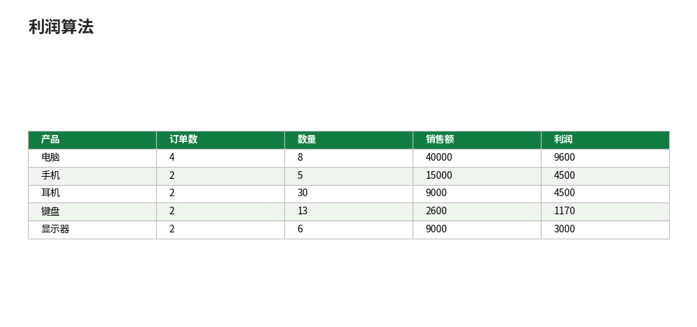

# pandas：DataFrame 与 Excel 互转、数据清洗与分组汇总

- **所属栏目**：C15 Python 与 Excel ／ C15-L2-2 pandas
- **适用版本**：Python 3.10 及以上，pandas 2.1.4，openpyxl 3.1.2（pandas 读写 xlsx 依赖 openpyxl）；生成的 xlsx 文件可用 Excel 2016／2019／2021／365 打开
- **难度**：进阶
- **预计阅读时长**：45 分钟
- **更新日期**：2026-11-10

## 1. 学习目标

学完本篇，你将能够：
- 用 `read_excel` 读入 xlsx，用 `to_excel` 把 DataFrame 写回 xlsx（一张表或多张表）
- 说出 DataFrame 与 Excel 工作表之间的对应关系（行、列、索引、表头）
- 对一份脏数据做清洗：去重、处理缺失值、转换文本型数字、解析日期
- 用 `groupby` 做按产品、按地区、按月的分组汇总，并用手工计算核对结果
- 跑通一个完整的数据分析流程：读入、清洗、关联维度表、算利润、汇总、写出报告

本篇全部示例脚本均在本机真实运行通过（Python 3.12，pandas 2.1.4），运行结果为真实运行输出；示例按顺序执行，示例 1 生成的文件供后续示例读取。配套可运行脚本见第 11 节。

本篇数据与阶段 6 教程共用同一份 12 行订单，另加 3 行脏数据演示清洗；清洗后应恰好回到 12 行，总销售额 75600、数量合计 62、总利润 22770、利润率 30.12%。

## 2. 基础概念

### 2.1 DataFrame 是什么

DataFrame 是 pandas 里的一张“内存中的表”：有行、有列、有表头，跟 Excel 工作表几乎一一对应。区别在于 DataFrame 活在 Python 内存里，可以整列运算、整表筛选、分组汇总，一行代码顶 Excel 里几十步操作。`read_excel` 把工作表变成 DataFrame，`to_excel` 把 DataFrame 变成工作表，互转就是本篇的起点。

### 2.2 DataFrame 与 Excel 工作表的对应关系

| DataFrame | Excel 工作表 |
|---|---|
| 一列（Series） | 一列数据 |
| 列名（columns） | 标题行 |
| 索引（index） | 行号（但 pandas 索引可以是日期、订单号等任意值） |
| 一行 | 一行记录 |
| `df.shape`（行数，列数） | 表的规模 |

注意：`to_excel` 默认会把索引也写进文件，多出一列无名列；写文件时通常加 `index=False` 不写索引。

### 2.3 数据分析流程

本篇的流程固定为五步：读入、清洗、转换、汇总、写出。读入解决“数据进来”，清洗解决“数据能用”，转换解决“算出新列”（金额、利润、月份），汇总解决“看出结论”，写出解决“结果给人看”。后面任何分析任务都可以往这个流程里套。

### 2.4 安装

```bash
pip install pandas openpyxl
```

pandas 读写 xlsx 要靠 openpyxl 做引擎，两个都要装。装好后检查版本（本篇实测版本 pandas 2.1.4、openpyxl 3.1.2）：

```python
import pandas as pd
print(pd.__version__)
```

运行结果：

```
2.1.4
```

## 3. 操作步骤

1. 准备数据：12 行干净订单加 3 行脏数据（重复行、缺失单价、无法识别的单价文本），写成原始文件（示例 1）。
2. 读入：`pd.read_excel` 读回原始文件，检查行列数与数据类型；演示文本型数字的转换（示例 2）。
3. 清洗：文本单价转数值、去重、删缺失、解析日期、算出金额列，清洗后核对行数与合计（示例 3）。
4. 分组汇总：`groupby` 按产品、按地区、按月汇总，与手工计算逐项核对（示例 4）。
5. 完整分析：关联产品表算利润、关联客户表取地区，汇总后用 `ExcelWriter` 一次写出 5 张表，重新读回核对（示例 5）。

## 4. 图文示例

示例：清洗前后对照（文字版）。

清洗前 15 行：12 行干净订单 + 3 行脏数据。

| 订单号 | 日期 | 客户编号 | 产品编号 | 数量 | 单价 | 问题 |
|---|---|---|---|---|---|---|
| O003 | 2025-02-08 | C001 | P003 | 10 | 300 | 与 O003 完全重复 |
| O013 | 2026-03-25 | C002 | P001 | 1 | （空） | 单价缺失 |
| O014 | 2026-03-28 | C003 | P005 | 1 | 待确认 | 单价是无法转数值的文本 |

清洗后 12 行：重复行去掉 1 行，缺失与无法识别的行各去掉 1 行，剩下 12 行干净订单，销售额合计 75600。

按产品汇总（清洗后）：

| 产品 | 订单数 | 数量 | 销售额 | 利润 |
|---|---|---|---|---|
| 电脑 | 4 | 8 | 40000 | 9600 |
| 手机 | 2 | 5 | 15000 | 4500 |
| 耳机 | 2 | 30 | 9000 | 4500 |
| 键盘 | 2 | 13 | 2600 | 1170 |
| 显示器 | 2 | 6 | 9000 | 3000 |

利润算法：数量 ×（单价 - 成本），成本来自产品表（电脑 3800、手机 2100、耳机 150、键盘 110、显示器 1000）；总利润 9600+4500+4500+1170+3000 = 22770，利润率 22770 / 75600 = 30.12% 

## 5. 公式和代码

示例 1：准备原始数据，写入 xlsx。

```python
import pandas as pd

ORDERS = [
    ("O001", "2025-01-05", "C001", "P001", 2, 5000),
    ("O002", "2025-01-12", "C002", "P002", 3, 3000),
    ("O003", "2025-02-08", "C001", "P003", 10, 300),
    ("O004", "2025-03-15", "C003", "P004", 5, 200),
    ("O005", "2025-03-20", "C002", "P005", 2, 1500),
    ("O006", "2025-06-10", "C004", "P001", 1, 5000),
    ("O007", "2026-01-06", "C001", "P001", 3, 5000),
    ("O008", "2026-01-15", "C002", "P002", 2, 3000),
    ("O009", "2026-02-10", "C003", "P003", 20, 300),
    ("O010", "2026-02-18", "C001", "P004", 8, 200),
    ("O011", "2026-03-05", "C004", "P005", 4, 1500),
    ("O012", "2026-03-22", "C002", "P001", 2, 5000),
]
DIRTY_EXTRA = [
    ("O003", "2025-02-08", "C001", "P003", 10, 300),
    ("O013", "2026-03-25", "C002", "P001", 1, None),
    ("O014", "2026-03-28", "C003", "P005", 1, "待确认"),
]
raw = pd.DataFrame(
    ORDERS + DIRTY_EXTRA,
    columns=["订单号", "日期", "客户编号", "产品编号", "数量", "单价"],
)
raw.to_excel("原始订单.xlsx", index=False)
print("原始行数：", len(raw))
print(raw.dtypes)
```

运行结果（本机真实运行输出）：

```
原始行数： 15
订单号     object
日期      object
客户编号    object
产品编号    object
数量       int64
单价      object
dtype: object
```

要点：单价列是 `object` 类型，因为里面混进了空值与文本“待确认”——这正是脏数据的典型信号。`to_excel` 写文件时加 `index=False`，否则文件里会多出一列行号。

示例 2：读回文件，并演示文本型数字的转换。

```python
import pandas as pd

df = pd.read_excel("原始订单.xlsx")
print("读回行数：", len(df))
print(df.head(3).to_string(index=False))
# 文本型数字转换演示："1500" 这样的文本能转成数值，"待确认" 转不成，会变成 NaN
s = pd.to_numeric(pd.Series(["1500", "300", "待确认"]), errors="coerce")
print(s.tolist())
```

运行结果（本机真实运行输出）：

```
读回行数： 15
 订单号         日期 客户编号 产品编号  数量   单价
O001 2025-01-05 C001 P001   2 5000
O002 2025-01-12 C002 P002   3 3000
O003 2025-02-08 C001 P003  10  300
[1500.0, 300.0, nan]
```

读回行数 15，说明脏数据原样都在文件里；`pd.to_numeric(..., errors="coerce")` 的规则是：能转的转成数值，转不了的变成 NaN（缺失值），而不是报错——清洗时就靠这个把“待确认”筛出来。上面最后一行 `[1500.0, 300.0, nan]` 就是转换结果，其中的 `nan` 表示“待确认”无法转成数值。

示例 3：数据清洗——去重、删缺失、解析日期、算金额。

```python
import pandas as pd

df = pd.read_excel("原始订单.xlsx")
df["单价"] = pd.to_numeric(df["单价"], errors="coerce")
df = df.drop_duplicates()
df = df.dropna(subset=["单价"])
df["日期"] = pd.to_datetime(df["日期"])
df["金额"] = df["数量"] * df["单价"]
print("清洗后行数：", len(df))
print("销售额合计：", int(df["金额"].sum()))
print("数量合计：", int(df["数量"].sum()))
df.to_excel("清洗后明细.xlsx", index=False)
```

运行结果（本机真实运行输出）：

```
清洗后行数： 12
销售额合计： 75600
数量合计： 62
```

清洗掉了 3 行：重复的 O003 去掉 1 行，单价缺失的 O013 去掉 1 行，单价“待确认”的 O014 去掉 1 行。清洗后 12 行、销售额 75600，与手工计算一致，说明清洗没有误删干净行。顺序要注意：先转数值再去重、删缺失——如果先删缺失，文本“待确认”那行当时还不是缺失，会漏网。

示例 4：分组汇总——按产品、按地区、按月。

```python
import pandas as pd

PRODUCTS = {"P001": "电脑", "P002": "手机", "P003": "耳机", "P004": "键盘", "P005": "显示器"}
CUSTOMERS = {"C001": "华东", "C002": "华南", "C003": "华北", "C004": "华西"}
df = pd.read_excel("清洗后明细.xlsx")
df["产品"] = df["产品编号"].map(PRODUCTS)
df["地区"] = df["客户编号"].map(CUSTOMERS)
df["月份"] = pd.to_datetime(df["日期"]).dt.strftime("%Y-%m")
by_product = df.groupby("产品").agg(订单数=("订单号", "count"), 数量=("数量", "sum"), 销售额=("金额", "sum"))
print(by_product.to_string())
by_region = df.groupby("地区").agg(订单数=("订单号", "count"), 销售额=("金额", "sum"))
print(by_region.to_string())
by_month = df.groupby("月份").agg(订单数=("订单号", "count"), 销售额=("金额", "sum"))
print(by_month.to_string())
```

运行结果（本机真实运行输出）：

```
     订单数  数量    销售额
产品
手机     2   5  15000
显示器    2   6   9000
电脑     4   8  40000
耳机     2  30   9000
键盘     2  13   2600
    订单数    销售额
地区
华东    4  29600
华北    2   7000
华南    4  28000
华西    2  11000
         订单数    销售额
月份
2025-01    2  19000
2025-02    1   3000
2025-03    2   4000
2025-06    1   5000
2026-01    2  21000
2026-02    2   7600
2026-03    2  16000
```

核对：按产品销售额 40000+15000+9000+2600+9000 = 75600；按地区 29600+28000+11000+7000 = 75600；按月 19000+3000+4000+5000+21000+7600+16000 = 75600。三张汇总表总额相同，互相印证。注意 `groupby` 的结果默认按分组键排序（按 Unicode 编码排，不是按销售额排）；要按销售额排需加 `.sort_values("销售额", ascending=False)`。

示例 5：完整分析流程——关联维度表算利润，一次写出 5 张表。

```python
import pandas as pd

PRODUCTS = pd.DataFrame([
    {"产品编号": "P001", "产品": "电脑", "成本": 3800},
    {"产品编号": "P002", "产品": "手机", "成本": 2100},
    {"产品编号": "P003", "产品": "耳机", "成本": 150},
    {"产品编号": "P004", "产品": "键盘", "成本": 110},
    {"产品编号": "P005", "产品": "显示器", "成本": 1000},
])
CUSTOMERS = pd.DataFrame([
    {"客户编号": "C001", "地区": "华东"},
    {"客户编号": "C002", "地区": "华南"},
    {"客户编号": "C003", "地区": "华北"},
    {"客户编号": "C004", "地区": "华西"},
])
df = pd.read_excel("清洗后明细.xlsx")
df = df.merge(PRODUCTS, on="产品编号").merge(CUSTOMERS, on="客户编号")
df["利润"] = df["数量"] * (df["单价"] - df["成本"])
df["月份"] = pd.to_datetime(df["日期"]).dt.strftime("%Y-%m")
print("总利润：", int(df["利润"].sum()))
print("利润率：", round(df["利润"].sum() / df["金额"].sum() * 100, 2), "%")
by_product = df.groupby("产品").agg(订单数=("订单号", "count"), 数量=("数量", "sum"),
                                    销售额=("金额", "sum"), 利润=("利润", "sum")).reset_index()
by_region = df.groupby("地区").agg(订单数=("订单号", "count"), 数量=("数量", "sum"),
                                   销售额=("金额", "sum")).reset_index()
by_month = df.groupby("月份").agg(订单数=("订单号", "count"), 销售额=("金额", "sum")).reset_index()
with pd.ExcelWriter("销售分析.xlsx", engine="openpyxl") as writer:
    pd.read_excel("原始订单.xlsx").to_excel(writer, sheet_name="原始数据", index=False)
    df.to_excel(writer, sheet_name="清洗后明细", index=False)
    by_product.to_excel(writer, sheet_name="按产品汇总", index=False)
    by_region.to_excel(writer, sheet_name="按地区汇总", index=False)
    by_month.to_excel(writer, sheet_name="按月汇总", index=False)
check = pd.read_excel("销售分析.xlsx", sheet_name="按产品汇总")
print("读回核对电脑销售额：", int(check.loc[check["产品"] == "电脑", "销售额"].iloc[0]))
print("读回核对总利润：", int(check["利润"].sum()))
```

运行结果（本机真实运行输出）：

```
总利润： 22770
利润率： 30.12 %
读回核对电脑销售额： 40000
读回核对总利润： 22770
```

前两行是分析结果（总利润 22770，利润率 30.12%）；后两行是写出后重新读回的核对结果——电脑销售额 40000，总利润 22770，与写出前一致，说明 `to_excel` 与 `read_excel` 往返没有丢数。利润手工验算：电脑 8×(5000-3800)=9600，手机 5×900=4500，耳机 30×150=4500，键盘 13×90=1170，显示器 6×500=3000，合计 22770。

## 6. 实际工作场景

场景 1：每周销售周报，一键生成。

- 背景：每周一要交一份销售周报：本周销售额、按产品和按地区的汇总、异常订单清单。手工做要打开订单表、筛选、复制、粘贴、再拉透视表，至少半小时。
- 做法：把本周订单导出成 xlsx，跑示例 3 到示例 5 的流程：读入、清洗、分组、写出 5 张表的报告文件；异常订单（单价缺失、重复行）在清洗步骤里自动被筛掉，清洗前后的行数差就是异常行数，直接写进周报。
- 结果：以本篇数据为例，15 行原始数据清洗成 12 行，异常 3 行；报告文件一次生成，按产品、按地区、按月三张汇总表总额都是 75600，互相印证，下周数据换了直接重跑。

场景 2：两个月的订单表对账。

- 背景：财务给的订单表与仓库给的出库表，订单号有重叠也有各自独有的，要找出差异。
- 做法：两张表分别 `read_excel` 读成 DataFrame，用 `merge(..., how="outer", indicator=True)` 外连接，`_merge` 列等于 `left_only` 的是只有财务有、等于 `right_only` 的是只有仓库有、等于 `both` 的是对得上的。
- 结果：差异清单一次算出，不用再用 VLOOKUP 逐行比对；这个做法在数据量上万行时优势最大，Excel 公式逐行比对会明显变慢。

## 7. 常见错误

| 错误现象 | 原因 | 解决方案 |
|---|---|---|
| `ImportError: Missing optional dependency 'openpyxl'` | 只装了 pandas，没装 openpyxl | 执行 `pip install openpyxl`；pandas 读写 xlsx 必须有 openpyxl 做引擎 |
| `read_excel` 读到的数字变成 5000.0 | 列里混进了空值或文本，pandas 把整列推断成浮点型 | 用 `pd.to_numeric` 转回数值，或读时指定 `dtype={"单价": "Int64"}`（可空整数类型） |
| 写出的 xlsx 多出一列无名的行号列 | `to_excel` 默认把索引也写进文件 | 写文件时加 `index=False`；读回时若已有该列，用 `index_col=0` 读或直接删掉 |
| `groupby` 后想继续用分组列，报 KeyError | `groupby` 的结果把分组列变成了索引，不再是普通列 | 分组后加 `.reset_index()` 把分组列变回普通列（示例 5 就是这样写的） |
| 日期列读进来是文本，做不了按月分组 | 日期在 Excel 里存的是文本，或格式不统一 | 用 `pd.to_datetime(df["日期"])` 统一解析，再用 `.dt.strftime("%Y-%m")` 取月份 |
| `dropna` 后行数没变，缺失还在 | 缺失值不是真正的空值，而是空格、"N/A"、"待确认"这类文本 | 先用 `pd.to_numeric(..., errors="coerce")` 或 `replace` 把这类文本转成真正的缺失值，再 `dropna` |
| 合并后行数暴涨（12 行变 60 行） | 关联键在维度表里不唯一，例如产品表里同一产品编号出现两次 | 合并前检查维度表的关联键是否唯一：`df["产品编号"].duplicated().sum()` 应为 0；不唯一先去重 |
| `merge` 后某一列全是 NaN | 两边的关联键类型不一致（一边是文本 "P001"，另一边是数值）或多了空格 | 合并前统一类型：`astype(str).str.strip()`；用 `df["产品编号"].dtype` 检查两边类型是否相同 |
| 中文列名在 `groupby` 里写错一个字就报 KeyError | 列名里有看不见的空格，或全角半角括号混用 | 打印 `df.columns.tolist()` 核对列名原样；读入后先 `df.columns = df.columns.str.strip()` 去掉首尾空格 |
| `ExcelWriter` 写多张表后文件打不开 | 在 `with` 块外又写了一次，或两次 `to_excel` 用了同一个 writer 但没关 | 多张表必须在同一个 `with pd.ExcelWriter(...) as writer:` 块里写完，退出块时自动保存关闭，不要中途手动 `save` |

## 8. 相关教程

- 同栏目上一篇：01-openpyxl.md（openpyxl：用 Python 读写工作簿、单元格样式、公式写入）
- 同栏目下一篇：03-xlwings.md（xlwings：调用正在运行的 Excel、批量处理、与 openpyxl 的分工）
- 同栏目相关：04-python-in-excel.md（Python in Excel：=PY() 入门、适用与限制）
- 跨栏目相关：docs/powerquery/01-power-query.md（Power Query：不用写代码的数据清洗，适合与本篇对照选型）
- 跨栏目相关：docs/pivottable/01-pivottable.md（数据透视表：不写代码做分组汇总，与 groupby 对照）
- 跨栏目相关：docs/data-management/02-clean-data.md（数据清洗：Excel 界面内的数据清洗方法）

## 9. 练习题

1. 用 `read_excel` 读入示例 1 生成的原始订单，打印行数与列数，并说出单价列的数据类型为什么是 object。
2. 对原始订单做清洗：文本单价转数值、去重、删缺失、解析日期、算出金额列；清洗后应为 12 行，销售额合计 75600。写出清洗代码并报出你得到的行数与合计。
3. 用 `groupby` 按“地区”汇总订单数与销售额，并手工验算华东地区的销售额是不是 29600（提示：华东是 C001 的 4 笔订单）。
4. 用 `groupby` 按“月份”汇总销售额，找出销售额最高的月份是哪个月、金额是多少。
5. 把产品表（产品编号、产品、成本）与清洗后明细合并，算出每笔订单的利润，再按产品汇总利润；利润最高的产品的利润额是多少？
6. 用 `ExcelWriter` 把“清洗后明细”“按产品汇总”“按地区汇总”写进同一个 xlsx 的 3 张表，写完后用 `read_excel` 重新读回“按产品汇总”，核对电脑的销售额是不是 40000。

## 10. 参考答案

<details>
<summary>点击查看答案</summary>

1. 行数 15，列数 6；单价列是 object，因为里面混进了空值（O013）与文本“待确认”（O014），pandas 无法把整列推断成数值类型，只能当作通用对象类型。
2. 清洗代码见示例 3。清洗后 12 行，销售额合计 75600，数量合计 62。如果得到 13 行，说明“待确认”那行没被筛掉：检查是不是忘了 `pd.to_numeric(..., errors="coerce")`，或 `dropna` 写在了转数值之前。
3. 华东 4 笔、29600；华南 4 笔、28000；华西 2 笔、11000；华北 2 笔、7000。手工验算华东：O001 10000 + O003 3000 + O007 15000 + O010 1600 = 29600。四地区相加 75600，与总额一致。
4. 按月汇总：2025-01 是 19000，2025-02 是 3000，2025-03 是 4000，2025-06 是 5000，2026-01 是 21000，2026-02 是 7600，2026-03 是 16000。最高是 2026-01，21000（O007 15000 + O008 6000）。
5. 每笔利润 = 数量 ×（单价 - 成本）。按产品汇总利润：电脑 9600，手机 4500，耳机 4500，键盘 1170，显示器 3000。最高是电脑，9600。总利润 22770，利润率 22770 / 75600 = 30.12%。
6. 写法见示例 5（把 5 张表改成 3 张表即可）。读回核对：电脑销售额 40000；如果读回是 40000.0，属正常现象——pandas 读回数值列默认是浮点型，用 `int(...)` 转回整数再比较。

</details>

## 11. 可下载示例文件

- Python-pandas-analysis.py（templates/Python-pandas-analysis.py，pandas 清洗、分组汇总与利润分析的完整脚本，运行方法 `python3 Python-pandas-analysis.py`）
- Python-pandas-analysis.xlsx（templates/Python-pandas-analysis.xlsx，脚本运行产物：原始数据 15 行 / 清洗后明细 12 行 / 按产品汇总 / 按地区汇总 / 按月汇总，共 5 张表）
