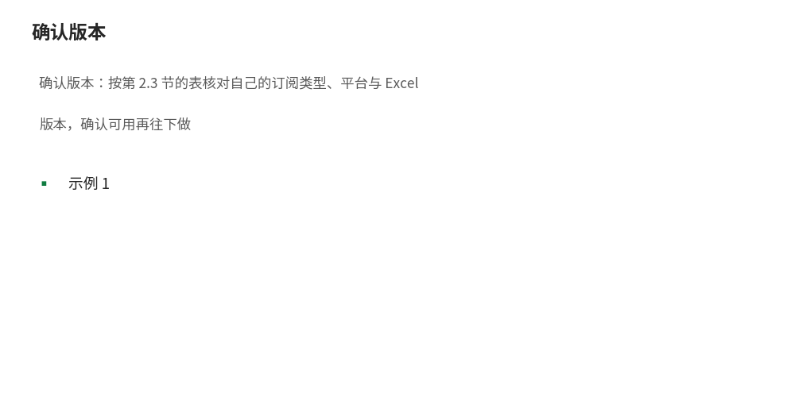
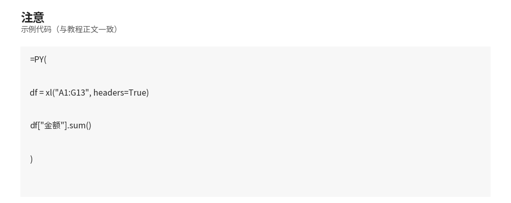

# Python in Excel：用 =PY() 在单元格里写 Python

- **所属栏目**：C15 Python 与 Excel ／ C15-L2-4 Python in Excel（365）
- **适用版本**：仅 Microsoft 365，不支持买断版 Excel 2021／2024 与 Office LTSC；企业与商业用户 Windows 当前频道 2408 版（内部版本 17928.20114）起、网页版 Excel；Mac 企业与商业用户当前频道 16.96 版（内部版本 25041326）起；家庭与个人用户为预览版（见第 2.3 节版本表，口径以 Microsoft 支持文档为准）
- **难度**：进阶
- **预计阅读时长**：40 分钟
- **更新日期**：2026-11-10

## 1. 学习目标

学完本篇，你将能够：
- 说出 Python in Excel 是什么：`=PY()` 公式、代码在微软云端运行、不用在本机装 Python
- 写出第一个 `=PY()` 公式，并用 `xl()` 引用工作表里的区域
- 说出 Python 对象与 Excel 值两种输出方式的区别，并切换它们
- 对照版本表判断自己的 Excel 能不能用 Python in Excel
- 说出 5 条以上限制：不支持的平台、联网要求、读文件函数不可用、重算模式与付费提速
- 在没有 Microsoft 365 的电脑上，用本地 pandas 复现同样的分析并核对结果

**验证口径（必读）：** 本篇所有 `=PY()` 代码**未在 Excel 内执行验证**：本机为 Linux 且无 Excel、无 Microsoft 365 订阅，无法打开 Python in Excel；每段 `=PY()` 代码处均已标注“未在 Excel 内执行验证”。`=PY()` 示例的预期结果数值为本地 pandas 等价运算的真实运行输出（见第 5 节本地等价代码，Python 3.12，pandas 2.1.4），不是在 Excel 里跑出来的。版本与可用性口径以 Microsoft 支持文档为准（2026-11-10 核对，见第 2.3 节）。

## 2. 基础概念

### 2.1 Python in Excel 是什么

Python in Excel 是微软把 Python 放进 Excel 单元格的功能：在单元格里输入 `=PY(`，写 Python 代码，代码被送到微软云端（由 Anaconda 提供运行环境）执行，结果返回到工作表。不用在本机装 Python，不用装任何库，pandas、Matplotlib 这些数据分析库在云端已经装好。

### 2.2 =PY() 与 xl()

- `=PY()`：进入 Python 模式的公式。在单元格里输入 `=PY(` 后写 Python 代码，确认后单元格开始计算，计算时显示 BUSY，算完后返回结果。
- `xl()`：Python 代码里引用 Excel 对象的专用函数。`xl("A1")` 取一个格子，`xl("A1:G13", headers=True)` 取一个区域并把第一行当表头返回 DataFrame，`xl("表名[#All]", headers=True)` 取一整张表。
- 输出类型：公式栏里的 Python 输出菜单可以切换两种输出。Python 对象：单元格显示 DataFrame 这样的对象卡片，点卡片看详情；Excel 值：把结果转成普通单元格数值，可以继续用公式引用、做图表。两种输出的数字相同，区别在结果能不能被其他单元格直接使用。

### 2.3 版本与可用性（以 Microsoft 支持文档为准，2026-11-10 核对）

| 用户类型 | 平台与最低版本 | 状态 |
|---|---|---|
| 企业与商业（Microsoft 365） | Windows 当前频道 2408 版（17928.20114）起 | 正式版 |
| 企业与商业（Microsoft 365） | Windows 每月企业频道 2408 版（17928.20216）起 | 正式版 |
| 企业与商业（Microsoft 365） | Windows 半年企业频道 2502 版（18526.20472）起 | 正式版 |
| 企业与商业（Microsoft 365） | Excel 网页版 | 正式版 |
| 企业与商业（Microsoft 365） | Mac 当前频道 16.96 版（25041326）起 | 正式版 |
| 家庭与个人（Microsoft 365） | Excel 网页版，或 Windows 当前频道 2405 版（17628.20164）起 | 预览版 |
| 家庭与个人（Microsoft 365） | Mac Insider 计划 Beta 频道 16.95 版（25021921）起 | 预览版 |
| 教育订阅 | Windows，通过 Microsoft 365 Insider 计划，2406 版（17726.20016）起 | 通过 Insider 计划提供 |

不支持的情况：Excel for iPad、iPhone、Android 上不能运行；买断版 Excel 2021／2024 与 Office LTSC 不支持；免费的消费者帐户与设备型授权（按设备而非按用户授权）不支持；共享计算机激活的订阅不支持。企业与商业订阅的预览已结束，符合条件的用户直接用正式版。

### 2.4 计算方式与费用

- 代码在微软云端运行，不是在你的电脑上运行：必须联网，且须开启 Microsoft 365 联网体验。
- 包含在订阅里的是标准算力与自动重算模式；想要更快的计算（高级算力）与手动／部分重算模式，需购买 Python in Excel 附加许可证（或请管理员申请）。
- 云端环境由 Anaconda 提供，预装 pandas、Matplotlib、seaborn、scikit-learn 等数据分析库；但出于安全原因，`pandas.read_csv`、`pandas.read_excel` 这类从外部读文件的函数在 Python in Excel 里不可用——数据要先放进工作表，再用 `xl()` 引用。

## 3. 操作步骤

1. 确认版本：按第 2.3 节的表核对自己的订阅类型、平台与 Excel 版本，确认可用再往下做 
2. 准备数据：把 12 行订单放进工作表 A1:G13（含标题行），标题为订单号、日期、客户编号、产品、数量、单价、金额。
3. 写第一个 `=PY()` 公式：选中一个空单元格，输入 `=PY(`，写一行求和代码，确认后看结果（示例 1；未在 Excel 内执行验证）。
4. 引用区域做分组汇总：用 `xl("A1:G13", headers=True)` 读整表，`groupby` 按产品汇总，输出选 Excel 值（示例 2；未在 Excel 内执行验证）。
5. 描述统计：`describe()` 一次算出数量、单价、金额的计数、均值、标准差与分位数（示例 3；未在 Excel 内执行验证）。
6. 本地对照：在没有 Microsoft 365 的电脑上，用本篇第 5 节的本地等价代码跑同样的逻辑，核对数字是否一致。

## 4. 图文示例

示例：工作表布局（文字版）。

- A1:G13 是订单明细（12 行订单 + 1 行标题），其中 G 列金额是公式 `=E2*F2` 下拉得到的。
- A15 单元格写 `=PY()` 求和公式，输出类型选 Excel 值，显示 75600。
- A17 单元格写 `=PY()` 分组汇总公式，输出类型选 Excel 值，结果向下溢出成一张小表：电脑 40000、手机 15000、耳机 9000、键盘 2600、显示器 9000。
- A25 单元格写 `=PY()` 描述统计公式，输出类型选 Excel 值，结果是一张描述统计表。

注意：如果 A17 的溢出区域里已经有内容，公式会返回 #SPILL! 错误，先清空那片区域再算 

## 5. 公式和代码

示例 1：第一个 `=PY()` 公式——总销售额（未在 Excel 内执行验证）。

```excel
=PY(
df = xl("A1:G13", headers=True)
df["金额"].sum()
)
```

预期结果（未在 Excel 内执行验证；数值为本地 pandas 等价运算的真实运行输出）：75600。输出类型选 Excel 值时，单元格直接显示 75600，可以被其他公式引用；选 Python 对象时，单元格显示对象卡片，需点开卡片看值。`xl("A1:G13", headers=True)` 把区域读成 DataFrame，第一行是列名；最后一行表达式的值就是返回给单元格的结果。

本地等价代码（可运行，与上面 `=PY()` 逻辑相同）：

```python
import pandas as pd

ORDERS = [
    ("O001", "2025-01-05", "C001", "P001", 2, 5000),
    ("O002", "2025-01-12", "C002", "P002", 3, 3000),
    ("O003", "2025-02-08", "C001", "P003", 10, 300),
    ("O004", "2025-03-15", "C003", "P004", 5, 200),
    ("O005", "2025-03-20", "C002", "P005", 2, 1500),
    ("O006", "2025-06-10", "C004", "P001", 1, 5000),
    ("O007", "2026-01-06", "C001", "P001", 3, 5000),
    ("O008", "2026-01-15", "C002", "P002", 2, 3000),
    ("O009", "2026-02-10", "C003", "P003", 20, 300),
    ("O010", "2026-02-18", "C001", "P004", 8, 200),
    ("O011", "2026-03-05", "C004", "P005", 4, 1500),
    ("O012", "2026-03-22", "C002", "P001", 2, 5000),
]
PRODUCTS = {"P001": "电脑", "P002": "手机", "P003": "耳机", "P004": "键盘", "P005": "显示器"}
df = pd.DataFrame(ORDERS, columns=["订单号", "日期", "客户编号", "产品编号", "数量", "单价"])
df["产品"] = df["产品编号"].map(PRODUCTS)
df["金额"] = df["数量"] * df["单价"]
df.to_excel("订单明细.xlsx", index=False)
print("总销售额：", int(df["金额"].sum()))
print("订单笔数：", len(df))
print("客单价：", int(df["金额"].sum() // len(df)))
```

运行结果（本机真实运行输出）：

```
总销售额： 75600
订单笔数： 12
客单价： 6300
```

示例 2：按产品分组汇总（未在 Excel 内执行验证）。

```excel
=PY(
df = xl("A1:G13", headers=True)
df.groupby("产品")["金额"].sum()
)
```

预期结果（未在 Excel 内执行验证；数值为本地 pandas 等价运算的真实运行输出）：

```
产品
手机     15000
显示器     9000
电脑     40000
耳机      9000
键盘      2600
```

输出类型选 Excel 值时，结果向下溢出成两列（产品、金额）；选 Python 对象时，单元格只显示一个 Series 对象卡片。手工验算：电脑 10000+5000+15000+10000 = 40000，手机 9000+6000 = 15000，耳机 3000+6000 = 9000，键盘 1000+1600 = 2600，显示器 3000+6000 = 9000，五数相加 75600。

本地等价代码（可运行）：

```python
import pandas as pd

df = pd.read_excel("订单明细.xlsx")
by_product = df.groupby("产品")["金额"].sum()
print(by_product.to_string())
print("五产品合计：", int(by_product.sum()))
```

运行结果（本机真实运行输出）：

```
产品
手机     15000
显示器     9000
电脑     40000
耳机      9000
键盘      2600
五产品合计： 75600
```

示例 3：描述统计 `describe()`（未在 Excel 内执行验证）。

```excel
=PY(
df = xl("A1:G13", headers=True)
df[["数量", "单价", "金额"]].describe()
)
```

预期结果（未在 Excel 内执行验证；数值为本地 pandas 等价运算的真实运行输出）：

```
              数量           单价            金额
count  12.000000    12.000000     12.000000
mean    5.166667  2500.000000   6300.000000
std     5.390789  2083.702998   4093.009562
min     1.000000   200.000000   1000.000000
25%     2.000000   300.000000   3000.000000
50%     3.000000  2250.000000   6000.000000
75%     5.750000  5000.000000   9250.000000
max    20.000000  5000.000000  15000.000000
```

读法：`count` 是 12 行；`mean` 是平均值（平均每笔 6300 元）；`std` 是标准差（金额标准差 4093.01，说明订单金额波动大）；`50%` 是中位数（金额中位数 6000，低于均值 6300，说明少数大单拉高了均值）；`min` 与 `max` 是最小与最大订单金额（1000 与 15000）。输出类型选 Excel 值时整张表溢出到工作表里，可以直接用它做图表的数据源。

本地等价代码（可运行）：

```python
import pandas as pd

df = pd.read_excel("订单明细.xlsx")
desc = df[["数量", "单价", "金额"]].describe()
print(desc.to_string())
by_product = df.groupby("产品").agg(订单数=("订单号", "count"), 数量=("数量", "sum"),
                                    销售额=("金额", "sum")).reset_index()
with pd.ExcelWriter("分析结果.xlsx", engine="openpyxl") as writer:
    df.to_excel(writer, sheet_name="明细", index=False)
    by_product.to_excel(writer, sheet_name="按产品汇总", index=False)
    desc.to_excel(writer, sheet_name="描述统计")
check = pd.read_excel("分析结果.xlsx", sheet_name="按产品汇总")
print("读回核对电脑销售额：", int(check.loc[check["产品"] == "电脑", "销售额"].iloc[0]))
```

运行结果（本机真实运行输出）：

```
              数量           单价            金额
count  12.000000    12.000000     12.000000
mean    5.166667  2500.000000   6300.000000
std     5.390789  2083.702998   4093.009562
min     1.000000   200.000000   1000.000000
25%     2.000000   300.000000   3000.000000
50%     3.000000  2250.000000   6000.000000
75%     5.750000  5000.000000   9250.000000
max    20.000000  5000.000000  15000.000000
读回核对电脑销售额： 40000
```

本地等价代码（可运行）：交叉核对——把三处结果互相印证。

```python
import pandas as pd

detail = pd.read_excel("分析结果.xlsx", sheet_name="明细")
by_product = pd.read_excel("分析结果.xlsx", sheet_name="按产品汇总")
desc = pd.read_excel("分析结果.xlsx", sheet_name="描述统计", index_col=0)
print("明细行数：", len(detail))
print("明细总额与汇总表总额一致：", int(detail["金额"].sum()) == int(by_product["销售额"].sum()) == 75600)
print("描述统计里的金额均值：", round(float(desc.loc["mean", "金额"]), 2))
print("描述统计里的金额最大值：", int(desc.loc["max", "金额"]))
assert int(detail["金额"].sum()) == 75600
assert round(float(desc.loc["mean", "金额"]), 2) == 6300.0
assert int(desc.loc["max", "金额"]) == 15000
print("交叉核对通过")
```

运行结果（本机真实运行输出）：

```
明细行数： 12
明细总额与汇总表总额一致： True
描述统计里的金额均值： 6300.0
描述统计里的金额最大值： 15000
交叉核对通过
```

三处结果互相印证：明细表 12 行加总是 75600，按产品汇总表加总也是 75600，描述统计的金额均值 6300 正好等于 75600 / 12，最大值 15000 对应 O007 那笔订单。

## 6. 实际工作场景

场景 1：周报里加一张“异常订单”分析，不离开 Excel。

- 背景：每周例会要回答三个问题：本周最大的一笔订单是多少、平均每笔多少、哪个产品卖得最好。数据已经在工作表里，但 Excel 公式写描述统计要拼一堆函数。
- 做法：在空白单元格写 `=PY(df[["数量", "单价", "金额"]].describe())`，输出选 Excel 值，一张描述统计表直接出现在工作表里；再写一个 `groupby` 公式得到按产品汇总。
- 结果：以本篇数据为例，平均每笔 6300 元，中位数 6000 元，最大一笔 15000 元（O007），卖得最好的是电脑（40000 元）。下周数据更新后公式自动重算，不用重写。

场景 2：给不懂 Python 的同事留一个“可改参数”的分析模板。

- 背景：分析模板要交给同事用，同事不会 Python，但会改 Excel 里的数字。
- 做法：把参数（例如“只看 2026 年的订单”）写成工作表里的单元格，`=PY()` 代码里用 `xl()` 读这个参数单元格做筛选；同事改参数、公式重算，结果跟着变。
- 结果：同事全程只碰 Excel 单元格，不用学 Python；但要注意两点：一是文件必须在支持 Python in Excel 的电脑或网页版打开，否则 Python 单元格重算会报错；二是含 Python 公式的文件发给用买断版 Excel 的同事，对方只能看不能算。

## 7. 常见错误

| 错误现象 | 原因 | 解决方案 |
|---|---|---|
| 输入 `=PY(` 后没有任何反应 | Excel 版本或订阅不符合第 2.3 节的版本表 | 按版本表核对订阅类型、平台与版本号；买断版 Excel 2021／2024 不支持，需改用 Microsoft 365 |
| Python 单元格显示错误，无法重算 | 在 iPad、iPhone、Android 上打开，或订阅是设备型授权／共享计算机激活 | 换到 Windows、Mac 或网页版 Excel；设备型授权与共享计算机激活不在支持范围 |
| 公式一直显示 BUSY 不出结果 | 代码正在云端计算，或断网了 | 等待计算完成；检查网络与 Microsoft 365 联网体验是否开启；代码死循环时删掉公式重写 |
| 结果溢出时返回 #SPILL! | 输出区域里已有内容，挡住了溢出位置 | 清空输出区域内的单元格；或把公式移到一片空白区域再算 |
| `xl()` 引用后读到的不是 DataFrame | 引用时忘了加 `headers=True`，第一行被当成数据而不是表头 | 区域含标题行时写 `xl("A1:G13", headers=True)`；整张表用 `xl("表名[#All]", headers=True)` |
| 想用 `pd.read_excel` 读文件，报错 | Python in Excel 出于安全原因不支持从外部读文件的函数 | 数据先放进工作表，再用 `xl()` 引用；不要试图在 `=PY()` 里读本地文件 |
| 返回的对象卡片不能被其他公式引用 | 输出类型是 Python 对象，不是 Excel 值 | 在公式栏的 Python 输出菜单里切换为 Excel 值，再让其他公式引用它 |
| 同事打开文件后 Python 单元格全是错误 | 对方用的 Excel 不支持 Python in Excel | 提前说明版本要求；或把 Python 输出切换为 Excel 值并粘贴为数值后再发给对方 |
| 大数据量时计算很慢 | 标准算力有速度上限，自动重算会反复触发云端计算 | 大表先筛选再算；需要更快速度或手动／部分重算模式时购买附加许可证 |
| 公式栏里看不到 Python 代码，只有结果 | 单元格处于 Python 对象输出模式，或选中的不是 Python 单元格 | 选中 Python 单元格，在公式栏查看代码；点对象卡片看详情与报错信息 |

## 8. 相关教程

- 同栏目上一篇：03-xlwings.md（xlwings：调用正在运行的 Excel；与本篇对照：一个在本地跑，一个在云端跑）
- 同栏目相关：01-openpyxl.md（openpyxl：用 Python 读写工作簿，不依赖 Excel 程序）
- 同栏目相关：02-pandas.md（pandas：DataFrame 与 Excel 互转、分组汇总；本篇的 `groupby` 与 `describe` 与该篇同源）
- 跨栏目相关：docs/powerpivot-dax/02-dax-basics.md（DAX 基础：度量值与筛选上下文；同一份 12 行订单的另一种汇总做法）
- 跨栏目相关：docs/pivottable/01-pivottable.md（数据透视表：不写代码做分组汇总，与 `groupby` 对照）
- 跨栏目相关：docs/basics/05-versions.md（版本与兼容：各 Excel 版本的功能差异总览）

## 9. 练习题

1. 说出 Python in Excel 里代码是在哪里运行的（本机还是云端），以及这对联网有什么要求。
2. 写出引用区域 A1:G13（含标题行）并返回 DataFrame 的 `xl()` 调用；如果忘了加 `headers=True`，读到的 DataFrame 会有什么不同？
3. 判断：同事用买断版 Excel 2021 打开含有 `=PY()` 公式的你发去的文件，能正常重算吗？为什么？
4. 用 `=PY()` 写一个公式，算出订单表里“金额”列的总和，并说出输出类型选 Python 对象与选 Excel 值时，单元格分别显示什么。
5. 用 `=PY()` 写一个公式，按产品分组算销售额，并写出电脑一行的预期结果；再用本地 pandas 等价代码跑一遍，核对数字是否一致。
6. 解释以下两个限制各会带来什么实际影响：（1）`pandas.read_excel` 在 Python in Excel 里不可用；（2）标准算力下只有自动重算模式。

## 10. 参考答案

<details>
<summary>点击查看答案</summary>

1. 代码在微软云端运行（由 Anaconda 提供运行环境），不是在本机运行。因此必须联网，且须开启 Microsoft 365 联网体验；断网时 Python 单元格无法计算。
2. `xl("A1:G13", headers=True)`。忘了加 `headers=True`，第一行标题（订单号、日期……）会被当成第一行数据，列名变成 0、1、2 这样的数字，后续 `df["金额"]` 会报 KeyError。
3. 不能。买断版 Excel 2021 不支持 Python in Excel（见第 2.3 节版本表）；对方打开文件只能看，不能重算 Python 单元格，单元格会显示错误。发给对方前应把输出切换为 Excel 值并粘贴为数值。
4. 公式见示例 1：`=PY(df = xl("A1:G13", headers=True); df["金额"].sum())`，结果 75600。选 Python 对象时单元格显示对象卡片（一个数值对象）；选 Excel 值时单元格直接显示 75600，可以被其他公式引用。
5. 公式见示例 2：`=PY(df = xl("A1:G13", headers=True); df.groupby("产品")["金额"].sum())`。电脑一行预期 40000（10000+5000+15000+10000）。本地 pandas 等价代码见示例 2 的本地等价代码，跑出电脑 40000、五产品合计 75600，与预期一致。
6. （1）`pandas.read_excel` 不可用意味着不能在 `=PY()` 里直接读磁盘上的文件，数据必须先放进工作表再用 `xl()` 引用；已有的本地 Python 脚本不能原样粘进 `=PY()` 单元格。（2）只有自动重算意味着数据一改就触发云端重算，大表或多个 Python 公式时会反复计算、速度受限；想要手动控制重算时机或更快速度，需购买附加许可证。

</details>

## 11. 可下载示例文件

- Python-in-excel-demo.py（templates/Python-in-excel-demo.py，教程中 `=PY()` 示例的本地 pandas 等价运算，运行方法 `python3 Python-in-excel-demo.py`）
- Python-in-excel-demo.xlsx（templates/Python-in-excel-demo.xlsx，脚本运行产物：明细 12 行 / 按产品汇总 / 描述统计，共 3 张表）
