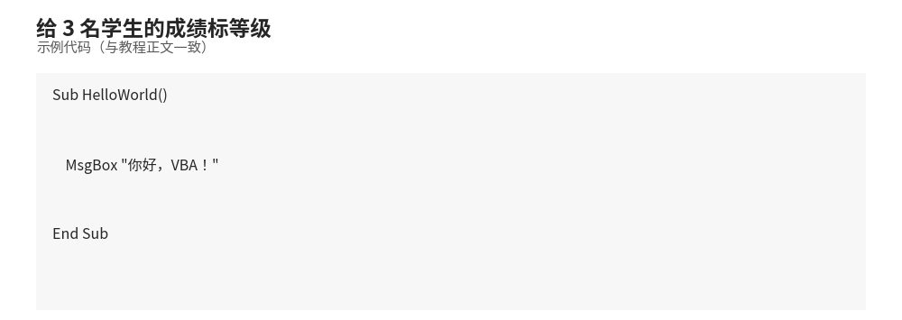

# VBA 基础

本章带你从零开始认识 VBA：打开编辑器、声明变量、使用运算符、写条件和循环、操作数组与字符串，并理解 Sub 过程与 Function 函数的区别。

- **所属栏目**：C11 VBA 自动化 ／ C11-L2-1 VBA 基础语法
- **适用版本**：Excel 2010 / 2013 / 2016 / 2019 / 2021 / 365（Windows 桌面版）
- **难度**：入门
- **预计阅读时长**：40 分钟
- **更新日期**：2026-11-10

> **验证说明**：本篇 VBA 语法经 Microsoft 官方文档核对，数值经 Python 独立验算；**所有 VBA 代码均未在 Excel 内执行验证**（无 Excel 环境）。36 个关键字的完整语法与示例见本目录 [03-keywords.md](03-keywords.md)（VBA 关键字大全）。

## 1. 学习目标

学完本篇，你将能够：
- 打开 VBE 编辑器并写出第一个 Sub 过程
- 声明变量并用对数据类型（Long 而非 Integer 存行号）
- 用 If、For、Do 写条件与循环

## 2. 基础概念

### 2.1 打开 VBE 编辑器

VBE（Visual Basic Editor）是编写 VBA 代码的地方，有三种打开方式：

- 快捷键：`Alt + F11`
- 功能区：「开发工具」选项卡 → 「Visual Basic」（如果没有该选项卡，到「文件 → 选项 → 自定义功能区」中勾选「开发工具」）
- 右键工作表标签 → 「查看代码」（直接进入该工作表对应的代码窗口）

### 插入模块并运行宏

1. 在 VBE 中点击菜单「插入 → 模块」，得到一个空白代码窗口（Module1）。
2. 输入代码，例如：第一个宏 `HelloWorld` 只有三行，运行后弹出消息框“你好，VBA！”（完整代码见 §5 公式和代码）。
3. 把光标放在过程中，按 `F5` 运行；或点击工具栏的绿色三角 ▶。
4. 也可以回到 Excel 按 `Alt + F8`，在宏列表中选择并运行。

> **提示**：保存含宏的工作簿时要用 `.xlsm` 格式，`.xlsx` 会丢掉所有代码。

### 2.2 变量声明与数据类型

### Dim 声明变量

```vb
Sub DeclareDemo()
    Dim name As String      ' 声明字符串变量
    Dim age As Integer      ' 声明整数变量
    Dim price As Double     ' 声明双精度浮点数

    name = "张三"
    age = 30
    price = 99.9

    MsgBox name & "今年" & age & "岁"
End Sub
```

### 常用数据类型

| 类型 | 说明 | 示例 |
|------|------|------|
| `String` | 字符串 | `"Hello"` |
| `Integer` | 整数（-32768 ~ 32767） | `100` |
| `Long` | 长整数（约 ±21 亿） | `100000` |
| `Single` | 单精度小数 | `3.14` |
| `Double` | 双精度小数 | `3.14159265` |
| `Boolean` | 布尔值 | `True` / `False` |
| `Date` | 日期时间 | `#2026-10-03#` |
| `Variant` | 万能类型（可存任何值） | 任意 |

> **建议**：整数优先用 `Long` 而不是 `Integer`。现代计算机上 `Long` 更快，且行号超过 32767 时 `Integer` 会溢出报错。

### 类型声明符（简写）

```vb
Dim s$      ' 等价于 Dim s As String
Dim n%      ' 等价于 Dim n As Integer
Dim l&      ' 等价于 Dim l As Long
Dim d#      ' 等价于 Dim d As Double
```

### Option Explicit：强制声明

在模块顶部写 `Option Explicit`，则所有变量必须先 `Dim` 才能使用。拼写错误会被立即发现，而不是默默产生一个新变量。

```vb
Option Explicit

Sub Test()
    Dim count As Long
    count = 10
    ' cont = 5   ' 拼错变量名会直接报错，而不是创建新变量
End Sub
```

> **强烈建议**：在 VBE「工具 → 选项 → 编辑器」中勾选「要求变量声明」，以后新建模块会自动加上 `Option Explicit`。

### 2.3 运算符

### 算术运算符

```vb
Dim a As Long, b As Long
a = 10: b = 3
Debug.Print a + b   ' 13  加
Debug.Print a - b   ' 7   减
Debug.Print a * b   ' 30  乘
Debug.Print a / b   ' 3.333  除
Debug.Print a \ b   ' 3   整除（丢掉小数）
Debug.Print a Mod b ' 1   取余数
Debug.Print a ^ b   ' 1000 乘方
```

### 比较运算符

`=`, `<>`（不等于）, `>`, `<`, `>=`, `<=`。注意字符串比较用 `Like` 可做通配符匹配：

```vb
If "ABC123" Like "ABC*" Then MsgBox "以ABC开头"   ' * 匹配任意多个字符
If "A1" Like "A#" Then MsgBox "A后面跟一个数字"    ' # 匹配一个数字
If "AB" Like "A?" Then MsgBox "A后面跟一个字符"    ' ? 匹配一个字符
```

### 逻辑运算符

`And`（与）、`Or`（或）、`Not`（非）、`Xor`（异或）。

### 连接运算符

字符串连接用 `&`（推荐），`+` 也可以但遇到数字字符串时可能做加法，`&` 更安全：

```vb
Dim s As String
s = "总分：" & 100        ' "总分：100"
```

### 2.4 条件语句

### If...Then...Else

```vb
Sub Grade(score As Long)
    If score >= 90 Then
        MsgBox "优秀"
    ElseIf score >= 60 Then
        MsgBox "及格"
    Else
        MsgBox "不及格"
    End If
End Sub
```

### Select Case

条件分支较多时比一串 `ElseIf` 更清晰：

```vb
Sub WeekdayName(n As Long)
    Select Case n
        Case 1
            MsgBox "星期一"
        Case 2 To 5
            MsgBox "工作日"
        Case 6, 7
            MsgBox "周末"
        Case Else
            MsgBox "输入错误"
    End Select
End Sub
```

`Case` 支持多种写法：单个值（`Case 1`）、范围（`Case 2 To 5`）、多个值（`Case 6, 7`）、比较（`Case Is > 100`）。

### IIf：单行条件函数

```vb
Dim result As String
result = IIf(score >= 60, "及格", "不及格")   ' 注意：两边都会被求值
```

> **注意**：`IIf` 是函数，两个分支都会执行，不适合放有副作用的代码。

### 2.5 循环

### For...Next：固定次数

```vb
Sub SumDemo()
    Dim i As Long, total As Long
    For i = 1 To 100
        total = total + i
    Next i
    MsgBox "1到100的和是：" & total   ' 5050
End Sub

' 倒序 + 步长
Sub ReverseLoop()
    Dim i As Long
    For i = 10 To 1 Step -2
        Debug.Print i   ' 10, 8, 6, 4, 2
    Next i
End Sub
```

### For Each：遍历集合

```vb
Sub LoopSheets()
    Dim ws As Worksheet
    For Each ws In ThisWorkbook.Worksheets
        Debug.Print ws.Name
    Next ws
End Sub
```

### Do While / Do Until

```vb
Sub DoWhileDemo()
    Dim i As Long
    i = 1
    Do While i <= 5
        Debug.Print i
        i = i + 1
    Loop
End Sub

Sub DoUntilDemo()
    Dim i As Long
    i = 1
    Do Until i > 5      ' 条件成立时退出
        Debug.Print i
        i = i + 1
    Loop
End Sub
```

### Exit 跳出循环

```vb
Sub FindDemo()
    Dim i As Long
    For i = 1 To 1000
        If Cells(i, 1).Value = "目标" Then
            MsgBox "在第" & i & "行找到"
            Exit For    ' 跳出 For 循环
        End If
    Next i
End Sub
```

`Exit For` 跳出 For 循环，`Exit Do` 跳出 Do 循环。

### 2.6 数组

### 静态数组

```vb
Sub StaticArray()
    Dim arr(1 To 5) As String   ' 1到5，共5个元素
    Dim i As Long

    arr(1) = "一月": arr(2) = "二月": arr(3) = "三月"
    arr(4) = "四月": arr(5) = "五月"

    For i = 1 To 5
        Debug.Print arr(i)
    Next i
End Sub
```

### 动态数组

大小运行时决定，用 `ReDim` 调整：

```vb
Sub DynamicArray()
    Dim arr() As Long
    Dim n As Long
    n = 10

    ReDim arr(1 To n)          ' 分配10个元素
    ' ... 使用 ...
    ReDim Preserve arr(1 To n + 5)  ' 扩大到15个，Preserve 保留原有数据
End Sub
```

> 不加 `Preserve` 时 `ReDim` 会清空数组。

### 一维数组快速赋值：Array 函数

```vb
Dim week As Variant
week = Array("一", "二", "三", "四", "五", "六", "日")
Debug.Print week(0)   ' 注意：Array 返回的数组下标从 0 开始
```

### 二维数组：批量读写单元格（性能关键）

逐个单元格读写很慢，一次读入数组、内存中处理、一次写回，快 10 倍以上：

```vb
Sub FastReadWrite()
    Dim data As Variant
    Dim i As Long

    ' 一次读入 A1:C1000 到二维数组（下标从1开始）
    data = Range("A1:C1000").Value

    For i = 1 To UBound(data, 1)       ' UBound(data,1) = 行数
        data(i, 3) = data(i, 1) * data(i, 2)
    Next i

    ' 一次写回
    Range("A1:C1000").Value = data
End Sub
```

### 2.7 字符串处理

```vb
Sub StringDemo()
    Dim s As String
    s = "  Hello, VBA  "

    Debug.Print Trim(s)              ' "Hello, VBA"  去两端空格
    Debug.Print LCase(s)             ' 全小写
    Debug.Print UCase(s)             ' 全大写
    Debug.Print Len("你好")          ' 2  字符数
    Debug.Print Left("ABCDEF", 3)    ' "ABC"  取左边
    Debug.Print Right("ABCDEF", 2)   ' "EF"  取右边
    Debug.Print Mid("ABCDEF", 2, 3)  ' "BCD"  从第2个起取3个
    Debug.Print InStr("ABCDEF", "CD")' 3  查找位置（找不到返回0）
    Debug.Print Replace("a-b-c", "-", "+")  ' "a+b+c"  替换
    Debug.Print Split("a,b,c", ",")(1)      ' "b"  分割成数组（从0开始）
    Debug.Print Join(Array("a","b","c"), "-") ' "a-b-c"  连接数组
End Sub
```

### 2.8 Sub 过程与 Function 函数

| | Sub 过程 | Function 函数 |
|---|---|---|
| 作用 | 执行一系列操作 | 计算并**返回一个值** |
| 调用 | `Call MySub` 或直接 `MySub` | `x = MyFunc(1, 2)` 或在单元格中 `=MyFunc(A1)` |
| 返回值 | 无 | 有（函数名 = 返回值） |

```vb
' Sub：做事
Sub Greet(name As String)
    MsgBox "你好，" & name
End Sub

' Function：算值
Function AddTax(price As Double) As Double
    AddTax = price * 1.13   ' 函数名 = 返回值
End Function

Sub Test()
    Greet "张三"                 ' 调用 Sub
    MsgBox AddTax(100)           ' 调用 Function，结果 113
End Sub
```

**自定义函数（UDF）**：写在标准模块里的 `Function` 可以直接在工作表公式中使用，比如在单元格输入 `=AddTax(A1)`。

> 相关：`Sub`、`Function`、`Dim` 等 36 个关键字的完整语法与示例见本目录 [03-keywords.md](03-keywords.md)（VBA 关键字大全）；对象操作（Range、With、事件）见 [02-objects.md](02-objects.md)。

### 2.9 注释与代码规范

```vb
' 单行注释用单引号

Sub Standard()
    Dim userName As String   ' 变量名：驼峰式，见名知意
    Dim totalAmount As Double

    userName = "张三"
    totalAmount = 1234.56

    ' 复杂逻辑前写注释说明意图，而不是复述代码
    ' 计算含税总价（税率13%）
    totalAmount = totalAmount * 1.13
End Sub
```

### 规范建议

1. **模块顶部写 `Option Explicit`**，强制声明变量。
2. **变量命名**：驼峰式（`userName`），过程名动词开头（`GetTotal`、`SaveReport`）。
3. **缩进**：每个嵌套层级缩进 4 个空格（Tab 键）。
4. **一行只做一件事**，过程尽量短（超过 50 行考虑拆分）。
5. **魔法数字**用常量代替：`Const TAX_RATE As Double = 0.13`。
6. 长语句用空格加下划线 ` _` 换行：

```vb
MsgBox "这是一条很长的消息，" _
     & "用下划线换行书写更清晰。"
```

## 3. 操作步骤

1. 按 `Alt + F11` 打开 VBE 编辑器（没有「开发工具」选项卡时，到「文件 → 选项 → 自定义功能区」勾选）。
2. 在 VBE 中点「插入 → 模块」，得到空白代码窗口。
3. 在模块顶部写 `Option Explicit`，强制所有变量先声明再使用。
4. 用 `Dim` 声明变量：行号、计数一律用 `Long`，不要用 `Integer`（超过 32767 会溢出）。
5. 按 §2 的顺序写逻辑：先写 `If` 条件分支，再写 `For` / `For Each` / `Do` 循环，需要批量读写单元格时用 §2.6 的二维数组。
6. 把光标放在过程中按 `F5` 运行，或回 Excel 按 `Alt + F8` 从宏列表运行。
7. 保存含宏的工作簿时用 `.xlsm` 格式，`.xlsx` 会丢掉所有代码。
8. 出错时用 VBE「调试 → 编译」定位到具体行，再对照 §7 常见错误表排查。

## 4. 图文示例

给 3 名学生的成绩标等级：95 分、72 分、45 分。做法：用 §2.4 的 `If...ElseIf` 写一个 `Grade` 过程，90 分及以上标“优秀”，60 分及以上标“及格”，其余标“不及格”；再用 §2.5 的 `For...Next` 循环整列。结果：95 分 → 优秀，72 分 → 及格，45 分 → 不及格；规则只写在一处，改阈值不用逐格改公式。 

## 5. 公式和代码

第一个宏（出自 §2.1）：

```vb
Sub HelloWorld()
    MsgBox "你好，VBA！"
End Sub
```

运行结果：弹出消息框“你好，VBA！”。其余 21 个代码块见 §2 各小节（变量、运算符、条件、循环、数组、字符串、Sub/Function、代码规范）。

## 6. 实际工作场景

### 场景 1：月末对账单批量求和

财务每月收到一张对账单，A 列是项目、B 列是金额，共 300 多行，手工加容易错。做法：用 §2.5 的 `For...Next` 循环累加 B 列，`MsgBox` 弹出合计；熟练后改成 §2.6 的数组批量读写，一次读入、内存里算、一次写回。结果：300 行求和从逐格点算的十几分钟变成一秒出数，且公式可复用于下月。

### 场景 2：工资表按分数段标等级

人事有一张成绩表，要按 90 / 60 两档标"优秀 / 及格 / 不及格"。做法：用 §2.4 的 `If...ElseIf` 或 `Select Case` 写一个 `Grade` 过程循环整列；等级规则变了只改一处阈值。结果：规则写进代码，下次直接跑，不用再逐格写 IF 公式。

## 7. 常见错误

| 错误现象 | 原因 | 解决方案 |
|---|---|---|
| 运行报"变量未定义" | 写了 `Option Explicit`，但某个变量没 `Dim` 就直接用 | 给该变量补 `Dim` 声明；用 VBE「调试 → 编译」定位到具体行 |
| 变量名拼错了也不报错，还算出奇怪结果 | 没写 `Option Explicit`，拼错的名字被当成新变量（Variant，初值 Empty） | 模块顶部加 `Option Explicit`；在 VBE「工具 → 选项 → 编辑器」勾选「要求变量声明」 |
| 行号超过 32767 后报"溢出" | 行号、计数用了 `Integer`（上限 32767） | 整数一律用 `Long` 存行号与计数 |
| `a = 10: b = 3: a / b` 得到 3.333，但想要整数 3 | `/` 是正常除法，整除要用反斜杠 `\` | 整除写 `a \ b`（得 3），取余数写 `a Mod b`（得 1） |
| 字符串连接用了 `+`，结果变成加法 | `"1" + 2` 会被当成数字相加得 3，而不是"12" | 字符串连接一律用 `&`，不用 `+` |
| `If "A" Like "A*"` 没反应 | `Like` 的通配符写错，或把 `*` 写成了 `%`（那是 SQL 的写法） | VBA 通配符：`*` 任意多个字符、`?` 一个字符、`#` 一个数字 |
| `IIf` 两个分支里的代码都执行了 | `IIf` 是函数，两个分支都会先求值再选一个返回 | 有副作用的代码不要放进 `IIf`，改写成标准 `If...Else` |
| 数组下标越界报"下标越界"（错误 9） | `Array()` 返回的数组下标从 0 开始，但按 1 开始访问 | `Array()` 的结果从下标 0 取；`Dim arr(1 To 5)` 声明的数组从 1 取，先确认是哪种 |

## 8. 相关教程

- 同栏目下一篇：[02-objects.md](02-objects.md)（VBA 对象模型：Application、Workbook、Worksheet、Range）
- 同栏目相关：[03-keywords.md](03-keywords.md)（VBA 关键字大全：36 个关键字速查）、[04-examples.md](04-examples.md)（VBA 实战实例：8 个可直接运行的实例）
- 跨栏目相关：公式基础（C03）——先会写工作表公式，再学 VBA 会更快

## 9. 练习题

1. 写程序计算 1～1000 中 3 的倍数之和，结果是多少？
2. 为什么行号要用 Long 而不是 Integer？
3. `Dim x` 不写类型时 x 是什么类型？有什么风险？
4. 写程序计算 1～100 中全部偶数之和，结果是多少？
5. `For i = 10 To 1 Step -2: Debug.Print i: Next i` 会打印出哪几个数？它们的和是多少？
6. `Debug.Print 10 \ 3 + 10 Mod 3 + 10 ^ 2` 的输出是多少？请分步说明。

## 10. 参考答案

<details>
<summary>点击查看答案</summary>

1. 结果 166833。验算：3 的倍数共 333 个（3～999），和 = 3×(1+2+…+333) = 3×333×334÷2 = 166833。参考写法：`S = 0: For i = 3 To 1000 Step 3: S = S + i: Next i`。

2. Integer 上限 32767，行数超过会溢出报错；Long 上限 21 亿，行号、计数一律用 Long。

3. 默认 Variant 类型，灵活但慢且易错。应显式声明类型，并加 `Option Explicit` 强制声明。

4. 结果 2550。验算：偶数共 50 个（2～100），和 = 2×(1+2+…+50) = 2×50×51÷2 = 2550。参考写法：`S = 0: For i = 2 To 100 Step 2: S = S + i: Next i`。

5. 打印 10、8、6、4、2，共 5 个数；和是 30（10+8+6+4+2）。要点：`Step -2` 是倒序递减，循环在 `i < 1` 时结束，所以 0 不会打印。

6. 输出 104。分步：`10 \ 3` 整除得 3；`10 Mod 3` 取余得 1；`10 ^ 2` 乘方得 100；3+1+100 = 104。注意 `\` 是整除、`Mod` 是取余、`^` 是乘方，不要与 `/`（正常除法，得 3.333…）混淆。

</details>
